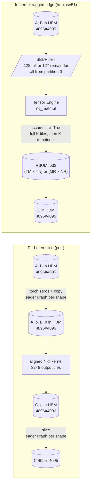

# trnblas: the odd-shape cliff that wasn't

An 8191³ GEMM took 1605 s on its first call on Trn2 while 8192³ took 4.4 s, and trnblas blamed three things in turn before finding the cliff in its own benchmark: a lazy `torch.randn(device="neuron")` inside the timed call. Two fixes from the wrong turns are real and sit in the still-unmerged [trnblas#51](https://github.com/trnsci/trnblas/pull/51) — the autotune sweep is opt-in, and unaligned shapes now take their ragged edges inside the kernel, which PSUM accumulation and partition-0 tiles make nearly free. The post is for anyone timing first calls on the native TorchNeuron device, and for CUDA programmers who expect "pad to the tile" to cost nothing.

<!-- more -->

## The problem

The work was part of moving the suite to TorchNeuron's native `neuron` device ([trnsci#35](https://github.com/trnsci/trnsci/issues/35), [trnblas#50](https://github.com/trnsci/trnblas/issues/50)). It ran on a trn2.3xlarge with the public Neuron SDK 2.33.0 (torch-neuronx 2.14.3, NKI 0.7.0, neuronx-cc 2.28.7631, LNC=2). After the suite passed, the next item was a large-shape GEMM sweep: fp32, single core, first call including compile.

| shape (M×K×N) | result | rel_err vs FP64 | first call |
|---|---|---|---|
| 2048³ | PASS | 1.53e-7 | 33 s |
| 4096³ | PASS | 1.84e-7 | 206 s |
| 8191³ | PASS | 2.33e-7 | **1605 s** |
| 8192³ | PASS | 2.33e-7 | **4.4 s** |
| 2048×4096×8191 | PASS | 1.84e-7 | 196 s |
| 16384³ | ERROR | — | — |

Odd shapes are the everyday case in chemistry. DF-MP2 basis and auxiliary dimensions are set by the molecule, not by the 128-partition tile, so a 27-minute penalty for missing a multiple of 128 would make the library unusable at scale. cuBLAS handles ragged edges inside its kernels and nobody thinks about it. Before this work, trnblas did what a straight port does: zero-pad every operand to the tile in torch, run the aligned kernel, then slice the result. That was how [trnblas#13](https://github.com/trnsci/trnblas/issues/13) got closed.

The 16384³ failure was `NRT Execution error ... neuron::alloc::lazy`. The three operands total 3 GiB, so the inputs alone don't explain it. The working theory is that tiling buffers exceed what one LNC=2 core gets. The case is still open.

## What the architecture suggests

A GPU kernel author handles a ragged edge with predicated loads: every thread checks whether its index is in bounds. NKI kernels on Trainium are built differently, and the differences make the edge a non-event:

- **Shapes are static per compile.** Every NEFF is compiled for one (M, K, N). The remainder sizes `M % 128`, `K % 128` and `N % 512` are compile-time constants. A remainder tile is just one more tile with a smaller static shape, with no mask and no runtime branch.
- **PSUM accumulates over K.** The Tensor Engine writes partial products into an FP32 PSUM tile with `accumulate=True`. A short K remainder is one more `nc_matmul` into the same PSUM tile. It needs no zero-filled operand to make the reduction length come out even.
- **Every tile starts at partition 0.** The stationary and moving operands of a K-remainder matmul both have `K % 128` partitions, from partition 0. The partition counts match, and the matmul is legal as written.

The pad-then-slice port gives all of that up and pays for the privilege in HBM traffic and extra graphs:



On the left there are two extra eager graphs per new shape, two zero-filled operand copies and one oversized output. On the right the edge is just the last iteration of the tile walk.

## The approach

`_gemm_kernel_ragged` splits each dimension into `D // T` full tiles plus one remainder tile of `D - (D // T) * T`, with the default tile (128, 128, 512) clamped when a dimension is smaller. That gives four kinds of output tile (full×full, full×N-remainder, M-remainder×full and the corner), and each one runs the full K tiles followed by the K remainder into its own PSUM tile. Aligned shapes keep the unchanged default kernel. Dispatch picks the ragged kernel only for the default tiles. Under the opt-in autotuner it falls back to the pad path, which is still there as `_run_padded_gemm` and can be forced with `TRNBLAS_GEMM_RAGGED=0`.

The tradeoff is source size. The kernel body is written out once for each kind of output tile, because the NKI frontend resolves names from source and doesn't support helper closures inside a kernel. That means four near-identical loop nests to keep in sync, with a torch emulation (`_ragged_gemm_reference`) and CPU tests that check every index is covered exactly once.

The other change is a default. The tile autotuner (trnblas#26) used to sweep up to six tile configs on the first call in each shape bucket. It is now opt-in.

## Implementation

The full-M×full-N branch of the ragged kernel shows the K remainder going into the same PSUM tile:

```python
# excerpt from trnblas/nki/dispatch.py, _gemm_kernel_ragged (branch fix-50-pad-odd)
psum = nl.zeros((TM, TN), dtype=nl.float32, buffer=nl.psum)
for k in nl.affine_range(KF):
    k_off = k * TK
    a_t = nl.load_transpose2d(a[m_off : m_off + TM, k_off : k_off + TK])
    b_t = nl.load(b[k_off : k_off + TK, n_off : n_off + TN])
    nisa.nc_matmul(dst=psum, stationary=a_t, moving=b_t, accumulate=True)
if KR > 0:
    a_r = nl.load_transpose2d(a[m_off : m_off + TM, K0:K])
    b_r = nl.load(b[K0:K, n_off : n_off + TN])
    nisa.nc_matmul(dst=psum, stationary=a_r, moving=b_r, accumulate=True)
c_sbuf = nl.ndarray((TM, TN), dtype=a.dtype, buffer=nl.sbuf)
nisa.tensor_copy(src=psum, dst=c_sbuf)
nl.store(c[m_off : m_off + TM, n_off : n_off + TN], value=c_sbuf)
```

The autotune default is a single line:

```python
_AUTOTUNE_ENABLED: bool = os.environ.get("TRNBLAS_AUTOTUNE", "0").lower() in ("1", "true", "yes")
```

The tool that eventually found the real cause was `scripts/probe_first_call.py`. It runs one N per fresh process with fresh caches and fences every phase with a sync. Its most important lines are the ones that build the inputs:

```python
g = torch.Generator().manual_seed(N)
A_h = phase("host_randn", lambda: torch.randn(N, N, generator=g), sync=False)
B_h = torch.randn(N, N, generator=g)
A = phase("h2d_inputs", lambda: A_h.to(DEV))
```

## What didn't work

The trnblas#50 thread records three diagnoses, in order. Each one was confident when it was posted.

**Wrong turn 1: "odd shapes take a slow path."** The first comment after the sweep blamed the ragged edge tile and proposed padding to 128 at dispatch. Six minutes later a correction pointed out that dispatch *already* padded to 128/512, so 8191³ ran the very same 8192³ kernel. 8192³ also ran second, in the same autotune bucket, and reused 8191's tile choice and compiled kernels. The 4.4 s figure measured a warm cache. An alignment sweep showed the pattern clearly: 1000³ 10.3 s, then 1023³ 2.5 s, then 1024³ 0.1 s. The slow run was simply whichever came first in its bucket.

**Wrong turn 2: "the torch pad graphs."** The next step was a cold harness with fresh NEFF, HLO and autotune caches in each process. It found two costs. The autotune sweep was real: at 4096³ the first call took 182.7 s with the sweep and 15.6 s without it, and the warm times were the same (36.3 ms vs 35.4 ms). Odd shapes still looked about 10× colder on the first call and 2× slower warm, and the thread blamed the eager pad and slice graphs. In-kernel ragged edges (the approach above) fixed the warm cost. The first call at 4095³ stayed at 150.1 s, and the pad path (`TRNBLAS_GEMM_RAGGED=0`) measured 151.6 s. Removing the pad didn't move the first call, so the pad wasn't the cause.

**Wrong turn 3, sort of: "a remaining odd-shape cost in trnblas."** The per-phase probe built its inputs on the host and copied them over. With that change, a cold `trnblas.gemm` cost 16.1 s at 4095 and 15.3 s at 4096. The odd-shape first-call cost belonged to the harness's own `A, B = torch.randn(n, n, device="neuron")`. That call is lazy, so the RNG work ran inside the timed GEMM. Timed alone, `torch.randn` was about 10× colder and 50–58× slower warm at non-128-multiple shapes (table below). A cold `x * 2 + 1` and `x.T.contiguous()` took 1.4–2.0 s, with no difference between odd and aligned shapes. The fix in the harness was one line; finding it took three wrong diagnoses.

To be fair to the earlier diagnoses, the warm ragged-kernel gains were measured on inputs that already existed on the device, so they stand.

**Toolchain feedback.** The `randn` behaviour is filed upstream as [aws-neuron-sdk#1439](https://github.com/aws-neuron/aws-neuron-sdk/issues/1439), with a four-line reproducer. The ask is to pad internally in the aten RNG ops, or to document the alignment sensitivity. [trnrand](https://github.com/trnsci/trnrand) pads internally and shows no odd/aligned gap (162 ms warm at 4095² vs 174 ms at 4096²). There is also a general lesson for anyone benchmarking on the native device: build inputs on the host, or synchronize after creating them on the device, before the timer starts. Laziness means the timer measures whatever ran before it, too.

**Fit.** Dense GEMM with static shapes is where Trainium is well indexed, and a ragged remainder costs it almost nothing. The NKI path is not a win at every size, though. At N ≤ 2048, TorchNeuron's own aten matmul is faster than the trnblas kernel (Numbers). The 16384³ allocation failure also shows that one LNC=2 core runs out of headroom for an fp32 problem this size, before there is any question of sharding.

## Numbers

Cold harness, a fresh process and fresh caches per case. fp32, native `neuron` device, inputs from device `randn` (which is why the odd first calls are inflated):

| case | first call | warm |
|---|---|---|
| 2048³, autotune on | 25.1 s | 7.5 ms |
| 2048³, autotune off | 3.4 s | 8.1 ms |
| 4096³, autotune on | 182.7 s | 36.3 ms |
| 4096³, autotune off | 15.6 s | 35.4 ms |
| 2047³, pad path | 41.3 s | 14.9 ms |
| 2047³, ragged | 36.1 s | **7.1 ms** |
| 4095³, pad path | 153.9 s | 69.3 ms |
| 4095³, pad path (`TRNBLAS_GEMM_RAGGED=0`, later run) | 151.6 s | 68.9 ms |
| 4095³, ragged | 150.1 s | **32.0 ms** |

Per-phase probe with host-created inputs, alongside the bare RNG op:

| N | `trnblas.gemm` cold | direct `nki_op` cold | `torch.randn(N, N, device="neuron")` first / warm |
|---|---|---|---|
| 2047 | 3.4 s | 3.1 s | 41.4 s / 60.4 ms |
| 2048 | 3.1 s | — | 8.9 s / 1.2 ms |
| 4095 | 16.1 s | 15.6 s | 151.2 s / 242.7 ms |
| 4096 | 15.3 s | 16.6 s | 15.3 s / 4.2 ms |

Warm 4095³ ragged (32.0 ms) edges out aligned 4096³ (35.4 ms). The thread attributes that to skipping the padded FLOPs. But padding 4095 to 4096 adds only 0.07% more FLOPs, so the honest reading is parity until a profile says otherwise. The probe's single warm call also reported 12.0–12.5 ms at 4095/4096, against the cold harness's 32–35 ms. The two harnesses time warm calls differently, and that gap hasn't been reconciled yet.

Warm op latency with operands resident on the device, against the 12-vCPU host. There are two runs on the same branch, both on a busy box ([trnblas#50](https://github.com/trnsci/trnblas/issues/50)):

| N | trnblas `gemm` (NKI) | TorchNeuron aten matmul | CPU |
|---|---|---|---|
| 128 | 0.26–0.43 ms | 0.10–0.42 ms | 0.016–0.017 ms |
| 512 | 0.42–0.57 ms | 0.15–0.30 ms | 0.46–0.53 ms |
| 1024 | 0.49–0.69 ms | 0.20–0.47 ms | 3.8–3.9 ms |
| 2048 | 2.16–2.32 ms | 0.59–0.83 ms | 29.4–31.5 ms |

The NKI kernel overtakes the CPU somewhere between N=512 and N=1024 when the operands are already resident; the two runs disagree on which. At every size measured, though, aten matmul is faster, by about 2.8–3.6× at N=2048. At 128 both device paths are sitting on the roughly 0.2 ms eager dispatch floor. That floor is down from the roughly 100 ms on the XLA path that motivated [batched pair energy](https://trnsci.dev/blog/trnblas-phase-3-from-215-slower-to-36-faster-in-one-kernel-boundary-move/).

Correctness on this branch: the neuron suite gave 78 passed and 1 skipped, twice, under `TRNBLAS_REQUIRE_NKI=1`. The awkward-size sweep (1, 7, 127, 128, 129, 255, 257, 1000 and 4097, plus mixed shapes such as 4097×1×7) passed with rel_err 3.6e-8 to 1.9e-7, and trntensor's einsum paths, which use the same kernel, passed too. All 19 suite examples passed. PySCF DF-MP2 on NH3/cc-pVTZ matched PySCF to |ΔE| = 2.57e-7 Ha. That is the FP32 regime, not nanohartree. On the same workload the autotune-off default cost nothing measurable: 8.08 s total, against 7.49 s with the sweep, which is within run-to-run noise on a busy box.

## What's next

- [trnblas#51](https://github.com/trnsci/trnblas/pull/51): the ragged kernel and the opt-in autotuner, awaiting review. Its CHANGELOG entry still attributes the odd-shape first-call cost to the pad graphs, and that needs correcting before merge.
- [trnblas#50](https://github.com/trnsci/trnblas/issues/50): native TorchNeuron dispatch, including the decision on whether aten matmul should be the default for plain GEMM.
- [Phase 2: double-double FP64 GEMM (trnblas#22)](https://github.com/trnsci/trnblas/issues/22), the path from 2.57e-7 Ha to nanohartree.
- [Phase 4: tensor-parallel GEMM across NeuronCores (trnblas#24)](https://github.com/trnsci/trnblas/issues/24), where 16384³ belongs.
- [Phase 5: trn2 FP16-accumulate GEMM path (trnblas#25)](https://github.com/trnsci/trnblas/issues/25).

Earlier trnblas posts cover the [fused MP2 energy kernel](https://trnsci.dev/blog/trnblas-fusing-df-mp2-energy-reduction-into-one-nki-kernel/) and the [profiler that found its Amdahl ceiling](https://trnsci.dev/blog/trnblas-four-hypotheses-one-profiler-trace-and-why-148-is-the-correct-answer/). Suite context is at [trnsci.dev](https://trnsci.dev), on the [roadmap](https://trnsci.dev/roadmap/) and in the [suite tracker](https://github.com/trnsci/trnsci/issues/1).

## Takeaway

On Trainium a ragged edge isn't a special case to pad away. Shapes are static per compile, so a remainder is one more fixed-size tile. PSUM accumulates over K, so a short K tile is one more accumulating matmul. Every tile starts at partition 0, so the operands still line up. The pad-then-slice port paid twice in warm time for skipping that idea, and the first-call cliff it seemed to explain was never in the GEMM. When a lazy device makes an odd shape look slow, check what else ran inside the timer before redesigning the kernel.
