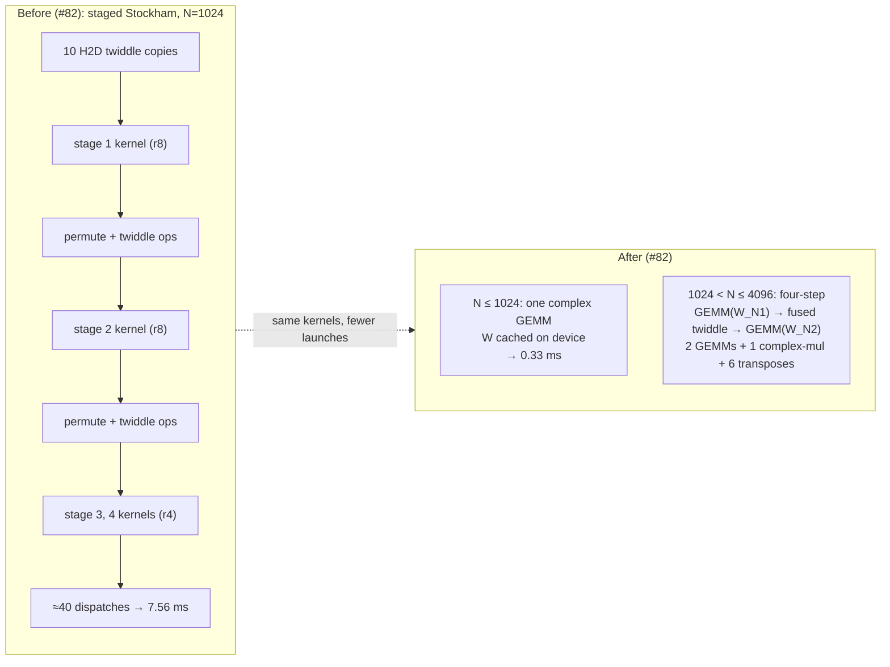

# trnfft: on native PyTorch, the launch is the unit of cost

On the native TorchNeuron device in Neuron SDK 2.33.0, trnfft's N=1024 FFT dropped from 7.56 ms to 0.33 ms. No kernel got faster; there were just fewer launches. When every launch costs a fixed ~0.25 ms, arithmetic barely registers, and the best-fitting shape is one Tensor Engine GEMM accumulating in PSUM, not a sequence of radix stages. The concession comes first: a multithreaded host CPU still beats trnfft at every size and batch measured. For anyone deciding whether a standalone FFT belongs on Trainium: mostly it doesn't, for specific reasons.

<!-- more -->

!!! note "Status"
    Not merged. The launch work is PR [trnsci/trnfft#84](https://github.com/trnsci/trnfft/pull/84) ([#82](https://github.com/trnsci/trnfft/issues/82)); the large-n fix is PR [#85](https://github.com/trnsci/trnfft/pull/85) ([#83](https://github.com/trnsci/trnfft/issues/83)), stacked on it. Both are under review. Measurements: trn2.3xlarge, public Neuron SDK 2.33.0 (torch-neuronx 2.14.3, NKI 0.7.0, neuronx-cc 2.28.7631), LNC=2, native `neuron` device.

## The problem

Earlier posts in this arc ([FFT is a GEMM, and then it isn't](2026-04-20-trnfft-fft-is-a-gemm.md), [the NeuronCore is the unit of parallelism](2026-04-30-trnfft-multicore-batch-split.md)) targeted the XLA lazy-tensor path, with a dispatch overhead of roughly 100 ms ([trnsci/trnsci#35](https://github.com/trnsci/trnsci/issues/35)). There, the sensible design folded everything into one traced graph, and a Stockham plan's stage count was a detail.

Neuron SDK 2.33.0 shipped TorchNeuron as a public beta: an eager, native `neuron` device for PyTorch. The suite's migration spikes measured its eager dispatch floor at about 0.2 ms (0.199 ms for a resident 128² `nki_op` matmul), roughly 500× lower. It is now the whole cost of a small FFT.

On the native device, trnfft's existing dispatch took 7.10 ms for a batch of 32 N=1024 transforms; CPU `torch.fft` took 0.026 ms. N=256 (one GEMM) took 0.53 ms. At N=1024 the plan was four mixed-radix Stockham stages, and instrumenting it counted about 40 device dispatches per call: 4 kernels, 26 inter-stage permutes and twiddle multiplies, and 10 host-to-device twiddle copies (table in Numbers). At ~0.2 ms each, that's the 7 ms. The kernels were fine. The plan around them had too many steps.

cuFFT-style staged plans assume a launch is cheap compared with a pass over memory. That doesn't hold here, and native `torch.fft` doesn't help: it is unsupported on the `neuron` device ("CPU fallback disabled"), so trnfft is the only FFT there.

## What the architecture suggests

If a launch costs a fixed amount, the target is a plan with as few launches as possible, and the question is how much FFT fits in one launch.

The Tensor Engine already answers it. A DFT is a matrix multiply: for complex input, four real `nc_matmul` accumulations into PSUM, as trnfft has done since Phase 1. PSUM accumulates in FP32, so a single-GEMM DFT rounds once per output, after the full K-term sum, instead of once per stage written back to HBM. The O(N²) FLOP count that rules out DFT-by-matmul on a CPU hardly matters when the systolic array idles through most of a 0.25 ms launch.

The [April post](2026-04-20-trnfft-fft-is-a-gemm.md) capped the single GEMM at N=256 as a PSUM precision limit, and a code comment cited 2.2% error at N=1024 on trn1. That was a twiddle-generation bug ([#81](https://github.com/trnsci/trnfft/issues/81)), not PSUM. With FP64-built twiddles, a single GEMM at N=1024 measures 1.54e-7 on Trn2.

Past the single-GEMM range, the four-step (Bailey) factorisation keeps the transform on the Tensor Engine. With N = N1·N2 it becomes a GEMM against W_N1, a pointwise twiddle, and a GEMM against W_N2. Each GEMM contracts over only K ≤ 64 terms at N=4096, so its accumulation error stays at the small-N level. No new kernel was needed, only a different launch structure.



## The approach

[#82](https://github.com/trnsci/trnfft/issues/82) changed the dispatch, not the kernels.

- **Single GEMM up to N=1024** (`TRNFFT_DFT_GEMM_THRESHOLD`, default 256 → 1024). W is built once in FP64 with `k·j` reduced mod N and cached on the device; the inverse's 1/N is folded into W (exact for power-of-2 N). A warm call is one GEMM.
- **Four-step for 1024 < N ≤ 4096** (`TRNFFT_FOUR_STEP_MAX`). Both GEMMs reuse `_complex_gemm_kernel`. The twiddle runs as one `_complex_mul_kernel` launch instead of six elementwise ops (`TRNFFT_FOUR_STEP_FUSED_TWIDDLE=1`).
- **Low-precision modes stay at N ≤ 256.** `_LOWP_GEMM_MAX` stops the higher FP32 threshold from silently extending `bf16`, `bf16_refined`, `ozaki` and `ozaki_hq` beyond their characterised range.
- **`kahan` shares those paths up to N=4096.** With no per-stage rounding there is nothing for a compensated butterfly to fix. The Kahan butterfly still runs above 4096; Bluestein keeps its compensated chirp multiplies.

The deliberate tradeoff: FLOPs are spent to save launches. A single GEMM at N=1024 does O(N²) work where a staged plan does O(N log N), which is right only while the launch floor dominates. The Numbers section shows where it stops dominating: N=4096 with B ≥ 128.

## Implementation

The dispatch is plain Python. This excerpt is from `_cooley_tukey_nki_nograd` in `trnfft/fft_core.py` on `perf-82-fft-launches`, with the force-path toggles and the low-precision branches trimmed:

```python
    # "kahan" takes the GEMM paths too (trnfft#82). On Trn2 the single GEMM /
    # four-step measure 1.2e-7-1.6e-7 rel err, below the Kahan butterfly
    # (1.9e-7-4.6e-7, trn1): the PSUM accumulates in FP32 with no per-stage
    # rounding to compensate. ...
    if n <= _DFT_GEMM_THRESHOLD:
        return _fft_via_gemm(x, inverse)

    # Four-step FFT as two GEMMs (trnfft#82): 2 kernel launches instead of one
    # per Stockham stage plus inter-stage permutes. A threshold of 0 disables
    # it along with DFT-GEMM ("force butterfly/Stockham").
    if _DFT_GEMM_THRESHOLD > 0 and n <= _FOUR_STEP_MAX and n >= 4 and _is_power_of_two(n):
        return _fft_via_four_step(x, inverse)
```

The large-n fix on `fix-83-big-fft` is a planner and a loop around the Stockham stage kernels:

```python
def _plan_row_chunks(total_rows: int, max_rows: int) -> list[tuple[int, int]]:
    if total_rows <= 0:
        raise ValueError(f"total_rows must be positive, got {total_rows}")
    cap = max(_STOCKHAM_ROW_TILE, (max_rows // _STOCKHAM_ROW_TILE) * _STOCKHAM_ROW_TILE)
    if total_rows <= cap:
        return [(0, total_rows)]
    return [(start, min(start + cap, total_rows)) for start in range(0, total_rows, cap)]

# in _launch_stockham_stage(kernel, rows_re, rows_im, arg_c, arg_d, use_sim, per_row_cd):
    chunks = _plan_row_chunks(rows_re.shape[0], _max_rows_per_launch())
    if len(chunks) == 1:
        return _run(rows_re, rows_im, arg_c, arg_d)
    outs_re, outs_im = [], []
    for start, stop in chunks:
        c = arg_c[start:stop].contiguous() if per_row_cd else arg_c
        d = arg_d[start:stop].contiguous() if per_row_cd else arg_d
        o_re, o_im = _run(rows_re[start:stop].contiguous(), rows_im[start:stop].contiguous(), c, d)
        outs_re.append(o_re)
        outs_im.append(o_im)
    return torch.cat(outs_re, dim=0), torch.cat(outs_im, dim=0)
```

The cap is `_MAX_ROWS_PER_LAUNCH = 1 << 21` (`TRNFFT_MAX_ROWS_PER_LAUNCH` overrides), rounded to the kernels' 128-row tile. It is safe because each Stockham stage packs data as `(B·L·M, r)` rows, each an independent r-point butterfly group with its own twiddle row. No kernel reads across rows, so a chunked launch computes exactly what the unchunked one does.

One caveat on every number here: trnfft is not yet ported to the native path ([#80](https://github.com/trnsci/trnfft/issues/80): `nki_op` registration, no `torch_xla.sync()`). The measurements ran trnfft's existing kernels through a test-only stand-in that maps its few `torch_xla` calls onto the native device.

## What didn't work

**The first default broke a contract.** Commit bbff7be raised the defaults, passed the accuracy sweep 20/20, and failed 2 of 30 hardware tests: `TestKahanCharacterization` at N=997, kahan 4.09e-7 against fast 2.62e-7. Bluestein pads 997 to an inner 2048; `fast` now ran that on the GEMM paths while `kahan` stayed on the Kahan butterfly. The "more accurate" mode had become the less accurate one. A CPU check found the same inversion, untested, at N=4096 (1.73×). Commit 011b51c routes kahan through the same paths; the suite is back to 30/30.

**A latency table that measured the box.** The 82b table had N=64 (0.674 ms) and N=512 (0.926 ms) slower than N=1024. Some of that was probably other lanes loading the box; the 011b51c re-run on a quieter box replaced it. Latency runs on a busy instance are provisional.

**A wrong estimate for 2^26.** First-call compile time grew about 3× per doubling (154 s at 2^24, 456 s at 2^25), so 2^26 was estimated at 20+ minutes and deferred. It took 246.5 s: with launches capped at 2^21 rows, 2^26 reuses the chunk-shaped kernels 2^25 had already compiled. Chunking also bounds how many kernel shapes ever need compiling.

**The kernel-body overflow** ([#83](https://github.com/trnsci/trnfft/issues/83)). 2^18 through 2^24 passed, with 2^24 taking 154 s on first call and peaking at 2.25 GiB. 2^25 failed at kernel build, on a `[8388608, 4]` operand:

```
RuntimeError: [NkiDispatch] Python lower_func failed for cache_key=nki_call:76:():g2|[8388608,4]:Float:S(C)|... : RuntimeError: BIR emission failed
error: colz: body blob exceeds uint32 offset range
```

It isn't memory: after the fix, 2^26 runs at an 11 GiB peak. The stage kernels already iterate over 128-row tiles with `nl.affine_range`, the textbook fix. The emitted body still grows linearly with trip count, as if the loop were unrolled during lowering, so there was no in-kernel fix to make; it had to move to the dispatcher.

**Precision promises that still fail.** The suite-wide precision-honesty sweep (trnsci#35) still reports 37 known FAILs, unchanged by these branches. Five are trnfft's BF16 modes: `bf16_refined` at N=64–256 measures 1.9e-3 to 2.1e-3 against a promised 1e-5 (2.03e-3 at N=128), and `bf16` at N=128/256 is just over its 2e-3 bound. On device, the one-step refinement from the [April PSUM-refinement post](2026-04-22-trnfft-bf16-psum-refinement.md) buys essentially nothing. Neither a dedicated issue nor a docstring correction exists yet. Both are owed.

**Upstream ask** ([aws-neuron/aws-neuron-sdk#1440](https://github.com/aws-neuron/aws-neuron-sdk/issues/1440)): (1) keep `affine_range`/`sequential_range` loops rolled when the body is identical across iterations, or document the trip count beyond which they are unrolled and the resulting size limit; (2) have the error name the kernel and loop that overflowed and suggest splitting the launch. "colz: body blob exceeds uint32 offset range" gave no hint that the fix was in the dispatcher.

**Fit.** A standalone 1-D FFT at N ≤ 4096 is badly matched to Trainium: its arithmetic is far too small to amortise a fixed launch floor, and a host CPU finishes in microseconds. That's sizing, not a defect on either side. The fit improves inside a larger on-device pipeline, where input is already resident, output feeds the next device op, and the FFT replaces a host round trip. Batching helps but doesn't flip the result.

## Numbers

Dispatches per warm `trnfft.fft` call (batch 32, counted with fake kernels on CPU):

| N | before: kernels / other device ops / H2D | after (011b51c) |
|---|---|---|
| 64, 256 | 1 GEMM / 0 / 2 | 1 GEMM, nothing else |
| 512 | 3 radix-8 / 28 / 8 | 1 GEMM, nothing else |
| 1024 | 4 (2 r8 + 2 r4) / 26 / 10 | 1 GEMM, nothing else |
| 2048 | 4 (3 r8 + 1 r4) / 32 / 10 | 2 GEMM + 1 complex-mul + 6 transposes |
| 4096 | 4 radix-8 / 38 / 10 | 2 GEMM + 1 complex-mul + 6 transposes |

Trn2 A/B on b83ff8d (batch 32, device-resident warm median, ms), the run that set the new defaults:

| N | staged (old) | four-step | four-step + fused twiddle | single GEMM | CPU |
|---|---|---|---|---|---|
| 512 | 5.45 | 1.67 | 1.23 | **0.26** | 0.018 |
| 1024 | 7.56 | 2.22 | 2.04 | **0.31** | 0.029 |
| 2048 | 8.22 | 1.58 | **1.20** | 1.08 | 0.057 |
| 4096 | 10.25 | 2.43 | **2.18** | 2.36 | 0.107 |

Latency, merge candidate 011b51c (B7 op-latency script, batch 32; warm median of 20, ms). The 82b column is the noisy run discussed above:

| N | 82b resident | 011b51c resident | 011b51c with host copies | CPU |
|---|---|---|---|---|
| 64 | 0.674 | 0.248 | 0.455 | 0.007 |
| 256 | 0.412 | 0.244 | 0.459 | 0.013 |
| 512 | 0.926 | 0.265 | 0.503 | 0.019 |
| 1024 | 0.523 | 0.334 | 0.592 | 0.030 |
| 2048 | 1.333 | 0.890 | 1.173 | 0.051 |
| 4096 | 2.324 | 2.238 | 3.174 | 0.095 |

Batched `(B, N)`, device ms / CPU ms (CPU is `torch.fft.fft` on the 12-vCPU host, multithreaded; rel_err vs FP64 1.3e-7 to 2.2e-7 throughout):

| N | B=1 | B=16 | B=128 | B=1024 |
|---|---|---|---|---|
| 256 | 0.331 / 0.006 | 0.342 / 0.013 | 0.302 / 0.042 | 0.410 / 0.101 |
| 1024 | 0.403 / 0.017 | 0.412 / 0.034 | 0.405 / 0.089 | 1.156 / 0.290 |
| 4096 | 0.949 / 0.058 | 2.056 / 0.103 | 3.012 / 0.212 | 11.68 / 6.34 |

Up to N=1024, B=128 costs about the same as B=1: the launch floor, directly. The device/CPU ratio narrows from about 55× (N=256, B=1) to about 1.8× (N=4096, B=1024), but the CPU wins every cell. At N=4096, device time grows roughly linearly with B above 128, so four-step is bound by per-batch work there, not dispatch.

Large n, `fix-83-big-fft` b46a96e (one logical core; relative L2 vs FP64 `torch.fft`, bound 1e-5):

| n | result | first call | peak device memory |
|---|---|---|---|
| 2^22 | PASS (chunked, cap 2^17, bit-identical to unchunked) | — | — |
| 2^24 | PASS (unchunked before the fix) | 154 s | 2.25 GiB |
| 2^25 | FAIL at build before; PASS after | 456 s | — |
| 2^26 | PASS, rel_l2 3.71e-6 | 246.5 s (reused 2^25's kernels) | 11.0 GiB |

Accuracy and suite results:

| Item | Before | After |
|---|---|---|
| ozaki_hq rel error, N=64–256 ([#81](https://github.com/trnsci/trnfft/issues/81)) | 4.9e-6 – 2.0e-5 | 7.5e-8 – 8.8e-8 |
| ozaki rel error, N=64–256 | 5.9e-6 – 2.0e-5 | 3.5e-6 – 3.8e-6 |
| FP32 path rel error, N=64–4096 | ~1.6e-6 (staged) | 1.2e-7 – 1.6e-7 |
| Bluestein n=1000 | 1.2e-4 | 2.8e-7 |
| Hardware suite | 30/30 (011b51c, three passes) | 32/32 (b46a96e, +2 large-FFT tests) |

The #81 and Bluestein bugs shared a cause: FP32 angles of order 2πN, rounded before any precision-aware code saw them. Both fixes build in FP64 with the index product reduced mod N (mod 2N for the chirp); ozaki_hq also splits W three ways, and the chirp now lives on the input's device. The #81 result reopens the [trn2 conclusion of the April Ozaki post](2026-04-30-trnfft-ozaki-hardware-correction.md): with exact twiddles, Trn2 matches the CPU prediction. That needs a re-measurement on the native path before it becomes a claim. Under `torch.compile(backend="neuron", fullgraph=True)`, `fft`, `ifft`, `rfft`, Bluestein n=127 and `complex_matmul` compile with 0 graph breaks.

## What's next

- **Batch-level fusion** (one kernel covering many rows of a four-step pass): the next lever before multi-core, per the N=4096, B ≥ 128 numbers.
- **Native registration** ([#80](https://github.com/trnsci/trnfft/issues/80)): `nki_op` for every kernel, `register_autograd`, and no `torch_xla` on the native path.
- **Four-step beyond 4096**, where per-stage Stockham launches remain the time limit (trnsci#35 capacity sweep).
- [Phase 2 — precision (Kahan/Neumaier for long Bluestein chains)](https://github.com/trnsci/trnfft/issues/52), including the open BF16 FAILs and [kahan characterisation on silicon](https://github.com/trnsci/trnfft/issues/58)
- [Phase 3 — plan reuse, streaming large FFTs, NEFF cache](https://github.com/trnsci/trnfft/issues/53), where #82 and #83 live
- [Phase 4 — multi-chip large-N FFT](https://github.com/trnsci/trnfft/issues/54). Multi-rank `nki.collectives` were bit-exact at 2 and 4 ranks in trnsci#35
- [Phase 5 — trn2 larger-SBUF path](https://github.com/trnsci/trnfft/issues/55)

Suite context: [trnsci.dev](https://trnsci.dev), the [roadmap](https://trnsci.dev/roadmap/), the [suite-wide tracker](https://github.com/trnsci/trnsci/issues/1). Siblings face the same floor: trnblas's batched-pair kernel and trntensor's homogeneous batching were built around the old 100 ms one, and trnsci#35 flags both for revisiting.

## Takeaway

When a launch has a fixed price, an FFT plan costs its launch count; FLOPs barely enter. On Trainium the cheapest way to cut launches is to hand the transform to the Tensor Engine as one GEMM (two for four-step) and let FP32 PSUM accumulate, which also proved more accurate than the staged plan. The same accounting shows up at the large-n end: the fix for an overflowing kernel was more launches, chosen so their shapes repeat. None of it makes a standalone FFT beat the CPU. It makes the FFT cheap enough to leave on the device when the surrounding pipeline already lives there.
