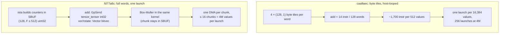

# trnrand: from byte tiles to full words on Trn2

The [byte-tile post](https://trnsci.dev/blog/trnrand-the-integer-multiply-gap-pointed-to-a-better-algorithm/)
argued that storing each Threefry word as four `(128, 1)` byte tiles was the representation
the architecture preferred. On Trn2 with NKI 0.7 that design was correct and slow: the
kernel was bound by instruction issue, because every instruction did 128 elements of work.
Widening the tiles to `(128, F ≤ 512)` and moving the 32-bit adds onto GpSimd's native
integer path takes `trnrand.normal()` at 4M elements from 934 ms to 15.9 ms with
bit-identical output. That result shipped in
[trnrand v0.8.0](https://github.com/trnsci/trnrand/releases/tag/v0.8.0) via PR
[trnsci/trnrand#62](https://github.com/trnsci/trnrand/pull/62).
Aten `randn` is still about 11× faster, and the host CPU still wins at every size measured.

<!-- more -->

!!! warning "Correction (2026-11-01)"
    The fit section's "partitioned multi-chip draws" did not hold in the releases this post describes. In trnrand 0.7.0–0.11.0, a `Generator(partition_rank=r, partition_size=P)` with P > 1 on the NKI path advanced its counter by one rank's share per draw, so from the second draw on rank r reused rank r+1's counters, and with `key_mode="counter"` the ranks returned duplicate values ([trnrand#72](https://github.com/trnsci/trnrand/pull/72), fixed in [v0.12.0](https://github.com/trnsci/trnrand/releases/tag/v0.12.0)). Separately, `get_state()`/`set_state()` did not save the NKI stream counter until [v0.12.1](https://github.com/trnsci/trnrand/releases/tag/v0.12.1) ([#75](https://github.com/trnsci/trnrand/pull/75)). Unpartitioned generators, which this post's measurements use, are unaffected.

## The problem

trnrand is the suite's cuRAND analog. Its default on-device generator is Threefry4x32-20,
chosen in April because it needs only add, XOR and rotate. The 2²⁴ exact-integer ceiling
reported in [aws-neuron-sdk#1308](https://github.com/aws-neuron/aws-neuron-sdk/issues/1308)
had ruled out Philox's 32×32 multiply. That post's answer was to keep every intermediate
below 2²⁴ by working in bytes.

The Trn2 window in October ran trnrand on the public Neuron SDK 2.33.0 (torch-neuronx
2.14.3, NKI 0.7.0, neuronx-cc 2.28.7631) through TorchNeuron's native `neuron` device
([trnsci/trnsci#35](https://github.com/trnsci/trnsci/issues/35)). The first latency numbers
were bad enough that they got their own issue,
[trnrand#60](https://github.com/trnsci/trnrand/issues/60): `normal(4M)` took 9.2 s. Two
rounds of host-side fixes came first. Routing bulk draws through the 32-tile streaming
kernel cut 8,192 launches to 256, and keeping inputs and outputs on the device (commit
caa9aec) cut the copies from 1,792 to 7. Together they brought 4M to 934 ms.

Then the curve stopped bending. At caa9aec, cost was linear at about 0.23 ms per 1,000
elements. That is roughly 800× behind aten `randn` at 4M, and launches and copies were
already near their floor. A cost that scales with element count after the launch overhead
is gone lives inside the kernel.

## What the architecture suggests

A NeuronCore tile has two axes. The partition axis is 128 lanes. The free axis is how far
each instruction sweeps along every lane. A CUDA habit maps one thread to one
counter, and the April design did the Trainium equivalent: one partition lane per counter,
free dimension of 1. Each instruction did 128 elements of work when it could have done 128 × F
for the same issue cost.

Reading the caa9aec kernel made the cost concrete. A byte-sliced 32-bit add is four byte
adds, three carry adds, three shifts and four masks: 14 instructions for 128 words. One
512-value tile of Threefry-20, with key injections, came to about 1,700 instructions. That
explains why the cost was linear, and why removing launches and copies stopped helping.

The second axis is the engine. The
[four-engine post](https://trnsci.dev/blog/trnrand-rng-is-a-four-engine-workload-if-the-silicon-lets-you-say-so/)
argued that RNG belongs on GpSimd and the Vector Engine, not the Tensor Engine. NKI 0.7
makes that literal for integers. Its documentation says `nisa.tensor_tensor` with all-int32
or all-uint32 operands runs on GpSimd with native integer arithmetic. The bitwise ops XOR,
shift and OR already handle full 32-bit patterns on the Vector Engine. Only the add ever
needed the byte workaround, and GpSimd now does that add natively.



## The approach

The fix took two commits, each validated separately on device.

**f4e8af5: widen the tile.** The same byte arithmetic now runs on `(128, F)` tiles, with F
up to 512. Each launch handles up to 16 chunks, so one launch covers 16 × 512 × 512 =
4,194,304 values. Counters are built in SBUF with `nisa.iota` instead of shipped from the
host. Box-Muller stays fused in the kernel, and each chunk leaves with one DMA. That alone
gave 4.3× to 29× over caa9aec.

**ea3800e, then fd77a8c: widen the word.** ea3800e added two opt-in widths under
`TRNRAND_LIMB_BITS`. The 16-bit width splits each word into two limbs, so every add stays
below 2¹⁷ and is exact even through fp32. The 32-bit width uses whole words with the adds
pinned to GpSimd. The NKI docs promise exact integer results. They don't say whether the
add wraps mod 2³², and Threefry depends on that wrap. The simulator can't settle the
question, so hardware did. All three widths matched bit for bit at 1; 16,385 (offset
2²⁴−5); 1,048,577 (seed 2⁴⁰+3); and 4,194,305 elements. fd77a8c then made 32 the default.

The deliberate tradeoffs:

- **Bit-identity over a cleaner stream.** The full-word kernel keeps the byte-era stream
  layout: 24-bit key halves from the seed, and batch counters masked to 24 bits. A native
  32-bit layout would be simpler, but it would change every existing stream for a given seed.
- **Bounded shapes over perfect fit.** F is capped at 512 by SBUF, since about 16 live
  `(P, F)` state tiles plus temporaries share each partition. C is capped at 16 because
  chunks are unrolled, so C bounds instruction count and compile time. Both come from a small
  bucket set, so a few NEFFs serve every request size.
- **The byte path stays.** `TRNRAND_LIMB_BITS=8` is the documented fallback. The XLA/Trn1
  lineage never uses the bulk kernels and is unchanged.

## Implementation

Every add in the round function now goes through this helper. It replaced the 14-instruction
byte add (from `trnrand/nki/dispatch.py` on branch
[`perf-60-fullword`](https://github.com/trnsci/trnrand/tree/perf-60-fullword)):

```python
def _add32_w(x, y):
    out = nl.ndarray(x.shape, dtype=nl.uint32, buffer=nl.sbuf)
    nisa.tensor_tensor(out, x, y, op=nl.add, engine=nisa.engine.gpsimd)
    return out

def _rotl32_w(x, rot):
    return nl.bitwise_or(
        nl.left_shift(x, rot, dtype=nl.uint32),
        nl.right_shift(x, 32 - rot, dtype=nl.uint32),
        dtype=nl.uint32,
    )

def _mix_w(a, b, rot):
    a_new = _add32_w(a, b)
    b_new = nl.bitwise_xor(_rotl32_w(b, rot), a_new, dtype=nl.uint32)
    return a_new, b_new
```

The counter setup inside the kernel body is where the free dimension gets used:

```python
col = nl.ndarray((P, F), dtype=nl.uint32, buffer=nl.sbuf)
nisa.iota(col, [[1, F]], offset=0, channel_multiplier=0)
...
for c in nl.static_range(C):
    start_w = _pack_bytes_wide(_b_split(start_ref[:, c : c + 1]), zero)
    c1_w = nl.bitwise_and(_add32_w(col, start_w), 0xFFFFFF, dtype=nl.uint32)
```

On the host, `_bulk_plan` picks `(F, C, launches)`, and the chunk count rounds to a bucket
of powers of two plus their quarter steps:

```python
def _chunk_bucket(chunks: int) -> int:
    chunks = max(1, int(chunks))
    if chunks <= 4:
        return chunks
    p = _next_pow2(chunks) // 2  # chunks in (p, 2p]
    step = p // 4
    return min(_BULK_CHUNKS_MAX, -(-chunks // step) * step)
```

## What didn't work

**The byte-tile premise was half wrong.** The April post said NKI routes 32-bit tile
arithmetic through a float32 path. For the ops trnrand called, that held. The general
conclusion did not. On NKI 0.7 the 2²⁴ limit came from how trnrand used NKI. `nl.add` and
`nl.multiply` with a `(P, 1)` operand lower to `tensor_scalar_arith`, which is float-only.
An int32↔uint32 `nl.copy` is a saturating value conversion, not a bitcast
([trnrand#56](https://github.com/trnsci/trnrand/issues/56)). The Philox tests that had been
marked xfail against #1308 were failing on the saturating copy. With `tensor_tensor` and
`NkiTensor.view()` bitcasts, Philox is bit-exact on Trn2, 512 of 512 words, so the
four-engine post's Philox gate now passes. The byte tiles solved a real problem, but they
were the wrong fix for most of it.

**torch.compile was not the lever.** Before the kernel was rewritten, the compiled
counter-mode path gave 1.5× at 16k (7.61 → 5.24 ms) and 1.1× at 262k. At 1M, compilation
failed:

```
[F137] neuronx-cc was forcibly killed
```

The graph inlined every per-tile `nki_op` launch, and neuronx-cc's `walrus_driver` reached
about 50 GB RSS before it was killed. Compiling a slow kernel mostly yields a slow kernel
and a large compile.

**Compiling at all required changing the stream.**
[trnrand#61](https://github.com/trnsci/trnrand/issues/61) found two blockers. Dynamo cannot
proxy the `torch.Generator` argument ("Failed to convert args/kwargs to proxy"). The workaround,
opaque `torch.library.custom_op`s, passed on CPU backends and then failed on `backend="neuron"`
with "failed to legalize operation 'torch.operator'". The Neuron backend lowers the whole
FX graph to StableHLO, and only aten ops and `nki_op` kernels survive. Default seeding draws
each key from the host Mersenne Twister, and a graph can't express that. The result is an
opt-in `Generator(key_mode="counter")`, which fixes the key from the seed and advances only
a counter tensor. It compiles with zero graph breaks and matches eager bit for bit, but it
produces a different stream for the same seed. The default stays `"draw"`. That work shipped
in v0.8.0 via PR [trnsci/trnrand#63](https://github.com/trnsci/trnrand/pull/63), on top of
#62.

**Power-of-two buckets had a cliff.** f4e8af5 rounded chunk counts up to a power of two, so
2²⁰ + 1 elements cost 1.7× as much as 2²⁰ (15.43 vs 8.86 ms). The quarter-step buckets above
bring 1M+1 to within 1.1–1.15× of 1M.

**Fit, stated plainly.** Counter-based RNG is integer-heavy, branch-free and has no
contraction. That suits the partition-and-free-axis shape once both axes are used. It never
touches the Tensor Engine, which is most of the silicon. Aten `randn` at 4M is about 11×
faster, and that gap is not yet explained. Threefry-20 spends 20 rounds of add, rotate and
XOR plus five key injections on every four outputs, so it may simply be more work than
whatever aten runs. trnrand's case on
device is reproducibility (counter streams, partitioned multi-chip draws, bit-identity
across cores) more than speed.

**Upstream ask.** The NKI 0.7 docs say GpSimd `tensor_tensor` integer arithmetic is exact,
but not that the add wraps mod 2³². The docs also don't collect which integer ops are exact
on which engine, so the `nl.add` float lowering and the saturating `nl.copy` had to be found
on hardware. The
[new comment on aws-neuron-sdk#1308](https://github.com/aws-neuron/aws-neuron-sdk/issues/1308)
asks for docs that say which integer ops are exact on which engine. (AWS closed the issue in April once the workaround shipped, noting that native int32
arithmetic support is on their list.) One table of
op × engine × dtype, marked exact, wraps, saturates or via-fp32, would cover it.

## Numbers

Warm median, `normal(n)`, trn2.3xlarge, SDK 2.33.0, native `neuron` device. Ranges span
repeated runs on a shared box, recorded in trnrand#60.

| n | caa9aec (bytes, host-looped) | f4e8af5 (8-bit, wide tiles) | 16-bit limbs | **32-bit (fd77a8c default)** | aten `randn` | CPU |
|---|---|---|---|---|---|---|
| 16k | 4.77 ms | 0.90–1.11 ms | 1.64 ms | **0.78 ms** | 0.13–0.21 ms | 0.045 ms |
| 262k | 59.9 ms | 2.46–2.82 ms | 1.63 ms | **1.25 ms** | 0.20–0.38 ms | 0.71–0.74 ms |
| 1M | 232.9 ms | 7.90–10.64 ms | 6.88 ms | **4.96 ms** | 0.40–0.80 ms | 2.86–3.0 ms |
| 4M | 934.4 ms | 37.1–42.8 ms | 22.07 ms | **15.87 ms** | 1.14–1.4 ms | 11.4–11.8 ms |

The 32-bit column is a direct kernel-call measurement. The suite's B7 harness, run on a
loaded box, measured fd77a8c at 0.97 / 1.57 / 4.06 / 20.9 ms. The CPU column is a faster
generator at every size here. The 16-bit width, a diagnostic setting, is slower than bytes
at 16k. First calls for f4e8af5 took 0.7 s at 16k and 17.0 s at 4M.

| Validation (fd77a8c unless noted) | Result |
|---|---|
| Full hardware suite | 88 passed, 1 xpassed |
| B10 edge sweep (counters near 2³²−1, 1,024 seeds, Sobol/Halton at scale) | 17/17 |
| trnrand examples on the bulk kernels | 4/4 |
| Bit-identity vs caa9aec, across the 2²⁴ counter wrap | identical |
| B1 determinism, run to run and across NeuronCores | bit-identical |
| Philox vs `philox4x32_reference` (#56 fixes) | 512/512 words |
| Counter mode, full suite (0f9fe23, #63) | 82 passed, 1 xpassed |

## What's next

- [trnrand#62](https://github.com/trnsci/trnrand/pull/62) and
  [#63](https://github.com/trnsci/trnrand/pull/63) are merged, along with
  [#55](https://github.com/trnsci/trnrand/pull/55) (native TorchNeuron dispatch), and shipped in
  [v0.8.0](https://github.com/trnsci/trnrand/releases/tag/v0.8.0).
- [trnrand#60](https://github.com/trnsci/trnrand/issues/60) remains open for the rest of the
  gap to aten. Per the notes there, Philox, Sobol and Halton still launch once per tile.
- [Phase 5: trn2 PSUM sizing for larger batched tile generation (trnrand#21)](https://github.com/trnsci/trnrand/issues/21).
- [Benchmarks vs cuRAND (trnrand#3)](https://github.com/trnsci/trnrand/issues/3), now that
  `normal` and `uniform` are correct and bit-identical on Trn2.
- [trnrand#57](https://github.com/trnsci/trnrand/issues/57): the streaming kernels' SBUF OOM
  on neuronx-cc 2.26, which still matters for the Trn1 lineage.
- The suite-wide view is on the [roadmap](https://trnsci.dev/roadmap/) and the
  [suite tracker](https://github.com/trnsci/trnsci/issues/1).

## Takeaway

The partition axis is not where the parallelism ends. A `(128, 1)` tile leaves the free axis
idle and makes every instruction pay full issue cost for 128 elements. The April design
fixed correctness by working inside one engine's limits. The October fix came from using
the second tile axis and from moving the integer adds to the engine with native int32
arithmetic. On Trainium, choosing the shape and the engine is the main decision in the
kernel, and it is not a later tuning step.
