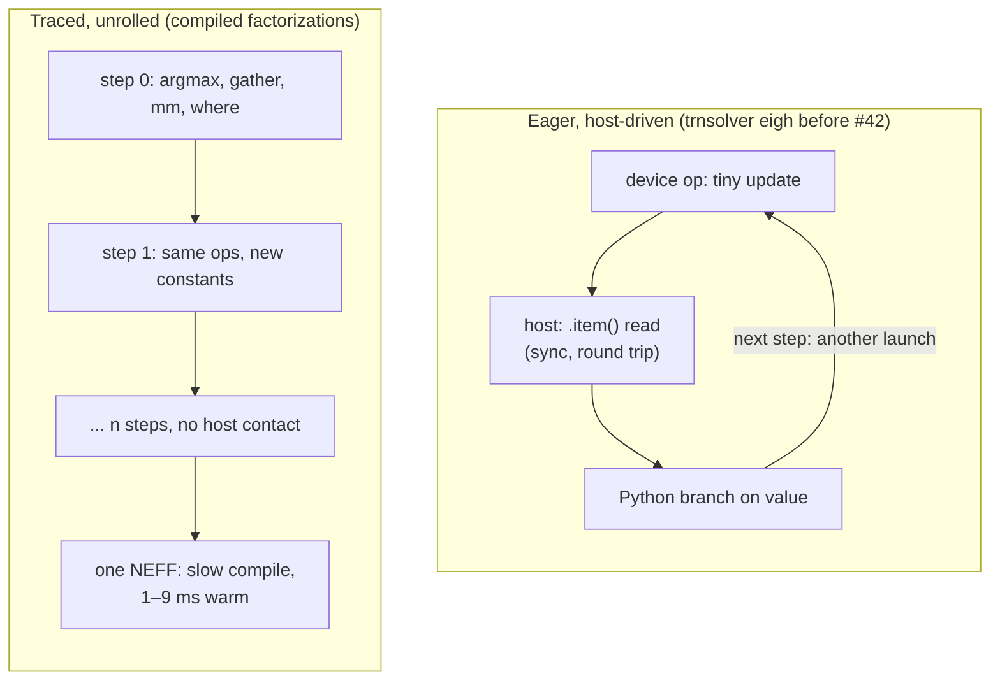
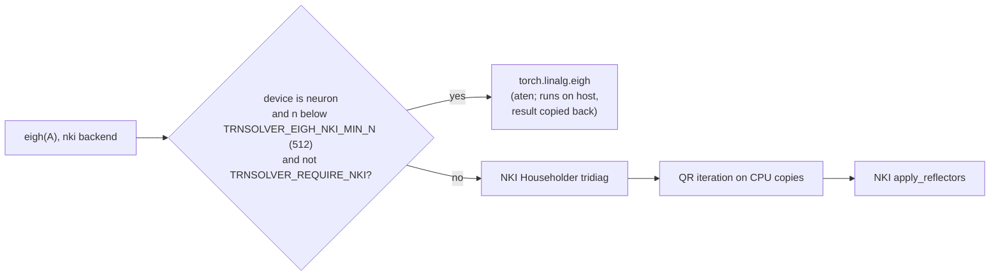

# trnsolver: what torch.compile can't lower, and a 20-second eigh

trnsolver's Cholesky, LU solve and QR now compile under `torch.compile(backend="neuron", fullgraph=True)` on Trn2, and `eigh` at n=128 dropped from 20.8 s to 1.17 ms. Neither is the triumph it sounds like: first calls of the compiled factorizations take 13–259 s because their loops unroll, and the 1.17 ms `eigh` runs on the host CPU, which is where aten's `linalg_eigh` executes for a `neuron` tensor. The lesson for anyone putting dense linear algebra inside a compiled Trainium graph: a whole-graph, static-shape compile model turns pivoting into cheap data movement, but has no answer yet for convergence loops.

<!-- more -->

!!! note "Code status"
    Everything below lives in [trnsci/trnsolver#43](https://github.com/trnsci/trnsolver/pull/43) (branch `fix-42-eigh-latency`), which is open for review and **not merged**. The rejected blocked variant is kept on branch `repro-ncc-inla001-blocked` as an upstream reproducer only.

## The problem

The [suite-wide move to native TorchNeuron](https://github.com/trnsci/trnsci/issues/35) puts every trnsci library on the Neuron SDK 2.33.0 stack: the TorchNeuron public beta (torch-neuronx 2.14.3 on PyTorch 2.14), NKI 0.7.0 and neuronx-cc 2.28.7631, on a trn2.3xlarge. Eager ops run on a `neuron` device; `torch.compile(backend="neuron")` hands a whole FX graph to neuronx-cc and gets back one NEFF.

cuSOLVER's model is a library call per factorization (`potrf`, `getrf`, `geqrf`) with an `info` code for failure. The naive port is to call `torch.linalg.*` and trust the backend to lower it. A compile coverage spike over trnsolver's public API (B6 in trnsci#35, recorded in [trnsolver#41](https://github.com/trnsci/trnsolver/issues/41)) showed what that trust buys today:

| call under `fullgraph=True` | result on SDK 2.33 |
|---|---|
| `cholesky`, `solve` | `Higher-order operation 'with_effects' not implemented in the FxImporter (tried '_import_hop_with_effects')` |
| `cholesky_ex` | `Neuron has no lowering for this op` |
| `solve_ex` | `failed to legalize operation 'torch.operator' that was explicitly marked illegal` |
| `qr` | `failed to legalize operation 'torch.aten.linalg_qr'` |
| `eigh` (n=128) | 26 graph breaks (`Tensor.item()`, guard `x < 1e-20`) |
| `cg` | 4 graph breaks (guard `x < 1e-15`) |

The `with_effects` failure is the instructive one. `torch.linalg.cholesky` decomposes into `linalg_cholesky_ex` plus `aten._linalg_check_errors(info)`, a side-effecting op that only raises; PyTorch wraps it in the `with_effects` higher-order op, which the Neuron FxImporter can't import. Error checking broke before the factorization did.

A separate latency spike (B7, [trnsolver#42](https://github.com/trnsci/trnsolver/issues/42)) found the second problem: trnsolver's NKI `eigh` on device-resident inputs took 391–413 ms at n=16 and 20.8 s at n=128, while `torch.linalg.eigh` on the same device took about 1 ms.

## What the architecture suggests

The Neuron compile model wants the whole computation at once, static shapes, and no host round trips. A solver written like a host-side LAPACK caller violates all three.



**Data-dependent data movement fits.** Partial pivoting looks like control flow but is a data choice: `argmax` over a column, then `gather` with a permutation index. Nothing leaves the device and the graph shape doesn't depend on the answer.

**Data-dependent trip counts don't fit.** QR iteration in `eigh` and the residual test in `cg` stop when a value crosses a tolerance. With no loop higher-order op (`while_loop`, `scan`) in the Neuron FxImporter, a convergence loop either syncs to the host every iteration or can't be traced.

**Static loops fit, at a price.** A fixed-length loop unrolls at trace time into n copies of the step: a straight-line NEFF with no host contact, whose size and compile time grow with n. Same NEFF-cache economics as the [Jacobi post](https://trnsci.dev/blog/trnsolver-jacobi-for-trainium--when-the-hardware-inverts-the-algorithm-choice/) and the [Schur post](https://trnsci.dev/blog/trnsolver-v0100-schur-decomposition-and-the-architecture-of-two-stage-algorithms/): pay once to compile, win only if the same shape runs many times.

One hardware rule reaches up into plain PyTorch: partition accesses must start at partition 0, 32, 64 or 96 with matching spans. trnsolver hit it in its own kernel ([#40](https://github.com/trnsci/trnsolver/issues/40)), then in a graph with no NKI code at all (below).

None of this uses the Tensor Engine well. Each unrolled step is a rank-1 update, an (n×1)@(1×n) `mm` with a contraction dimension of 1, against a 128-row systolic array. The compiled path removes host round trips; it doesn't turn a factorization into a GEMM.

## The approach

**Factorizations: traceable implementations under compile.** When `torch.compiler.is_compiling()` is true and the input is real, `cholesky`, `solve`, `solve_spd`, `inv_spd` and `qr` take implementations built from elementwise ops, `where` masks, `mm`, `sqrt`, `sum`, `argmax`, `gather` and `cat`. The rules are: no `.item()`, no data-dependent Python control flow, no in-place slice assignment (every per-column restriction is a row or column mask), and a static loop over n. Eager calls are unchanged and still call `torch.linalg`.

The deliberate tradeoff is error reporting. `_linalg_check_errors` is the op that broke, so the traceable paths don't raise: compiled `cholesky` on a non-SPD input returns NaN, and compiled `solve` on a singular matrix returns inf or NaN instead of `LinAlgError`. Callers who need the exception call eagerly.

**Convergence loops: eager-only, labeled as such.** `eigh`'s NKI path and `cg`/`gmres` run under `torch.compiler.disable`: one graph break instead of 26. Under `fullgraph=True` that break is an error, which is the honest answer.

**eigh latency: a cutover and host QR.**



The default routes every size the single-tile NKI path supports (n ≤ 128) to aten. `TRNSOLVER_REQUIRE_NKI=1` bypasses the cutover so the hardware suite still exercises the kernels.

## Implementation

The GEPP solve shows pivot-as-data-movement: the row swap is a `gather` with a permutation built from `argmax`, and elimination runs on the augmented `[A | B]`, so no L factor or pivot vector exists. From [`trnsolver/factor.py`](https://github.com/trnsci/trnsolver/blob/fix-42-eigh-latency/trnsolver/factor.py):

```python
def _solve_lu_traceable(A: torch.Tensor, B: torch.Tensor) -> torch.Tensor:
    n = A.shape[-1]
    batch = torch.broadcast_shapes(A.shape[:-2], B.shape[:-2])
    M = torch.cat([A.expand(*batch, n, n), B.expand(*batch, n, B.shape[-1])], dim=-1)
    rows = torch.arange(n, device=A.device)
    for k in range(n):
        mag = torch.where(rows >= k, M[..., :, k].abs(), -1.0)  # (..., n)
        p = torch.argmax(mag, dim=-1, keepdim=True)  # (..., 1)
        perm = torch.where(rows == k, p, torch.where(rows == p, k, rows))  # (..., n)
        M = torch.gather(M, -2, perm.unsqueeze(-1).expand(M.shape))
        factors = torch.where(rows > k, M[..., :, k] / M[..., k : k + 1, k], 0.0)
        M = M - factors.unsqueeze(-1) * M[..., k : k + 1, :]
    return _solve_triangular_traceable(M[..., :n], M[..., n:], upper=True)
```

Cholesky writes column k into L with a mask, not `L[:, k] = ...`:

```python
    for k in range(n):
        d = torch.sqrt(S[..., k : k + 1, k : k + 1])  # (..., 1, 1)
        col = torch.where(rows >= k, S[..., :, k : k + 1] / d, 0.0)  # (..., n, 1)
        L = torch.where(cols == k, col, L)
        S = S - col @ col.transpose(-2, -1)
```

In `_householder_qr`, LAPACK's "skip the reflector if the sub-column is zero" branch becomes a `where` on `tail_sq > 0`:

```python
        active = tail_sq > 0
        denom = torch.where(active, alpha - beta, one)
        tau = torch.where(active, (beta - alpha) / torch.where(active, beta, one), 0.0)
        v = torch.where(rows == k, one, tail / denom)
        w = (v.transpose(-2, -1) @ R) * (cols >= k)  # (..., 1, n)
        R = R - tau * (v @ w)
```

The `eigh` fix in [`trnsolver/eigen.py`](https://github.com/trnsci/trnsolver/blob/fix-42-eigh-latency/trnsolver/eigen.py) is a cutover predicate plus moving the QR iteration onto host tensors:

```python
def _eigh_aten_cutover(A: torch.Tensor) -> bool:
    if _REQUIRE_NKI:
        return False
    if A.device.type != _NATIVE_DEVICE_TYPE:
        return False
    return A.shape[-1] < _eigh_nki_min_n()

# in _householder_qr_eigh:
    host = torch.device("cpu")
    eigenvalues, Q_right = _qr_iterate(
        diag.detach().to(host, copy=True), subdiag.detach().to(host, copy=True), tol
    )
    Q_right = Q_right.to(A.device)
```

## What didn't work

**Switching to `*_ex` only moved the wall.** The first fix (5baa5cf) called `cholesky_ex` and `solve_ex` directly to keep `_linalg_check_errors` out of the graph. `with_effects` disappeared; `Neuron has no lowering for this op` and `failed to legalize operation 'torch.operator'` replaced it. The backend has no linalg decomposition lowerings at all, so the traceable rewrite was the only route that didn't wait on upstream.

**Blocking didn't shrink the graph, and it found a compiler bug.** A third round (616bd39) tried right-looking blocked variants with panel width 32. The graph node count stayed O(n), since the panels still unroll column by column. At n=64 blocking helped `solve_spd`, `inv_spd` and `qr` and hurt `cholesky` and `solve`:

| op, n=64 first call | unblocked (1b3d819) | blocked nb=32 (616bd39) |
|---|---|---|
| cholesky | 12.8 s | 14.5 s |
| solve | 47.2 s | 61.5 s |
| solve_spd | 44.6 s | 27.3 s |
| inv_spd | 49.8 s | 27.6 s |
| qr | 46.0 s | 33.3 s |

At n=128 every blocked op failed inside neuronx-cc 2.28.7631:

```
[INTERNAL_ERROR] [NCC_INLA001] Unhandled exception with message: === BIR verification failed ===
Reason: Pattern accesses 96 (> 32) partitions starting at partition 32
Opcode: GenericCopy
Instruction Source: (GenericCopy: I-21761), tensorizer(output tensor: float32<96 x 96> , id: 21761)
```

The 96×96 tensor is the trailing submatrix `A[32:, 32:]`: one copy starting at partition 32 and spanning 96, the same 0/32/64/96 rule as #40, reached from ordinary aten ops. Blocking was rejected. It doesn't fix graph size, and an internal compiler error isn't worth working around.

A correction belongs on the record. The first draft of the upstream report, in a trnsolver#41 comment, said a plain slice `x[32:, 32:]` of a 128×128 tensor triggers NCC_INLA001. It doesn't. `x[32:,32:]*2`, the trailing update `x[32:,32:] - x[32:,:32] @ x[:32,32:]` and that update reassembled with `cat` all compile correctly at n=128. The bug needs the large fused graph, so the filed reproducer is the whole blocked branch, not a ten-line script. The same comment had left blocked `qr` at n=128 unchecked; it fails the same way.

**The 20-second eigh passed every test.** The hardware suite passed 20/20 while `eigh` took 20.8 s at n=128, because the suite's inputs live on the CPU. The NKI kernels weren't the cost. `_qr_iterate`/`_qr_sweep` moved `diag`, `subdiag` and `Q` back to the input's device and ran scalar Givens code element by element there: about 20 device ops per rotation over about 1.25·n² rotations, roughly 400k tiny ops at n=128. Hence ~4× per doubling of n, O(n²) wall time for an O(n³) algorithm. The benchmark was counting launches, not FLOPs.

The #40 fix earlier in the window had its own wrong first guess. The issue blamed the Jacobi kernels for `Expected 'src' partition start in {0, 32, 64, 96} for a 1-partition access, but got 6`. The culprit was `apply_reflectors_kernel` in the Householder path, slicing row k of an SBUF-resident Vᵀ. Loading each row with `nl.load_transpose2d` so it lands at partition 0 took the suite from 1 passed / 19 failed to 20 passed.

**Upstream asks, filed:**

- [aws-neuron-sdk#1438](https://github.com/aws-neuron/aws-neuron-sdk/issues/1438): support `with_effects` in the FxImporter, or drop the `_linalg_check_errors` effect on Neuron. Add lowerings for `linalg_cholesky_ex`, `linalg_solve_ex`/LU, `linalg_qr`, `triangular_solve` and, if possible, `eigh`; a host fallback with a graph break beats a hard failure. Document which `aten.linalg_*` ops run on the host in eager.
- [aws-neuron-sdk#1441](https://github.com/aws-neuron/aws-neuron-sdk/issues/1441): the tensorizer should split copies at legal partition starts instead of emitting an illegal pattern. Reproducer: branch `repro-ncc-inla001-blocked` at n=128.
- Not yet filed: a loop higher-order op (`while_loop`/`scan`) in the Neuron FxImporter, the one change that would make compile time independent of n and let a convergence loop trace.

### Fit: where this lands today

The `eigh` cutover is the right default, and it puts no work on Trainium. The profiler shows `aten::linalg_eigh` on a `neuron` tensor going through `aten::_to_cpu`: TorchNeuron computes `eigh` on the host and copies the result back. The 1.17 ms at n=128 is host LAPACK with device-resident I/O, and trnsolver's on-device `eigh` adds nothing at these sizes. Even with host QR, the NKI path loses by 100–1000× at n ≤ 128, because tridiagonalization still makes n−2 host-driven steps with about six `.item()` syncs each. Until that stage stops syncing, `eigh` on Trainium means "run it on the host."

The compiled factorizations fit narrowly. Warm calls of 1–9 ms up to n=256 suit a fixed-shape graph that runs thousands of times, such as an SCF loop at constant basis size; 13–259 s first calls rule out one-off or variable-n use. Against training graphs this workload is under-indexed: data-dependent loops at small n, where the Tensor Engine wants large static GEMMs.

## Numbers

All measurements: trn2.3xlarge, Neuron SDK 2.33.0, native `neuron` device. Compiled factorizations use `fullgraph=True, dynamic=False` on 1b3d819. First call includes the neuronx-cc compile; warm is the steady state.

| op | n=64 first / warm | n=128 first / warm | n=256 first / warm |
|---|---|---|---|
| cholesky | 12.8 s / 1.0 ms | 49.8 s / 1.3 ms | 91.5 s / 3.0 ms |
| solve (GEPP) | 47.2 s / 2.4 ms | 143.4 s / 4.3 ms | 258.9 s / 9.0 ms |
| solve_spd | 44.6 s / 1.2 ms | 76.1 s / 2.1 ms | 227.5 s / 5.1 ms |
| inv_spd | 49.8 s / 4.0 ms | 73.3 s / 2.6 ms | 223.6 s / 7.5 ms |
| qr | 46.0 s / 1.9 ms | 70.9 s / 1.9 ms | 159.8 s / 4.2 ms |

Compiled results match eager on the device to at most 9.3e-6 relative error (GEPP solve at n=128, fp32 roundoff from different pivot tie-breaks and accumulation order); every other case is at 2.8e-6 or below. Inside the B6 coverage harness, compiled `solve` at n=128 took 528 s. No CPU baseline was taken for these ops, so the table compares compile against warm, not Trainium against CPU.

`eigh`, warm median. "Before" is the NKI path on device-resident input (0efaf9f/1b3d819); CPU is `torch.linalg.eigh` on CPU tensors from the same spike:

| n | before | cutover (default) | aten on `neuron` | NKI path, host QR | CPU |
|---|---|---|---|---|---|
| 16 | 391–413 ms | 0.52 ms | 0.42 ms | 68.9 ms | 0.016 ms |
| 32 | 1.45–1.87 s | 0.61 ms | 0.42 ms | 145.9 ms | 0.05 ms |
| 64 | 5.5–6.2 s | 0.54 ms | 0.52 ms | 394.6 ms | 0.15 ms |
| 128 | 20.8 s | 1.17 ms | 0.95 ms | 1112 ms | 0.56 ms |
| 256 | — | 2.73 ms | 2.70 ms | n/a (NKI path is n ≤ 128) | — |

The CPU column is the uncomfortable one: CPU-resident `eigh` is 2–33× faster than the cutover, a gap consistent with the cutover's device-to-host-to-device copies. Relative error against FP64 is 2.0e-7 to 3.7e-7 for the cutover and 1.3e-6 to 2.1e-6 for the NKI path. With `TRNSOLVER_REQUIRE_NKI=1` the hardware suite passed 20/20 on the final head, twice, and results stay on `neuron:0`.

## What's next

- **Review and merge of [trnsolver#43](https://github.com/trnsci/trnsolver/pull/43).** Nothing above ships until then.
- **On-device tridiagonalization.** One kernel per panel, no `.item()`, so NKI `eigh` stops paying O(n) host syncs: the step that would give it an on-device reason to exist. Recorded as Phase 3 work on [#42](https://github.com/trnsci/trnsolver/issues/42).
- [Phase 3 — preconditioned iterative solvers + NEFF cache reuse](https://github.com/trnsci/trnsolver/issues/28), with [NEFF compile-cache reuse in examples and benchmarks](https://github.com/trnsci/trnsolver/issues/34) as the near-term lever on 50–260 s first calls.
- [Phase 4 — parallel Jacobi sweeps across NeuronCores](https://github.com/trnsci/trnsolver/issues/29).
- [Phase 5 — trn2 rotation-block tuning](https://github.com/trnsci/trnsolver/issues/30).
- Upstream: [aws-neuron-sdk#1438](https://github.com/aws-neuron/aws-neuron-sdk/issues/1438) and [#1441](https://github.com/aws-neuron/aws-neuron-sdk/issues/1441). A loop higher-order op would replace unrolling.

Siblings hit the same launch-count lesson in the same window: trnrand cut `normal` at 4M elements from 934 ms to 15.9 ms with one launch per request ([trnrand#60](https://github.com/trnsci/trnrand/issues/60)). The suite-wide picture is in the [migration tracker](https://github.com/trnsci/trnsci/issues/35), the [suite tracker](https://github.com/trnsci/trnsci/issues/1) and the [roadmap](https://trnsci.dev/roadmap/).

## Takeaway

Under Trainium's compile model, the line that matters in a solver is whether the data decides which values move or how many times the loop runs. Pivoting is the first kind: `argmax` plus `gather` traces cleanly, and a compiled GEPP solve runs in 2–9 ms warm. Convergence is the second kind, and today it can't stay on the device: `eigh` at 1.17 ms is fast because it runs on the host. The way forward is to remove host syncs from stages with fixed trip counts, starting with tridiagonalization, and to ask the toolchain for a loop primitive for the stages without them.
