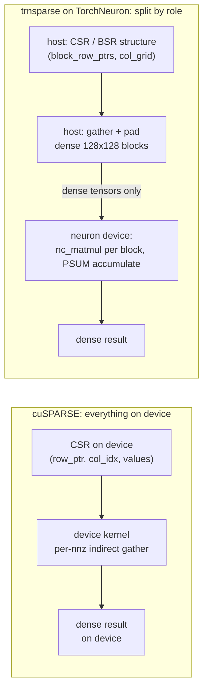

# trnsparse: from 14/30 to 30/30 on NKI 0.7

trnsparse's block-sparse attention and screened-SpMM kernels had run under `nki.simulate` for six months, then failed 16 of 30 hardware tests the first time they ran on the native `neuron` device under NKI 0.7.0. The fixes are small: a reciprocal-multiply where a divide used to be, an explicit partition broadcast, and two host-side gather bugs, one of which had been blamed on the simulator since April. The compile fixes say a lot about how the engines want per-row scalars and partition counts expressed. The branch passes 30/30 on Trn2. It sits in an open, unmerged PR, [trnsci/trnsparse#31](https://github.com/trnsci/trnsparse/pull/31), and anyone moving NKI 0.3-era kernels to the native PyTorch path should read it before starting.

<!-- more -->

## The problem

Neuron SDK 2.33.0 brings the TorchNeuron public beta (`torch-neuronx` 2.14.3, NKI 0.7.0, `neuronx-cc` 2.28.7631). Tensors live on a native `neuron` device rather than an XLA device. The suite-wide migration is tracked in [trnsci/trnsci#35](https://github.com/trnsci/trnsci/issues/35), and trnsparse's share of it is [trnsci/trnsparse#29](https://github.com/trnsci/trnsparse/issues/29).

The first experiment was deliberately lazy. The existing XLA-path hardware suite ran unchanged on a trn2.3xlarge. A test-only stand-in mapped the `torch_xla` device and sync calls onto the native device. The result was **14 passed, 16 failed**. Plain SpMM and BSR SpMM held parity. The failures landed in the code the earlier posts were proudest of: the two-pass block-sparse attention kernels from [the attention-mask post](https://trnsci.dev/blog/trnsparse-the-attention-mask-is-a-bsrmatrix/) and [the v0.6.0 post](https://trnsci.dev/blog/trnsparse-what-trainium-thinks-a-sparse-matrix-is/), and the fused Schwarz-screened SpMM. Fourteen were kernel compile failures. The other two, in the SpMM/BSR differentiability tests, were a host-side `float != double` mix.

The second problem is the one cuSPARSE users would hit first. cuSPARSE assumes the sparse matrix lives on the device: row pointers, column indices and values are all device arrays, and every routine takes device handles. TorchNeuron has no sparse CSR tensors on the `neuron` device ([trnsci/trnsparse#30](https://github.com/trnsci/trnsparse/issues/30)). A naive port that calls `.to("neuron")` on a `torch.sparse_csr_tensor` stops right there.

## What the architecture suggests

The three distinct compile errors from #29 read like a short manual for the NeuronCore datapath:

```
error: 'nisa.tensor_scalar_arith' op unsupported op0 'divide'
error: 'nisa.tensor_scalar_arith' op 'operand0' partition total elements 128 != 'dst' partition total elements 1
s3s3d3_tt_valid_op   (neuronx-cc ISA validation, tensor_tensor divide)
```

**A `(128, 1)` operand is a per-partition scalar.** Softmax normalisation divides a `(128, 128)` tile of exponentials by a `(128, 1)` row denominator. NKI lowers that to `tensor_scalar_arith`, the instruction form that broadcasts one value per partition along the free axis. In neuronx-cc 2.28 that form has no divide. The datapath supports reciprocal followed by multiply, and that is also the cheaper shape on paper: the denominator is constant across every K-block of a block-row, so 128 reciprocals per block-row replace a divide per element of every block. The trnrand work in #35 found the integer side of the same rules: `(P, 1)` tiles take a float-only path ([aws-neuron/aws-neuron-sdk#1308](https://github.com/aws-neuron/aws-neuron-sdk/issues/1308)), and integer `tensor_tensor` needs matching operand dtypes.

**Partitions are lanes, not a broadcast axis.** NumPy happily broadcasts `(128, 1) * (1, 128)` into an outer product. On a NeuronCore the first axis is the 128-lane partition dimension, and an instruction's operands and destination have to occupy the same partitions. A 1-partition operand cannot quietly fan out to 128 lanes inside an arithmetic instruction. The broadcast has to be its own step.

**Sparse structure does not need to be on the device at all.** The thesis of [the tile post](https://trnsci.dev/blog/trnsparse-the-tile-is-the-unit-not-the-nonzero/) was that the Tensor Engine consumes dense 128×128 tiles, so BSR at block size 128 is the native format. Followed to its end, that means the device never needs row pointers. It needs dense blocks, already gathered and padded into the shape `nc_matmul` consumes. The index metadata is a scheduling input, and scheduling already happens on the host.



## The approach

The fixes in PR #31 follow those three readings literally:

| Rule (NKI 0.7 / neuronx-cc 2.28) | Where it bit | Fix on `fix-29-nki07` |
|---|---|---|
| No `divide` in `tensor_scalar_arith` | softmax in `_attn_out_kernel`, `_attn_bwd_dq_kernel`, `_attn_bwd_dkdv_kernel` | `nl.multiply(exp, nl.reciprocal(row_denom))`, hoisted per block-row in forward and dQ |
| Operand/dst partition counts must match | `(128,1) * (1,128)` Schwarz outer product; `(1,1)` threshold | `nl.broadcast_to` to `(128,128)` and `(128,1)` |
| `tensor_tensor` divide fails ISA validation | screened-SpMM soft mask | reciprocal-multiply |
| No fp64 datapath; native device downcasts silently | PyTorch-level backward under fp64 gradcheck | kernels always get fp32; results cast back to caller dtype |

The deliberate tradeoff is in the fourth row. Hardware gradcheck tolerances moved from `eps=1e-6, atol=1e-4` to `eps=1e-2, atol=rtol=1e-2`. With an fp32 forward, an fp64-sized `eps` measures fp32 rounding, not the gradient. The ops are linear in each input, so the larger step adds no truncation error, and a wrong adjoint would still be off by O(1). The cost is that the tests now prove the adjoint is structurally right, not that it is accurate to fp64.

For sparse structure, #30 records the design rule and leaves the implementation open: CSR and BSR structure stays on the host, or travels as plain dense index and value tensors that trnsparse's own kernels consume, and never as `torch.sparse_csr_tensor` on `neuron`. The BSR and attention paths already work this way, since their host-side gather emits dense padded tensors.

## Implementation

The softmax change in `_attn_out_kernel` (diff from `git diff main...fix-29-nki07`):

```python
        for m in nl.affine_range(M_tiles):
            row_max_m = nl.load(row_max[m, :, :])  # (128, 1)
            row_denom_m = nl.load(row_denom[m, :, :])
+           # NKI 0.7: tensor_scalar_arith has no `divide`; multiply by the
+           # reciprocal of the (128, 1) softmax denominator instead.
+           row_denom_inv_m = nl.reciprocal(row_denom_m)
            ...
            for ki in nl.affine_range(K_max):
                ...
                stable = nl.subtract(score, row_max_m)
-               weights = nl.divide(nl.exp(stable), row_denom_m)
+               weights = nl.multiply(nl.exp(stable), row_denom_inv_m)
```

The partition-count fix in `_screened_spmm_kernel`:

```python
+       # threshold_sqrt is a (1, 1) HBM tensor. NKI 0.7 rejects a 1-partition
+       # scalar operand against a 128-partition tile, so broadcast it to a
+       # (TILE_M, 1) per-partition scalar once, up front.
+       thr = nl.broadcast_to(nl.load(threshold_sqrt), shape=(TILE_M, 1))
        ...
                    q_k = nl.load_transpose2d(q[k_off : k_off + TILE_K, :])  # (1, TILE_K)
-                   pair_bound = nl.multiply(q_m, q_k)
+                   q_k_b = nl.broadcast_to(q_k, shape=(TILE_M, TILE_K))
+                   pair_bound = nl.multiply(q_k_b, q_m)
-                   relu_diff = nl.relu(nl.subtract(pair_bound, threshold_sqrt))
-                   mask_f = nl.divide(relu_diff, nl.add(relu_diff, 1e-10))
+                   relu_diff = nl.relu(nl.subtract(pair_bound, thr))
+                   mask_f = nl.multiply(relu_diff, nl.reciprocal(nl.add(relu_diff, 1e-10)))
```

After the broadcast, the multiply is a plain `(P, F) × (P, 1)` tensor-scalar op, which is the form the instruction supports. The full diff, including the new [`tests/test_nki_compile.py`](https://github.com/trnsci/trnsparse/blob/fix-29-nki07/tests/test_nki_compile.py), is on [PR #31](https://github.com/trnsci/trnsparse/pull/31).

## What didn't work

**The simulator was the wrong gate.** Every one of these kernels passed `nki.simulate`. The simulator does not run the MLIR verifier, so a kernel can pass the whole simulator suite and still fail to compile. `nki.compiler.frontend.source_to_mlir(...).verify()` catches the first two errors on a CPU host with no device. It does not catch the third: a `tensor_tensor` divide passes `verify()` and fails later, in neuronx-cc's ISA validation. Getting full coverage takes a ladder of checks:

| Check (CPU unless noted) | Catches | Misses |
|---|---|---|
| `nki.simulate` | Python-layer and shape errors | all three compile errors above |
| `source_to_mlir(...).verify()` | `tensor_scalar_arith` divide, partition-count mismatch | `s3s3d3_tt_valid_op` |
| Full NEFF compile (`neuronx-cc` on PATH) | ISA validation | numeric bugs |
| neuronx-cc BIRSim (trn2) | the 49% forward mismatch, bit-for-bit | screened SpMM (exit code 70, see below) |
| Trn2 hardware | everything that remains | — |

`test_nki_compile.py` now runs the verify and NEFF steps for every kernel on both trn1 and trn2 targets: 60/60 on CPU at 60faa05.

**Five failures survived the compile fixes, and they were trnsparse's bugs.** At 60faa05, the hardware run was 25/30. All five remaining failures were numeric and all were in attention. The local-window forward and head_dim 256 forward had about 49% of elements mismatched. Backward local, backward dilated and head_dim 256 backward had about 99%. The investigation in #29 routed the device path through neuronx-cc's BIRSim for trn2 on a CPU host. `test_local_window_parity` reproduced exactly: 15,954 of 32,768 elements wrong, max abs error 0.2599. The backward failures also reproduced under `nki.simulate`. With hand-built inputs, the dQ kernel matched a NumPy reference under BIRSim to 4.8e-6. That cleared the kernels and the 0.7 rewrites, and pointed at the host-side gather. Two bugs were sitting there, older than the branch and hidden on hardware behind the compile failures:

1. **Padded k-slots.** Rows with fewer than `K_max` blocks are padded with sentinel slots, and those slots gathered column block 0. Block 0 then leaked into the softmax and `weights @ V` of every padded row. With a local window of 2 across four block-rows, rows 0 and 3 are padded, which accounts for the ~49%. Dilated and global masks have no padding, which is why they passed. The fix zeroes K/V (or Q/dO) in padded slots and drops their stats from `_attn_host_reduction`.
2. **dO gathered by column.** `_attn_bwd_gather` gathered `dO` by column block when `dP = dO_m @ V_ki.T` needs the row block `dO_m`. dQ was wrong whenever a row attended to any block other than its own. dK and dV were already correct.

The second bug has history. The [v0.6.0 post](https://trnsci.dev/blog/trnsparse-what-trainium-thinks-a-sparse-matrix-is/) reported a "dQ backward systematic error in the simulator" and guessed at floating-point reordering. [trnsci/trnsparse#28](https://github.com/trnsci/trnsparse/issues/28) went further and filed it as a simulator PSUM-accumulate bug. Both were wrong. The two xfails it explained were this gather bug, and on the fix branch they pass. A third host-side bug, fixed earlier at 60faa05, was in the same family: the `ndim <= 3 and shape[-1] == b` heuristic that picks which backward stats to unsqueeze also matched Q/K/V whenever `head_dim == 128`. Stats are now selected by name. New CPU regression tests in `tests/test_attn_gather.py` pin both gather bugs.

**fp64 is downcast silently.** On the native device, fp64 operands reach the kernel as fp32 and come back as fp32, with no warning. The host-side backward then mixed float and double. The dispatch layer now casts explicitly in both directions.

**An unexplained harness gap.** Screened-SpMM tests fail under BIRSim with `neuronx-cc compilation failed with exit code 70`, although the plain NEFF compile passes and the tests pass on Trn2. It is treated as a BIRSim harness limitation and has not been investigated.

**Fit.** Block-structured sparsity fits this design well: once structure is on the host, the device workload is dense tiles and PSUM accumulation, which is what Trainium was built for. Irregular CSR fits less well than before. With no device CSR, the CSR SpMM path builds its operands on the host and ships dense data across. Sparse structure that changes on the device, as in iterative pruning or graph rewiring, would need a host round trip. Under `torch.compile(backend="neuron", fullgraph=True)`, no trnsparse op worked in the B6 coverage spike, because the inputs were device CSR. A re-run is on #30's checklist.

**Upstream asks.** Both are filed: [aws-neuron-sdk#1442](https://github.com/aws-neuron/aws-neuron-sdk/issues/1442) (sparse CSR on `neuron`) and [aws-neuron-sdk#1443](https://github.com/aws-neuron/aws-neuron-sdk/issues/1443) (simulator and `verify()` parity with the hardware compile).

- **Sparse CSR on `neuron`.** `aten::_to_dense` and `aten::addmv.out` have no `SparseCsrneuron` implementation, and `from_dense` on a device tensor fails with `Values and crow_indices need to be on the same device`. Either kernels, or a documented host fallback with an error that says so.
- **Simulator parity with the hardware verifier.** An `nki.simulate` option that runs `source_to_mlir(...).verify()`, and ideally ISA validation, would have flagged every kernel behind the 14 compile failures before any hardware time.
- **A hint in the divide error.** `unsupported op0 'divide'` could name the reciprocal-multiply form.

## Numbers

All runs on trn2.3xlarge (LNC=2), Neuron SDK 2.33.0, `torch-neuronx` 2.14.3, NKI 0.7.0, native `neuron` device via the test stand-in. Hardware suite (`pytest -m neuron`, 30 tests):

| Head | Passed | Failed | Failure class |
|---|---:|---:|---|
| `main` | 14 | 16 | compile errors (14), host fp32/fp64 mix (2) |
| `60faa05` (compile + dtype fixes) | 25 | 5 | numeric, attention gather |
| `d41b0fa` (gather fixes) | **30** | 0 | — (passed on two separate runs) |

The five numeric failures at 60faa05:

| Test | Mismatched elements | Cause |
|---|---:|---|
| `test_local_window_parity` | ~49% (15,954 / 32,768 under BIRSim) | padded k-slots |
| `test_forward_head_dim_256` | ~49% | padded k-slots |
| `test_bwd_local_parity` | ~99% | dO gathered by column |
| `test_bwd_dilated_parity` | ~99% | dO gathered by column |
| `test_backward_head_dim_256` | ~99% | dO gathered by column |

Other checks from the same window:

| Check | Result |
|---|---|
| Benchmarks, native device | 186/186 on `main` and on 60faa05 |
| SpMM shape sweep, host-resident CSR, n ∈ {1, 7, 127, 128, 129, 255, 257, 1000, 4097} | 9/9 (with device CSR: errors) |
| Cross-core determinism (`spmm`, `spmv`, `bsr_spmm` among the suite's 20 ops) | bit-identical |
| LNC=1 vs LNC=2 at 60faa05 | identical results (25/5) |
| CPU: MLIR verify + NEFF compile at 60faa05 | 60/60 |
| CPU: `pytest -m "not neuron"` at d41b0fa | 79 passed |

These are correctness results. The benchmark timings from that run aren't published in the issue threads, so none are quoted here. The performance comparison against scipy from [the tile post](https://trnsci.dev/blog/trnsparse-the-tile-is-the-unit-not-the-nonzero/) still stands as the last published one.

## What's next

- [trnsci/trnsparse#29](https://github.com/trnsci/trnsparse/issues/29): native dispatch. Remaining items are `nki_op` registration and moving the autograd wrappers to `register_autograd`. PR #31 awaits review.
- [trnsci/trnsparse#30](https://github.com/trnsci/trnsparse/issues/30): host-structure API for device dense operands, docs, and the compile-coverage re-run.
- [trnsci/trnsparse#28](https://github.com/trnsci/trnsparse/issues/28): to be re-scoped now that the two xfails are explained.
- [Phase 3: #15](https://github.com/trnsci/trnsparse/issues/15) nnz-bucketing SpMM and streaming; [#22](https://github.com/trnsci/trnsparse/issues/22) on-chip iterative solvers over BSR.
- [Phase 4: #16](https://github.com/trnsci/trnsparse/issues/16) sharded sparse matrices. The multi-rank `nki.collectives` results in #35 are its first prerequisite.
- [Phase 5: #17](https://github.com/trnsci/trnsparse/issues/17) trn2 DMA bandwidth for SpMM.

Suite context: [roadmap](https://trnsci.dev/roadmap/), [suite tracker](https://github.com/trnsci/trnsci/issues/1), [trnsci.dev](https://trnsci.dev).

## Takeaway

NKI 0.7's compile rules are not arbitrary strictness. They describe the datapath. A `(128, 1)` tensor is a per-partition scalar, the scalar form multiplies but does not divide, and partitions are lanes that have to line up. Writing kernels in that vocabulary (reciprocal once per block-row, broadcasts made explicit) is closer to what the hardware does than the NumPy-shaped code it replaced. The same reading extends to the data structure. If the Tensor Engine only ever sees dense 128×128 tiles, then the sparse pattern belongs with the scheduler on the host, and TorchNeuron's lack of device CSR costs BSR almost nothing.
