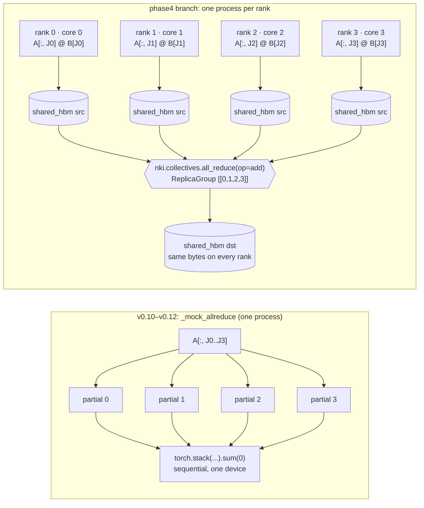

# trntensor: the mock all-reduce meets four real ranks

trntensor's reduce-parallel einsum now sums its partials with a real multi-rank all-reduce, either `torch.distributed` or an NKI `nki.collectives.all_reduce` kernel, across all four logical NeuronCores of one trn2.3xlarge, in three stacked PRs that are not yet merged, and the first write-up of the four-rank result claimed a bit-exactness it didn't have. Architecturally, the collective is an instruction inside an NKI kernel operating on HBM rather than a library beside the compute, and the rules it enforces (which cores may form a group, which HBM buffer type returns correct values) expose the chip's topology. Anyone planning multi-core contractions on Trainium, or arriving from NCCL, will want those rules before writing a launcher.

<!-- more -->

## The problem

The [v0.10.0 post](2026-04-21-trntensor-test-surface-names-the-interface.md) introduced `_mock_allreduce`, a named CPU stand-in that let reduce-parallel sharding run in CI. Reduce-parallel means the sharded dimension is a contracted index, so every shard produces a partial of the full output and the partials have to be summed. The [v0.12.0 post](2026-04-22-trntensor-mixed-sharding.md) added mixed output- and reduce-parallel dispatch on top of the same mock. Both posts ended the same way: on hardware, `HAS_NKI=True` raised `NotImplementedError` pointing at "`nki.collectives`, Neuron SDK 2.30+," and the swap was promised as "one function call."

On NVIDIA, the cuTENSOR family splits this work between two products. cuTENSORMg handles distributed contractions, and NCCL is the communication layer under most multi-GPU code. A direct port would treat the all-reduce as an external library call made between kernels on a separate communicator. The awkward part on Trainium is that no such separate library exists to call. The collective is something an NKI kernel issues itself.

There was a second, less glamorous problem. A reduce-parallel result is only as trustworthy as each rank's single-core result, and the same hardware window that produced the collectives data also found two precision promises trntensor was not keeping (below). Those fixes come first in the PR stack, and the collective work sits on top of them.

## What the architecture suggests

`nki.collectives.all_reduce(srcs, dsts, replica_group, op)` is called from inside an `@nki.jit` kernel. Its operands are HBM tensors, and the transfer is carried out by the device's own DMA and collective-communication machinery, not by a host-side library. Each rank is a separate process pinned to one logical core, and every rank compiles the same NEFF. In other words, the collective is just another instruction in the kernel's DAG, with HBM as the meeting point.



Two constraints follow from this design, and both turned out to be physical rather than API trivia. Replica groups have to match the hardware's pairing of cores: cores 0–1, 2–3 and 0–3 form groups, and 1–2 does not. Buffer placement also matters. At LNC=2 each logical core is two physical cores, and `shared_hbm` buffers reduce correctly while `private_hbm` buffers do not. A GPU programmer reaches for a communicator and a stream. On Trainium the questions are which cores the collective hardware can join and which HBM the kernel is allowed to name.

## The approach

The design keeps one rule from the mock era: the einsum dispatch does not know which all-reduce it is using. `_execute_sharded` now hands a `compute_partial(i)` callable to `reduce_partials`, which picks a backend:

| Backend | When `auto` picks it | Who computes what |
|---|---|---|
| `mock` | no process group, `world_size == 1`, or `n_shards != world_size` | every partial, in this process, summed by `_mock_allreduce` |
| `torch` | multi-rank group with any non-`neuron` c10d backend (e.g. gloo) | rank *r* computes shard *r*; `torch.distributed.all_reduce(SUM)` |
| `nki` | multi-rank `"neuron"` process group | rank *r* computes shard *r*; `nki.collectives.all_reduce(add)` on `shared_hbm` |

`TRNTENSOR_ALLREDUCE=mock|torch|nki|auto` or `set_allreduce_backend()` overrides the choice.

The deliberate tradeoff is that an explicit `torch` or `nki` request that cannot be honored raises `RuntimeError` instead of falling back. A silent fallback to `mock` under a multi-rank group would have every rank compute every shard. The answer would still be correct, but all the cost of distribution would be paid for none of the benefit, and nothing would look wrong. The library also requires `world_size == n_shards`, so shard *r* always belongs to rank *r*. Supporting more shards than ranks would be more flexible, but it would add a scheduling layer that nothing in Phase 4 needs yet.

The `torch` backend stays even though `auto` prefers `nki`. It is the baseline the NKI kernel is checked against, and it is the path that runs under gloo in the CPU pre-flight.

## Implementation

The collective kernel, from [`trntensor/nki/collectives.py`](https://github.com/trnsci/trntensor/blob/phase4-reduce-parallel-collectives/trntensor/nki/collectives.py):

```python
@nki.jit
def trntensor_all_reduce_add(x, replica_group):
    src = nl.ndarray(x.shape, dtype=x.dtype, buffer=nl.shared_hbm, name="trntensor_ar_src")
    dst = nl.ndarray(x.shape, dtype=x.dtype, buffer=nl.shared_hbm, name="trntensor_ar_dst")
    out = nl.ndarray(x.shape, dtype=x.dtype, buffer=nl.shared_hbm)
    nisa.dma_copy(dst=src, src=x)
    ncc.all_reduce(srcs=[src], dsts=[dst], replica_group=replica_group, op=nl.add)
    nisa.dma_copy(dst=out, src=dst)
    return out

# invoked per rank:
y = wrap_nki(_kernel)[(lnc,)](x, ReplicaGroup([list(range(world))]))
```

Backend resolution and the rank-local split, from [`trntensor/parallel.py`](https://github.com/trnsci/trntensor/blob/phase4-reduce-parallel-collectives/trntensor/parallel.py):

```python
def reduce_partials(compute_partial, n_shards):
    backend = allreduce_backend(n_shards)
    if backend == "mock":
        return _mock_allreduce([compute_partial(i) for i in range(n_shards)])
    import torch.distributed as dist

    local = compute_partial(dist.get_rank())
    if backend == "torch":
        return _dist_allreduce(local)
    from .nki.collectives import nki_all_reduce_sum

    return nki_all_reduce_sum(local)
```

[`scripts/run_reduce_parallel_multirank.py`](https://github.com/trnsci/trntensor/blob/phase4-reduce-parallel-collectives/scripts/run_reduce_parallel_multirank.py) launches its own workers. It sets `NEURON_RT_VISIBLE_CORES` before torch is imported, then calls `init_process_group("neuron")`, and it refuses unaligned layouts before anything compiles:

```python
if not _CPU and not args.allow_unaligned:
    for w in worlds:
        if w > 1 and args.core_start % w != 0:
            sys.exit(
                f"cores {args.core_start}-{args.core_start + w - 1} are not an aligned "
                f"{'pair' if w == 2 else 'group'} (core_start % world != 0); replica groups "
                "like cores 1-2 fail ('no_hier no_mesh'). Use --core-start "
                f"{args.core_start - args.core_start % w} or --allow-unaligned."
            )
```

That check exists because the runtime's own message did not explain the problem (below).

## What didn't work

**Waiting for a primitive that already existed.** The v0.9–v0.12 gate said `nki.collectives` would arrive in SDK 2.30. A spike on 2.30 found that, per the NKI release notes, it had been there since NKI 0.2.0. The function is also `all_reduce(srcs, dsts, replica_group, op=nl.add)`, not `allreduce(list, op=SUM)`. The v0.12.0 post's upstream ask was a request to make the real API match a guess. The first single-rank `all_reduce` kernel then failed with a tracing error. The working form needed a genuine multi-process replica group, plus three rules now recorded in the kernel's docstring: collectives cannot read or write kernel IO tensors (hence the two `dma_copy` calls), collective buffers need `name=` (otherwise `NCC_IBIR440`), and every rank must pass an identical shape and dtype.

**`private_hbm` returns wrong values at LNC=2.** At both 2 and 4 ranks, the `private_hbm` src/dst all-reduce failed on every rank, even though the NKI docstring says either buffer type is allowed at LNC=2. `shared_hbm` is bit-exact.

**The unaligned-group error names the wrong coordinates.** Ranks on cores 1–2 fail at process-group setup with:

```
ENC:enc_init_comm failed to init a collective algorithm. reason: no_hier no_mesh replica-group:[0,1]
```

The group it reports is `[0,1]`, the rank IDs, while the problem is the physical placement on cores 1 and 2. Nothing in the message says that the pair straddles an alignment boundary, which is why the launcher now checks `core_start % world` itself and quotes the failure in its own error.

**The world-4 note overclaimed.** The first world-4 comment on [trntensor#30](https://github.com/trnsci/trntensor/issues/30) reported each result as "bit-exact to the fixed-order host reduction." It was not: `bitexact[fixed_order=False]` was in the log. At two ranks the collective's sum and the sequential sum `p0 + p1` are the same operation. At four ranks the collective most likely associates as `(p0+p1)+(p2+p3)` while the reference computes `((p0+p1)+p2)+p3`, so the last bits differ. The [structural-determinism principle](../../trainium_positioning.md#4-determinism-is-structural) survives in a narrower form. Results are reproducible run to run and rank to rank, and they match a serial reference bit for bit only at two ranks or fewer. The follow-up is to make the reference use the collective's tree order rather than to loosen the claim further.

**Precision promises found on the same window.** On NKI 0.7, per-call `use_sr` is a no-op ([trntensor#41](https://github.com/trnsci/trntensor/issues/41)). Stochastic rounding is process-wide, controlled by `NEURON_RT_STOCHASTIC_ROUNDING_EN=1` and read once at runtime init, with round-to-nearest-even as the default. So `precision="sr"` silently did no stochastic rounding, and with the variable set, every downcast in the process becomes stochastic. It now warns once when the variable is missing. Separately, `target_forward_error` accepted targets below output roundoff, and `precision="kahan"` was not really fp64 on the device, which has no fp64 datapath ([trntensor#42](https://github.com/trnsci/trntensor/issues/42)). Both are fixed and quantified below.

**One honest suite failure.** The native-device suite is 17/18. The failure is `test_matmul_stays_on_xla` (`expected xla, got neuron:0`). The test stand-in maps the old XLA device to `neuron`, and the `to_xla()`/`from_xla()` helpers it exercises are slated for deprecation. It reflects the harness, not the numerics.

**Fit.** All four logical cores of one chip share one chip's HBM, so on this instance sharding adds no memory capacity, and no sharded-versus-single-device timing at these sizes has been broken out yet. The case Phase 4 actually targets, THC/Tucker tensors larger than one chip's HBM, needs a trn2.48xlarge or an UltraServer, and neither was available. These results are a correctness milestone, not a scaling result. The communication-free contrast is the suite's data-parallel check (B8), which reached 3.99× aggregate throughput with four independent copies.

**Upstream asks for the Neuron team:**

1. Document `private_hbm` collective semantics at LNC=2. Either it should work as the docstring says, or the docstring should say it does not.
2. Document the replica-group alignment rules (which core pairs and quads are legal at LNC=1 and LNC=2).
3. Make `enc_init_comm` say *why* a group is rejected, and report physical cores alongside rank IDs.

## Numbers

All runs used trn2.3xlarge, Neuron SDK 2.33.0 (TorchNeuron public beta, torch-neuronx 2.14.3, NKI 0.7.0, neuronx-cc 2.28.7631) and the native `neuron` device, at LNC=2 unless stated.

**B4 collectives spike** ([trnsci#35](https://github.com/trnsci/trnsci/issues/35), [`spike_collectives_multirank.py`](https://github.com/trnsci/trnsci/blob/spikes/torchneuron-sdk233/scripts/spike_collectives_multirank.py)):

| Case | 2 ranks | 4 ranks |
|---|---|---|
| `all_reduce` add / max, `all_gather`, `reduce_scatter` (`shared_hbm`) | bit-exact, every rank | bit-exact, every rank |
| `torch.distributed` `neuron` backend baseline | bit-exact | bit-exact |
| `all_reduce` with `private_hbm` src/dst | FAIL, all ranks | FAIL, all ranks |
| Replica group on cores 0–1 / 2–3 / 0–3 | works | works (0–3) |
| Replica group on cores 1–2 | setup error (`no_hier no_mesh`) | — |

**Reduce-parallel einsum** (`ij,jk->ik`, fp32, `j` sharded, n = 512 / 1024 / 2048, commit `6dcaa8b`; error is relative Frobenius vs an FP64 host reference):

| World | Backends passing | Ranks agree | Bit-exact vs sequential sum | Error vs FP64 (sharded) | Error vs FP64 (single rank) |
|---|---|---|---|---|---|
| 1 (mock) | mock | — | bit-identical to single-process | — | — |
| 2 (cores 0–1) | auto, torch, nki | yes | yes | 1.22e-7 – 1.38e-7 | 1.25e-7 – 1.53e-7 |
| 4 (cores 0–3) | auto, torch, nki | yes | no: max diff 7.6e-6 (n=512), 1.5e-5 (n=1024/2048) | 1.22e-7 – 1.30e-7 | 1.25e-7 – 1.53e-7 |

At world 4, `torch` and `nki` give the same error vs FP64 at every size. Job wall time was 16 s with `nki` and 28 s with `torch`. That covers all three sizes, including process startup and NEFF compilation. It has not been broken down further, so it should not be read as a kernel-level comparison.

**Precision fixes** (#41, #42):

| Check | Before | After |
|---|---|---|
| `precision="sr"`, variable unset | round-to-nearest, silently | round-to-nearest, one-time `RuntimeWarning` |
| `precision="sr"`, `NEURON_RT_STOCHASTIC_ROUNDING_EN=1` at start | — | SR hardware tests 2/2 pass |
| `kahan` fp32 componentwise error, N=128 / 256 | 8.4e-8 / 6.5e-8 (bound 5.96e-8) | 2.4e-8 / 1.4e-8 (and 1.2e-8 / 1.1e-8 at 512 / 1024) |
| Bounds used by `select_precision_for_error` | accumulation term only | accumulation + output floor u_out (bf16 3.9e-3, fp32 6.0e-8) |
| `pytest -m neuron` | 10 passed / 8 failed | 17 passed / 1 failed (stand-in artifact) |

At LNC=1 (8 logical cores), the trntensor suite matched LNC=2, and the suite's 20 determinism ops were bit-identical across the two LNC settings.

## What's next

- **Merge the stack**: [trntensor#43](https://github.com/trnsci/trntensor/pull/43) (NKI 0.7 fixes, SR warning) → [#44](https://github.com/trnsci/trntensor/pull/44) (honest bounds, host fp64 for kahan) → [#45](https://github.com/trnsci/trntensor/pull/45) (reduce-parallel on a real all-reduce). All three are open for review.
- **Phase 4 — sharded contractions across chips** ([trntensor#30](https://github.com/trnsci/trntensor/issues/30)): multi-chip reduce-parallel on trn2.48xlarge or an UltraServer, a tree-order fixed reference, and sharded CP/Tucker.
- **Phase 5 — trn2 fused multi-contraction paths** ([trntensor#31](https://github.com/trnsci/trntensor/issues/31)).
- **Sibling work**: the same launch pattern is the prerequisite for trnfft's multicore collectives, which would extend the batch-split design in [the NeuronCore is the unit of parallelism](2026-04-30-trnfft-multicore-batch-split.md).

Hardware-window record: [trnsci#35](https://github.com/trnsci/trnsci/issues/35). Live roadmap: [trnsci.dev/roadmap/](https://trnsci.dev/roadmap/). Suite tracker: [trnsci/trnsci#1](https://github.com/trnsci/trnsci/issues/1).

## Takeaway

The "one function swap" promised in v0.12.0 held at the dispatch layer: `_execute_sharded` changed by one call, and the mock still runs in CI. Underneath, the swap brought in topology. On Trainium the all-reduce is an instruction inside an NKI kernel, operating on HBM buffers the kernel names, within replica groups the core layout allows. That is why the useful rules are about alignment and buffer placement, not communicators. Determinism holds as reproducibility across runs and ranks, and as bit-identity to serial order only up to two ranks.
