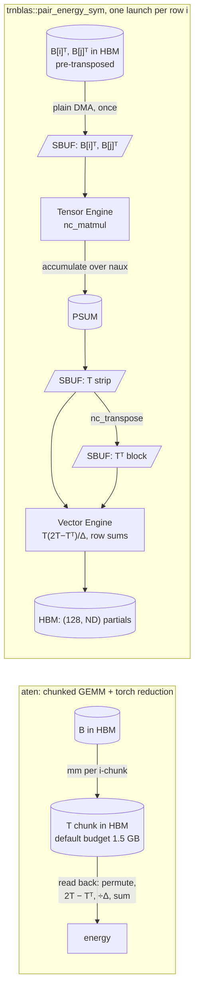

# trnblas: the 92× that was 1.8×, and the DF-MP2 win that holds up

trnblas published a 92× speedup for its fused pair-energy kernel on Trn2, and it was wrong: the aten baseline had slowed because device memory was filling up, and against a fair baseline the kernel is 1.8× faster. What survives is narrower and more useful. GEMM routes to aten, a fused kernel keeps the energy step where it avoids work aten can't, and the metric Cholesky moves to the host, which makes density-fitted MP2 1.1–1.8× faster than aten on the molecules where the device beats the CPU at all. The post is for anyone benchmarking TorchNeuron eager code, and for chemists deciding which DF-MP2 stages belong on Trainium.

<!-- more -->

## The problem

DF-MP2 is trnblas's flagship workload. On CUDA it is a cuBLAS story: three-index transforms, a metric contraction and a pair-energy reduction, all GEMMs with elementwise work bolted on. The [odd-shape cliff post](https://trnsci.dev/blog/trnblas-the-odd-shape-cliff-that-wasnt/) ended with a warning sign: on the native TorchNeuron `neuron` device, aten's own `matmul` beat the trnblas NKI GEMM at every size measured.

[trnblas#55](https://github.com/trnsci/trnblas/pull/55) measured that properly. All runs were on a trn2.3xlarge with the public Neuron SDK 2.33.0 (torch-neuronx 2.14.3, NKI 0.7.0, neuronx-cc 2.28.7631), restricted to one LNC=2 logical core (`NEURON_RT_VISIBLE_CORES=1`), in fp32. aten was 2.4–3.2× faster than the NKI GEMM at every shape, including the DF-MP2 energy chunk (12928×1536×28672: 32.2 ms against 77.5 ms). The older fused energy kernels did worse. `batched_pair`, the subject of the [batched pair energy post](https://trnsci.dev/blog/trnblas-phase-3-from-215-slower-to-36-faster-in-one-kernel-boundary-move/), took 7.8 s against aten's 207 ms at nocc/nvir/naux = 64/448/1536. That post's 3.6× was a win over the XLA path's roughly 100 ms dispatch floor. On the native device the floor is about 0.2 ms, and two GEMMs per pair through `load_transpose2d` have nowhere to hide.

So: what is a cuBLAS-equivalent for, when the framework's own GEMM is faster?

## What the architecture suggests

On Trn2 the suite-wide answer is that hand-written kernels win where they avoid work aten can't, not on raw GEMM. For DF-MP2 that points at the energy step. aten evaluates it as a chunk of `T = B[i] B[j]ᵀ`, written to HBM, then read back for the `T(2T − Tᵀ)/Δ` reduction. An NKI kernel can keep T on-chip:

- **SBUF holds the operands and T.** B is pre-transposed on the host, so every load is a plain DMA with no `load_transpose2d`. B[i]ᵀ and B[j]ᵀ are loaded once and stay resident in SBUF. The kernel's live set is budgeted at 144 KiB of Trn2's 192 KiB per partition.
- **PSUM accumulates over naux.** Each 128-row strip of T fills a fresh PSUM tile, and the result is copied into SBUF.
- **The Tensor Engine does the transpose.** Tᵀ blocks come from `nc_transpose` of the SBUF-resident T, which is bit-exact on NeuronCore-v3. That replaces the second GEMM the old kernel ran per pair.
- **An LNC=2 logical core is two physical cores.** A one-program kernel uses half the silicon aten uses. The pair window should split across both.
- **Pair symmetry is free to exploit.** Because e_ij = e_ji, row i only needs j = i+d (mod nocc) for d = 0..nocc/2.



The other half of the answer is less glamorous: the host is a resource too. The metric J is naux×naux, 71 to 555 on the molecules measured. On the device its factorization is an aten Cholesky plus a triangular solve, a chain of small ops that each pay launch and sync costs. A float64 LAPACK call on the host, with one copy each way (20 KB at naux 71), can beat that, and is more accurate.

## The approach

trnblas now routes each DF-MP2 stage by where its operands live and how much work each launch carries:

| stage (native path, device-resident inputs) | runs on | switch |
|---|---|---|
| plain GEMM family (`gemm`, `batched_gemm`, `syrk`, `trsm` trailing updates) | aten | `TRNBLAS_NATIVE_GEMM=auto\|nki` |
| metric factor X = L⁻ᵀ (`metric_inv_half`) | host fp64 LAPACK if naux ≤ 1024, device otherwise | `TRNBLAS_METRIC_SOLVE=auto\|host\|device` |
| pair energy (`nki_batched_pair_energy`) | `pair_energy_sym` at ≥ 3 GFLOP per row launch and within the SBUF budget, aten below | `TRNBLAS_PAIR_ENERGY=auto\|sym\|aten\|legacy` |

Host tensors, the Trn1 XLA path and the simulator are unchanged.

**One launch per occupied row.** The sym kernel launches nocc times, so it pays nocc launch floors. That is why aten wins below the threshold: at 16/128/384, aten takes 1.9 ms and the kernel 5.5 ms. But the single-launch version compiled for 734 s at 64/448/1536, against 3–45 s per row launch. Compile time won.

**The metric threshold sits at the tie, not the speed optimum.** At naux 1024 the routes measured 38.9 and 40.2 ms (42.6 and 43.2 on a repeat). The host route's residual max|XᵀJX − I| is 100–300× smaller, and it never compiles; the device route compiles for 33–210 s per new naux at 1024–6144.

**The threshold assumes two host threads.** Every host number was measured on 2 cores pinned with `taskset -c 4,5`. More cores would move the crossover up; that hasn't been measured.

The GEMM routing decision shipped in [trnblas v0.7.0](https://github.com/trnsci/trnblas/tree/v0.7.0). The host metric factor ([trnblas#57](https://github.com/trnsci/trnblas/pull/57)) and the LNC=1 fix ([trnblas#58](https://github.com/trnsci/trnblas/pull/58)) are on `main`, in the upcoming v0.8.0.

## Implementation

The GEMM routing rule is short:

```python
# excerpt from trnblas/nki/dispatch.py
def _gemm_via_aten(*tensors: torch.Tensor) -> bool:
    """True when a plain GEMM on these operands should run as aten on the device."""
    if _use_simulator() or not _on_neuron_device(*tensors):
        return False
    return _native_gemm_policy() == "auto"
```

Inside `_pair_energy_sym_kernel`, the core split and the Tensor Engine transpose look like this:

```python
# excerpt from trnblas/nki/dispatch.py, _pair_energy_sym_kernel
n_prog = nl.num_programs() if nl.program_ndim() > 0 else 1
if ND % n_prog != 0:  # ND is even, so this only guards n_prog > 2
    n_prog = 1
pid = nl.program_id(0) if n_prog > 1 else 0
NJ = ND // n_prog
...
                    # T.T[a-strip, b-strip] = (T[b-strip, a-strip]).T
                    ptt = nl.ndarray((TILE, TILE), dtype=nl.float32, buffer=nl.psum)
                    nisa.nc_transpose(
                        dst=ptt, data=t_all[0:TILE, b * NVIR + a_off : b * NVIR + a_off + TILE]
                    )
                    tt = nl.ndarray((TILE, TILE), dtype=nl.float32, buffer=nl.sbuf)
                    nisa.tensor_copy(src=ptt, dst=tt)
                    t = t_all[0:TILE, a * NVIR + b_off : a * NVIR + b_off + TILE]
```

The host metric factor has two details that decide whether it is faster at all:

```python
# excerpt from trnblas/nki/dispatch.py, _host_inv_chol_factor
Jd = J.detach().to(device="cpu", dtype=torch.float64)
L, info = torch.linalg.cholesky_ex(Jd)
...
# solve_triangular returns a column-major result; make it row-major on the
# host. Uploading the strided tensor costs ~3.8 ms at naux 71 on trn2
# (the device materialises the layout), against 0.06 ms contiguous.
return torch.linalg.solve_triangular(L.T, eye, upper=True).contiguous()
```

The other detail is in the docstring: torch's own LAPACK, not SciPy's, because a second BLAS thread pool on 2 pinned cores made the interleaved torch LAPACK calls several times slower.

## What didn't work

**The 92×.** #55 measured aten's chunked energy at 96/672/2304 at 63.0 s, against 0.69 s for the sym kernel. It suggested 672 = 5.25×128 as the cause and flagged the number as "pathological" and "worth a TorchNeuron repro". Then it published 92× anyway: in the PR's verdict, in a [trnblas#50](https://github.com/trnsci/trnblas/issues/50) summary and in the v0.7.0 CHANGELOG. An aten time 300× the one a row above it, for 2.5× the work per row, should have been checked before it went anywhere.

Torch-only repros in #57 cleared 672 (chunk GEMMs at 640, 704 and 768 took 39–55 ms, with no 672 effect), slicing and sync placement. What reproduced the slowdown was holding memory on the 24 GB logical core:

| tensors already held on the logical core | warm 12-chunk aten loop at 96/672/2304 |
|---|---|
| 0 GB | 1.22 s |
| 8 GB | 1.22 s |
| 10 GB | 35 s |
| 14 GB | 64 s |
| 18 GB | about 5 min, then `Failed to load model, Invalid NEFF, instruction, or input` |

#57 attributes #55's 63 s to that 10–14 GB band, which is what a full 768/96/2304 DF-MP2 working set occupies. Against the fair 1.22 s the sym kernel is **1.8×** faster. The code comment, `docs/benchmarks.md`, the CHANGELOG and the [suite tracker](https://github.com/trnsci/trnsci/issues/35) now carry it. The 1.34× end-to-end result at 512/64/1536 was never affected.

One footnote: part of the kernel's real advantage is that it never writes T to HBM, so the pressure doesn't reach it. A full 768/96/2304 DF-MP2 run takes 25.0 s on aten with the default 1.5 GB chunk budget, 1.55 s with 0.75 GB chunks, and 948 ms on trnblas. Quoting 26× would repeat the mistake; the fair figure is 1.6×. Shrinking the aten fallback's default budget is an open follow-up, because it changes the baseline.

**A faster NKI GEMM that still loses.** A spike launched the same GEMM loop as an LNC=2 grid with a pre-transposed A. It came within 8–15% of aten at 2048³ and above (4096³: 4.71 against 4.09 ms; energy chunk: 34.8 against 32.2 ms). So the one-program launch and the DMA transposes were most of the gap. The spike didn't ship: closing most of a gap still leaves a loss.

**`kernel[2]` at LNC=1.** The sym kernel first launched as an explicit two-program grid, which fails at LNC=1:

```
NKI kernel '_pair_energy_sym_kernel' is configured with LNC=2, but neuronx-cc is using LNC=1.
... Remove any bracket syntax from NKI kernel calls (for example, kernel[2](...)); this is being deprecated.
```

For once the error message said exactly what to do. #58 launches the kernel gridless and splits by `nl.num_programs()`, the same pattern [trnrand](https://github.com/trnsci/trnrand) adopted in trnrand#66. Timing nearly doubles at LNC=1 (Numbers), which confirms that the second physical core was doing half the work.

**A transposed matmul over 4 GiB.** DF-MP2's half-transform `C_occ.T @ eri_flat` aborted the process at 768/96/2304 with `NRT status: 1203, A DMA engine encountered an unrecoverable error`. It fails only with a transposed-view left operand and a right operand over 2³² bytes (4.29e9 works, 4.30e9 aborts; a contiguous left operand works at 5.44e9), which suggests 32-bit offset arithmetic somewhere in the transposed-operand DMA path. `gemm` now copies the small left operand to row-major first.

**`OMP_WAIT_POLICY`.** With the default OpenMP wait policy, torch's thread pool spin-waits on the same 2 pinned cores the Neuron runtime threads use. A 20 KB upload that takes 0.06 ms under `OMP_WAIT_POLICY=PASSIVE` took about 4 ms after a host LAPACK call. The policy is worth 3–6 ms on every device path for small molecules (H₂O/cc-pVDZ: 8.4 to 3.1 ms). trnblas can't set it at runtime, so `docs/benchmarks.md` documents it. With spare cores it matters less; pinned to two, it decides whether the host route wins at all.

**Upstream.** Both runtime issues are filed with minimal repros and exact versions: [aws-neuron-sdk#1447](https://github.com/aws-neuron/aws-neuron-sdk/issues/1447) (the eager loop slows 30–50× as HBM fills, then fails to load a model where an OOM was expected) and [aws-neuron-sdk#1448](https://github.com/aws-neuron/aws-neuron-sdk/issues/1448) (transposed-LHS `aten::mm` with an RHS over 4 GiB). The ask for #1447 is a prompt, legible out-of-memory error, or a warning when the allocator starts thrashing. A silent 30–50× slowdown at 40–60% HBM occupancy is exactly what ends up published as a speedup.

**Fit.** DF-MP2's GEMMs are the Tensor Engine's home turf, which is why aten, using both physical cores, already does them well. trnblas's NKI value on Trn2 is the energy fusion, and only above about 3 GFLOP per row launch. That threshold wasn't reached on any real molecule measured. Molecules with nocc ≥ 32 and an RI aux basis weren't run; PySCF SCF on 2 host threads was the limit. So the real-molecule gains come almost entirely from moving a small, precision-sensitive factorization *off* Trainium. At nocc 5 the device as a whole loses: about 3 ms of launches and syncs against a 0.4–2.4 ms CPU run.

## Numbers

All runs used one LNC=2 logical core and fp32. Host work ran on 2 cores (`taskset -c 4,5`), so the CPU column is a floor, not a CPU-node baseline. Other libraries' window-2 performance work ran on the same box, and the device Cholesky stage was noisy (5–26 ms) before #57.

Plain GEMM, warm, device-resident:

| M×K×N | aten | trnblas NKI | LNC=2 + pre-transposed A (spike) |
|---|---|---|---|
| 1024³ | 0.20 ms | 0.54 ms | — |
| 2048³ | 0.65 ms | 2.06 ms | within 8–15% |
| 4096³ | 4.09 ms | 12.1 ms | 4.71 ms |
| 12928×1536×28672 | 32.2 ms | 77.5 ms | 34.8 ms |

Energy step, warm, device-resident:

| nocc/nvir/naux | row GFLOP | aten | `pair_energy_sym` |
|---|---|---|---|
| 16/128/384 | 0.11 | 1.9 ms | 5.5 ms |
| 32/256/768 | 1.71 | 12.1 ms | 13.8 ms |
| 32/384/1024 | 5.13 | 27.3 ms | 20.5 ms |
| 64/448/1536 | 26.6 | 207 ms | 118 ms |
| 96/672/2304 | 66.9 | 1.22 s (was published as 63.0 s) | 0.69 s |

The sym kernel's relative error against FP64 is 9e-9 to 7e-8, against 1.4e-7 for aten. At 64/448/1536 it takes 119.7 ms at LNC=2 and 230.6 ms at LNC=1, with the same 6.8e-8 error.

Metric factor, warm, `OMP_WAIT_POLICY=PASSIVE`:

| naux | device: chol + trsm | host: down + fp64 + up | residual at cond 1e4, device / host |
|---|---|---|---|
| 71 | 2.6 ms | 0.5 ms | 3e-5 / 3e-7 |
| 300 | 5.9 ms | 1.6 ms | 4e-5 / 2e-7 |
| 555 | 13.5 ms | 9.0 ms | 7e-5 / 2e-7 |
| 1024 | 38.9 ms | 40.2 ms | 4e-5 / 1e-7 |
| 2304 | 215 ms | 278 ms | 4e-5 / 1e-7 |
| 4096 | 688 ms | 1235 ms | 4e-5 / 1e-7 |

At RI-like conditioning (cond 1e7), the device residual reaches 1e-2 to 4e-2, while the host stays at 5e-6.

DF-MP2 end to end, PySCF RHF+DF, warm best-of, `OMP_WAIT_POLICY=PASSIVE`. The last column is the speedup over aten under the default OpenMP policy:

| molecule / basis | nbasis/nocc/naux | CPU | aten | trnblas | vs aten | \|ΔE\| vs PySCF | vs aten, default OMP |
|---|---|---|---|---|---|---|---|
| H₂O / cc-pVDZ | 24/5/71 | **0.4 ms** | 5.6 | 3.1 | 1.81× | 3.2e-8 | 0.94× |
| NH₃ / cc-pVTZ | 72/5/82 | **1.1 ms** | 6.7 | 3.2 | 2.09× | 3.5e-7 | 1.24× |
| CH₄ / cc-pVTZ | 86/5/93 | **2.4 ms** | 4.3 | 3.3 | 1.30× | 3.2e-7 | 1.54× |
| glycine / cc-pVDZ | 95/20/300 | 27.4 | 8.1 | **4.5** | 1.80× | 2.9e-7 | 2.00× |
| glycine / cc-pVTZ | 220/20/300 | 230 | 17.3 | **9.6** | 1.80× | 4.1e-8 | 1.34× |
| glycine / cc-pVTZ-RI | 220/20/555 | 276 | 22.3 | **16.5** | 1.35× | 1.5e-7 | 1.62× |
| (H₂O)₃ / cc-pVTZ-RI | 174/15/423 | 93.2 | 15.6 | **14.2** | 1.10× | 2.5e-7 | 1.71× |
| synthetic | 512/64/1536 | 21.4 s | 309 | **228** | 1.35× | 9.3e-9 | 1.34× |
| synthetic | 768/96/2304 | 120 s | 1.55 s † | **948** | 1.6× † | 6.3e-7 | — |

† With 0.75 GB aten chunks. The default 1.5 GB chunks take 25.0 s (#1447).

Across all six small molecules (three shown), trnblas is 1.3–2.1× faster than aten and the CPU still wins (0.4–2.4 ms against 3.1–3.3 ms). On glycine and the water trimer the device is 6.6–24× faster than the 2-thread CPU, and trnblas 1.1–1.8× faster than aten. The trimer is noisy: in the passive run the host route lost to #55's device route (14.2 against 12.6 ms), while both default-policy rounds favoured it. |ΔE| stays at 8e-9 to 4e-7 Ha on every path. That is the FP32 regime; the GEMMs dominate the error, so the better metric residual doesn't show in ΔE.

## What's next

- [Phase 2: double-double FP64 GEMM (trnblas#22)](https://github.com/trnsci/trnblas/issues/22), the path from the 1e-7 Ha FP32 regime to nanohartree.
- [Phase 4: tensor-parallel GEMM across NeuronCores (trnblas#24)](https://github.com/trnsci/trnblas/issues/24). The LNC=1/LNC=2 timing is the smallest case of the same idea.
- [Phase 5: trn2 FP16-accumulate GEMM path (trnblas#25)](https://github.com/trnsci/trnblas/issues/25).
- Follow-ups listed in #57: a free-memory-aware aten chunk budget, overlapping the host factor with the half-transform, and the metric crossover with more host threads.

Earlier trnblas posts: the [fused MP2 energy kernel](https://trnsci.dev/blog/trnblas-fusing-df-mp2-energy-reduction-into-one-nki-kernel/), the [profiler that found its Amdahl ceiling](https://trnsci.dev/blog/trnblas-four-hypotheses-one-profiler-trace-and-why-148-is-the-correct-answer/), [batched pair energy](https://trnsci.dev/blog/trnblas-phase-3-from-215-slower-to-36-faster-in-one-kernel-boundary-move/) and the [odd-shape cliff](https://trnsci.dev/blog/trnblas-the-odd-shape-cliff-that-wasnt/). Suite context is at [trnsci.dev](https://trnsci.dev), on the [roadmap](https://trnsci.dev/roadmap/) and in the [suite tracker](https://github.com/trnsci/trnsci/issues/1).

## Takeaway

On Trn2, a BLAS library earns its place by deciding where each stage runs, not by out-writing the framework's GEMM. trnblas keeps the pair energy in SBUF and PSUM across both physical cores, avoiding an HBM round trip aten can't. It hands plain GEMMs to aten and sends a small fp64 factorization back to the host, where it is faster and 100–300× more accurate. The 92× showed that a memory-pressured eager device can make a baseline arbitrarily slow. When one row of a table is two orders of magnitude off its neighbours, the baseline is the first suspect.
