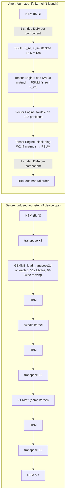

# trnfft: batch fusion, and the first FFT result that beats the CPU

trnfft's four-step FFT now runs a whole batch in one NKI launch. At N=4096 with 1,024 rows, the device goes from 10.1 ms to 0.93 ms, against 11.0 ms for a 2-thread host CPU. The previous post found the CPU winning every cell and called batch fusion "the next lever". It was, though the time it recovered wasn't launches: it was a DMA transpose repeated on every tile of every GEMM. The CPU still wins at B ≤ 128 and at N=256, so this matters for batched transforms on device-resident data, not for single calls.

<!-- more -->

!!! warning "Correction (2026-11-01)"
    "Larger N still goes through per-stage Stockham launches" is no longer true. Since [trnfft v0.25.0](https://github.com/trnsci/trnfft/releases/tag/v0.25.0), power-of-2 FP32 N ≥ 8192 defaults to a six-step FFT built from two batched passes of this post's fused kernel ([trnfft#95](https://github.com/trnsci/trnfft/pull/95), [#96](https://github.com/trnsci/trnfft/pull/96)). It was 9.7–340× faster than the Stockham path in every case measured from 2^13 to 2^26, with 11–17× lower error; `TRNFFT_SIX_STEP=0` restores the old route.

!!! note "Status"
    Merged in PR [trnsci/trnfft#91](https://github.com/trnsci/trnfft/pull/91) (follow-up to [#82](https://github.com/trnsci/trnfft/issues/82)) and tagged in [trnfft v0.24.0](https://github.com/trnsci/trnfft/tree/v0.24.0), along with the native TorchNeuron dispatch ([#88](https://github.com/trnsci/trnfft/pull/88)) and the `bf16_refined` fix ([#87](https://github.com/trnsci/trnfft/pull/87)). The tag is not on PyPI yet. Measurements: trn2.3xlarge, public Neuron SDK 2.33.0 (torch-neuronx 2.14.3, NKI 0.7.0, neuronx-cc 2.28.7631), native `neuron` device, NeuronCore 3, `OMP_NUM_THREADS=2` for both the device and CPU runs, on a box shared with other work.

## The problem

The [launch-cost post](2026-10-27-trnfft-launch-cost.md) cut trnfft's plan to as few launches as the dispatch allowed: one complex GEMM up to N=1024, and the four-step (Bailey) factorisation from there to N=4096, run as two GEMMs, one twiddle kernel and three transpose pairs. Its batched table ended with an observation: at N=4096, device time grew roughly linearly with B above 128, from 3.0 ms at B=128 to 11.7 ms at B=1024. That pointed to per-batch work, not dispatch.

Timing each stage in place, with `torch_neuronx.synchronize()` between stages, located the work:

| B | T1 transposes | GEMM1 | twiddle | T2 | GEMM2 | T3 | sum (ms) |
|---|---|---|---|---|---|---|---|
| 16 | 0.39 | 1.04 | 0.59 | 0.39 | 1.02 | 0.47 | 3.9 |
| 128 | 0.45 | 1.94 | 0.58 | 0.42 | 1.97 | 0.42 | 5.8 |
| 1024 | 0.50 | 5.46 | 1.13 | 0.56 | 5.42 | 0.78 | 13.9 |

The synchronizes inflate the sum (a free-running call is 10.1 ms at B=1024), but the shares are clear. At B=1024, 78% of the time is in the two `_complex_gemm_kernel` launches. That kernel is a general complex GEMM: it DMA-transposes A (`load_transpose2d`) into the stationary layout on every one of 512 M-tiles, and at N1 = N2 = 64 each transpose feeds a moving operand only 64 wide, an eighth of the 512 maximum. At B=16 the picture differs: about nine device ops at roughly the 0.3 ms dispatch floor each. Host Python (about 1.6 ms per call) overlapped with the device and was not the bottleneck.

The four-step had been assembled from a general GEMM and general transposes, library-style. Each piece was reasonable alone. Together they wrote the batch back to HBM between every stage and transposed it again on every tile.

## What the architecture suggests

A NeuronCore matmul contracts over the partition axis of its stationary operand, so the question for any layout is whether data arrives with the contraction axis on partitions. For four-step it does, written the right way round.

View row b as an (N1, N2) matrix, `X[n1, n2] = x[b, N2·n1 + n2]`. A plain strided DMA puts n1, step 1's contraction axis, on partitions. Step 1 yields `Y[n2, k1]` with n2, step 2's contraction axis, on PSUM partitions. Step 2 yields `O[k2, k1]`: the output in natural order. Every transpose in the unfused driver was an artefact of calling a GEMM that expected another layout.

Second, the tile. The PE array is 128 × 128 and N2 = 64 fills half of it. Two rows side by side fill it, if step 2 stays one matmul. A block-diagonal W2 (P copies of W_N2) contracts P rows at once without mixing them. Block-diagonal matrices usually waste FLOPs; here the zeros are free, because the array costs the same full or half empty.

Third, PSUM accumulates in FP32 and SBUF holds the intermediates, so Y never returns to HBM. The batch is read once and written once.



## The approach

`four_step_fft_kernel` does the whole transform for a group of rows in SBUF and PSUM:

- **No transposes.** The (N1, N2) row view is loaded directly as the stationary operand of step 1.
- **Packed rows.** P = 128/N2 rows share one stationary operand, and step 2 uses a block-diagonal W2, so the twiddle and both matmuls run on all 128 partitions. Each group of rows is loaded with one strided DMA per component and stored with one.
- **Complex step 1 as one real matmul.** X_re and X_im are stacked on the contraction axis against the real block matrix `[[W1r, W1i], [-W1i, W1r]]`, so one K = 2·N1 = 128 matmul writes `[Y_re | Y_im]` side by side in PSUM.
- **Groups sized to PSUM.** Q = 512/N1 packs per group fill one 512-wide FP32 PSUM tile.

Each step was measured on its own, in one process, kernel only, at N=4096, B=1024:

| Kernel variant | Time (ms) |
|---|---|
| One row per stationary | 3.13 |
| Packed rows | 1.31 |
| Two-matmul step 1 | 0.88 |
| One K=128 matmul (shipped) | 0.79 |

A load/store-only probe with the same strided access pattern takes 0.62 ms. The shipped kernel is within 0.17 ms of moving the data and nothing else: it is DMA-bound, and matmul tuning has little left to give.

The deliberate tradeoff is generality. The kernel needs N1 ≤ 64, P·N2 ≤ 128 and Q·N1 ≤ 512, so it covers power-of-2 FP32 transforms from 512 to 4096 and nothing else. It also replaces the single DFT-GEMM at N=512 and 1024, which it beat at large B. N=256 keeps the single GEMM. `TRNFFT_FOUR_STEP_BATCH_FUSED=0` restores the old dispatch for A/B.

## Implementation

The core of a group, from `trnfft/nki/four_step.py` on `main`:

```python
            # PSUM tiles are zeroed and every matmul accumulates, the pattern of
            # _complex_gemm_kernel. Starting groups with accumulate=False on
            # column slices of one PSUM tile lost accumulated terms on Trn2
            # (only the last row of each group was right).
            y = nl.zeros((PN2, packs, 2, n1), dtype=nl.float32, buffer=nl.psum)
            for q in nl.affine_range(packs):
                st = xs[:, q, :, :].reshape((2 * n1, PN2))  # (2*N1, P*N2) stationary
                yq = y[:, q, :, :].reshape((PN2, 2 * n1))
                # Step 1: [Y_re | Y_im] = X^T W1 for P rows, K = 2*N1.
                nisa.nc_matmul(dst=yq, stationary=st, moving=w1b, accumulate=True)
            y_r = y[:, :, 0, :]
            y_i = y[:, :, 1, :]

            # Twiddle: A = T * Y (same formula as _complex_mul_kernel(T, Y)).
            t_r = tr[:, 0:width].reshape((PN2, packs, n1))
            t_i = ti[:, 0:width].reshape((PN2, packs, n1))
            ar3 = nl.subtract(nl.multiply(t_r, y_r), nl.multiply(t_i, y_i))
            ai3 = nl.add(nl.multiply(t_r, y_i), nl.multiply(t_i, y_r))
            ar = ar3.reshape((PN2, width))
            ai = ai3.reshape((PN2, width))

            # Step 2: O = blockdiag(W2)^T A (contraction over the P*N2 partitions).
            o_r = nl.zeros((PN2, width), dtype=nl.float32, buffer=nl.psum)
            o_i = nl.zeros((PN2, width), dtype=nl.float32, buffer=nl.psum)
            nisa.nc_matmul(dst=o_r, stationary=w2r, moving=ar, accumulate=True)
            nisa.nc_matmul(dst=o_r, stationary=w2n, moving=ai, accumulate=True)
            nisa.nc_matmul(dst=o_i, stationary=w2r, moving=ai, accumulate=True)
            nisa.nc_matmul(dst=o_i, stationary=w2i, moving=ar, accumulate=True)
```

The constants are built on the host and cached on the device. This is from `_four_step_fused_consts` in `trnfft/fft_core.py`:

```python
    w1_blk = torch.cat(
        [torch.cat([W1.real, W1.imag], dim=1), torch.cat([-W1.imag, W1.real], dim=1)], dim=0
    )
    out = (
        w1_blk,
        t_re.repeat(pack, packs),
        t_im.repeat(pack, packs),
        torch.block_diag(*[W2.real] * pack),
        torch.block_diag(*[W2.imag] * pack),
    )
```

`four_step_pack_rows` picks P per call: the largest power of 2 ≤ 128/N2 that divides the batch, so an odd batch gets P = 1 and runs with less of the array filled rather than failing. That removes an old limit: the unfused N=4096 path's twiddle kernel asserted for any B > 16 not a multiple of 16 (B=38, say).

## What didn't work

**The PSUM trap.** The first version began each group with `nc_matmul(..., accumulate=False)` on column slices of one shared PSUM tile, the obvious way to say "this slice starts fresh". On Trn2 it lost terms: only the last row group of each tile came out right. `nki.simulate` got every group right. The pattern that works on hardware, zeroing the tile and always passing `accumulate=True`, is what `_complex_gemm_kernel` already did, and the simulator warns that it is undefined. So the simulator accepts the pattern that fails and warns on the one that works. This is a comment on [aws-neuron/aws-neuron-sdk#1443](https://github.com/aws-neuron/aws-neuron-sdk/issues/1443#issuecomment-6514257182), which already collects simulator/hardware mismatches from trnrand and trnsparse. The ask: document what `accumulate=False` on a slice of a larger PSUM tile means, or make the simulator model the hardware, and move the warning to the pattern that actually fails. Until then, `verify()` plus a hardware run are both needed; neither catches everything.

**Spreading the twiddle across engines.** Moving part of the twiddle from the Vector Engine onto GpSimd and the Scalar Engine looked like free parallelism. It measured slower and was dropped. The cause wasn't isolated; SBUF port sharing is a plausible explanation, not a measured one.

**Compile time grows with B.** The kernel body is unrolled per row group, so first-call compile grows with the batch: 3 s at B=1024, 17 s at B=8192. It is the unrolling reported in [aws-neuron/aws-neuron-sdk#1440](https://github.com/aws-neuron/aws-neuron-sdk/issues/1440), and the workaround is borrowed from the row-chunked Stockham launches of [#85](https://github.com/trnsci/trnfft/pull/85): `TRNFFT_FOUR_STEP_FUSED_MAX_ROWS` (default 4096) splits larger batches into launches that share one compiled shape.

**Not bit-identical.** The fused kernel differs from the unfused driver by up to 6e-5 absolute on outputs of order 10², about 1 ulp, because step 1 sums its K = 2·N1 terms in one PE pass instead of two. Error against FP64 is unchanged at N=2048 and 4096 and slightly lower at 512 and 1024. Each path is deterministic, and chunked and single-launch outputs are bit-equal. Golden outputs pinned against v0.23.0 will change.

**A refinement that never refined.** The [April PSUM-refinement post](2026-04-22-trnfft-bf16-psum-refinement.md) said `bf16_refined` drives error "to ~1e-6". On Trn2 it measured about 2e-3 against a promised 1e-5 ([#86](https://github.com/trnsci/trnfft/issues/86)), no better than plain `bf16`. The fault was the algorithm, not the device: CPU emulation reproduces the Trn2 numbers to three digits. The residual `r = x − IFFT(X̂)` used the BF16 inverse GEMM. With W̃ = W + E and W̃′ = W⁻¹ + E′, the correction cancels the forward error and adds the inverse's, which is the same size, so more steps don't help either. [#87](https://github.com/trnsci/trnfft/pull/87) reconstructs with the FP32 DFT-GEMM instead, now validated on Trn2 (table below). The cost: each step is 2 BF16 GEMMs plus 1 FP32 GEMM, more than `"fast"` alone, and the docstrings say so. A CPU regression test now holds `bf16_refined` below `bf16`/100, which would have caught the April claim.

| precision | N | Trn2 before #87 | Trn2 after #87 | bound |
|---|---|---|---|---|
| bf16_refined | 128 | 2.029e-3 | 4.61e-6 | 1e-5 |
| bf16_refined | 256 | 2.078e-3 | 4.74e-6 | 1e-5 |
| bf16 | 128 / 256 | 2.058e-3 / 2.091e-3 | 2.06e-3 / 2.09e-3 | 2e-3 → 3e-3 (restated) |

**Fit.** This is the first trnfft result where the device beats the host, and the reason is architectural: a batch of N ≤ 4096 transforms is a stack of 128-partition matmuls with FP32 PSUM accumulation, once the layout stops fighting the array. The kernel is now DMA-bound, and under it sits the ~0.27–0.35 ms eager dispatch floor that no kernel change moves. Small batches and N=256 are too little work per launch; a CPU finishes them in tens of microseconds. That matches the suite-wide Trn2 finding: hand-written kernels win where they avoid work aten can't (here, intermediate HBM passes and per-tile transposes), not on raw GEMM.

## Numbers

Before (unfused dispatch, same process, knob off; a clean-`main` run matched within noise) and after, on PR #91 head c627709. Device-resident `(B, N)`, warm median of 20, ms. CPU is `torch.fft.fft` on complex64 with 2 pinned threads, on the shared box. rel is relative error against FP64.

| N | B | before | after | CPU | before rel | after rel |
|---|---|---|---|---|---|---|
| 256 | 1 | 0.269 | 0.281 | **0.009** | 1.23e-07 | 1.23e-07 |
| 256 | 1024 | 0.411 | 0.433 | **0.099** | 1.24e-07 | 1.24e-07 |
| 512 | 1024 | 0.537 | 0.468 | **0.285** | 1.36e-07 | 1.22e-07 |
| 1024 | 1 | 0.425 | 0.335 | **0.022** | 1.56e-07 | 1.40e-07 |
| 1024 | 128 | 0.409 | 0.383 | **0.063** | 1.54e-07 | 1.41e-07 |
| 1024 | 1024 | 0.825 | 0.538 | 0.578 | 1.54e-07 | 1.41e-07 |
| 2048 | 128 | 1.281 | 0.374 | **0.169** | 1.50e-07 | 1.50e-07 |
| 2048 | 1024 | 2.669 | **0.620** | 1.327 | 1.50e-07 | 1.50e-07 |
| 4096 | 1 | 1.408 | 0.369 | **0.074** | 1.58e-07 | 1.59e-07 |
| 4096 | 16 | 2.287 | 0.366 | **0.103** | 1.58e-07 | 1.58e-07 |
| 4096 | 128 | 3.266 | 0.443 | **0.376** | 1.58e-07 | 1.58e-07 |
| 4096 | 1024 | 10.105 | **0.925** | 10.968 | 1.58e-07 | 1.58e-07 |

The full 20-row table, including every B at N=512 and 2048, is in the [#82 comment](https://github.com/trnsci/trnfft/issues/82). N=256 does not use the new kernel, so its before/after difference is noise.

Larger batches at N=4096, one launch:

| B | device (ms) | CPU, 2 threads (ms) |
|---|---|---|
| 4096 | 2.48 | 47.8 |
| 8192 | 4.73 | 95.8 |

The CPU baseline is the main caveat: 2 pinned threads on a shared box is a modest CPU. The window-1 run on all 12 vCPUs (also a loaded box) measured 6.34 ms at N=4096, B=1024, against which 0.93 ms is about 7×, not 12×. At N=1024, B=1024 that run measured 0.290 ms, so a full-width CPU wins the cell that is a tie here.

Hardware suite on the PR head, one file at a time on core 3: 97 passed, 1 xfailed (the known `torch.compile` composite), 1 skipped. That includes 34 new `TestNativeFourStepFused` tests: N ∈ {512…4096} × B ∈ {1, 3, 38, 1024} × forward/inverse at rel < 5e-7, plus chunked-vs-single-launch bit-equality.

## What's next

- **The small-B floor.** What is left at B ≤ 128 is dispatch, at about 0.3 ms per call. The two options in #82 are fusing the FFT into a larger on-device graph (STFT, or a `torch.compile` region) and lowering the per-launch cost.
- **Beyond N=4096.** The kernel's N1 ≤ 64 limit comes from stacking re/im on 128 partitions. Larger N still goes through per-stage Stockham launches.
- **Multi-core.** Still after the dispatch-floor work, per #82.
- [Phase 2 — precision](https://github.com/trnsci/trnfft/issues/52), including whether `bf16_refined` stays, is deprecated, or points users to `ozaki` on Trn2 (an open decision in #87)
- [Phase 3 — plan reuse, streaming large FFTs, NEFF cache](https://github.com/trnsci/trnfft/issues/53)
- [Phase 4 — multi-chip large-N FFT](https://github.com/trnsci/trnfft/issues/54)
- [Phase 5 — trn2 larger-SBUF path](https://github.com/trnsci/trnfft/issues/55)

Suite context: [trnsci.dev](https://trnsci.dev), the [roadmap](https://trnsci.dev/roadmap/), the [suite-wide tracker](https://github.com/trnsci/trnsci/issues/1), and the Trn2 window scoreboard [trnsci#35](https://github.com/trnsci/trnsci/issues/35).

## Takeaway

The launch-cost post found that the unit of cost was the launch. Once launches were few, it was layout. The unfused four-step spent most of its time transposing data into the shape a general GEMM wanted, when the FFT's own index structure already put the contraction axis on partitions. Reading the rows in place, packing two per stationary operand with a block-diagonal W2, and keeping everything in SBUF and PSUM turned 10.1 ms into 0.93 ms, within 0.17 ms of the DMA floor. The [April observation](2026-04-20-trnfft-fft-is-a-gemm.md) that FFT is a GEMM still holds, with a condition: it has to be a GEMM laid out for this array, not a call to a general one.
