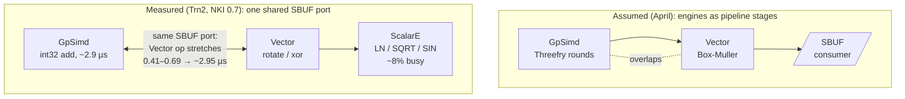

# trnrand: the 2× floor of bit-identical Threefry

trnrand v0.9.0 takes the full-word Threefry kernel from 5.0 to 2.5 ms at 4M normals on Trn2. It also brings `trnrand.normal(4M)`, measured end to end to a host tensor, to 5.5–8.1 ms, below CPU `randn` at 11.5–15.6 ms. Most of that gain came from moving host work off the critical path and from noticing the kernel had been running twice. The part worth writing about is the kernel's floor, which sits at about 2× aten `randn` for a reason the [four-engine post](https://trnsci.dev/blog/trnrand-rng-is-a-four-engine-workload-if-the-silicon-lets-you-say-so/) did not anticipate: on this silicon, GpSimd and the Vector Engine cannot overlap. Anyone planning to spread an integer workload across Trainium's engines and expecting the engine times to overlap should read the profile below first.

<!-- more -->

## The problem

trnrand is the suite's cuRAND analog. Its on-device generator is Threefry4x32-20, and its contract is bit-identity: for a given seed and `counter_offset`, every kernel width and every launch plan must produce the same values. That contract shaped the [byte-tile post](https://trnsci.dev/blog/trnrand-the-integer-multiply-gap-pointed-to-a-better-algorithm/) in April, and the [full-words post](https://trnsci.dev/blog/trnrand-from-byte-tiles-to-full-words-on-trn2/) from the first Trn2 window. That post ended with `normal(4M)` at 15.9 ms, about 11× behind aten, and a guess about the reason: Threefry-20 "may simply be more work than whatever aten runs."

The guess was aimed at the wrong place. The 15.9 ms was measured through the `threefry_normal_nki` host wrapper. On v0.8.0, a device profile of one 16-chunk launch and some instrumentation of the host path in the second window split the 4M call like this (warm, 2 CPU threads, from [trnrand#66](https://github.com/trnsci/trnrand/pull/66)):

| step (v0.8.0, `normal(4M)` to host) | ms |
|---|---|
| bulk32 kernel launch, incl. sync | ~5.3 |
| 6 host→device input copies (one was 2.7 ms in situ) | ~4.6 |
| device→host copy, 16 MB | 1.3–4.7 |
| host reorder `_bulk_tile_order` | 2–7 |
| `out * std + mean`, out of place on the CPU | **~9** |
| **total** | **20–28** |

The biggest single item was a scale-and-shift that allocated two fresh 4M-element tensors on the CPU, even for `std=1, mean=0`. The kernel was about a fifth of the total. The profile also showed that the 4.56 ms of device time was not even spent once. The kernel was gridless, and a gridless NKI kernel at LNC=2, the Trn2 default, runs in full on both physical cores of the logical core. Both cores computed every value and both wrote the same output.

## What the architecture suggests

The four-engine post drew RNG on Trainium as a pipeline: counter rounds on GpSimd, Box-Muller on the Vector Engine, and output staying in SBUF for the next consumer. The diagram did not say the stages overlap, but the argument depended on it. Separate engines were supposed to mean separate throughput. The Trn2 profile tested that and it did not hold.

Per core, before the fix:

| engine | active | instructions | doing |
|---|---|---|---|
| Vector | 4.14 ms | 4,295 | rotate/xor, ~160 per chunk |
| GpSimd | 3.03 ms | 1,402 | int32 adds, 65 per chunk at ~2.9 µs each |
| ScalarE | 0.37 ms | 519 | LN, SQRT, SIN; 78 activation-table loads |
| DMA | ~2% | | |

Three things in that table contradict the April picture.

**The integer stage spans two engines, not one.** GpSimd is the only engine whose int32 add is exact. The rotate and XOR are bitvec ops, which run on the Vector Engine. Every Threefry round therefore crosses between GpSimd and Vector.

**The transcendentals are not on the Vector Engine.** LN, SQRT and SIN lower to ScalarE activations, and ScalarE is about 8% busy. The engine April assigned to Box-Muller is busy with rotate/xor. The engine that does run Box-Muller sits mostly idle.

**GpSimd and Vector serialize.** A Vector rotate or xor takes 0.41–0.69 µs when it runs alone. Issued while a GpSimd add is in flight, it stretches to about 2.95 µs, the length of the add. The two engines share the SBUF port. This is why Vector shows 4.14 ms active for work that should take a fraction of that.



Profiling settles the obvious next idea before it is written. Double-buffering Threefry on chunk k+1 against Box-Muller on chunk k would only help if the engines could run at the same time, and for GpSimd and Vector they cannot. That limit comes from the hardware, not from the bit-identity contract. With overlap ruled out, three levers remained: issue fewer GpSimd adds, issue fewer Vector instructions, and stop running the whole kernel twice.

## The approach

[trnrand#66](https://github.com/trnsci/trnrand/pull/66) made five changes. All of them preserve bit-identity, and the kernel changes apply only to the full-word kernels (`TRNRAND_LIMB_BITS=32`, the native default).

1. **Both LNC=2 cores, split by `program_id`.** If the chunk count C is even, each core gets whole chunks. Otherwise each core gets half the columns of every chunk. Per-core tiles are never wider than before, so SBUF use does not grow.
2. **Hoisted key injection.** `x0 = lane + ks0` is the same for every chunk, and `x2`, `x3` are just the key words. That removes three GpSimd adds per chunk.
3. **One instruction for u24 → uniform.** `(x & 0xFFFFFF)` feeds a single `tensor_scalar` that multiplies by 2⁻²⁴ and clamps at 1e-7. The implicit uint32→fp32 cast inside it is exact below 2²⁴.
4. **Output in final order.** The kernel writes `(C·P, F, 4)` so that the flat output is already in per-tile order. The host reorder is gone, and each partition leaves in one contiguous DMA.
5. **Host path.** One packed host→device copy per call instead of six, a device-cached lane tile, and an in-place affine.

The deliberate tradeoff is the one carried over from earlier posts: the stream stays fixed. The changes that would most obviously move the floor, discussed below, all change the values for a given seed. trnrand is giving up the last factor of two to keep its streams stable.

## Implementation

The core split in `_threefry_bulk32_body` (`trnrand/nki/dispatch.py` on `main`):

```python
n_prog = nl.num_programs() if nl.program_ndim() > 0 else 1
pid = nl.program_id(0) if n_prog > 1 else 0
if C % n_prog == 0:  # whole chunks per core: full-width instructions
    W = F
    c_lo = pid * (C // n_prog)
    c_hi = c_lo + C // n_prog
elif F % n_prog == 0:  # e.g. C = 1: split every chunk's columns
    W = F // n_prog
    c_lo = 0
    c_hi = C
else:
    n_prog = 1
    pid = 0
    W = F
    c_lo = 0
    c_hi = C
j0 = 0 if W == F else pid * W
```

The u24 → uniform step, one instruction per word:

```python
nisa.tensor_scalar(
    u0, m0, op0=nl.multiply, operand0=inv24, op1=nl.maximum, operand1=clamp_eps
)
```

The fix for the largest single item in the host table is less clever (`trnrand/distributions.py`):

```python
def _affine(out: torch.Tensor, scale: float, shift: float) -> torch.Tensor:
    if _compiling():
        return out * scale + shift
    if scale != 1.0:  # x * 1.0 == x exactly
        out.mul_(scale)
    return out.add_(shift)
```

Eager NKI draws come back as fresh host tensors, so nothing else holds a reference and the in-place version is safe. The arithmetic is the same two fp32 ops, so the values do not change. Nine milliseconds went to allocations in a Python expression that looks free.

## What didn't work

**The Vector Engine cannot do the adds.** If the adds could move to the Vector Engine, the shared-port problem would at least become a scheduling problem on one engine. A direct test of `tensor_tensor(..., engine=vector)` on uint32 operands gave wrong results in 99.7% of cases, because the Vector Engine computes the add in fp32. A 16-bit-limb add on the Vector Engine is exact but costs about 11 instructions, which is slower than one GpSimd add. The adds stay on GpSimd.

**Rotate and xor cannot be fused.** Fusing them would cut the Vector instruction count, which is the half of the critical path that GpSimd does not own. `scalar_tensor_tensor` does not accept bitvec ops, so the fusion cannot be expressed.

**ScalarE cannot take the bitwork.** ScalarE is 92% idle and would be the natural place to move rotate/xor off the shared port, but it has no bitvec ops.

**The four-engine framing was right about which engine does what, and wrong about the throughput.** Counter-based RNG does use GpSimd, the Vector Engine and ScalarE. What it did not get was their time in parallel. The full-words post's guess that Threefry is "more work than aten" was also wrong in a specific way: at v0.8.0 the kernel was about a fifth of the call, and that kernel was running on both cores.

**Toolchain notes.** NKI 0.7.0 on neuronx-cc 2.28.7631:

- A gridless kernel at LNC=2 runs redundantly on both cores without any signal. The output was correct, so only the device profile showed it. A compiler note for gridless kernels compiled at LNC>1 would have caught it a window earlier.
- #66 adds an LNC=2 `source_to_mlir(..., lnc=2).verify()` test for each split shape. Per [aws-neuron-sdk#1443](https://github.com/aws-neuron/aws-neuron-sdk/issues/1443), `verify()` accepts some kernels that neuronx-cc rejects for hardware. So the test is a structural check, and the hardware suite remains the gate.

**Upstream ask.** The [trnrand comment on aws-neuron-sdk#1308](https://github.com/aws-neuron/aws-neuron-sdk/issues/1308) asked for documentation of which integer ops are exact on which engine. The result that Vector uint32 adds are computed in fp32 is one more row for that table. The SBUF port shared by GpSimd and the Vector Engine is a second gap: it decides whether a two-engine design can overlap at all. A short note in the NKI performance guide on which engine pairs contend for SBUF bandwidth would save the next library a profiling session. Neither of these has been filed as its own issue.

## Numbers

trn2.3xlarge, public Neuron SDK 2.33.0 (torch-neuronx 2.14.3, NKI 0.7.0, neuronx-cc 2.28.7631), native `neuron` device. `NEURON_RT_VISIBLE_CORES=2`, host threads pinned with `taskset -c 10,11`, and `OMP_NUM_THREADS=2` / `torch.set_num_threads(2)` for every column, including CPU `randn`. Warm medians of 30, two alternating rounds. The box was shared (load average about 7), so the ranges in the host columns mostly show contention.

| n | kernel, device-resident: v0.8.0 | kernel: v0.9.0 | `normal()` → host: v0.8.0 | v0.9.0 | aten `randn` (device) | CPU `randn` |
|---|---|---|---|---|---|---|
| 16,384 | 0.27–0.28 | 0.27–0.36 | 0.82–1.27 | 0.70–0.93 | 0.13–0.15 | 0.05–0.09 |
| 262,144 | 0.53–0.69 | 0.47–0.57 | 3.8–5.7 | 1.3–2.0 | 0.21–0.24 | 0.83–1.27 |
| 1,048,576 | 1.43 | 0.82–0.89 | 6.7–6.8 | 1.9–2.1 | 0.37–0.39 | 2.9–3.9 |
| 4,194,304 | 5.0–5.2 | **2.50–2.55** | 25.7–28.1 | **5.5–8.1** | 1.08–1.14 | 11.5–15.6 |

All times are in ms. "Kernel" is the `nki_op` launch with device inputs, synchronized. "`normal()` → host" is the public API, including the 16 MB device→host copy at 4M.

| device profile, 4M, per core | v0.8.0 | v0.9.0 |
|---|---|---|
| device time | 4.56 ms (on both cores) | 2.20 ms (split) |
| GpSimd instructions | 1,402 | 734 |
| Vector instructions | 4,295 | 2,225 |
| GpSimd add time | ~1.9 ms | 1.43 ms |

| validation (v0.9.0) | result |
|---|---|
| `test_limb_variants_bit_identical`, 8- vs 32-bit at n = 1, 16,385, 1,048,577, 4,194,305 (column split, odd C, two launches) | bit-identical |
| full neuron suite | 90 passed, 1 xpassed |
| simulator (`-m nki_simulator`) | 132 passed |
| CPU (`-m "not neuron"`) | 941 passed |

**The floor.** A bit-identical Threefry4x32-20 needs about 62 GpSimd adds per (128, 512) chunk at about 2.9 µs each. At 4M that comes to about 1.4 ms per core. Add about 0.7 ms of Vector rotate/xor that cannot overlap the adds, and the total is roughly 2 ms of device time, about 2× aten's 1.1 ms. The measured 2.20 ms is close to that. There is little left to win without changing the stream.

**Fit, stated plainly.**

- *Where Trainium wins.* Generating on the device and shipping the result to the host now beats CPU `randn` at 1M and 4M. trnrand also keeps its property of bit-identical streams across kernel widths, launch plans and cores.
- *Where the CPU wins.* At 16k and 262k, the CPU is faster end to end. At 16k, both device paths are bound by launch overhead: the kernel takes 0.27 ms against aten's 0.14 ms.
- *Where aten wins.* On the device, aten is about 2.3× faster at 4M at aligned shapes, and that gap is close to structural. aten presumably uses the hardware RNG (`nisa.rand2`/`rng`), which produces a different stream. Fewer Threefry rounds would also change the stream. More NeuronCores would cut the time without changing the stream, but that is a resource choice, not a kernel improvement. At shapes that are not multiples of 128, the comparison flips. aten `randn` has a cliff there ([aws-neuron-sdk#1439](https://github.com/aws-neuron/aws-neuron-sdk/issues/1439), and the [trnblas odd-shape post](https://trnsci.dev/blog/trnblas-the-odd-shape-cliff-that-wasnt/)), while trnrand pads internally.

The architectural reason for the 2× is that Threefry is ALU-bound, integer-only work. Its two instruction classes run on two engines that share one SBUF port, and the engine with spare capacity has no bitwise instructions. The Tensor Engine, most of the silicon, is never touched. That matches the suite-wide finding on Trn2: hand-written kernels win where they avoid work that aten can't, not where they compete with it head to head.

## What's next

- [trnrand#60](https://github.com/trnsci/trnrand/issues/60) is closed. The work in this post shipped in [trnrand v0.9.0](https://github.com/trnsci/trnrand/releases/tag/v0.9.0), which is tagged but not yet on PyPI.
- [Phase 5: trn2 PSUM sizing for larger batched tile generation (trnrand#21)](https://github.com/trnsci/trnrand/issues/21).
- [Benchmarks vs cuRAND (trnrand#3)](https://github.com/trnsci/trnrand/issues/3).
- A hardware-RNG mode would be an opt-in, different-stream generator, like the existing `key_mode="counter"`. It is an open design question, not yet an issue.
- Suite context lives on the [roadmap](https://trnsci.dev/roadmap/) and the [suite tracker](https://github.com/trnsci/trnsci/issues/1).

## Takeaway

On Trainium, four engines do not add up to four times the throughput. Before splitting a workload across engines on the assumption that their work overlaps, profile which engines actually run concurrently. On Trn2, GpSimd and the Vector Engine share an SBUF port, so Threefry's integer adds and its rotate/xor run one after the other however the code is scheduled. Most of v0.9.0's gain came from things that were never about engines: a CPU affine, a host reorder, six copies, and a kernel running twice. What remains is about 2× aten, and that is the cost of keeping the stream bit-identical.
