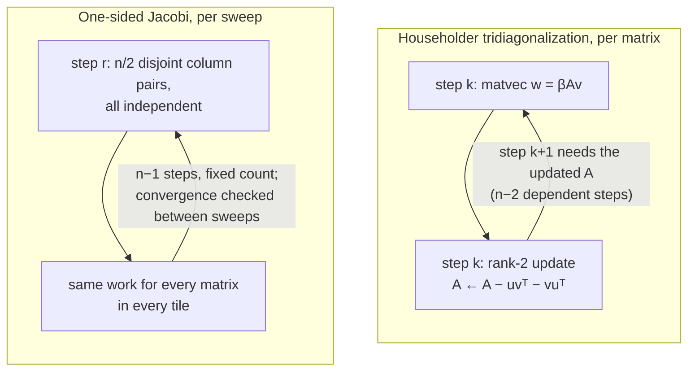

# trnsolver: Jacobi on hardware, six months after the argument

trnsolver's batched block-Jacobi `eigh` on one Trn2 core runs 1.5–2.2× faster than batched 2-thread CPU LAPACK for FP32 batches at n = 64 and 128 with B ≥ 64–256, and at n = 32 with B = 1024. Against a fairer CPU baseline, the batch split across the same threads, the margin shrinks to about 1.13× (see the correction below). Getting there meant first measuring the design the library had picked over Jacobi in April, batched Householder tridiagonalization, losing to the CPU by 6–17×. The [April post](2026-04-14-trnsolver-jacobi-for-trainium.md) argued that Trainium wants Jacobi, then the library deleted its Jacobi kernels two days later; this post is the hardware verdict on both decisions, for anyone with thousands of small symmetric eigenproblems, such as SCF inner loops.

<!-- more -->

!!! warning "Correction (2026-11-01)"
    The CPU column below is batched `torch.linalg.eigh`, which barely uses its second thread at these sizes. Splitting the batch across the same 2 threads is 1.6–5.8× faster ([trnsolver#54](https://github.com/trnsci/trnsolver/pull/54)). Against that baseline the single-core kernel at n = 128, B = 1024 is 310 vs 352 ms, 1.13× rather than 2×. Spreading the batch over all 4 cores of the chip brings it to 152 ms (0.43× of the split CPU on 2 threads), but against 8 CPU threads the best device result is at most 1.25× faster. The Jacobi-over-Householder verdict stands; the margin over a well-used CPU is small.

!!! note "Code status"
    The one-sided Jacobi kernel ([trnsolver#50](https://github.com/trnsci/trnsolver/pull/50)) shipped in [v0.17.0](https://github.com/trnsci/trnsolver/releases/tag/v0.17.0). The block kernel and the `method="auto"` region ([#52](https://github.com/trnsci/trnsolver/pull/52)) are in [v0.18.0](https://github.com/trnsci/trnsolver/tree/v0.18.0). The Householder device pipeline ([#45](https://github.com/trnsci/trnsolver/pull/45), [#47](https://github.com/trnsci/trnsolver/pull/47), [#49](https://github.com/trnsci/trnsolver/pull/49)) stays as draft PRs, kept for their measurements. Everything ran on a trn2.3xlarge with public Neuron SDK 2.33.0 (torch-neuronx 2.14.3, NKI 0.7.0, neuronx-cc 2.28.7631).

## The problem

The [previous trnsolver post](2026-10-27-trnsolver-compile-and-eigh.md) ended with a concession: `eigh` on a `neuron` tensor ran in about 1 ms because aten's `linalg_eigh` executes on the host, and trnsolver's own NKI path was 100–1000× slower. The stated fix was on-device tridiagonalization, so that the NKI path stopped paying O(n) host syncs.

That fix landed: one launch that does the whole Householder reduction with A resident in SBUF (#45, rebuilt on the native dispatch path as #47). It is cuSOLVER's `syevd` plan: reduce, solve the tridiagonal, back-transform. At n = 128 the all-device path first measured 115.5 ms, against 1.5 ms for the aten cutover.

That 115.5 ms was wrong. Three other lanes were running heavy jobs on the box's 12 vCPUs, and the host LAPACK stages were competing with them for threads. With `OMP_NUM_THREADS=1` the same path took 7.9 ms at n = 128 and 5.0 ms at n = 64. Since then, every timing job pins its host threads. The corrected gap was fixed overhead (launches, copies, a device `apply_reflectors`, host LAPACK), and still not the on-device reason to exist the previous post predicted. The honest framing: one small `eigh` is a latency benchmark, and the comparison that matters is a batch on the device against batched CPU LAPACK ([#48](https://github.com/trnsci/trnsolver/issues/48)).

## What the architecture suggests

A single n = 128 matrix fills one 128-partition tile once. A batch of small matrices can fill many tiles, but only if the algorithm gives every tile independent work to do at each step.



**Householder is a dependency chain.** Each of the n−2 steps is a BLAS-2 matvec plus a rank-2 update, and the next reflector needs the updated matrix. Running 16 matrices in lockstep gives the scheduler chains to overlap, but each is still small serial instructions, and the Tensor Engine sits mostly idle.

**Jacobi is a fixed schedule of independent work.** A sweep is n−1 steps, and each step rotates n/2 disjoint pairs. The trip count inside a sweep doesn't depend on the data. The only data-dependent decision, whether to run another sweep, happens between launches. That is the previous post's line, data deciding which values move versus how many times a loop runs, and Jacobi pushes the second kind out to sweep granularity: 6–8 sweeps for random matrices.

**The batch is what fills the tile.** In the compact layout each tile holds 128/n matrices, so n = 32 packs four per tile, and a launch holds up to 128 tiles: 512 matrices at n = 32.

## The approach

Two kernels share a driver, `jacobi_eigh_device`.

**One-sided (Hestenes) Jacobi, #50.** The kernel rotates the columns of Z = A + σI, where σ is the Gershgorin bound, so ±λ pairs stay apart. The state X = [Zᵀ | Vᵀ] stays in SBUF for a whole sweep, and one launch is one sweep. Per step, the Tensor Engine applies the partner permutation as an exact matmul whose block-diagonal stationary operand every tile shares. The Vector Engine applies the rotations in the delta form `X += (c−1)∘X − s∘M`. Under LNC=2 each physical core of the pair takes half the tiles. Before the split both cores ran the same program redundantly; it gave close to 2×.

**Block Jacobi, #52, for 33 ≤ n ≤ 128.** The profile showed the #50 kernel was bound by the Vector Engine (table below). Its rows are 2n wide, and about 25 short column-math instructions run per step. The block kernel groups columns into blocks of 8, so each block pair forms a 16-column superblock. The Tensor Engine forms ZᵀZ, compacts each pair's 16 × 16 Gram block with a 0/1 matmul, and then applies all the pair rotations to [Zᵀ | Vᵀ] as one orthogonal matmul, with the circle-method block shuffle folded in. The Vector Engine runs Jacobi only on the 16 × 16 Gram blocks, on rows 32 wide. Here the Tensor Engine finally applies the rotations, which is the April post's "a rotation is a matmul" idea, but at block granularity.

**The deliberate tradeoff is padding.** The kernel's cost follows the padded size (32, 64 or 128), while aten's cost follows n. So at n = 80, B = 256 the kernel (77.9 ms) loses to the cutover (74.6 ms), and at n = 96 it wins. The `method="auto"` region encodes that, and the default cutover is unchanged outside it.

## Implementation

From [`trnsolver/nki/jacobi.py`](https://github.com/trnsci/trnsolver/blob/main/trnsolver/nki/jacobi.py), the block kernel's Tensor Engine half. `gram` builds each pair's Gram block and `update` applies the accumulated rotations as one matmul per tile:

```python
        def gram(g):
            """Y[:, g] = [Gc | I]: the pairs' Gram blocks, rotations reset."""
            ps_t = nl.ndarray((ne, P), dtype=f32, buffer=nl.psum)
            nisa.nc_transpose(dst=ps_t, data=X[0:P, g, 0:ne], engine=nisa.engine.tensor)
            zm = nl.ndarray((ne, P), dtype=f32, buffer=nl.sbuf)
            nisa.activation(dst=zm, op=nl.copy, data=ps_t)
            ps_g = nl.ndarray((P, P), dtype=f32, buffer=nl.psum)
            nisa.nc_matmul(dst=ps_g, stationary=zm, moving=zm, accumulate=False)
            gm = nl.ndarray((P, P), dtype=f32, buffer=nl.sbuf)
            nisa.tensor_tensor(dst=gm, data1=ps_g, data2=mask, op=mul)
            ps_c = nl.ndarray((P, S), dtype=f32, buffer=nl.psum)
            nisa.nc_matmul(
                dst=ps_c, stationary=gm, moving=rid, is_moving_onezero=True, accumulate=False
            )
            nisa.activation(dst=Y[0:P, g, 0:S], op=nl.copy, data=ps_c)
            nisa.activation(dst=Y[0:P, g, S : 2 * S], op=nl.copy, data=rid)
```

```python
            for g in range(g0, g1):
                ps_w = nl.ndarray((P, P), dtype=f32, buffer=nl.psum)
                nisa.nc_matmul(
                    dst=ps_w,
                    stationary=E[0:P, g, 0:P],
                    moving=pblk,
                    is_moving_onezero=True,
                    accumulate=False,
                )
                wsb = nl.ndarray((P, P), dtype=f32, buffer=nl.sbuf)
                nisa.activation(dst=wsb, op=nl.copy, data=ps_w)
                ps_x = nl.ndarray((P, 2 * ne), dtype=f32, buffer=nl.psum)
                nisa.nc_matmul(
                    dst=ps_x, stationary=wsb, moving=X[0:P, g, 0 : 2 * ne], accumulate=False
                )
                nisa.activation(dst=X[0:P, g, 0 : 2 * ne], op=nl.copy, data=ps_x)
```

The dispatch side, from [`trnsolver/eigen.py`](https://github.com/trnsci/trnsolver/blob/main/trnsolver/eigen.py), is a table of measured (n_min, n_max, B_min) rows. `TRNSOLVER_EIGH_JACOBI_AUTO` overrides it:

```python
_JACOBI_AUTO_REGION: tuple[tuple[int, int, int], ...] = (
    (1, 32, 512),
    (33, 64, 256),
    (65, 128, 1024),
    (96, 128, 256),
    (128, 128, 64),
)
```

`group_plan` pads the tail group with identity tiles to a power of two, "so each ne compiles at most log2(group) + 1 shapes whatever the batch size."

## What didn't work

**The April plan, as first built.** The April post's diagram had the per-round Jacobi kernel hitting the NEFF cache every round. On trn1 it didn't. [trnsolver#9](https://github.com/trnsci/trnsolver/issues/9) recorded 67 compile workdirs after 39 minutes, because the driver called the kernel three times per round, each after different preceding XLA ops. [#38](https://github.com/trnsci/trnsolver/issues/38) then weighed three candidates: full-sweep Jacobi in one kernel, Householder-QR, and block Jacobi. It picked Householder as "the most architecture-aligned" because rank-1 updates map onto PSUM accumulation, and v0.4.0 deleted `rotate_pairs_kernel` and the Brent–Luk driver. What shipped this month is #38's candidates A and C, the two it ranked below Householder. The redesign avoids #9's failure: one launch per sweep instead of three per round, the step loop inside the traced kernel, and padding that keeps launches on a handful of compiled shapes.

**Batched Householder lost by 6–17×.** #49 got the launch count down to 4 per chunk of 16 matrices: 256 launches instead of 5,120 at B = 1024. That made it 7–30× faster than per-matrix calls, and it still lost to CPU LAPACK by about 6× at n = 128 and 17× at n = 32. Device tridiagonalization alone cost 1594 ms at n = 128, B = 1024, about 1.6 ms per matrix. That stage is the dependency chain from the diagram.

**"Rotation as matmul" was the slow mapping at the scalar level.** Before #50, four formulations were measured per tile-step at n = 32. Dense-J two-sided Jacobi as matmuls took 3.2 µs, and the Vector Engine rotation took 0.6 µs, then 0.40 µs after the LNC=2 split. An FP32 `nc_matmul` costs 2 passes plus a LDWEIGHTS of the tile's own stationary, and a per-tile rotation matrix pays both on every tile. The permutation is one stationary shared by every tile, marked 0/1 since #52 (`is_stationary_onezero`, which the code credits with halving the FP32 passes).

**Toolchain notes, NKI 0.7.0 / neuronx-cc 2.28.7631:**

| rule found | what the kernel does instead | source |
|---|---|---|
| `abs_max` is NeuronCore-v4+ only | \|h\| as `max(-h, h)` | #50, `jacobi.py` |
| hardware `reciprocal` was thought accurate to about 1e-3 (*corrected:* ~1.5e-6 in range; the real hazard is a silent clamp outside roughly \|x\| ∈ [2⁻⁴², 2⁴¹]) | `1/x` as `rsqrt(x)²`, arguments clamped to the rsqrt table range [2⁻⁸⁷, 2⁹⁷]; no divide anywhere | #50 |
| each activation-table switch costs about 1.3 µs | √x as `x·rsqrt(x)`, so only the rsqrt table is loaded | #50 |
| `accumulate=False` matmuls into sub-bank column slices of one PSUM tile lose terms on hardware (the simulator computes them correctly) | each matmul writes a whole 2 KiB bank (512 FP32 columns) or the bank-aligned tail | `jacobi.py`; trnfft hit it first ([trnfft#91](https://github.com/trnsci/trnfft/pull/91), reported on [aws-neuron-sdk#1443](https://github.com/aws-neuron/aws-neuron-sdk/issues/1443)) |
| the SBUF-only column-math chain on GpSimd failed at run time on Trn2 | stays on the default engines | #48 |

`nki.simulate` checks none of the ISA-version or partition rules, so `tests/test_jacobi.py` also runs `source_to_mlir(...).verify()` at lnc = 1 and 2. That gate isn't complete either: #1443 lists a `tensor_tensor` divide that passes `verify()` and then fails neuronx-cc ISA validation.

Two numerical findings also apply to the torch path. Rows p and q must use the same symmetrised a_pq, or clustered spectra stall at off ≈ 1e-4. And the delta form with `c − 1 = −s²/(1+c)` keeps FP32 orthogonality at about 1e-6, where plain `JᵀX` drifts to 3e-5 at n = 128.

The `abs_max`, reciprocal and table-switch rows are not filed upstream yet. The ask would be an accuracy column for each activation op and the ISA generation on each `nisa` op's docs page.

**Fit.** Trainium wins when the batch fills the tiles; then the block kernel keeps the Tensor, Vector and Scalar engines all at 57–74% busy, and DMA stays under 10%. It loses at B = 16 at every n, and at n = 32 below B = 256, because of fixed cost: launches plus about 6 ms of host preparation. A single small `eigh` still belongs on the host. The CPU baseline is 2 pinned threads on a shared box; a whole-socket LAPACK run would move the crossover and wasn't measured. Against training workloads, small eigenproblems are under-indexed: the 128 × 128 array helps only when many independent problems are stacked into it. An accurate reciprocal, or a divide in the (P, 1) column math, would shorten the chain of short instructions that still bounds the Vector Engine.

## Numbers

Trn2, one logical NeuronCore (`NEURON_RT_VISIBLE_CORES=3`), FP32. The CPU baseline is batched `torch.linalg.eigh` with `OMP_NUM_THREADS=2` and `taskset -c 10,11`. Times are end to end from host input to host output, warm medians in ms, all from one session (#52).

| n | B | CPU LAPACK | aten cutover | Jacobi #50 | **block #52** | #52 / CPU |
|---|---|---|---|---|---|---|
| 32 | 16 | 0.93 | 6.19 | 9.89 | 6.53 | 7.0 |
| 32 | 256 | 14.3 | 16.0 | 15.7 | 12.1 | 0.85 |
| 32 | 1024 | 57.3 | 78.3 | 36.2 | **28.3** | **0.49** |
| 64 | 16 | 3.03 | 12.1 | 19.0 | 8.52 | 2.8 |
| 64 | 64 | 10.2 | 11.7 | 22.7 | 11.0 | 1.08 |
| 64 | 256 | 40.8 | 47.9 | 51.6 | **22.1** | **0.54** |
| 64 | 1024 | 163 | 198 | 195 | **75.2** | **0.46** |
| 128 | 16 | 9.42 | 11.9 | 25.3 | 15.1 | 1.6 |
| 128 | 64 | 40.9 | 50.5 | 95.6 | **27.1** | **0.66** |
| 128 | 256 | 165 | 207 | 336 | **79.0** | **0.48** |
| 128 | 1024 | 668 | 904 | 1350 | **321** | **0.48** |

At n = 32 the kernel is the same as #50. The gain there came from the driver: a row `index_select` replaced a `torch.gather` that took 102 ms on device at B = 1024, n = 128. In #50's own session at B = 1024, the scalar kernel won only at n = 32 (40.2 ms against 60.5 ms) and lost 1.2× at n = 64 and 2× at n = 128.

Where the time went, from one-sweep `neuron-explorer` profiles:

| kernel | n | µs per matrix-sweep | Vector | Tensor | Scalar (ACT) | GpSimd | DMA |
|---|---|---|---|---|---|---|---|
| #50 scalar | 64 | 21.2 | **94%** | 46% | 58% | 3% | 8% |
| #50 scalar | 128 | 145 | **90%** | 54% | 51% | 1% | 5% |
| block | 64 | **8.0** | 72% | 61% | 57% | 9% | 9% |
| block | 128 | **32.7** | 74% | 67% | 63% | 4% | 7% |

The power-throttle limit read about 0.57 in every capture. Sweep counts were unchanged at 7 for n = 64 and 8 for n = 128.

The Householder baseline it replaced (#49, host threads pinned to 4, so its CPU column differs):

| n | B | batched Householder | per-matrix | CPU LAPACK |
|---|---|---|---|---|
| 32 | 1024 | 951 | 27,400 | 55 |
| 128 | 256 | 849 | 3,200 | 133 |
| 128 | 1024 | 3578 | 25,700 | 561 |

| accuracy vs FP64 | eigenvalues | residual | orthogonality |
|---|---|---|---|
| block #52 | ≤ 6.5e-6 | ≤ 9.7e-6 | ≤ 1.7e-6 |
| scalar #50 | ≤ 5.9e-6 | ≤ 7.5e-6 | ≤ 1.2e-6 |
| Householder #49 | ≤ 2.6e-5 | ≤ 1.2e-5 | — |

## What's next

- **Fixed cost.** The next levers in #52 are the per-tile load and store DMAs and the PSUM→SBUF copies on ACT, which decide the B = 16 rows. Tracked on [#48](https://github.com/trnsci/trnsolver/issues/48).
- [Phase 4 — parallel Jacobi sweeps across NeuronCores](https://github.com/trnsci/trnsolver/issues/29). The batch is independent, so sharding it across logical NeuronCores should scale linearly; not yet measured.
- [Phase 5 — trn2 rotation-block tuning](https://github.com/trnsci/trnsolver/issues/30). Block size 8 won over 4 at n = 64 and over 16 at n = 128. n > 128 is multi-tile and untouched.
- [Phase 2 — iterative refinement](https://github.com/trnsci/trnsolver/issues/27), for chemistry that needs more than FP32's ~1e-6. [Phase 3 — NEFF cache reuse](https://github.com/trnsci/trnsolver/issues/28).
- Upstream: [aws-neuron-sdk#1443](https://github.com/aws-neuron/aws-neuron-sdk/issues/1443), simulator and verifier gaps, including the PSUM slice hazard.

The suite-wide finding from this window: on Trn2, hand-written kernels win where they avoid work aten can't do, not on raw GEMM. See the [migration tracker](https://github.com/trnsci/trnsci/issues/35), the [suite tracker](https://github.com/trnsci/trnsci/issues/1) and the [roadmap](https://trnsci.dev/roadmap/).

## Takeaway

The April argument was right about the algorithm and wrong about the mechanism. Jacobi beats Householder on Trainium, by 3–21× at B = 1024 in #50, because a sweep is a fixed schedule of independent work, not a chain of n−2 dependent BLAS-2 steps. But per-rotation matmuls were the slowest of the four mappings measured. The Tensor Engine paid off when it moved data exactly and applied whole blocks of rotations at once, and when the batch filled its 128 partitions. When the batch is large it beats a 2-thread CPU by 1.5–2.2×. When the batch is small, the host still wins.
