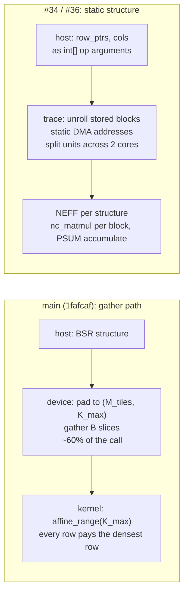

# trnsparse: the crossover density, with the sparsity pattern compiled in

Before [trnsparse#34](https://github.com/trnsci/trnsparse/pull/34), no sparse path in trnsparse beat plain dense aten on Trn2 (`matmul`, or unmasked SDPA), and about 60% of each BSR SpMM call went to padding and gathering on the device. The fix is to treat the block structure, which TorchNeuron already forces onto the host, as compile-time constants: the kernel unrolls exactly the stored 128×128 blocks with fixed DMA addresses and no gather, at the cost of one compile per distinct structure. The result is a measured crossover density by matrix size, which anyone choosing between BSR and dense on Trainium can read off a table.

<!-- more -->

## The problem

cuSPARSE's model is that the sparse matrix lives on the device. Row pointers, column indices and values are device arrays, and the kernel resolves the indirection at run time. A naive port to TorchNeuron fails at once, because `torch.sparse_csr_tensor` has no `neuron` implementation ([aws-neuron-sdk#1442](https://github.com/aws-neuron/aws-neuron-sdk/issues/1442), [trnsparse#30](https://github.com/trnsci/trnsparse/issues/30)). The [window-1 post](https://trnsci.dev/blog/trnsparse-from-1430-to-3030-on-nki-07/) concluded that this costs BSR "almost nothing", since the structure is a scheduling input and scheduling already happens on the host.

Window 2 showed the cost was real, just paid elsewhere. On `main` at `1fafcaf`, the native path still behaved like a device-structure design: it built a padded `(M_tiles, K_max)` grid of blocks, gathered the matching slices of B on the device, and handed both to a kernel with fixed loop bounds. Two consequences:

- **Pad and gather took about 60% of every call.** The Tensor Engine was not the bottleneck.
- **Every block row cost as much as the densest one.** With a global-token attention mask, `K_max` equals the total number of block columns, so one dense row made the whole matrix dense. At seq 8192, forward plus backward took 127–195 ms.

[The tile post](https://trnsci.dev/blog/trnsparse-the-tile-is-the-unit-not-the-nonzero/) said each block needs "no gather step", and [the v0.6.0 post](https://trnsci.dev/blog/trnsparse-what-trainium-thinks-a-sparse-matrix-is/) said "zero gather overhead". The tile post did note that padded rows "pay for the max". The claims were true of the format and false of the implementation. Each block was a Tensor Engine tile, but the code that lined the blocks up was the most expensive part of the call.

## What the architecture suggests

An NKI kernel is traced and compiled ahead of execution into a NEFF. Every Python value the trace knows becomes part of the instruction stream: loop trip counts, slice offsets, DMA sources and destinations. A GPU kernel reads a column index from memory and then issues a load. An NKI kernel can have the load address baked in, because it was known while the trace ran.

A BSR structure that lives on the host and changes rarely is exactly that kind of value. If `row_ptrs` and `cols` are tuples of Python ints at trace time, the kernel needs no gather, no padding to `K_max`, and no indirect DMA, which the tile post named as the blocker for row bucketing ([#15](https://github.com/trnsci/trnsparse/issues/15)). Each block row walks its own stored blocks, each B slice is a static DMA from a known offset, and PSUM accumulates across the row as before.

LNC=2 follows the same logic. On Trn2 a logical NeuronCore is two physical cores, and NKI traces the kernel once per core with `program_id` as a Python int. So deciding which core owns which output tile can also happen at trace time, from the same constants.



## The approach

[PR #34](https://github.com/trnsci/trnsparse/pull/34) added three custom ops whose structure arguments are `int[]`. They reach the kernel as tuples, and torch-neuronx keys the compiled kernel on them:

- `trnsparse::bsr_spmm_static` is now the default for `bsr_spmm` on the native path. It walks exactly the stored blocks and addresses B by block column.
- `trnsparse::attn_fwd_static`: one launch, two passes, softmax statistics on chip. Pass 2 puts keys on partitions, so P^T is directly the stationary operand of `P @ V`. No per-block score round trip through HBM, no host reduction, no K/V gather.
- `trnsparse::attn_bwd_static` computes dQ (row-first) and dK/dV (column-first) in one launch.

[PR #36](https://github.com/trnsci/trnsparse/pull/36) splits output tiles between the two physical cores with a deterministic longest-processing-time greedy over stored-block counts: a global-token row gets a core to itself, and every output tile has one writer. The same PR adds bf16: the matmuls run in bf16 with fp32 PSUM accumulation, while scores, softmax statistics and `exp` stay in fp32.

The deliberate tradeoff is **one compile per distinct structure**. That takes 1–16 s, cached in-process and keyed by the constants. A test with two structures of identical shape confirmed the cache does not alias them. A fixed attention mask or basis-set block pattern pays once; a pattern that changes every step pays every time. Two guards bound the damage: above `TRNSPARSE_STATIC_MAX_UNROLL` (16,384 unrolled block matmuls by default) the dispatcher falls back to the gather path, and `TRNSPARSE_STATIC_STRUCTURE=0` restores it outright.

Release status: #34 shipped in trnsparse [v0.8.0](https://github.com/trnsci/trnsparse/tree/v0.8.0) (tagged). The two-core split and bf16 from #36 are in [v0.9.0](https://github.com/trnsci/trnsparse/tree/v0.9.0).

## Implementation

The op wrapper, from `trnsparse/nki/_native.py`:

```python
@nki_op("trnsparse::bsr_spmm_static", mutates_args={}, fake_fn=_fake_bsr_spmm_static)
def bsr_spmm_static(
    blocks: torch.Tensor, b: torch.Tensor, row_ptrs: list[int], cols: list[int]
) -> torch.Tensor:
    # Structure arrives as int lists and reaches the kernel as tuples, i.e.
    # compile-time constants (torch_neuronx keys the compiled kernel on them).
    return _k._bsr_spmm_static_kernel(blocks, b, tuple(row_ptrs), tuple(cols))
```

The inner loop of `_bsr_spmm_static_kernel` in `trnsparse/nki/kernels.py`. The loops are plain Python `range` over Python ints, so they unroll at trace time:

```python
        for u in _assign_units(costs, n_prog, pid):
            m, nt = units[u]
            lo = row_ptrs[m]
            hi = row_ptrs[m + 1]
            r0 = m * _TILE_M
            n0 = nt * TILE_N
            if hi == lo:
                nl.store(
                    out[r0 : r0 + _TILE_M, n0 : n0 + TILE_N],
                    value=nl.zeros((_TILE_M, TILE_N), dtype=b.dtype),
                )
                continue
            psum = nl.zeros((_TILE_M, TILE_N), dtype=nl.float32, buffer=nl.psum)
            for idx in range(lo, hi):
                j = cols[idx]
                a_t = nl.load_transpose2d(blocks[idx, :, :])
                b_tile = nl.load(b[j * _TILE_K : (j + 1) * _TILE_K, n0 : n0 + TILE_N])
                nisa.nc_matmul(psum, a_t, b_tile, accumulate=True)
            _pp = nl.ndarray((_TILE_M, TILE_N), dtype=nl.float32)
            _pn = nl.ndarray((_TILE_M, TILE_N), dtype=nl.float32)
            nisa.activation(_pp, nl.relu, psum)
            nisa.activation(_pn, nl.relu, psum, scale=-1.0)
            c_sbuf = nl.copy(nl.subtract(_pp, _pn), dtype=b.dtype)
            nl.store(out[r0 : r0 + _TILE_M, n0 : n0 + TILE_N], value=c_sbuf)
```

`j` is an int, so `b[j * _TILE_K : ...]` is a fixed DMA. The last five lines are the PSUM evacuation, which comes up again in the bf16 results.

## What didn't work

**bf16 is correct, and it narrows sparsity's advantage.** Relative error is about 2e-3, which is bf16 output rounding. Against matched-precision dense aten, though, every crossover moves down. Dense `matmul` gets 1.6–3.3× faster in bf16. The sparse kernel gets 1.3–2.3× faster at 50% block density and less at low density. PR #36 attributes this to per-block cost being DMA and PSUM evacuation, not Tensor Engine work, so bf16's 4× PE rate barely shows. That reading comes from the shape of the numbers, not a profile. Three per-block costs are visible in the code:

- `load_transpose2d` of fp32 A blocks is a software DMA transpose, because the hardware DMA transpose (hwdge) handles 2-byte types only. Pre-transposed blocks were 30% faster at 10% density and width 512, but they need a cache keyed on block identity, so they were left out.
- The PSUM evacuation is two activations and a subtract.
- Each block makes its own DMAs.

**Two cores gave 1.1–1.6×, not 2×.** The launch floor, about 0.22 ms for the kernel alone, is the same on one core or two, and calls below about 0.3 ms are bound by it. At low density the floor dominates, and the split has little left to halve.

**The crossover moves between runs.** PR #34's one-core crossovers and PR #36's one-core column disagree by up to 10 points (see the crossover table). Both ran on a shared trn2.3xlarge. #34 reported about ±0.1 ms of noise below 1 ms. #36 ran every configuration in two rounds and kept the lower warm median; the rounds disagreed by more than 30% in about 60 of roughly 400 cells, almost all below 1 ms. A crossover near the launch floor is good to a few points of density at best.

**The reciprocal.** The kernel docstring records that the hardware reciprocal alone is accurate to only about 1e-3. *Correction:* a later on-device repro found `nl.reciprocal` accurate to about 1.5e-6 relative in range; its real hazard is a silent clamp (it returns 1e7 or 0) outside roughly |x| ∈ [2⁻⁴², 2⁴¹], and `nisa.reciprocal` on the Vector Engine is correctly rounded across the full fp32 range. The forward therefore computes `1/denom` as `rsqrt²`, and the backward uses exact aten division.

**CSR and screened SpMM still lose.** CSR with host structure now scatters nnz triplets on the device below 10% density instead of copying a host-built dense matrix: 4–11× faster at ≤1% density, still far behind `torch.sparse` on two CPU threads. Screened SpMM is 1.5–2× faster than on main and still 2–3× slower than dense `(A * mask) @ B` on the device. It has no tile skipping, so screening sparsity saves it nothing.

**Upstream.** [aws-neuron-sdk#1442](https://github.com/aws-neuron/aws-neuron-sdk/issues/1442) (sparse CSR on `neuron`) is open and acknowledged. BSR now routes around it, but `.to("neuron")` on a CSR tensor is still a hard failure rather than a fallback. [#1443](https://github.com/aws-neuron/aws-neuron-sdk/issues/1443) (simulator and `verify()` parity) still applies, so every new kernel was gated on `source_to_mlir(...).verify()` plus a full NEFF compile (84 cases in `tests/test_nki_compile.py`). Not yet filed: a 4-byte hwdge transpose, or documentation that fp32 `load_transpose2d` takes a software path.

### Fit

BSR at 128×128 is the native sparse format on Trainium, and now there are numbers for where it pays. Below n = 1024, nothing sparse wins. One launch costs about 0.3 ms end to end, and dense aten does the whole product in 0.14 ms. At n = 8192 in fp32, BSR beats dense up to 26% block density at width 128 and up to 49% at width 512. In bf16 those limits fall to 12% and 20%. Dense work is what the Tensor Engine does fastest, so sparsity pays only when skipped blocks save more than the per-block DMA and evacuation cost. That matches the suite-wide finding on Trn2: hand-written kernels win where they avoid work aten can't, not on raw GEMM.

Element-level CSR is a poor fit. With no device CSR and no indirect gather in trnsparse's kernels, every CSR call either densifies or scatters, and a small CPU pool beats both at low density. Static structure is also a poor fit for patterns that change on the device, such as iterative pruning or graph rewiring, because each change means a host round trip and a compile. A future chip, or SDK, with cheap indirect DMA would remove the reason to compile structure in. Until then, compiling it in is what this hardware rewards.

## Numbers

| Setup | |
|---|---|
| Hardware | trn2.3xlarge, LNC=2, one logical NeuronCore; box shared with other jobs throughout |
| Software | Neuron SDK 2.33.0: torch 2.14.0, torch-neuronx 2.14.3, NKI 0.7.0, neuronx-cc 2.28 |
| Data | structure on the host, dense operands on `device="neuron"`; warm medians, compile excluded |
| Host threads | `OMP_NUM_THREADS=2`; `taskset -c 8,9` (#34, also the CPU baselines), `taskset -c 6,7` (#36) |
| Baselines | dense aten on the device at the sparse kernel's precision; CPU columns on the same box |
| Sources | full tables on [#30](https://github.com/trnsci/trnsparse/issues/30), [#34](https://github.com/trnsci/trnsparse/pull/34), [#36](https://github.com/trnsci/trnsparse/pull/36); all times in ms |

**Gather path vs static structure, one core, fp32** (PR #34):

| n | width | block dens. | dense aten | main (gather) | static | static / dense |
|---|---|---|---|---|---|---|
| 1024 | 128 | 1% | 0.14 | 1.33 | 0.32 | 0.45× |
| 8192 | 128 | 1% | 0.85 | 2.30 | 0.31 | 2.73× |
| 8192 | 128 | 10% | 0.85 | 3.90 | 0.65 | 1.31× |
| 8192 | 128 | 50% | 0.85 | 7.22 | 2.27 | 0.38× |
| 8192 | 512 | 1% | 2.69 | 3.07 | 0.40 | 6.77× |
| 8192 | 512 | 10% | 2.69 | 5.41 | 1.41 | 1.91× |
| 8192 | 512 | 50% | 2.69 | 12.46 | 3.96 | 0.68× |

**BSR crossover block density vs dense aten** (PR #36, matched precision, linear interpolation):

| n | width | fp32 one-core | fp32 two-core | bf16 one-core | bf16 two-core |
|---|---|---|---|---|---|
| 1024 | any | never | — | — | — |
| 4096 | 128 | never (#34: ~2%) | ~10% | never | never |
| 4096 | 512 | ~26% (#34: ~16%) | ~34% | ~2% | ~4% |
| 8192 | 128 | ~14% | ~26% | ~7% | ~12% |
| 8192 | 512 | ~27% (#34: ~34%) | ~49% | ~9% | ~20% |

n = 1024 is from #34 only. #36 did not re-measure it.

**Two cores, fp32 vs bf16, n = 8192, width 512** (PR #36):

| block dens. | dense fp32 | BSR fp32 | dense bf16 | BSR bf16 |
|---|---|---|---|---|
| 1% | 2.33 | 0.32 | 0.71 | 0.30 |
| 10% | 2.33 | 0.67 | 0.71 | 0.46 |
| 25% | 2.33 | 1.36 | 0.71 | 0.82 |
| 50% | 2.33 | 2.38 | 0.71 | 1.40 |

**Block-sparse attention, seq 8192, forward + backward** (PR #36):

| hd | mask | block dens. | SDPA dense fp32 | one-core fp32 | two-core fp32 | SDPA dense bf16 | two-core bf16 |
|---|---|---|---|---|---|---|---|
| 64 | dilated | 25.0% | 6.25 | 10.90 | **5.64** | 3.32 | 5.09 |
| 64 | global | 7.7% | 6.25 | 4.42 | **3.29** | 3.32 | 3.99 |
| 64 | local | 4.6% | 6.25 | 3.64 | **2.98** | 3.32 | **2.83** |
| 128 | dilated | 25.0% | 6.48 | 10.78 | **5.16** | 3.26 | 5.16 |
| 128 | global | 7.7% | 6.48 | 4.38 | **3.51** | 3.26 | 3.76 |
| 128 | local | 4.6% | 6.48 | 3.90 | **3.01** | 3.26 | 3.36 |

In fp32 on two cores, forward plus backward beats unmasked dense SDPA at seq 8192 for every mask; at seq 4096 it loses (2.5–3.1 vs 2.0–2.1 ms). The forward alone never beats unmasked SDPA, a fused kernel at 0.71–0.85 ms; against SDPA with the mask applied (5.01–5.13 ms) it takes 0.84–2.08 ms. In bf16, dense SDPA wins every row except local at head dim 64 (local at 128 is a tie). Global-token masks moved most: 127–195 ms on main to about 4 ms on one core. Error against fp64 is about 1e-6 (fp32) and 2–3e-3 (bf16).

**The paths that still lose, n = 8192, width 128** (PR #34):

| op | density | dense aten (dev) | main | PR | CPU baseline |
|---|---|---|---|---|---|
| CSR SpMM | 0.1% elem | 0.85 | 156.79 | 13.95 | 0.86 (torch.sparse CSR) |
| CSR SpMM | 1% elem | 0.98 | 174.46 | 27.86 | 4.86 (torch.sparse CSR) |
| CSR SpMM | 10% elem | 0.90 | 158.89 | 168.36 | 55.52 (torch.sparse CSR) |
| screened SpMM | 17% kept | 1.30 (masked: 2.95) | 11.29 | 5.33 | 136.0 (masked dense) |

Against the CPU, whether dense or `torch.sparse`, the device BSR path wins at every size above n = 1024. The CPU baseline here is two threads, not a full socket.

## What's next

- [trnsparse#30](https://github.com/trnsci/trnsparse/issues/30): host-structure API. Next on the per-block overhead: pre-transposed fp32 blocks, a fused PSUM evacuation, and fewer, larger DMAs per block row.
- [Phase 3: #15](https://github.com/trnsci/trnsparse/issues/15): nnz-bucketing SpMM, streaming and the NEFF cache. The static-structure compile cost makes a persistent cache keyed on structure more interesting than before. [#22](https://github.com/trnsci/trnsparse/issues/22) covers on-chip iterative solvers over BSR, where a fixed A amortizes one compile over many iterations.
- [Phase 4: #16](https://github.com/trnsci/trnsparse/issues/16): sharded sparse matrices across chips.
- [Phase 5: #17](https://github.com/trnsci/trnsparse/issues/17): trn2 DMA bandwidth for SpMM. After this window, that is where the remaining per-block cost lives.

Suite context: [roadmap](https://trnsci.dev/roadmap/), [suite tracker](https://github.com/trnsci/trnsci/issues/1), [trnsci.dev](https://trnsci.dev).

## Takeaway

On Trainium, a sparsity pattern that is known before the kernel runs is not data. It is part of the program. Compiling it in replaces gathers and padding with fixed DMAs, and the device then pays only for the blocks that are stored. That buys a 6.8–7.3× win over dense at 1% block density (n = 8192, width 512), and a crossover that climbs with matrix size, up to about 49% block density in fp32. Below n = 1024, or for element-level CSR, or when the pattern changes every step, dense aten or the CPU is the better tool, and the tables say so.
