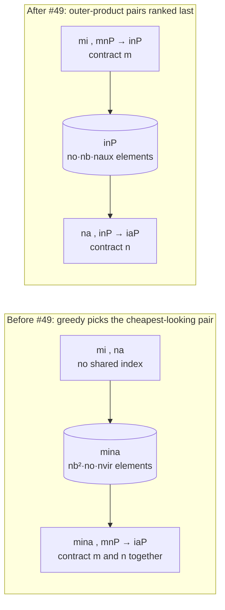

# trntensor: on Trn2 the planner earns its keep, the kernels don't

On the native TorchNeuron path, trntensor's hand-written NKI kernels did not beat aten on the device at any size measured, so [trntensor v0.18.0](https://github.com/trnsci/trntensor/releases/tag/v0.18.0) now routes plain and fused contractions to aten by default. What the library does add on Trn2 sits one level up, in the host-side planner: contraction order, batching and precision modes. That planner had a bug that built a 4-index outer product, which cost 70 ms on a contraction that should take about 1 ms. Anyone writing contraction code for Trainium, or deciding whether a hand-written kernel is worth it, may find the measured split between "plan" and "kernel" more useful than any single speedup.

<!-- more -->

!!! warning "Correction (2026-11-01)"
    "The kernels don't" no longer holds. Kernels rewritten for Trn2 beat aten in their `auto` regions: AO→MO by 1.3–1.6× at nbasis ≥ 256 and the MP2 energy by 1.25–1.9× above 3 GFLOP per occupied row ([trntensor#52](https://github.com/trnsci/trntensor/pull/52), [v0.19.0](https://github.com/trnsci/trntensor/releases/tag/v0.19.0)). The new fused DF exchange build takes K at n_ao = 970 to 94 ms, against 304 ms for the aten-and-`syrk` unpack path ([#62](https://github.com/trnsci/trntensor/pull/62), [#66](https://github.com/trnsci/trntensor/pull/66), v0.21.0–[v0.22.0](https://github.com/trnsci/trntensor/releases/tag/v0.22.0)). Plain matmul and bmm still lose to aten, and the planner result below stands; the kernel tables measure the original NKI 0.3-era kernels.

## The problem

trntensor's NKI kernels were written against NKI 0.3 on trn1, behind the PyTorch/XLA path. Their purpose rested on two posts. [When the kernel boundary is the API](2026-04-15-trntensor-kernel-boundary-as-api.md) argued that fused primitives such as `mp2_energy` and `ao_to_mo_transform` are the native Trainium shape for contraction. [Dispatch granularity is the architecture](2026-04-17-trntensor-dispatch-is-the-architecture.md) argued that a fixed 0.67 ms XLA dispatch floor meant the kernel boundary belonged at the loop.

The move to TorchNeuron on Trn2 came in four stacked PRs. [#43](https://github.com/trnsci/trntensor/pull/43) fixed the kernels that NKI 0.7's verifier rejected. [#44](https://github.com/trnsci/trntensor/pull/44) made the precision bounds honest. [#45](https://github.com/trnsci/trntensor/pull/45) put reduce-parallel einsum on a real all-reduce ([trntensor#30](https://github.com/trnsci/trntensor/issues/30)), which is the subject of [the previous post](2026-10-27-trntensor-real-allreduce.md). [#46](https://github.com/trnsci/trntensor/pull/46) registered all four kernels as `trntensor::` custom ops through `torch_neuronx.nki_op`, without changing a kernel body.

#46 also had to pick dispatch thresholds. It chose 1 G multiply-adds before host operands leave the host, and 128 M before NKI takes over from aten for device-resident operands. Its PR body labels both "provisional estimates, not measurements". The baseline changed too. The earlier posts measured the kernels against host torch. On TorchNeuron, aten runs eagerly on the `neuron` device, on the same Tensor Engine, so the real question is whether the kernel beats aten there. The XLA-era tables never asked it.

The cuTENSOR analog splits the work: cuTENSOR executes a binary contraction, and something like `opt_einsum` picks the order. A port puts the effort into the executor. Trn2 suggests the order.

## What the architecture suggests

Once aten runs eagerly on the device, a hand-written kernel and aten draw on the same engines, SBUF and PSUM. A kernel can only win by changing the work: doing fewer operations, moving fewer bytes through HBM, or paying a lower launch cost. On launch cost the custom op starts behind. Its floor is about 0.24 ms, against about 0.13 ms for aten. On raw GEMM, trntensor's kernels, written for trn1, lose to whatever aten lowers to on Trn2, at every size.

That leaves two places where the library can change the work. One is inside a fused kernel. `mp2_energy` keeps each pair block in SBUF and PSUM and never writes the nocc²·nvir² amplitude tensor `T` to HBM. That advantage is real, but it only pays off once `T` stops fitting comfortably. The other is before any kernel runs: the order in which a 3+-operand einsum is contracted. That choice changes the operation count by orders of magnitude, and no executor can win it back. On Trn2 that host-side decision turned out to be the larger lever.



For DF-MP2's AO→MO transform at nb=256, no=32, naux=512, the left path took 70 ms and the right path 1.16 ms, on the same device with the same executor.

## The approach

[PR #49](https://github.com/trnsci/trntensor/pull/49) replaced the estimates with measurements and accepted the verdict.

- **Three executors, not two.** `_route(flops, pinned)` returns `"host"` (torch on the operands' own device), `"aten"` (move host operands to `neuron`, run aten, bring the result back) or `"nki"`. The native defaults are 500 M multiply-adds for offload and `never` for NKI on the device.
- **Fused kernels only when asked.** Under native `"auto"`, `mp2_energy` and `ao_to_mo_transform` run as aten. `set_backend("nki")` or explicit thresholds still reach every kernel, and the XLA (Trn1) path is unchanged.
- **The planner ranks outer-product pairs last.**
- **The aten references became real implementations.** `ao_to_mo_transform` became two explicit binary einsums. `mp2_energy` became a vectorized form chunked over `i`, about 64 MiB of `T` per chunk, run on the operands' device.
- **Precision modes stay intact.** `kahan` is still a host fp64 contraction. `dd` still raises on NKI hosts until [trnblas#22](https://github.com/trnsci/trnblas/issues/22) lands. When the aten route handles an `sr` matmul, the one-time `NEURON_RT_STOCHASTIC_ROUNDING_EN` warning from #43 still fires, because stochastic rounding is a process-wide runtime setting either way.

There were two deliberate tradeoffs. First, the kernels stay in the tree and stay tested: `pytest -m neuron` passes 29 with 3 skipped, and MLIR verify passes 27/27 across trn1, trn2 LNC=1 and trn2 LNC=2. Deleting them would also delete the one property aten can't provide, an MP2 energy that never holds `T`. Second, the offload threshold is 500 M, not the 40 M that `autotune_dispatch.py` recommended on the box. The autotune rule backs off to just above the last losing shape. The crossover also moves with the number of host threads, and the sweep used two. A default should survive a host with more cores; per-host calibration remains the override.

## Implementation

The router, from `trntensor/nki/dispatch.py` on `main`:

```python
def _route(flops: int, pinned: bool) -> str:
    if not _on_native_path():
        return "nki" if flops >= _nki_flop_threshold(pinned) else "host"
    nki_ok = flops >= _MIN_NKI_FLOPS_NATIVE_PINNED
    if pinned:
        return "nki" if nki_ok else "host"
    if flops < _MIN_NKI_FLOPS_NATIVE:
        return "host"
    return "nki" if nki_ok else "aten"
```

With `_MIN_NKI_FLOPS_NATIVE_PINNED = NKI_NEVER` (2⁶³ − 1), `nki_ok` is never true on native unless the user sets a number. Thresholds now parse `never` and `inf` from environment variables and the autotune cache.

The planner fix, from the greedy path search in `trntensor/plan.py`, is a change to the cost key:

```python
flops = 1
for idx in pair_union:
    flops *= size_map.get(idx, 1)
outer = not (set(inputs[i]) & set(inputs[j]))
cost = (outer, flops)
```

Before #49 the key was `flops` alone, the product of index sizes in the pair's union. That estimates the step's cost but ignores the size of what it leaves behind. For `mi,na,mnP->iaP`, the pair `mi,na` has union cost nb²·no·nvir and `mi,mnP` has nb²·no·naux. With nvir < naux the outer product looked cheaper, so the greedy search chose it, and every later step paid for the 4-index intermediate. The tuple key keeps "smallest step first" among pairs that share an index, and only falls back to an outer product when nothing else is left.

## What didn't work

**The kernels.** On device-resident operands, `matmul` and `bmm` lost to aten at every size from 128³ to 4096³ in fp32 and bf16, by 2.5–5× at the large end. PR #49's summary puts the fused AO→MO kernel at 6–20× slower than two aten einsums. The end-to-end `ao_to_mo_transform` before-and-after rows below show a wider gap than that, and the PR doesn't break down where the rest goes. The MP2 energy kernel was never faster. In the measured rows it ran 1.0–1.8× slower than the vectorized aten form, reaching parity only at nvir=128, where no padding is needed. The kernels have not been profiled or re-tuned for Trn2. They are the trn1 kernels, changed in #43 only as far as NKI 0.7's verifier required. The honest reading is "unoptimized for Trn2", not "can't win", but a dense GEMM kernel is not where a contraction library's effort should go.

**The provisional thresholds.** The hint was already on file. Window 1's spike, recorded in the body of [trntensor#41](https://github.com/trnsci/trntensor/issues/41), measured aten matmul beating `matmul_kernel` from N ≥ 512 (0.82 ms against 2.33 ms at N=2048). #46 still shipped a pinned threshold of 128 M, which sent device-resident matmuls from about 512³ upward to the slower kernel. The PR was candid that this was an estimate. Releasing the estimate as a default anyway was the mistake.

**The planner bug.** The greedy path search shipped in Phase 3 ([trntensor#29](https://github.com/trnsci/trntensor/issues/29)) and passed its tests on small shapes, where an outer product of two thin matrices costs nothing worth noticing. At nb=256, trntensor's own `einsum` took 70.11 ms, slower than aten's `torch.einsum` on the device (57.88 ms), whose 3-operand einsum is similarly slow at that size. A library whose remaining claim to value is planning was losing to aten on planning. A threshold-calibration sweep surfaced it.

**Smaller things the sweep caught.**

- `autotune_dispatch.py` reported 2·M·K·N, but dispatch compares M·K·N, so every recommended threshold was off by a factor of two.
- `multi_einsum` could mix host and `neuron` operands in small contractions, which raised `input tensor is on cpu device, expected neuron` and failed three CPU-suite tests on the box.
- The non-NKI `mp2_energy` path was a nocc² Python loop taking 131.4 ms where the vectorized form takes 3.14 ms.

**What this changes in the earlier posts.** The kernel-boundary post's architectural point still holds: a fused NKI program can keep `T` out of HBM, and cuTENSOR's plan model has no name for that. Its implied claim that fused kernels are faster does not hold on Trn2's native path at the sizes measured. Its tables compared against host torch, which flattered the kernels. The same post listed "3+ operand einsums fall back to `torch.einsum`, losing the optimal-order choice" as a gap. That gap turned out to be where the value is. The dispatch post's 0.67 ms floor was a property of the XLA path. On native, the floors are 0.13 ms for aten and 0.24 ms for the NKI custom op, so dispatch granularity now argues against custom ops at small sizes rather than for fusing them. Its batching idea survives: homogeneous `multi_einsum` batching still beats an aten loop at 256³ and 512³. It loses at 1024³, and on the MP2 J/K pair it is slower than aten.

**Fit.** Trn2's Tensor Engine is well suited to the GEMMs inside these contractions, and aten already reaches it well. The suite-wide pattern from this window applies here: on Trn2, hand-written kernels win where they avoid work aten can't, not on raw GEMM. trntensor's real work-avoidance happens on the host, in the plan. On-chip, the one candidate is `mp2_energy`'s never-materialized `T`, and that only matters once the chunked aten form gets into trouble. The suite has seen that kind of trouble. trnblas found that an eager DF-MP2 loop slows 30–50× as device memory fills and then fails with "Failed to load model" ([aws-neuron/aws-neuron-sdk#1447](https://github.com/aws-neuron/aws-neuron-sdk/issues/1447)). Whether trntensor's fused kernel avoids that regime is unmeasured. One ask has not been filed yet: documentation of the per-launch cost of an `nki_op` custom op relative to an aten op, and of whether that 0.11 ms gap can be closed, would help every library deciding where a kernel boundary pays.

## Numbers

trn2.3xlarge, Neuron SDK 2.33.0 (torch-neuronx 2.14.3, NKI 0.7.0, neuronx-cc 2.28.7631), native `neuron` device. The runs used one NeuronCore (`NEURON_RT_VISIBLE_CORES=2`) and two host threads pinned with `taskset -c 6,7` and `OMP_NUM_THREADS=2`. Values are warm medians in ms. Device rows use device-resident operands and are timed to `torch.neuron.synchronize()`. The host was shared with other jobs, so expect about ±0.05 ms of noise near the launch floor and ±0.3 ms on the small MP2 rows. Some host fp32 `matmul` values in PR #49 come from an unpinned rerun after contention. Full tables are in [#49](https://github.com/trnsci/trntensor/pull/49), and every variant agrees with an fp64 reference to ≤ 5e-7 relative error.

**`ij,jk->ik` and `bij,bjk->bik`, device-resident (selected rows):**

| Shape | host fp32 | aten dev fp32 | NKI fp32 | aten dev bf16 | NKI bf16 |
|---|---|---|---|---|---|
| 128³ | 0.036 | 0.129 | 0.234 | 0.131 | 0.239 |
| 512³ | 0.753 | 0.149 | 0.268 | 0.137 | 0.255 |
| 1024³ | 5.624 | 0.197 | 0.548 | 0.160 | 0.285 |
| 2048³ | 42.81 | 0.598 | 2.217 | 0.265 | 1.049 |
| 4096³ | 367.5 | 4.131 | 11.91 | 1.376 | 6.847 |
| bmm 32×512³ | 33.69 | 0.419 | 1.208 | 0.210 | 0.495 |
| bmm 8×1024³ | 54.43 | 0.618 | 1.791 | 0.278 | 1.024 |

**DF-MP2 AO→MO, `mi,na,mnP->iaP`, fp32 (nvir = nb − no):**

| nb, no, naux | host | aten `torch.einsum` (dev) | `tt.einsum` before | `tt.einsum` after | `ao_to_mo_transform` before (NKI) | after (aten) |
|---|---|---|---|---|---|---|
| 64, 8, 128 | 2.39 | 0.336 | 0.533 | 0.474 | 6.00 | 0.491 |
| 128, 16, 256 | 85.0 | 0.814 | 2.942 | **0.508** | 16.45 | **0.510** |
| 256, 32, 512 | 1878 | 57.88 | 70.11 | **1.159** | 111.9 | **1.261** |

**MP2 energy, fp32:**

| no, nv, naux | aten dev (vectorized) | NKI kernel | old non-NKI loop | `tt` auto after |
|---|---|---|---|---|
| 8, 32, 128 | 0.836 | 0.886 | 2.348 | 1.326 (within noise) |
| 16, 64, 256 | 0.995 | 1.774 | 11.96 | 1.120 |
| 16, 128, 512 | 1.304 | 1.321 | 33.05 | 1.472 |
| 32, 128, 512 | 3.061 | 4.457 | 131.4 | **3.142** |

**`multi_einsum` and chains, fp32** (the aten column includes `.cpu()` on each result):

| Case | aten dev loop | `tt` before | `tt` after |
|---|---|---|---|
| 8× `ij,jk->ik` 256³, shared B | 1.408 | 0.679 | 0.692 |
| 8× `ij,jk->ik` 512³, shared B | 1.976 | 1.479 | 1.175 |
| 8× `ij,jk->ik` 1024³, shared B | 12.90 | 12.63 | 13.34 |
| MP2 J/K pair, no=16, nv=128, naux=512 | 26.00 | 27.72 | 29.17 |
| chain `ij,jk,kl->il` 1024³ | 0.429 | 1.997 | **0.311** |
| chain `ij,jk,kl->il` 2048³ | 1.144 | 15.26 | **1.145** |

#49 doesn't break the chain's 15.26 → 1.145 ms change down between the routing change and the planner change.

**Thresholds (native path, M·K·N):**

| Threshold | #46 (estimate) | #49 (measured) | Evidence |
|---|---|---|---|
| `TRNTENSOR_MIN_NKI_FLOPS_NATIVE` (host operands leave the host) | 1 G | 500 M | device offload beat host torch from 134 M (fp32) and about 0.5–1 G (bf16) with two host threads |
| `TRNTENSOR_MIN_NKI_FLOPS_NATIVE_PINNED` (NKI replaces aten on device) | 128 M | `never` | autotune: "NKI beats aten from: never", 128³ through 4096³ |

## What's next

- **Shipped in [v0.18.0](https://github.com/trnsci/trntensor/releases/tag/v0.18.0):** native dispatch ([#46](https://github.com/trnsci/trntensor/pull/46)) and the measured routes and planner fix ([#49](https://github.com/trnsci/trntensor/pull/49)). The tag is on GitHub but not yet on PyPI.
- **Phase 4: sharded contractions across chips** ([trntensor#30](https://github.com/trnsci/trntensor/issues/30)): multi-chip reduce-parallel, once a trn2.48xlarge or UltraServer is available.
- **Phase 5: trn2 fused multi-contraction paths** ([trntensor#31](https://github.com/trnsci/trntensor/issues/31)). After this window, the bar for a fused path is beating chunked aten on the device, not host torch. The `T`-never-in-HBM regime is the first place to look.
- **The XLA cross-kernel bug on trn1** ([trntensor#39](https://github.com/trnsci/trntensor/issues/39)) is still open.
- **Sibling work:** trnblas reached the same GEMM verdict and routed device GEMMs to aten. Its fused `pair_energy_sym` kernel is the suite's example of a kernel that wins by avoiding work.

Hardware-window record: [trnsci#35](https://github.com/trnsci/trnsci/issues/35). Live roadmap: [trnsci.dev/roadmap/](https://trnsci.dev/roadmap/). Suite tracker: [trnsci/trnsci#1](https://github.com/trnsci/trnsci/issues/1).

## Takeaway

On Trn2's native path, aten already drives the Tensor Engine better than trntensor's hand-written GEMM and fused kernels, so the library now routes to it. What a contraction library can still contribute is the decision aten doesn't make well: which pair to contract first. One cost-key change turned a 70 ms outer-product path into a 1.16 ms one. No kernel could have recovered that. The earlier posts were right that the kernel boundary is a design surface. On this hardware, the most valuable boundary to design turned out to be the one between the plan and whatever executes it.
