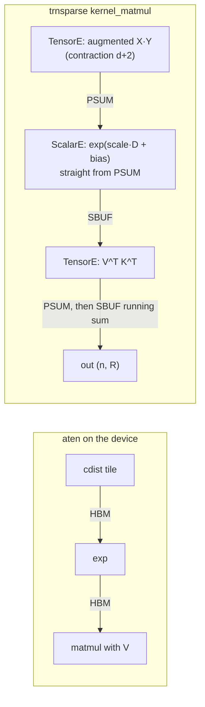

# trnsparse and trnsolver: a million-point Gaussian process on one Trn2 chip, and what the hardware actually limits

An exact Gaussian-process posterior mean at n = 10⁶ now converges on one trn2.3xlarge chip in [813 s](https://github.com/trnsci/trnsolver/pull/117#issuecomment-6608478916). It rests on trnsparse's fused `K(X, Y) @ V` kernel, which never writes the kernel matrix anywhere: squared distances as one Tensor Engine matmul into PSUM, the exponential on the Scalar Engine reading PSUM directly, then the product with V. The profile then showed that the planning number, 10¹² kernel entries per second per chip, was about [4× too optimistic for fp32](https://github.com/trnsci/trnsparse/issues/93#issuecomment-6598554499) even with perfect engine overlap. This post is for anyone running kernel methods or attention-shaped workloads who wants to know which Trainium engine is the real limit.

<!-- more -->

!!! note "Code status"
    The 813 s run used trnsparse at `a797170`, before #107, so it does not include the instruction-count gain. All runs: trn2.3xlarge, public Neuron SDK 2.33.0 (torch-neuronx 2.14.3, NKI 0.7.0, neuronx-cc 2.28).

    | piece | PR | release |
    |---|---|---|
    | fused `kernel_matmul` | [trnsparse#99](https://github.com/trnsci/trnsparse/pull/99) | [trnsparse v0.14.0](https://github.com/trnsci/trnsparse/releases/tag/v0.14.0) |
    | row blocking for the 30 s timeout | [trnsparse#101](https://github.com/trnsci/trnsparse/pull/101) | v0.14.0 |
    | 4-core spread | [trnsparse#104](https://github.com/trnsci/trnsparse/pull/104) | v0.14.0 |
    | fewer instructions, default group ≤ 16 | [trnsparse#107](https://github.com/trnsci/trnsparse/pull/107) | v0.14.0 |
    | group 32 as the default maximum | [trnsparse#108](https://github.com/trnsci/trnsparse/issues/108) | open, unreleased |
    | `cg_block`, pivoted preconditioner, host-fp64 apply | [trnsolver#107](https://github.com/trnsci/trnsolver/pull/107) | [trnsolver v0.22.0](https://github.com/trnsci/trnsolver/releases/tag/v0.22.0) |
    | batched build, `apply="projected"` (opt-in; `"auto"` is still `"host64"`) | [trnsolver#117](https://github.com/trnsci/trnsolver/pull/117) | v0.22.0 |
    | `examples/gp_regression/` | [trnsci#117](https://github.com/trnsci/trnsci/pull/117) | open PR |

## The problem

Exact GP regression needs solves with K̂ = K(X, X) + σ²I. At n = 10⁶, K is 4 TB in fp32, so a dense Cholesky is out of the question. The matrix-free alternative, tracked in [trnsci#109](https://github.com/trnsci/trnsci/issues/109), is preconditioned conjugate gradients. It computes K̂·V on the fly, and it solves many right-hand sides per iteration: here R = 33, the data vector plus 32 random probes for a later log-determinant. Almost all of the cost is the operator.

On a GPU the usual tool is KeOps under GPyTorch, or cuBLAS GEMM tiles plus an elementwise `exp`. The naive Trainium port is the second, in aten: tiled `cdist`, `exp`, matmul, each tile round-tripping through HBM. On the device that ran at [4–7e9 entries/s](https://github.com/trnsci/trnsparse/pull/99#issuecomment-6597365993).

## What the architecture suggests

The squared distance ‖x − y‖² = ‖x‖² + ‖y‖² − 2x·y is an inner product of augmented vectors: `[-2y, 1, ‖y‖²] · [x, ‖x‖², 1]`. So a whole 128 × 512 distance tile is **one `nc_matmul`** with contraction depth d + 2, and it lands in PSUM. The Scalar Engine's `activation` instruction can read PSUM, apply `exp(scale·D + bias)`, and write the kernel tile into SBUF, with the outputscale folded into the bias. The Tensor Engine then multiplies that tile by the matching rows of V and accumulates into another PSUM bank. K exists one tile at a time, on chip, and never touches HBM.

This is block-sparse attention without the softmax normaliser, and trnsparse already had [that tiling](2026-10-31-trnsparse-crossover-density.md). [The kernel issue](https://github.com/trnsci/trnsparse/issues/93) budgeted about 512 Tensor Engine cycles per tile for the distances and about 512 Scalar Engine cycles for the `exp`, and assumed the two would overlap. That gave the planning number of 10¹² entries/s per chip, labelled there as "a hypothesis to measure, not a claim."



## The approach

[trnsparse#99](https://github.com/trnsci/trnsparse/pull/99) implements this as one NKI launch per operator application, for RBF and three Matérn kernels. Most of the work was fitting the idea to NKI 0.7's rules:

- **Rolled loops.** In NKI 0.7, `affine_range` unrolls, and n = 16k already took 9 s to trace. The tile loops are `nl.fori_loop`, so trace and compile time stay constant in n.
- **No PSUM across a rolled loop.** neuronx-cc rejects it with `NCC_IBIR092`. Each loop body accumulates its group of Y tiles in PSUM, and the Vector Engine adds that partial into an SBUF running sum.
- **Identical control flow on both physical cores** at LNC=2. The compiler folds zero- and one-trip loops, so every core runs the same trip counts, and a core with no rows left recomputes the last chunk, writing the same bits twice.
- **Hyperparameters as a tensor**, not trace constants, because of the closure-constant trace-cache bug ([aws-neuron-sdk#1454](https://github.com/aws-neuron/aws-neuron-sdk/issues/1454)). New lengthscales never recompile.

The deliberate tradeoff is **fp32 distances**. The augmented expansion cancels for nearby points, with a per-entry error of about u·‖x‖²/ℓ² ([trnsci#109](https://github.com/trnsci/trnsci/issues/109#issuecomment-6591390306)). The host centres X, which is exact because the kernel is translation-invariant, and bf16 distances were ruled out. That choice turns out to set the throughput ceiling.

On the solver side, [trnsolver#107](https://github.com/trnsci/trnsolver/pull/107) added `cg_block`: R CG recurrences driven by one operator call per iteration, with a host convergence check every 10 iterations, and a rank-1024 pivoted-Cholesky preconditioner built from `op.diag` and `op.rows`.

## Implementation

The heart of a loop body in `_kmv_body`, from [`trnsparse/nki/kernels.py` at v0.14.0](https://github.com/trnsci/trnsparse/blob/v0.14.0/trnsparse/nki/kernels.py):

```python
for k, jr in enumerate(sizes):
    off = sum(sizes[:k])
    yb = y_all[:, off : off + jr]  # (d + 2, jr): stationary
    d_ps = ring[k % len(ring)][0:jr, 0:ni]
    nisa.nc_matmul(d_ps, yb, xb, accumulate=False)  # D^T, Y on partitions
    kt = _kmv_entries(d_ps, prm, kind, jr, ni)
    vk = v_all[:, k, :] if full else nl.load(v[nl.ds(j, jr), p0 : p0 + pr])
    for ri, (r0, rr) in enumerate(rg):
        # out^T += V_j^T K^T; the body's first Y tile opens
        # the accumulation group (accumulate=False).
        vb = vk[0:jr, r0 - p0 : r0 - p0 + rr]  # (jr, rr): stationary
        nisa.nc_matmul(ps[ri], vb, kt, accumulate=k > 0)
    j = j + jr
```

For RBF, `_kmv_entries` is a single instruction: `nisa.activation(k, nl.exp, d_ps, bias=log_s, scale=a)`, with `d_ps` in PSUM as its input.

## What didn't work

**The 30 s launch timeout.** The first device numbers were good: [2.6–2.7e10 entries/s per logical core](https://github.com/trnsci/trnsparse/pull/99#issuecomment-6597365993), flat in R from 1 to 128, and bitwise equal at LNC=1 and LNC=2. Then n = 2²⁰ failed with `NRT status 5, execution timeout (30000 ms)`, because one launch needs about 40 s ([trnsparse#100](https://github.com/trnsci/trnsparse/issues/100)). The fix is host-side row blocks of X ([#101](https://github.com/trnsci/trnsparse/pull/101)). The first block rule weighted its budget by (d + R), even though the same day's measurements showed the rate flat in R. That undersized blocks by about 36×: 512 launches, each re-running an O(m·d) prologue that stages Y, at about 75 ms apiece. The result was correct, bitwise, and [2× slower](https://github.com/trnsci/trnsparse/pull/101#issuecomment-6597358799): 78.7 s. Budgeting on entries alone (6e10 per launch) gives 19 launches and [42.2 s](https://github.com/trnsci/trnsparse/pull/101#issuecomment-6598211944), the single-launch rate.

**The 10¹² hypothesis.** A [`neuron-explorer` profile](https://github.com/trnsci/trnsparse/issues/93#issuecomment-6598554499) of one launch answered the questions the kernel issue had asked:

- **41% of each launch has no engine active.** The Tensor Engine is busiest at 46%, the Scalar Engine 13%. About 8.4M instructions in 0.65 s: issue-bound, not compute-bound.
- **The `exp` is not on the critical path.** Replacing it with an identity, or moving it to the Vector Engine, changed wall time by under 1%.
- **The d + 2 = 5-row distance matmul costs as much as a full one.** Tensor Engine time per `nc_matmul` is set by the moving operand's 512 columns and fp32 passes, not by the contraction depth. Five of 128 PE rows means the array is about 4% occupied while it is busy.
- **At R = 128 the core was power-throttled 30% of the time.**

The hope was misplaced for fp32 because the hypothesis counted cycles as if a shallow contraction were cheap and as if instruction issue were free. Neither is true. Even with every idle cycle removed, the fp32 ceiling is about 5.7e10 per logical core, or [2.3e11 per chip](https://github.com/trnsci/trnsparse/issues/103), about 4× below 10¹². Getting to 10¹² would need about 4× less Tensor Engine work per entry: a bf16 distance with error control, such as a three-way split or per-tile recentring, because the expansion's cancellation rules out plain bf16. A [later gate](https://github.com/trnsci/trnsparse/issues/93#issuecomment-6606985998) confirmed that device fp32 matmul really is fp32, not silently bf16 (relative error 1.40e-5 against 1.89e-5 on the CPU; bf16 would give about 1e-2), so these are fp32-rate figures.

**The preconditioner cancelled in fp32.** The Woodbury apply `(V − W WᵀV)/s` subtracts two nearly equal quantities on the captured subspace. In fp32, preconditioned CG at n = 2×10⁴, noise 1e-3, did not converge in 150 iterations; with the same preconditioner applied in fp64 it took 20 ([trnsolver#107](https://github.com/trnsci/trnsolver/pull/107#issuecomment-6593755679)). The fix moved the apply to host fp64, which accounted for most of about 5 s of host work per iteration at n = 10⁶ until [trnsolver#117](https://github.com/trnsci/trnsolver/pull/117) replaced it with a projected form: an orthonormal basis Q of L's range, with the projection applied twice so the cancelling component is removed. That runs as four fp32 GEMMs on the device in 92 ms.

**Bitwise across cores, but not across LNC end to end.** The operator, the preconditioner factor and its apply are all bitwise equal at LNC=1 and LNC=2. The CG solution at n = 10⁵ is not: [max difference 2.1e-2](https://github.com/trnsci/trnsolver/pull/107#issuecomment-6599507216), or 4.5e-4 in the posterior mean. A [minimal repro](https://github.com/trnsci/trnsolver/pull/107#issuecomment-6601261459) traced it to every device reduction over n: `sum`, `vector_norm`, and matmul-based reductions all round differently at the two LNC settings, while elementwise ops do not. That is expected floating-point behaviour, not a bug, and it is documented on the PR.

**Smaller slips.** The v0.14.0 CHANGELOG says a 4-tile body is bit-identical to 0.13.0. That holds in the simulator; on hardware the two orientations of the @V matmul round differently ([max difference 1.5e-5](https://github.com/trnsci/trnsparse/pull/107#issuecomment-6610975288), with unchanged accuracy against fp64). And `scipy.linalg.cho_factor` [segfaulted with threaded OpenBLAS](https://github.com/trnsci/trnsci/pull/117#issuecomment-6596438890) on the Trn2 host, so host LAPACK ran single-threaded throughout.

**Upstream asks.** The profiler summary reports "no engine active" as one number; splitting it into issue stalls, semaphore waits and DMA waits would have found the instruction overhead without ablations. An LNC-invariant mode for aten reductions, even a slower one, would allow deterministic iterative solvers without host round trips. Already filed: [#1451](https://github.com/aws-neuron/aws-neuron-sdk/issues/1451) (cross-core copies), [#1453](https://github.com/aws-neuron/aws-neuron-sdk/issues/1453) (tracing is not thread-safe) and [#1456](https://github.com/aws-neuron/aws-neuron-sdk/issues/1456) (dispatch floor).

### Fit

The workload fits well. X is about 12 MB at n = 10⁶ and d = 3, tiny next to the work, and the TensorE → PSUM → ScalarE → TensorE chain is the one attention uses. The [4-core spread](https://github.com/trnsci/trnsparse/pull/104#issuecomment-6600507112) scales 3.88×, bitwise identical across core counts and block shapes. It fits badly in one place: low-dimensional inputs leave the systolic array almost empty, and packing several distance tiles into one matmul doesn't help, because the output bank and the moving columns bound each instruction, not the contraction depth. A future chip whose matmul throughput scaled with short contractions (K ≤ 8) would help every low-d kernel method.

## Numbers

| Setup | |
|---|---|
| Hardware | trn2.3xlarge, LNC=2; "core" means logical NeuronCore (2 physical) |
| Software | Neuron SDK 2.33.0: torch-neuronx 2.14.3, NKI 0.7.0, neuronx-cc 2.28 |
| Problem | RBF, d = 3, fp32, synthetic field with known hyperparameters |
| Host | pinned to 2 vCPUs unless stated; `OPENBLAS_NUM_THREADS=1` (segfault workaround) |
| CPU baseline | the same algorithm, same box, 2 pinned threads. All-vCPU and gpytorch baselines were **not** run (see below) |

**Operator throughput, one logical core, entries/s** ([trnsparse#99](https://github.com/trnsci/trnsparse/pull/99#issuecomment-6597365993)):

| n = m | R | nki | aten (device) | CPU, 2 threads |
|---|---|---|---|---|
| 131072 | 1 | 2.64e10 | 7.01e9 | 5.31e7 |
| 131072 | 128 | 2.74e10 | 5.63e9 | 2.80e7 |
| 262144 | 1 | 2.69e10 | 5.30e9 | 5.13e7 |
| 262144 | 128 | 2.79e10 | 4.26e9 | 2.99e7 |

**One apply at n = 2²⁰, R = 33** ([#101](https://github.com/trnsci/trnsparse/pull/101#issuecomment-6598211944), [#104](https://github.com/trnsci/trnsparse/pull/104#issuecomment-6600507112)):

| version | launches | time | entries/s |
|---|---|---|---|
| one launch | 1 | about 40 s: killed at 30 s | — |
| blocks weighted by (d + R) | 512 | 78.7 s | 1.40e10 |
| blocks budgeted on entries, 1 core | 19 | 42.2 s | 2.61e10 |
| 2 cores | 20 | 21.5 s | 5.11e10 |
| 4 cores | 20 | **10.85 s** | **1.01e11** (3.88×) |

**Instruction-count rework, one logical core** ([trnsparse#107](https://github.com/trnsci/trnsparse/pull/107#issuecomment-6610975288)). Instructions per 128 × 512 tile per core, counted from the NEFF, fell from 44.0 to 13.4 at group 16.

| build, n = 131072 | R = 1 | R = 128 | vs main |
|---|---|---|---|
| main | 2.64e10 | 2.75e10 | 1.00 |
| group 4 | 2.68e10 | 2.70e10 | 1.02 / 0.98 |
| group 16 (v0.14.0 default) | 3.44e10 | 4.29e10 | **1.30 / 1.56** |
| group 32 (#108, unreleased) | 3.50e10 | 5.06e10 | 1.33 / **1.84** |

Group 4 matching main says the loop-body size is the lever. Group 32 at R = 128 reaches 89% of the 5.7e10 overlap ceiling.

**GP posterior mean at n = 10⁶, R = 33, rank 1024, tol 1e-6** ([trnsci#117](https://github.com/trnsci/trnsci/pull/117#issuecomment-6599061991), [same](https://github.com/trnsci/trnsci/pull/117#issuecomment-6601207278), [trnsolver#117](https://github.com/trnsci/trnsolver/pull/117#issuecomment-6608478916)):

| | 1 core, host64 | 4 cores, host64 | 4 cores, projected + batched build |
|---|---|---|---|
| preconditioner build (host) | 522 s (incl. setup) | 411 s | **143 s** |
| s per iteration (operator) | 43.0 (42.2) | 14.7 (9.7) | **12.7** (9.7) |
| iterations | > 28, stopped at 30 min | 50 | 50 |
| solve | — | 735 s | 650 s |
| **total** | not converged | 1165 s | **813 s** |
| true residual, fp32 / fp64 sampled | — | 7.1e-4 / 1.1e-3 | 7.0e-4 / 1.1e-3 |
| test RMSE vs latent f (noise sd 0.1) | — | 3.60e-3 | 3.60e-3 |

The recurrence reaches 1e-6; the true residual stops near 7e-4, the fp32 operator's floor. At n = 2×10⁴ there is an exact reference: the device posterior mean agrees with fp64 scipy and scikit-learn to [4.5e-5](https://github.com/trnsci/trnsci/pull/117#issuecomment-6596438890), and to 5.8e-8 with fp64 refinement. At 10⁶ only sampled rows are checked in fp64.

**The preconditioner build is host-thread-bound** ([trnsolver#117](https://github.com/trnsci/trnsolver/pull/117#issuecomment-6608478916)): 141 s on 2 pinned vCPUs and 70 s on 6, with device row evaluation only 7.6–15.5 s of it.

**Baselines, kept apart.** Milestone 1 of [trnsci#109](https://github.com/trnsci/trnsci/issues/109) asked for time to solution against three CPU baselines. This window measured one, and the CPU number below comes from a different machine, so it is not a speedup.

| baseline | where | status | result |
|---|---|---|---|
| same algorithm, 2 pinned threads | Trn2 host | measured ([#99](https://github.com/trnsci/trnsparse/pull/99#issuecomment-6597365993)) | about 5e7 entries/s, about 500× below one logical core |
| same algorithm, all vCPUs | Trn2 host | not run: it would have disturbed other jobs on the box | — |
| gpytorch CG | CPU | not run: without pykeops it evaluates the dense kernel, 80 GB at n = 10⁵ ([trnsci#117](https://github.com/trnsci/trnsci/pull/117)) | — |
| same fp32 algorithm, n = 10⁵ | separate 12-vCPU development machine | measured ([trnsci#117](https://github.com/trnsci/trnsci/pull/117)) | 146 s |
| device, n = 10⁵, 1 logical core | Trn2 | measured ([trnsci#117](https://github.com/trnsci/trnsci/pull/117#issuecomment-6596438890)) | 85.9 s, of which 43 s was the one-row host preconditioner build |

## What's next

- **The preconditioner build** ([trnsolver#114](https://github.com/trnsci/trnsolver/issues/114)): host fp64 Schur updates and the LᵀL Gram matrix. They should move to the device, or get more host threads. About 3 s per iteration is still host recurrence and transfer work outside the 92 ms apply.
- **Group 32** ([trnsparse#108](https://github.com/trnsci/trnsparse/issues/108)) needs SBUF and accuracy checks at large R. The 10⁶ GP has not been re-run with #107.
- **LNC-invariant reductions in `cg_block`**: host fp64 sums of device elementwise products (exact across LNC, one (n, R) transfer each), or a small NKI reduction with a fixed split.
- **[trnsci#109](https://github.com/trnsci/trnsci/issues/109) milestones 2–4**: the `tile_mask` for short lengthscales, a real dataset at about 10⁶, the log marginal likelihood and hyperparameter fitting, and n = 10⁷ on a trn2.48xlarge.
- Phase trackers: trnsparse [Phase 3 #15](https://github.com/trnsci/trnsparse/issues/15) and [#22](https://github.com/trnsci/trnsparse/issues/22); trnsolver [Phase 3 #28](https://github.com/trnsci/trnsolver/issues/28) (preconditioned iterative solvers).

Suite context: [trnsci.dev](https://trnsci.dev), the [roadmap](https://trnsci.dev/roadmap/), the [suite tracker](https://github.com/trnsci/trnsci/issues/1). The [Jacobi post](2026-10-31-trnsolver-jacobi-on-hardware.md) found the same pattern from the eigensolver side: hand-written kernels win where they avoid work aten can't.

## Takeaway

On Trainium, a kernel matrix doesn't need to exist. A distance tile is one matmul into PSUM, the Scalar Engine turns it into kernel entries without a round trip, and the Tensor Engine consumes them in place. That buys 4–7× over aten and an exact GP at n = 10⁶ on one chip. But for fp32, the limit isn't the `exp` or the product with V. It is instruction issue, and then the Tensor Engine running a 5-deep contraction at the cost of a 128-deep one. That puts the ceiling near 2.3e11 entries/s per chip, not 10¹².
