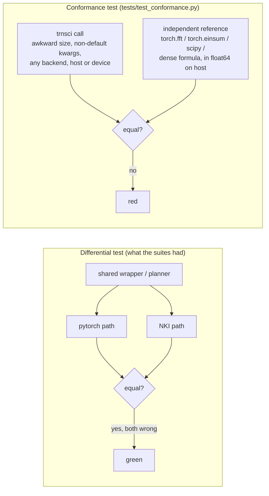

# trnsci: the suite's silent wrong answers, and the float64 rule that came out of them

Across three Trn2 hardware windows, correctness audits found about 60 silent wrong-result bugs in released versions of all six trnsci libraries. Most were wrong on every backend, so the suite's own pytorch-vs-NKI tests had passed them for months. The fixes taught the suite two things about Trainium: what float64 actually means on a device whose arithmetic is fp32, and that a test is only as independent as its reference. This post is for anyone who has shipped numerical code on Trainium, and for anyone deciding whether to trust ours.

<!-- more -->

!!! note "Code status"
    The fixes shipped across the 2026-10-31 to 2026-11-04 releases. Each README's "Known issues in earlier releases" table lists the ones up to 11-02 with affected versions: [trnblas](https://github.com/trnsci/trnblas#known-issues-in-earlier-releases), [trnfft](https://github.com/trnsci/trnfft#known-issues-in-earlier-releases), [trnrand](https://github.com/trnsci/trnrand#known-issues-in-earlier-releases), [trnsolver](https://github.com/trnsci/trnsolver#known-issues-in-earlier-releases), [trnsparse](https://github.com/trnsci/trnsparse#known-issues-in-earlier-releases), [trntensor](https://github.com/trnsci/trntensor#known-issues-in-earlier-releases). The float64 policy is released in [trnblas 0.11.0](https://github.com/trnsci/trnblas/releases/tag/v0.11.0), [trnsolver 0.22.0](https://github.com/trnsci/trnsolver/releases/tag/v0.22.0), [trnsparse 0.14.0](https://github.com/trnsci/trnsparse/releases/tag/v0.14.0), [trntensor 0.24.0](https://github.com/trnsci/trntensor/releases/tag/v0.24.0), [trnfft 0.28.0](https://github.com/trnsci/trnfft/releases/tag/v0.28.0) and [trnrand 0.14.0](https://github.com/trnsci/trnrand/releases/tag/v0.14.0). All device numbers are from a trn2.3xlarge on public Neuron SDK 2.33.0 (torch-neuronx 2.14.3, NKI 0.7.0), LNC=2 unless stated.

## The problem

Every trnsci library has the same shape: a public API that mirrors a cuX library, a dispatcher that picks pytorch, an NKI kernel or aten on the `neuron` device, and a test suite that runs the pytorch path on CPU and compares the NKI path against it on hardware. That last part is the cuBLAS-era habit: if the fast path matches the reference path, ship it.

The habit has a hole. If the bug is in code both paths share (argument parsing, a planner, a host-side wrapper), the two paths agree on the wrong answer. The suite's examples made it worse. They used tile-friendly sizes (128, 256, 4096) and default keyword arguments, so `uplo="U"`, `trans="T"`, a batch of 200 or an `n` of 33 rarely appeared.

The [2026-11-01 parameter audit](https://github.com/trnsci/trnsci/issues/35#issuecomment-6554033686) put a number on the hole. It generated cases from every public signature, ran them on every backend, and also checked the pytorch path against independent references (`torch.fft`, `torch.einsum`, `torch.linalg`, scipy, dense formulas). Of six confirmed silent bugs, the second pass found three, and those three were wrong on every backend. The worst was in trntensor: `einsum("ij,jk->ki", A, B)` returned `A @ B`, because the planner ignored output index order. 228 of 364 two-operand cases came back wrong or raised, in every release ([trntensor#64](https://github.com/trnsci/trntensor/issues/64)). For square operands that is a transpose with no error. The differential test was green throughout.

## What the architecture suggests

Read together, the bugs the audits found on the device trace the parts of Trainium a CUDA programmer would not think to test:

- **There is no float64 datapath.** The engines compute in fp32, and PSUM accumulates in fp32. A float64 tensor can live on the `neuron` device, but arithmetic on it is fp32. A device-side check in [trntensor#93](https://github.com/trnsci/trntensor/pull/93#issuecomment-6610999978) found where the line falls. `.to`, `.cpu()`, `clone`, `.contiguous()` of a slice or a transpose and `A[5]` are exact. `torch.cat`, `index_select`, fancy indexing (`A[idx]`, relative error 3.6e-8) and even `x * 1.0` round to fp32. The data movement ops keep their bits; anything else, apparently even a gather, rounds. That is an inference from the measurements, not something the Neuron docs state.
- **Complex is a software decomposition.** No engine has a complex type, which is where trnfft [started](2026-04-14-trnfft-fft-without-complex-dtype.md). A lowering that splits complex into real parts must also carry the tensor's metadata, including PyTorch's lazy conjugate bit.
- **The DMA engine is first-class, and its address arithmetic shows.** Two unrelated device bugs flip at exactly 2³² bytes.
- **Compilation is cached.** NKI traces and NEFFs are reused by key. A key that misses an input is a silent wrong result.
- **LNC is a configuration axis.** The same op at LNC=1 and LNC=2 runs on different physical-core layouts, and it can differ.

So correctness on Trainium spans dtype × size × dispatch route × device residency × LNC × cache state. The reference has to be independent of all of them.



## The approach

**Conformance tests against independent references.** Following [trnsci#105](https://github.com/trnsci/trnsci/issues/105), every library now has `tests/test_conformance.py`. Each public API is checked against a reference that shares no code with it, at sizes chosen to be awkward (1, 2, primes, 127/129 around the tile, 513, 1000) and with non-default keywords, dtypes, strides, empty shapes, `out=`, aliasing and autograd. The files are 1,000–1,600 lines each and run in the CPU CI job (`pytest -m "not neuron and not nki_simulator"`). The same cases run on Trn2 with `--backend nki --conformance-device neuron`, by hand: there is no hardware CI. The tradeoff is CI time and a maintenance surface roughly as big as the API. The alternative was finding these bugs from users.

**A float64 policy, so precision is never silently lost.** Before 11-02 the libraries disagreed. Some cast float64 to fp32 for the kernel, one routed to torch, and several sent float64 straight into fp32 kernels and returned inf/NaN. The [suite decision](https://github.com/trnsci/trnsci/issues/35#issuecomment-6583096371) and its [refinement](https://github.com/trnsci/trnsci/issues/35#issuecomment-6583607270) are the same in all six libraries:

| setting | float64 on the host | float64 already on the `neuron` device |
|---|---|---|
| `set_backend("auto")` (default) | host torch at float64 accuracy, no kernel | copied to the host, computed at float64, returned to the device as float64, one `UserWarning` per op |
| `auto` + `<LIB>_FP64_ON_DEVICE=1` | unchanged | device aten at fp32 precision, no warning (an explicit opt-in for speed) |
| `set_backend("nki")` | cast to fp32 for the kernel, one `UserWarning` per op, result returned as float64 | same |
| `<LIB>_REQUIRE_NKI=1` | `NotImplementedError` | `NotImplementedError`, before any copy, and ahead of `FP64_ON_DEVICE` |

The rule underneath: a caller who asks for float64 either gets float64 accuracy or is told, once and loudly, that they didn't. In every path, the result dtype matches the pytorch backend. The cost is real. Device-resident float64 under `auto` now pays a host round trip and host compute on every op, so a caller who wants device speed has to pass float32 or opt in. The suite took that over a fast answer that looks like float64 and isn't.

**A dtype guard at the kernel boundary.** The root cause of five of the nine new device bugs in the [window-3 audit](https://github.com/trnsci/trnsci/issues/35#issuecomment-6570060466) was "float64 tensors reach fp32-only kernels as is". Each library now has a per-kernel dtype table, checked in every launch route (native, XLA, simulator), that raises `TypeError` before any kernel runs.

## Implementation

The device-resident half of the policy is one decorator on every public op. From trnblas:

```python
# excerpt from trnblas/nki/dispatch.py (docstring dropped)
def _fp64_host_guard(op: str):
    def deco(fn):
        @functools.wraps(fn)
        def wrapper(*args, **kwargs):
            nested = getattr(_fp64_host_state, "active", False)
            if _REQUIRE_NKI and not nested and _use_nki():
                _refuse_device_fp64(op, (args, kwargs))
            if (
                _backend != "auto"
                or _FP64_ON_DEVICE
                or _REQUIRE_NKI
                or getattr(_fp64_host_state, "active", False)
                or not _any_tensor((args, kwargs), _fp64_device_resident)
            ):
                return fn(*args, **kwargs)
            _warn_fp64_host(op)
            device = _first_tensor((args, kwargs), _fp64_device_resident).device

            def down(t):
                return _fp64_to_host(t) if _is_neuron(t) else t

            h_args, h_kwargs = _map_tensors((args, kwargs), down)
            _fp64_host_state.active = True
            try:
                out = fn(*h_args, **h_kwargs)
            finally:
                _fp64_host_state.active = False
            return _map_tensors(out, lambda t: _fp64_from_host(t, device))

        return wrapper

    return deco
```

`_fp64_to_host` and `_fp64_from_host` are plain `.to` calls, which the trntensor check found exact for float64 in both directions. The guard depends on that. The thread-local `active` flag stops a guarded op that calls another guarded op from warning or copying twice.

The conformance side is less clever. This is the trntensor test that would have caught #64, with 120 subscript strings generated by a seeded RNG and a host float64 `torch.einsum` as the reference:

```python
# excerpt from trntensor/tests/test_conformance.py
@pytest.mark.parametrize("precision", ["fast", "kahan"])
@pytest.mark.parametrize("sub,sizes,dtype", _generated_cases(), ids=...)
def test_generated_subscripts(sub, sizes, dtype, precision):
    gen = torch.Generator().manual_seed(len(sub))
    ops = ops_for(sub, sizes, dtype, gen)
    dops = [d(o) for o in ops]
    snap = [o.clone() for o in ops]
    assert_ref(tt.einsum(sub, *dops, precision=precision), ref_einsum(sub, *ops))
    assert all(same_bits(a, b) for a, b in zip(dops, snap, strict=True)), "input mutated"
```

## What didn't work

**The suite fixed a silent bug and made a new one.** trntensor 0.23.0 fixed complex `tucker_decompose` using Uᵀ instead of Uᴴ ([#73](https://github.com/trnsci/trntensor/issues/73)) by writing `factors[mode].mH`, the idiomatic PyTorch. On the device, `.mH` is a lazy conjugate view, and device matmul ignores the conjugate bit: `A.mH @ B` returns `A.T @ B`, with relative error 1.34 ([aws-neuron-sdk#1455](https://github.com/aws-neuron/aws-neuron-sdk/issues/1455)). So 0.23.0's complex Tucker core was wrong by about 1.2 against an fp64 reference on device and correct on CPU ([trntensor#89](https://github.com/trnsci/trntensor/issues/89#issuecomment-6594801901)). 0.24.0 calls `.resolve_conj()` and adds a CPU `TorchFunctionMode` test that fails if a lazy conj view reaches any matmul.

**4 GiB, twice.** At LNC=1, `index_select(0, idx)` whose output reaches 2³² bytes returns wrong data or hits the 30 s runtime timeout. It is exact at 2³² − 16 KiB. trntensor's packed-integral unpack at 4.99e9 bytes returned 154,202,112 mismatched elements ([aws-neuron-sdk#1459](https://github.com/aws-neuron/aws-neuron-sdk/issues/1459), [trntensor#97](https://github.com/trnsci/trntensor/issues/97)). It is exact at LNC=2, which is where the suite usually tests. Separately, `A.T @ B` with B over 2³² bytes produced on device is wrong in every output element (relative error 1.06), where a host-uploaded B aborts instead ([aws-neuron-sdk#1457](https://github.com/aws-neuron/aws-neuron-sdk/issues/1457)). That is the silent sibling of the abort in the [DF-MP2 correction post](2026-10-31-trnblas-dfmp2-correction.md). trntensor now splits device gathers into blocks of at most 2 GiB ([#107](https://github.com/trnsci/trntensor/pull/107)) and makes the left operand contiguous ([#98](https://github.com/trnsci/trntensor/pull/98)).

**The test suites never ran in the users' configuration.** `import torch_neuronx` turns on the NKI trace cache, which NKI documents as experimental and off by default. Its key ignores constants a kernel captures from its enclosing scope, so factory-made kernels reuse the first one's trace (max error 4.07, 8.13, 12.2 for kernels two to four, [aws-neuron-sdk#1454](https://github.com/aws-neuron/aws-neuron-sdk/issues/1454)). Every trnsci conftest set `NKI_ENABLE_TRACE_CACHE=0`. A rerun with the cache on [passed in all six libraries](https://github.com/trnsci/trnsci/issues/35#issuecomment-6552474180), which was luck, not design. Device runs now cover cache on and off.

**Code that never ran.** trnfft's half-precision kernels called `nl.cast`, which NKI 0.7 doesn't have. On the NKI path every float16 or bfloat16 transform failed to lower with `AttributeError: module 'nki.language' has no attribute 'cast'`, in 0.13.0–0.27.0 on NKI 0.7 ([trnfft#133](https://github.com/trnsci/trnfft/issues/133)). This one was loud, but no device test sent half input until conformance did (26 cases). The fix ([#153](https://github.com/trnsci/trnfft/pull/153)) runs half input on fp32 copies, which measured more accurate at every N and faster from N = 2048. It is released in trnfft 0.28.0.

**What CPU CI cannot see.** On a Neuron host, `trnblas.trsm` under `auto` detaches host operands before its LAPACK call, so gradients silently stop, and `trnsolver.eigh_generalized` inherits it ([trnblas#101](https://github.com/trnsci/trnblas/issues/101)). It has been there since 0.9.0, including 0.11.0. The native route only exists when `torch_neuronx` is loaded, and the trnsolver release validation found it. It is open.

**A gap the policy leaves.** Under explicit `nki`, a trnblas op with no kernel (`symm`, `dot`) on device-resident float64 runs device aten at fp32 precision with no warning (2.7e-7 and 1.4e-8 in the [trnblas#91 probes](https://github.com/trnsci/trnblas/pull/91#issuecomment-6609364099)). The policy only warns where a cast happens. Closing that is a follow-up.

**Earlier posts.** Some published claims are overtaken, and they stay as written. The [precision-contract post](2026-04-24-trntensor-ozaki-dd.md) describes `precision="dd"`. Its CPU emulation turned out to be less accurate than `"fast"` until 0.23.0 ([trntensor#84](https://github.com/trnsci/trntensor/issues/84)).

**Fit, and the asks.** float64-heavy science is a poor fit for current Trainium. The silicon has no fp64 path, and the suite's honest answer for float64 is the host. Trainium's fit is fp32 work with an fp32 accumulator. What makes the mismatch dangerous is that device aten accepts float64 and quietly computes fp32. The asks for AWS Neuron:

- warn or raise on float64 arithmetic on the device, or at least document which ops keep the bits;
- honour `is_conj()` in matmul (#1455);
- fix the 2³² byte paths (#1457, #1459);
- key the trace cache on captured constants (#1454).

## Numbers

Silent wrong-result bugs fixed in released code, by library. "Known issues" counts the README table rows (releases up to 11-02). "11-04" counts the silent entries in the 11-04 CHANGELOG "Fixed" sections.

| library | Known issues | 11-04 | worst example |
|---|---|---|---|
| trnblas | 5 | 3 | BLAS letter flags ran the opposite branch, every backend, 0.2.0–0.9.1 ([#73](https://github.com/trnsci/trnblas/issues/73)) |
| trnfft | 9 | 0.28.0 | `irfft` used every bin, 78% error at n = 33 ([#104](https://github.com/trnsci/trnfft/issues/104)) |
| trnrand | 11 | 0.14.0 | partitioned generators returned duplicate values across ranks, 0.7.0–0.11.0 |
| trnsolver | 2 | 2 | complex Hermitian input used `.T` for `.mH`, every release through 0.20.0 ([#64](https://github.com/trnsci/trnsolver/issues/64)) |
| trnsparse | 12 | 5 | `spmv_symmetric` ignored `uplo`, rel. err 0.85–1.9 ([#52](https://github.com/trnsci/trnsparse/issues/52)) |
| trntensor | 8 | 4 | `einsum` output order, 228/364 cases ([#64](https://github.com/trnsci/trntensor/issues/64)) |
| **total** | **47** | **14** | |

The 11-04 column is this post's count from the CHANGELOGs: the new entries aren't in the README tables yet, and judging which are "silent" is ours.

The float64 policy on the device:

| measurement | before | after |
|---|---|---|
| trnblas `gemm`, device float64, rel. err vs CPU fp64 ([#91](https://github.com/trnsci/trnblas/pull/91#issuecomment-6609364099)) | 1.5e-7 in every mode, no warning, REQUIRE did not raise | `auto`: 0 (host), 1 warning; `nki`: 1.5e-7, 1 warning; REQUIRE raises |
| trnblas conformance, `auto` on device, float64/complex128 failures (same) | 2404 | 0 |
| trnblas conformance, `nki` on device, all failures ([0.11.0 validation](https://github.com/trnsci/trnsci/issues/35#issuecomment-6615258941)) | 3157 | 2022 (complex `mv` raises: 2012; harness: 2; test tolerance: 8) |
| trntensor conformance, `nki` on device ([triage](https://github.com/trnsci/trnsci/issues/35#issuecomment-6604543845)) | 45 | 10 (complex SVD unsupported: 9; fp64 precision: 1) |

None of the remaining device conformance failures in the four released libraries is a library bug. All are platform limits (complex linalg raises, float64 computes at fp32) or harness artifacts, and they are loud.

## What's next

- [trnsci#105](https://github.com/trnsci/trnsci/issues/105): the umbrella `TRNSCI_REQUIRE_NKI` switch is still open.
- [trnblas#101](https://github.com/trnsci/trnblas/issues/101): `trsm` autograd on Neuron hosts.
- [trnfft#159](https://github.com/trnsci/trnfft/issues/159): multicore host paths returned garbage when more cores were requested than visible, found during the 11-04 release validation.
- [Phase 2 — precision and numerical validation](https://github.com/trnsci/trnsci/milestone/2), including double-double GEMM ([trnblas#22](https://github.com/trnsci/trnblas/issues/22)), the route to float64 accuracy on the device without the host.
- The [suite tracker](https://github.com/trnsci/trnsci/issues/35) for window results, the [roadmap](https://trnsci.dev/roadmap/) and the [suite-wide tracker](https://github.com/trnsci/trnsci/issues/1). More at [trnsci.dev](https://trnsci.dev).

## Takeaway

A differential test checks that two paths agree, not that either is right. The bugs that matter most are the ones both paths share. On Trainium the paths multiply (dtype, size, route, residency, LNC, cache), and the hardware adds its own lines: arithmetic is fp32 whatever the dtype says, complex is a decomposition, and DMA arithmetic has a 2³² edge. The suite's answer is to test every call against a reference that shares nothing with it, at sizes and arguments nobody would pick for a demo. When the hardware can't give the precision a caller asked for, the suite computes it elsewhere or says so.
