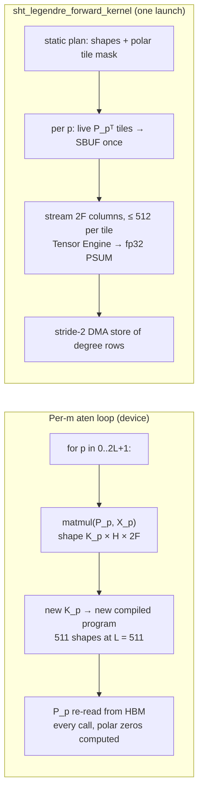

# trnfft: spherical harmonic transforms, and why plain PyTorch can't run them on Trainium

trnfft's new spherical harmonic transform, `trnfft.sht`, runs its forward [8.5–28× faster](https://github.com/trnsci/trnfft/pull/152#issuecomment-6613524387) than fp64 ducc0 on the same Trn2 box, while its inverse is [26× slower](https://github.com/trnsci/trnfft/issues/156) than its own forward at L = 511, F = 1024, nearly all of the gap spent in two `torch.flip` calls. The expensive half of an SHT, the Legendre stage, is a ragged batch of matmuls against fixed tables, which one NKI launch runs with the tables stationary in SBUF and plain PyTorch on the device can't run without compiling hundreds of programs. This is for anyone weighing Trainium for spectral-transform models in weather and climate, and for anyone wondering why a library sits between PyTorch and the hardware at all.

<!-- more -->

!!! note "Status"
    The SHT is [trnfft#152](https://github.com/trnsci/trnfft/pull/152), released in [trnfft v0.28.0](https://github.com/trnsci/trnfft/releases/tag/v0.28.0). Measurements: trn2.3xlarge, public Neuron SDK 2.33 (TorchNeuron, torch 2.14, NKI 0.7.0), one logical core, at the device-validated head 18905ae ([results](https://github.com/trnsci/trnfft/pull/152#issuecomment-6613524387)). This is milestone 1 of the [spectral-transform exemplar](https://github.com/trnsci/trnsci/issues/111), rank 3 on the [flagship-exemplar list](https://github.com/trnsci/trnsci/issues/112).

## The problem

Spectral-transform models of the atmosphere keep the linear terms in spherical-harmonic space and evaluate the nonlinear ones on a latitude–longitude grid, so each time step is a set of forward and inverse SHTs. Each SHT has two stages: a real FFT along every latitude ring, then a separate transform along latitude for each zonal wavenumber m, against a table of associated Legendre functions P_lm. At weather resolution (L ≈ 1000–1300) the latitude stage is O(L³) per field and dominates ([trnsci#111](https://github.com/trnsci/trnsci/issues/111)).

The CPU references, ducc0 and SHTns, are mature, vectorised fp64 codes. A Trainium user's natural first attempt is the textbook algorithm in PyTorch, on the `neuron` device. Here is what that gets:

| Route on the Trn2 device | What happens | Source |
|---|---|---|
| `torch.fft` for the longitude stage | Not supported on the `neuron` device: errors with "CPU fallback disabled". Complex dtypes are not native on the device. | [trnfft#82](https://github.com/trnsci/trnfft/issues/82), [trnsci#112](https://github.com/trnsci/trnsci/issues/112) |
| Per-m aten loop for the latitude stage | 2,046 matmul calls for a forward plus an inverse at L = 511, with 511 distinct matmul shapes and 769 distinct op signatures (1,023 / 1,537 at L = 1023). The cold run at L = 511, F = 1 exceeded a 19-minute slot. No warm number exists. | [trnfft#152 results](https://github.com/trnsci/trnfft/pull/152#issuecomment-6613524387), [trnfft#157](https://github.com/trnsci/trnfft/pull/157) |
| Padded aten (one `bmm` per size class, 10 classes) | 20 calls, 19 shapes, 35 op signatures at every L; +8.4–9.8% flops. Device timings **pending**. | [trnfft#157](https://github.com/trnsci/trnfft/pull/157) |
| `trnfft.sht`, NKI latitude kernels | One launch at L = 511, three at L = 1023. Numbers below. | [trnfft#152](https://github.com/trnsci/trnfft/pull/152) |

The per-m loop is a fair translation of the math, and on a CPU it is merely slow. On the device each new matmul shape is a new compiled program, paid before the model's first time step.

## What the architecture suggests

Three properties of the latitude stage line up with the NeuronCore.

**The table is the stationary operand.** After the even/odd fold (P_lm(−x) = (−1)^(l+m) P_lm(x)), each m splits into two problems p = 2m + q, each a GEMM `a_p = P_p · X_p` of K_p ≈ (L − m + 1)/2 degrees by H ≈ L/2 northern latitudes. P_p is the same for every field, so it belongs in SBUF, loaded once, while all F fields stream through the Tensor Engine. Arithmetic intensity is about L flops per field element. With F ≥ 128 the stage is compute-bound, and the table crosses HBM once per transform whatever F is.

**No complex arithmetic reaches the device.** The table is real. The longitude coefficients are complex, but their real and imaginary parts are just 2F columns of the moving operand. The device's missing complex dtype, which [trnfft has worked around since Phase 1](2026-04-23-trnfft-missing-dtype-80x-cliff.md), simply doesn't come up in this stage.

**The sparsity is static and tile-shaped.** Near the poles, P_lm for large m underflows. Which 128 × 128 tiles are all zero depends only on L and the grid, so it is known when the plan is built and can become a compile-time mask. The tile is the unit of skipping, the same idea [trnsparse uses for screened tiles](https://github.com/trnsci/trnsparse/pull/89).

PSUM accumulates in fp32, so each output rounds once after its K-term sum. That is what puts the device error at the CPU's fp32 level rather than above it.



## The approach

[trnfft#152](https://github.com/trnsci/trnfft/pull/152) builds the SHT from pieces trnfft already had, plus two new kernels:

| Piece | Design |
|---|---|
| Longitude | `trnfft.rfft` / `trnfft.irfft` on trnfft's NKI FFTs |
| Latitude | `sht_legendre_forward_kernel` / `sht_legendre_inverse_kernel` in `trnfft/nki/sht.py`: a ragged grouped GEMM over all 2(L+1) problems with static shapes. trnblas's [grouped GEMM](https://github.com/trnsci/trnblas/issues/98) is the general form |
| Polar tiles | entries below 1e-30 of the per-m maximum dropped; all-zero tiles neither loaded nor multiplied. Skips 3.9% of tiles (0.7% of flops) at L = 511, 11.3% (9.4%) at L = 1023 |
| Both physical cores | at LNC=2 each program takes half of the 2F columns, so both run identical shapes and masks |
| Tables | fp64 three-term recurrence on the host, stored fp32. P_mm starts in log space as mantissa × 2^e, because sin^m θ at m ≈ 1000 underflows fp64 near the poles before the recurrence can grow P_lm back |

The deliberate tradeoff is generality for compile stability. The kernel's shapes, chunking and mask are all baked into a `plan` string, so a given (L, grid) compiles once, and any other L is a new compile. Chunking caps a launch at 8192 live tiles, which gives three launches at L = 1023. Warm times with one launch and with three were the same (176.8 vs 177.9 ms forward), and so was the cold compile, roughly.

## Implementation

The core of the analysis kernel, from `trnfft/nki/sht.py` at 5cf7da5. `tt` holds the transposed, stationary table tiles for problem p; `live` is the static mask; the loop body runs once per column tile of up to 512 of the 2F columns:

```python
for kt in range(kt_n):
    ks = min(SHT_TILE, k - kt * SHT_TILE)
    hv = [h for h in range(ht_n) if live[kt][h]]
    sb = nl.ndarray((ks, ns), dtype=nl.float32, buffer=nl.sbuf)
    if hv:
        ps = nl.zeros((ks, ns), dtype=nl.float32, buffer=nl.psum)
        for h in hv:
            nisa.nc_matmul(
                dst=ps, stationary=tt[(kt, h)], moving=xs[h], accumulate=True
            )
        nisa.tensor_copy(dst=sb, src=ps)
    else:
        nisa.memset(dst=sb, value=0.0)
    row = o - base + q + 2 * kt * SHT_TILE
    nl.store(out[row : row + 2 * ks - 1 : 2, c0 + n0 : c0 + n0 + ns], value=sb)
```

The mask check is Python at trace time, so a skipped tile emits no instructions. The store writes every other coefficient row (one parity of degrees) as a stride-2 DMA access pattern rather than a gather. The forward kernel needs P_pᵀ as the stationary operand. Each tile is read with a plain `nl.load` and transposed once per problem with `nisa.nc_transpose`, not once per field tile, and `nl.load_transpose2d` is avoided ([trnfft#97](https://github.com/trnsci/trnfft/issues/97), [aws-neuron-sdk#1452](https://github.com/aws-neuron/aws-neuron-sdk/issues/1452)).

The mask travels in `plan`, a string kernel argument, not in a closure. Values captured from a closure or a global are not part of the NKI trace-cache key ([aws-neuron-sdk#1454](https://github.com/aws-neuron/aws-neuron-sdk/issues/1454)), so two SHTs with different masks could otherwise silently share one cached trace. The simulator tests include a poisoned table, where masked tiles hold NaN, to show that skipped tiles are never read.

## What didn't work

**The inverse.** At L = 511, F = 1024 the inverse takes 7.8 s against a 0.30 s forward. Its Legendre kernel takes 4.0 ms per 256-field chunk, the same as the forward's. The other 1.94 s per chunk is `trnfft.irfft`, and nearly all of that is the Hermitian fill that rebuilds the full spectrum before an inverse complex FFT ([trnfft#156](https://github.com/trnsci/trnfft/issues/156)):

```python
full_re[..., half:] = torch.flip(re[..., 1 : 1 + num_neg], dims=[-1])
full_im[..., half:] = -torch.flip(im[..., 1 : 1 + num_neg], dims=[-1])
```

One device `torch.flip` of a (256, 512, 511) fp32 tensor takes 1,053.7 ms. The full complex `ifft` of the same data takes 186.6 ms. Two lines of reversal cost about eleven times the transform they prepare. The best guess, still unconfirmed, is that a last-axis flip lowers to a general gather rather than a reversed strided copy. The fix path in #156 is to stop materialising the conjugate half: a c2r formulation with a half-length complex FFT and a post-twiddle, which also halves the FFT work ([trnfft#124](https://github.com/trnsci/trnfft/issues/124)), or a reversed-index load inside an NKI kernel.

**The plain-PyTorch row.** The plan for the device run included a `device-aten` row, the per-m loop on the device, as the fair PyTorch comparison. It never produced a number. Its cold run at L = 511, F = 1 alone exceeded the 19-minute single-core slot. The padded baseline in [trnfft#157](https://github.com/trnsci/trnfft/pull/157) exists because of that. Its device results are still pending, so this post has no padded-aten row.

**Two rows that didn't complete.** L = 1023 at LNC=1 is **unverified**: at LNC=1 one program takes all 2F columns, and the cold compile did not finish inside a 19-minute slot, cache on or off. It didn't fail, it just never finished. The L = 1023, F = 1024 benchmark also didn't complete: cold compile plus four slow inverse chunks exceeded the slot. Its working set (about three 8.6 GB arrays) is over the 24 GiB of one LNC=2 logical core anyway, so it runs as four 256-field chunks. The NEFFs from the window are kept for a pre-warmed retry ([trnsci#118](https://github.com/trnsci/trnsci/issues/118)).

**One reference, not two.** SHTns didn't build on the box (`pip install shtns` needs libfftw3-dev, which wasn't installed), so the device accuracy rests on ducc0 alone. On the CPU, the fp64 path agrees with both and with a direct `scipy.special.sph_harm_y` quadrature to 1e-12.

**Upstream asks for AWS Neuron.** (1) Lower a last-axis `torch.flip` on the `neuron` device to a reversed-stride DMA, or document that it gathers: 1.05 s for 67M fp32 elements is a trap that a CPU-trained intuition won't anticipate. (2) [aws-neuron-sdk#1454](https://github.com/aws-neuron/aws-neuron-sdk/issues/1454): include closure-captured values in the trace-cache key, or warn when a kernel reads one. (3) A grouped or ragged matmul in aten would make the per-m loop one compiled program instead of hundreds. Until then the padded `bmm` is the closest plain-PyTorch form.

**Fit.** The latitude stage is a good fit: stationary real tables, fp32 accumulation, static tile sparsity, and enough fields to make it compute-bound. The surrounding stages fit less well. At L = 1023, F = 128 the forward's Legendre kernels take 20.4 ms of 177.9. The FFT takes 58.4 ms, and the longitude fold, permute and weights take 151.9 ms. Small L is FFT- and data-movement-bound, as [trnsci#111](https://github.com/trnsci/trnsci/issues/111) predicted, and at F = 1 a 2-thread CPU still wins at L = 511 (5.6 ms vs 11.8 ms). The scale-out plan is ensembles, not higher resolution: splitting one field across cores needs all-to-all transposes, and cross-core transfers go through the host today ([aws-neuron-sdk#1451](https://github.com/aws-neuron/aws-neuron-sdk/issues/1451)).

## Numbers

Forward and inverse, device-nki row against fp64 ducc0 on the same box, warm medians, ms. The device is fp32; ducc0 is fp64. Speed-up is ducc0 time over device time:

| L | F | device fwd | device inv | ducc0 fwd, 2 threads / 12 vCPUs | ducc0 inv, 2 threads / 12 vCPUs | forward speed-up |
|---|---|---|---|---|---|---|
| 511 | 128 | 36.2 | 1,011.6 | 879.8 / 376.7 | 976.8 / 506.0 | 24× / 10× |
| 511 | 1024 (4 × 256) | 297.4 | 7,803.1 | 7,176.2 / 3,208.9 | 8,270.1 / 4,249.8 | **24× / 10.8×** |
| 1023 | 128 | 177.9 | 2,727.6 | 5,058.3 / 1,515.3 | 5,240.9 / 1,773.1 | **28× / 8.5×** |
| 1023 | 1024 | not completed | not completed | 41,782.2 / 12,472.9 | 45,211.2 / 14,208.0 | — |

The inverse loses to 12-vCPU ducc0 in every completed F ≥ 128 row (7.8 s vs 4.2 s at L = 511, F = 1024). Against 2-thread ducc0 it ranges from roughly even (L = 511) to 1.9× faster (L = 1023, F = 128). The 12-vCPU baseline ran under an exclusive chip lock with other lanes' idle processes still on the box.

Small batches, forward, ms:

| L | F | device | ducc0, 2 threads |
|---|---|---|---|
| 511 | 1 | 11.8 | 5.6 |
| 511 | 16 | 11.7 | 107 |
| 1023 | 1 | 31.8 | 31 |
| 1023 | 16 | 33.4 | 555 |

The forward latitude stage reaches 4.5–6.8 TFLOP/s at F = 128 and 8.6 TFLOP/s at L = 511, F = 1024. Cold forward calls, including compile, took 5–200 s depending on what the cache held (192 s at L = 1023, F = 1). Only forward cold times are reported: the benchmark built the forward's input before its first inverse call, so its "inverse cold" column was a warm time, a bug fixed in [4754564](https://github.com/trnsci/trnfft/pull/157/commits/47545643e42c97c9192c6decabc1b1d3ac12d530) on trnfft#157.

Accuracy against fp64 ducc0 (spectral ℓ2, tolerance 1e-6): 1.72e-7 forward / 1.68e-7 inverse at L = 511, and 1.80e-7 / 1.74e-7 at L = 1023, in line with the CPU fp32 path (2.6e-7 / 3.6e-7). The device tests pass at L = 127, 511 and 1023 at LNC=2 with the trace cache off and on, and at L = 127 and 511 at LNC=1. L = 1023 at LNC=1 is unverified, as above.


## What's next

- **The inverse** ([trnfft#156](https://github.com/trnsci/trnfft/issues/156)), then a half-cost real FFT ([trnfft#124](https://github.com/trnsci/trnfft/issues/124)). Once the flip is gone the inverse should land near the forward.
- **The padded-aten device row** ([trnfft#157](https://github.com/trnsci/trnfft/pull/157)), so the "plain PyTorch" comparison has a number.
- **L = 1023 at LNC=1 and the L = 1023, F = 1024 row**, from a pre-warmed NEFF cache ([trnsci#118](https://github.com/trnsci/trnsci/issues/118)).
- **The rest of milestone 1** ([trnfft#148](https://github.com/trnsci/trnfft/issues/148), [trnsci#111](https://github.com/trnsci/trnsci/issues/111)): the vector SHT, then smooth longitude sizes such as 1280 and 2560 for L = 1279 ([trnfft#149](https://github.com/trnsci/trnfft/issues/149)), and a shallow-water ensemble with [trnrand counter streams](https://github.com/trnsci/trnrand/issues/84).
- trnfft phase trackers: [Phase 2 — precision](https://github.com/trnsci/trnfft/issues/52), [Phase 3 — plan reuse, streaming, NEFF cache](https://github.com/trnsci/trnfft/issues/53), [Phase 4 — multi-chip](https://github.com/trnsci/trnfft/issues/54), [Phase 5 — trn2 larger-SBUF path](https://github.com/trnsci/trnfft/issues/55).

Suite context: [trnsci.dev](https://trnsci.dev), the [roadmap](https://trnsci.dev/roadmap/), the [suite-wide tracker](https://github.com/trnsci/trnsci/issues/1). Earlier trnfft posts on [launch cost](2026-10-27-trnfft-launch-cost.md) and [batch fusion](2026-10-31-trnfft-batch-fusion.md) used the same accounting: launches and compiled shapes before flops.

## Takeaway

The SHT's latitude stage is a few thousand small, ragged matmuls against tables that never change, which on a CPU is just a loop. On Trainium the table is a stationary SBUF operand, the fields stream through into fp32 PSUM, and the polar zeros vanish at trace time, so one launch does what PyTorch would spread across hundreds of separately compiled programs. That is the case for a library here: the shape problem lives below where aten can see it. The same run is a reminder that the hardware fit of the hot kernel doesn't carry the pipeline. The forward wins by 8.5–28×, and the inverse loses to a two-line array reversal until trnfft#156 lands.
