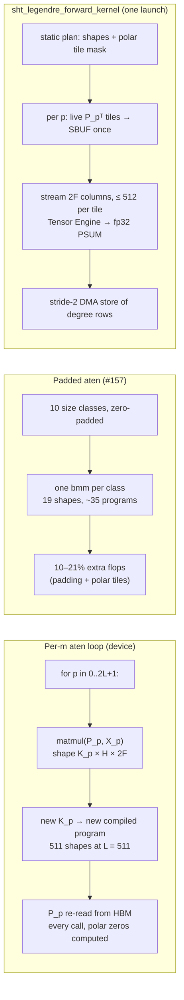

# trnfft: spherical harmonic transforms, and how close plain PyTorch gets on Trainium

trnfft's new spherical harmonic transform, `trnfft.sht`, runs its forward [8.5–28× faster](https://github.com/trnsci/trnfft/pull/152#issuecomment-6613524387) than fp64 ducc0 on the same Trn2 box, while its inverse is [26× slower](https://github.com/trnsci/trnfft/issues/156) than its own forward at L = 511, F = 1024, nearly all of the gap spent in two `torch.flip` calls. The Legendre stage is a ragged batch of matmuls against fixed tables, and the hand-written NKI kernel that holds those tables stationary in SBUF beats a carefully padded plain-PyTorch version by only [1.2–2.2× at large batch, and loses to it by 1.5–1.6× at one field](https://github.com/trnsci/trnfft/pull/157#issuecomment-6617354400): what plain PyTorch can't do on the device is the FFT, and the naive per-m loop never gets past compile. This is for anyone weighing Trainium for spectral-transform models in weather and climate, and for anyone deciding how much of that work needs a library at all.

<!-- more -->

!!! note "Status"
    The SHT is [trnfft#152](https://github.com/trnsci/trnfft/pull/152), released in [trnfft v0.28.0](https://github.com/trnsci/trnfft/releases/tag/v0.28.0). Measurements: trn2.3xlarge, public Neuron SDK 2.33 (TorchNeuron, torch 2.14, NKI 0.7.0), one logical core, at the device-validated head 18905ae ([results](https://github.com/trnsci/trnfft/pull/152#issuecomment-6613524387)). This is milestone 1 of the [spectral-transform exemplar](https://github.com/trnsci/trnsci/issues/111), rank 3 on the [flagship-exemplar list](https://github.com/trnsci/trnsci/issues/112).

## The problem

Spectral-transform atmosphere models run forward and inverse SHTs every time step. Each SHT is a real FFT along every latitude ring, then a transform along latitude for each zonal wavenumber m against a table of associated Legendre functions P_lm. At weather resolution (L ≈ 1000–1300) the latitude stage is O(L³) per field and dominates ([trnsci#111](https://github.com/trnsci/trnsci/issues/111)).

The CPU references, ducc0 and SHTns, are mature fp64 codes. On the `neuron` device, the textbook algorithm in PyTorch gets this:

| Route on the Trn2 device | What happens | Source |
|---|---|---|
| `torch.fft` for the longitude stage | Not usable on the `neuron` device. `rfft` ran, but `irfft` raised "complex dtypes are not supported natively on Neuron" with CPU fallback restricted; otherwise it falls back to the CPU. | [trnfft#157 results](https://github.com/trnsci/trnfft/pull/157#issuecomment-6617354400), [trnfft#82](https://github.com/trnsci/trnfft/issues/82) |
| Per-m aten loop for the latitude stage | 2,046 matmul calls for a forward plus an inverse at L = 511, with 511 distinct matmul shapes and 769 distinct op signatures (1,023 / 1,537 at L = 1023). The cold run at L = 511, F = 1 exceeded a 19-minute slot. No warm number exists. | [trnfft#152 results](https://github.com/trnsci/trnfft/pull/152#issuecomment-6613524387), [trnfft#157](https://github.com/trnsci/trnfft/pull/157) |
| Padded aten latitude stage (one `bmm` per size class, 10 classes) | 20 calls, 19 shapes, 35 op signatures at every L. Executes 1.10× (L = 511) and 1.21× (L = 1023) the kernel's flops. Cold first call 24–83 s forward. Same accuracy as the kernel. | [trnfft#157 results](https://github.com/trnsci/trnfft/pull/157#issuecomment-6617354400) |
| `trnfft.sht`, NKI latitude kernels | One launch at L = 511, three at L = 1023. Numbers below. | [trnfft#152](https://github.com/trnsci/trnfft/pull/152) |

On a CPU the per-m loop is merely slow. On the device each new shape is a new compiled program, about 770 of them; padding into ten size classes cuts that to about 35. The padded row still uses trnfft's FFTs, because `torch.fft` doesn't run there.

## What the architecture suggests

Three properties of the latitude stage line up with the NeuronCore.

**The table is the stationary operand.** After the even/odd fold (P_lm(−x) = (−1)^(l+m) P_lm(x)), each m splits into two problems p = 2m + q, each a GEMM `a_p = P_p · X_p` of K_p ≈ (L − m + 1)/2 degrees by H ≈ L/2 northern latitudes. P_p is the same for every field, so it belongs in SBUF, loaded once, while all F fields stream through the Tensor Engine. Arithmetic intensity is about L flops per field element. With F ≥ 128 the stage is compute-bound, and the table crosses HBM once per transform whatever F is.

**No complex arithmetic reaches the device.** The table is real, so the coefficients' real and imaginary parts are just 2F columns of the moving operand, and the [missing complex dtype](2026-04-23-trnfft-missing-dtype-80x-cliff.md) never comes up.

**The sparsity is static and tile-shaped.** Near the poles, P_lm for large m underflows. Which 128 × 128 tiles are all zero depends only on L and the grid, so it can be a compile-time mask, with the tile as the unit of skipping: the same idea [trnsparse uses for screened tiles](https://github.com/trnsci/trnsparse/pull/89).

PSUM accumulates in fp32, so each output rounds once after its K-term sum. That is what puts the device error at the CPU's fp32 level rather than above it.



## The approach

[trnfft#152](https://github.com/trnsci/trnfft/pull/152) builds the SHT from pieces trnfft already had, plus two new kernels:

| Piece | Design |
|---|---|
| Longitude | `trnfft.rfft` / `trnfft.irfft` on trnfft's NKI FFTs |
| Latitude | `sht_legendre_forward_kernel` / `sht_legendre_inverse_kernel` in `trnfft/nki/sht.py`: a ragged grouped GEMM over all 2(L+1) problems with static shapes. trnblas's [grouped GEMM](https://github.com/trnsci/trnblas/issues/98) is the general form |
| Polar tiles | entries below 1e-30 of the per-m maximum dropped; all-zero tiles neither loaded nor multiplied. Skips 3.9% of tiles (0.7% of flops) at L = 511, 11.3% (9.4%) at L = 1023 |
| Both physical cores | at LNC=2 each program takes half of the 2F columns, so both run identical shapes and masks |
| Tables | fp64 three-term recurrence on the host, stored fp32. P_mm starts in log space as mantissa × 2^e, because sin^m θ at m ≈ 1000 underflows fp64 near the poles before the recurrence can grow P_lm back |

The deliberate tradeoff is generality for compile stability: shapes, chunking and mask are baked into a `plan` string, so each (L, grid) compiles once and any other L is a new compile. Chunking caps a launch at 8192 live tiles (three launches at L = 1023); one launch and three gave the same warm time (176.8 vs 177.9 ms forward).

## Implementation

The core of the analysis kernel, from `trnfft/nki/sht.py` at 5cf7da5. `tt` holds the transposed, stationary table tiles for problem p; `live` is the static mask; the loop body runs once per column tile of up to 512 of the 2F columns:

```python
for kt in range(kt_n):
    ks = min(SHT_TILE, k - kt * SHT_TILE)
    hv = [h for h in range(ht_n) if live[kt][h]]
    sb = nl.ndarray((ks, ns), dtype=nl.float32, buffer=nl.sbuf)
    if hv:
        ps = nl.zeros((ks, ns), dtype=nl.float32, buffer=nl.psum)
        for h in hv:
            nisa.nc_matmul(
                dst=ps, stationary=tt[(kt, h)], moving=xs[h], accumulate=True
            )
        nisa.tensor_copy(dst=sb, src=ps)
    else:
        nisa.memset(dst=sb, value=0.0)
    row = o - base + q + 2 * kt * SHT_TILE
    nl.store(out[row : row + 2 * ks - 1 : 2, c0 + n0 : c0 + n0 + ns], value=sb)
```

The mask check is Python at trace time, so a skipped tile emits no instructions, and the store writes one parity of degrees as a stride-2 DMA rather than a gather. Table tiles are transposed once per problem with `nisa.nc_transpose`, avoiding `nl.load_transpose2d` ([aws-neuron-sdk#1452](https://github.com/aws-neuron/aws-neuron-sdk/issues/1452)). The mask travels in `plan`, a string argument, because closure-captured values are not in the NKI trace-cache key ([aws-neuron-sdk#1454](https://github.com/aws-neuron/aws-neuron-sdk/issues/1454)). A poisoned-table simulator test (masked tiles hold NaN) shows skipped tiles are never read.

## What didn't work

**The inverse.** At L = 511, F = 1024 the inverse takes 7.8 s against a 0.30 s forward. Its Legendre kernel takes 4.0 ms per 256-field chunk, the same as the forward's. The other 1.94 s per chunk is `trnfft.irfft`, and nearly all of that is the Hermitian fill that rebuilds the full spectrum before an inverse complex FFT ([trnfft#156](https://github.com/trnsci/trnfft/issues/156)):

```python
full_re[..., half:] = torch.flip(re[..., 1 : 1 + num_neg], dims=[-1])
full_im[..., half:] = -torch.flip(im[..., 1 : 1 + num_neg], dims=[-1])
```

One device `torch.flip` of a (256, 512, 511) fp32 tensor takes 1,053.7 ms; the full complex `ifft` takes 186.6 ms. Two lines of reversal cost about eleven times the transform they prepare. The unconfirmed guess is that a last-axis flip lowers to a gather. The fix path in #156 is to stop materialising the conjugate half, with a half-length c2r FFT ([trnfft#124](https://github.com/trnsci/trnfft/issues/124)) or a reversed-index load inside an NKI kernel.

**The plain-PyTorch row, and the margin it left.** The planned `device-aten` row, the per-m loop on the device, never produced a number: its cold run at L = 511, F = 1 exceeded the 19-minute slot. The padded baseline in [trnfft#157](https://github.com/trnsci/trnfft/pull/157), built as the fairer comparison, [narrowed the case for the kernel](https://github.com/trnsci/trnfft/pull/157#issuecomment-6617354400). End to end at L = 511 the two rows are within 3%, because the inverse longitude stage costs both of them 2.0 s per 256-field chunk. The kernel's advantage is confined to the latitude stage, and it reverses at F = 1.

**Rows that didn't complete.** L = 1023 at LNC=1 is **unverified**: its cold compile did not finish inside a 19-minute slot. L = 1023, F = 1024 didn't complete in either row. For the kernel, compile plus four slow inverse chunks exceeded the slot. For padded aten, the host OOM killer stopped neuronx-cc compiling the zero-pad (`aten::constant_pad_nd` on `[256, 1024, 1024]`) in the SHT's inverse longitude stage; at 64-field chunks it ran out of device memory, as the benchmark keeps about 13 GB resident ([results](https://github.com/trnsci/trnfft/pull/157#issuecomment-6617354400)). The NEFFs from the window are kept for a pre-warmed retry ([trnsci#118](https://github.com/trnsci/trnsci/issues/118)).

**One reference, not two.** SHTns didn't build on the box (it needs libfftw3-dev), so device accuracy rests on ducc0 alone. On the CPU the fp64 path agrees with both to 1e-12.

**Upstream asks for AWS Neuron.** (1) Lower a last-axis `torch.flip` on the `neuron` device to a reversed-stride DMA, or document that it gathers: 1.05 s for 67M elements is a trap. (2) [aws-neuron-sdk#1454](https://github.com/aws-neuron/aws-neuron-sdk/issues/1454): include closure-captured values in the trace-cache key. (3) A grouped or ragged matmul in aten would make the per-m loop one compiled program instead of hundreds, without the padded version's 10–21% extra flops.

**Fit.** The latitude stage is a good fit: stationary real tables, fp32 accumulation, static tile sparsity, and enough fields to make it compute-bound. The surrounding stages fit less well: at L = 1023, F = 128 the forward's Legendre kernels take 20.4 ms of 177.9, against 58.4 ms of FFT and 151.9 ms of longitude fold, permute and weights. Small L is FFT- and data-movement-bound, as [trnsci#111](https://github.com/trnsci/trnsci/issues/111) predicted. Scale-out is ensembles, not resolution: cross-core transfers go through the host ([aws-neuron-sdk#1451](https://github.com/aws-neuron/aws-neuron-sdk/issues/1451)).

## Numbers

Device-nki row (fp32) against fp64 ducc0 on the same box, warm medians, ms:

| L | F | device fwd | device inv | ducc0 fwd, 2 threads / 12 vCPUs | ducc0 inv, 2 threads / 12 vCPUs | forward speed-up |
|---|---|---|---|---|---|---|
| 511 | 128 | 36.2 | 1,011.6 | 879.8 / 376.7 | 976.8 / 506.0 | 24× / 10× |
| 511 | 1024 (4 × 256) | 297.4 | 7,803.1 | 7,176.2 / 3,208.9 | 8,270.1 / 4,249.8 | **24× / 10.8×** |
| 1023 | 128 | 177.9 | 2,727.6 | 5,058.3 / 1,515.3 | 5,240.9 / 1,773.1 | **28× / 8.5×** |
| 1023 | 1024 | not completed | not completed | 41,782.2 / 12,472.9 | 45,211.2 / 14,208.0 | — |

The inverse loses to 12-vCPU ducc0 in every completed F ≥ 128 row (7.8 s vs 4.2 s at L = 511, F = 1024). Against 2-thread ducc0 it ranges from roughly even (L = 511) to 1.9× faster (L = 1023, F = 128).

Small batches, forward, ms:

| L | F | device | ducc0, 2 threads |
|---|---|---|---|
| 511 | 1 | 11.8 | 5.6 |
| 511 | 16 | 11.7 | 107 |
| 1023 | 1 | 31.8 | 31 |
| 1023 | 16 | 33.4 | 555 |

The forward latitude stage reaches 4.5–6.8 TFLOP/s at F = 128 and 8.6 TFLOP/s at L = 511, F = 1024. Cold forward calls took 5–200 s depending on the cache. Only forward cold times are reported for the kernel: #152's "inverse cold" column was a warm time, a benchmark bug fixed in [4754564](https://github.com/trnsci/trnfft/pull/157/commits/47545643e42c97c9192c6decabc1b1d3ac12d530) on trnfft#157.

Accuracy against fp64 ducc0 (spectral ℓ2, tolerance 1e-6): 1.72e-7 forward / 1.68e-7 inverse at L = 511, and 1.80e-7 / 1.74e-7 at L = 1023,, identical for padded aten. Device tests pass at L = 127, 511 and 1023 at LNC=2 (trace cache off and on), and at L ≤ 511 at LNC=1.

Latitude stage, NKI kernel against padded aten ([trnfft#157 results](https://github.com/trnsci/trnfft/pull/157#issuecomment-6617354400)), warm ms. The L = 1023, F = 128 padded run used 64-field chunks (unchunked, it ran out of device memory), so compare only its latitude times, scaled to 128 fields:

| L | F | NKI fwd / inv | padded aten fwd / inv | kernel advantage fwd / inv | end to end fwd, NKI / padded |
|---|---|---|---|---|---|
| 511 | 1 | 4.1 / 4.7 | 3.96 / 5.72 | 1.0× / 1.2× | 11.8 / 6.33 |
| 511 | 128 | 3.8 / 3.9 | 4.67 / 6.59 | 1.2× / 1.7× | 36.2 / 36.5 |
| 511 | 1024, per 256 chunk | 4.0 / 4.0 | 6.12 / 8.80 | 1.5× / 2.2× | 297 / 305 |
| 1023 | 1 | 19.7 / 23.8 | 12.2 / 16.0 | **0.62× / 0.67×** | 31.8 / 21.0 |
| 1023 | 128 | 20.4 / 22.9 | ~27 / ~33 | 1.3× / 1.4× | not comparable |

**Why the kernel wins at large F.** On the same flop count, the latitude stage runs at 8.56 against 5.59 TFLOP/s at L = 511, F = 1024. Padding and polar tiles explain only 1.10× of that 1.53×. The rest is how the work runs: each table tile is loaded into SBUF once and stays stationary while every column tile accumulates its K-sum in fp32 PSUM, and degree rows go out as stride-2 DMA. The padded inverse also does an `index_select` per class; these runs don't isolate its cost.

**Why padded aten wins at F = 1.** The kernel's latitude time at L = 1023 barely moves from F = 1 to F = 128 (19.7 to 20.4 ms), so at one field it is a fixed per-transform cost: three launches that load and transpose every live tile of a 1.07 GB table. Padded aten's fixed cost is lower (12.2 ms); the data doesn't separate launch overhead from table traffic. At L = 511, F = 1 the latitude stages are even, yet padded aten is faster end to end (6.33 vs 11.8 ms), a difference outside the stage the rows differ in, and unexplained.


## What's next

- **The inverse** ([trnfft#156](https://github.com/trnsci/trnfft/issues/156)), then a half-cost real FFT ([trnfft#124](https://github.com/trnsci/trnfft/issues/124)). Once the flip is gone the inverse should land near the forward.
- **The kernel's fixed cost at small F**, the open question from the padded-aten comparison ([trnfft#157](https://github.com/trnsci/trnfft/pull/157)): whether to cut it or route small batches to the padded path.
- **L = 1023 at LNC=1 and the L = 1023, F = 1024 row**, from a pre-warmed NEFF cache ([trnsci#118](https://github.com/trnsci/trnsci/issues/118)).
- **The rest of milestone 1** ([trnfft#148](https://github.com/trnsci/trnfft/issues/148), [trnsci#111](https://github.com/trnsci/trnsci/issues/111)): the vector SHT, then smooth longitude sizes such as 1280 and 2560 for L = 1279 ([trnfft#149](https://github.com/trnsci/trnfft/issues/149)), and a shallow-water ensemble with [trnrand counter streams](https://github.com/trnsci/trnrand/issues/84).
- trnfft phase trackers: [Phase 2 — precision](https://github.com/trnsci/trnfft/issues/52), [Phase 3 — plan reuse, streaming, NEFF cache](https://github.com/trnsci/trnfft/issues/53), [Phase 4 — multi-chip](https://github.com/trnsci/trnfft/issues/54), [Phase 5 — trn2 larger-SBUF path](https://github.com/trnsci/trnfft/issues/55).

Suite context: [trnsci.dev](https://trnsci.dev), the [roadmap](https://trnsci.dev/roadmap/), the [suite-wide tracker](https://github.com/trnsci/trnsci/issues/1). Earlier posts: [launch cost](2026-10-27-trnfft-launch-cost.md), [batch fusion](2026-10-31-trnfft-batch-fusion.md).

## Takeaway

The SHT's latitude stage is a few thousand small, ragged matmuls against tables that never change. On Trainium the table is a stationary SBUF operand, the fields stream into fp32 PSUM, and the polar zeros vanish at trace time, which is why the kernel wins by 1.2–2.2× once enough fields share each table tile. The honest margin over carefully padded PyTorch is that, not orders of magnitude, and at one field the padding wins. What does need a library is everything PyTorch on the device can't express: the FFT, and a per-m loop that doesn't compile 770 programs. The forward beats ducc0 by 8.5–28×; the inverse loses to a two-line array reversal until trnfft#156 lands.
