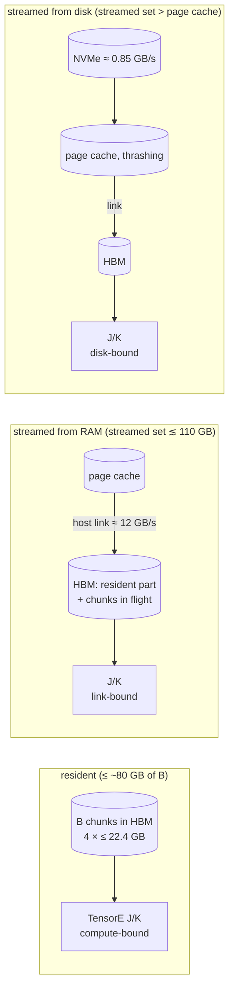

# trnsolver and trntensor: DF-RHF and DF-MP2 from 500 to 3508 AOs on one Trn2 chip, and what bounds each rung

Density-fitted RHF plus MP2 now runs end to end on one trn2.3xlarge from about 500 to 3508 basis functions, including three systems whose integrals exceed the chip's 96 GiB of HBM, two of them the host's 124 GB of RAM as well. The largest rung is the least flattering: at 3508 AOs an SCF iteration took about 8 minutes, bound by the NVMe, and its AO→MO transform and eigensolve ran on the host through driver patches. The finding is that each step up the ladder moved the bound to a different resource: Tensor Engine compute, the host link, the page cache, the disk, SBUF, and twice the compiler. It's for chemists sizing a Trainium run, and anyone streaming more data than fits on the device.

<!-- more -->

!!! warning "Correction (2026-11-08)"
    "SBUF is 192 KiB per partition" below is the NeuronCore-v2 (Trn1) figure. Trn2's NeuronCore-v3 has 224 KiB per partition, 28 MiB in all ([AWS Trainium2 architecture guide for NKI](https://awsdocs-neuron.readthedocs-hosted.com/en/latest/nki/guides/architecture/trainium2_arch.html)). NKI's allocator reported 212,472 bytes per partition after the compiler's share ([trnsparse#111](https://github.com/trnsci/trnsparse/pull/111)). The size limit the post describes still holds: the resident AO→MO kernel needed 979 KiB at 3508 AOs ([trntensor#112](https://github.com/trnsci/trntensor/issues/112)).

!!! note "Code status"
    The runs used pre-release branches during the window-4 hardware window (2026-11-02 to 11-04), on a trn2.3xlarge with public Neuron SDK 2.33.0 (torch-neuronx 2.14.3, NKI 0.7.0, neuronx-cc 2.28.7631), LNC=2, fp32 on the device. Host work was pinned to 2 vCPUs, `OMP_NUM_THREADS=2`, unless a row says otherwise. All but the last row has shipped. The SCF and MP2 drivers live in trnsolver's `examples/` and `scripts/`, not the installed package.

    | piece | PR | release |
    |---|---|---|
    | host pack/unpack, noise-aware convergence, out-of-core store, streamed J/K, DF-MP2, ladder script | [trnsolver#96](https://github.com/trnsci/trnsolver/pull/96), [#99](https://github.com/trnsci/trnsolver/pull/99), [#101](https://github.com/trnsci/trnsolver/pull/101), [#102](https://github.com/trnsci/trnsolver/pull/102), [#103](https://github.com/trnsci/trnsolver/pull/103), [#104](https://github.com/trnsci/trnsolver/pull/104) | [trnsolver v0.22.0](https://github.com/trnsci/trnsolver/releases/tag/v0.22.0) |
    | window-4 fixes: int32 row blocks, resident headroom, freeing B, fp64 host stream, blocked MP2 route, planner, minao, DIIS padding | [#108](https://github.com/trnsci/trnsolver/pull/108), [#109](https://github.com/trnsci/trnsolver/pull/109), [#110](https://github.com/trnsci/trnsolver/pull/110), [#111](https://github.com/trnsci/trnsolver/pull/111), [#112](https://github.com/trnsci/trnsolver/pull/112), [#113](https://github.com/trnsci/trnsolver/pull/113), [#115](https://github.com/trnsci/trnsolver/pull/115), [#119](https://github.com/trnsci/trnsolver/pull/119) (the last five via [#120](https://github.com/trnsci/trnsolver/pull/120)) | trnsolver v0.22.0 |
    | `AuxStream`, bounded aten MP2 blocks, direct memmap upload | [trntensor#102](https://github.com/trnsci/trntensor/pull/102), [#109](https://github.com/trnsci/trntensor/pull/109), [#110](https://github.com/trnsci/trntensor/pull/110) | [trntensor v0.24.0](https://github.com/trnsci/trntensor/releases/tag/v0.24.0) |
    | blocked packed AO→MO kernel (after the 3508 run) | [trntensor#113](https://github.com/trnsci/trntensor/pull/113) | [trntensor v0.25.0](https://github.com/trnsci/trntensor/releases/tag/v0.25.0) |
    | first-call compiles at 3508; GEMV compile hang | [trnsolver#122](https://github.com/trnsci/trnsolver/issues/122), [aws-neuron-sdk#1460](https://github.com/aws-neuron/aws-neuron-sdk/issues/1460) | open |

    Release validation on Trn2: [trnsolver 0.22.0](https://github.com/trnsci/trnsci/issues/35#issuecomment-6616139062), [trntensor 0.24.0](https://github.com/trnsci/trnsci/issues/35#issuecomment-6615119651), [trntensor 0.25.0](https://github.com/trnsci/trnsci/issues/35#issuecomment-6624197485). Every unlabelled number below is from the [window-4 results log](https://github.com/trnsci/trnsci/issues/115#issuecomment-6590856086) on [trnsci#115](https://github.com/trnsci/trnsci/issues/115).

## The problem

Density-fitted Hartree–Fock stores the integrals as a three-index tensor B: a packed lower triangle of AO pairs per auxiliary function. Every SCF iteration contracts all of B for the Coulomb and exchange matrices J and K. MP2 transforms B to the occupied-virtual basis and reduces pair energies. In fp32, B is 33 GB at 1658 AOs and 207 GB at 3508.

On a GPU the usual shape is cuBLAS GEMMs over B held in device memory, or recomputed. The [window-3 run](https://github.com/trnsci/trnsolver/issues/15#issuecomment-6568837695) took that port as far as it went: C40H82 / aug-cc-pVDZ (1658 AOs) converged in 10.7–13.6 s of loop time, but only with B split over all four logical cores, and only after PySCF's in-core build failed for want of 133 GB of host memory. The [tracker](https://github.com/trnsci/trnsci/issues/115) set the next target above 3000 functions.

## What the architecture suggests

A trn2.3xlarge offers four tiers for B, each with a hard number:

- **HBM:** 24 GiB per LNC=2 logical core, 96 GiB per chip. Tensors failed at about 22.4 GB per core.
- **Host link:** 13.9–14.0 GB/s host-to-device, measured.
- **Host RAM and page cache:** about 124 GB.
- **Instance-store NVMe:** about 0.85 GB/s cold, O_DIRECT or buffered, one reader or four.

J/K work per byte of B grows with the occupied count, and it is GEMM work the Tensor Engine does well: about 0.2 s per iteration at 1658 AOs with B resident. Once B streams, an iteration costs whatever moving the streamed part costs. So the design question at each size is which tier holds which chunks.



Two more resources matter. SBUF is 192 KiB per partition, so a kernel that keeps an n_ao-sized operand on chip has a size limit. The host builds the integrals and does everything float64.

## The approach

**Chunk B over the auxiliary index, and treat residency as a budget.** The out-of-core store (trnsolver#101) writes B to one `.npy` file per aux chunk, at 2.0–4.1 GB peak RSS at every size. Chunks stay under 2 GiB, below the 4 GiB transposed-operand bug ([aws-neuron-sdk#1457](https://github.com/aws-neuron/aws-neuron-sdk/issues/1457)). `trntensor.AuxStream` (trntensor#102) deals chunks round-robin over `neuron:0..3`, keeps them resident up to a per-core budget, uploads the rest each iteration, and builds J and K in one pass, so a streamed chunk crosses the link once. The deliberate cost: partial J and K are summed on the host, which held window 3's 4-core stage to 1.8×.

**Keep B packed; let the DMA engine unpack it.** AO→MO gathers rows of the packed triangle by indirect DMA rather than materialising the n² square, 4.3 GB per chunk at 3508 AOs.

**fp32 where it is noise, float64 where it isn't.** The SCF loop is fp32 with a noise-aware convergence test (trnsolver#99). E_HF is re-evaluated in float64 at the device orbitals, and the MP2 canonical Fock is float64 on the host. At C4H10 an fp32 Fock put E_MP2 4.1e-6 Eh from PySCF, against 2.7e-7 with float64 ([trnsolver#103](https://github.com/trnsci/trnsolver/pull/103)).

**Start closer.** At alkane69 / cc-pVDZ, fp32 DIIS from the core guess wandered between −1900 and +9500 Eh for 40 iterations, though the device J and K matched a CPU build to 5e-6. From the minao guess (trnsolver#115) it converged in 6, and every rung took 6–8 iterations, against 22–28 from the core guess. When every iteration re-reads B from disk, that beats any kernel.

## Implementation

trntensor#110 skips the host copy of a memory-mapped chunk bound for a device, from [`trntensor/stream.py` at v0.25.0](https://github.com/trnsci/trntensor/blob/v0.25.0/trntensor/stream.py):

```python
if _is_memmap(src) and self.owner[i].type == "cpu":
    # Host compute: one sequential read into RAM. Left mapped, the
    # kernels' row gathers (df_exchange's tril rows) fault pages in at
    # random ... A device upload reads the mapping sequentially and
    # needs no copy. On Trn2 an extra copy capped a page-cached 1.6 GB
    # chunk at 2.9 GB/s (one host-memcpy pass on 2 pinned CPUs),
    # against 12-14 GB/s straight from the mapping (trnsci/trnsci#115).
    src = np.array(src, copy=True)
```

The blocked AO→MO kernel (trntensor#113) streams μ tiles through SBUF up to 8 at a time while the PSUM accumulators stay put. Abridged from `stage1` in [`trntensor/nki/_kernels.py` at v0.25.0](https://github.com/trnsci/trntensor/blob/v0.25.0/trntensor/nki/_kernels.py):

```python
accs = [[nl.zeros((osz, NUM, TP), dtype=nl.float32, buffer=nl.psum) for _ in range(NUG)]
        for _, osz in pas]
for k0, kbs in kblocks:                      # μ blocks of ≤ 8 tiles
    nisa.dma_copy(dst=idx_sb, src=img[c, vb, 0:TILE, k0 * NUB : (k0 + kbs) * NUB])
    for k in nl.affine_range(kbs):           # packed rows, gathered by indirect DMA
        nisa.dma_copy(dst=e_blk[0:TILE, k, 0:NUB, 0:TP],
                      src=eri_v.ap(pattern=[[TP, TILE * NUB], [1, TP]],
                                   vector_offset=idx_sb[0:TILE, k * NUB : (k + 1) * NUB],
                                   indirect_dim=0))
    ...
    for k in nl.affine_range(kbs):
        nisa.nc_matmul(dst=accs[j][ug], stationary=co_blk[0:TILE, k, ob : ob + osz],
                       moving=e_blk[0:TILE, k, ug * NUM : (ug + 1) * NUM, 0:TP],
                       accumulate=True)
```

Each μ sum is still one PSUM chain in the resident kernel's order, so where both fit, results are bit-identical. SBUF use is 71–78 KiB per partition, independent of n_ao.

## What didn't work

**A wrapped int32 made a 13 GB block.** The store's row-block sizing multiplied PySCF's int32 `ao_loc`. At alkane43 / cc-pVTZ the product wrapped, the size check passed, and one block grew to 13.0 GB, about 39 GB with the solve's copies, until the OOM killer stepped in. NumPy had warned `overflow encountered in scalar multiply`. Blocks are 0.61 GB after [trnsolver#108](https://github.com/trnsci/trnsolver/pull/108).

**24 GiB is not 24 GiB.** A 20 GB resident budget plus two 2.1 GB chunks in flight died with `NRT_RESOURCE` at 1658 AOs on one core. [trnsolver#109](https://github.com/trnsci/trnsolver/pull/109) reserved prefetch + 1 chunks, failed again at nocc 277, and now reserves prefetch + 2. Separately, a warm-up-then-timed driver held two copies of B: fine at 8.3 GB per core, fatal at 19.2 ([trnsolver#110](https://github.com/trnsci/trnsolver/pull/110)).

**The prefetch thread overlapped nothing.** On the default stream, an upload queues behind every kernel already queued, from any thread ([trntensor#102](https://github.com/trnsci/trntensor/pull/102#issuecomment-6595022915)). A side-stream variant overlaps, but wasn't shipped: the path was bound by the host copy that trntensor#110 later removed.

**The AO→MO SBUF wall.** The resident AO→MO kernel needed 979 KiB of SBUF per partition at 3508 AOs, against a 176 KiB budget ([trntensor#112](https://github.com/trnsci/trntensor/issues/112)). Its aten fallback unpacks each chunk to the full square with a 12.3M-index gather, and its first call didn't finish compiling in 19 minutes. So alkane60's AO→MO ran on the host via a driver patch, 673 s from NVMe. trntensor#113 fixed it after that run, with two known costs. With an odd chunk count both LNC=2 programs gather every eri block, so LNC=2 (85 ms) barely beats LNC=1 (94 ms). And a faster tiling, splitting each chunk in two, was rejected: 54 instead of 73 ms per chunk at 2522 AOs, but a 552 s compile instead of 195 s.

**A GEMV that never compiled.** DIIS forms `(8, n²) @ (n²,)` each iteration. At n = 1640, neuronx-cc sat in walrus `remat_optimization` at 200% CPU with no further log output, through one exclusive slot and three single-core runs of 14.5–21 minutes each. The standalone repro, [aws-neuron-sdk#1460](https://github.com/aws-neuron/aws-neuron-sdk/issues/1460), narrows it to LNC=2, 8 rows, and lengths strictly between 164·16384 and 165·16384 that aren't multiples of 128; neighbouring lengths compile in 30–55 s. Zero-padding the history to a multiple of 16384 (trnsolver#119) compiles in about 40 s. The upstream ask: give up in bounded time, or log progress; a silent compile hang looks like a device hang.

**First-call compiles at 3508.** The first-call compiles of the X^T F X GEMMs at 3508³ and of float64 casts of 3508² device tensors outlasted two 14.5-minute exclusive slots. (`torch.linalg.eigh` wasn't the cause; aten already runs it on the host.) A driver patch moved the solve to host LAPACK, about 15 s per iteration. Bounding that compile set is [trnsolver#122](https://github.com/trnsci/trnsolver/issues/122).

**Fit.** The DF contractions suit the Tensor Engine: resident J/K scaled 3.8× on four cores at 2522 AOs. The awkward parts surround them. The host builds the stores (20 minutes to 4.4 hours on two threads, 85% of it a triangular solve) and does every float64 step; the canonical Fock alone took 6–45 minutes. Past HBM the bound is the link while the streamed part fits the page cache, and the drive once it doesn't, at about 110 GB on this box. More HBM per chip, or a storage-to-HBM DMA path like GPUDirect Storage, would help the top two rungs more than a faster Tensor Engine.

## Numbers

**The ladder.** Steady-state per-iteration times, and what set them.

| system / basis | n_ao / naux / nocc | B (fp32) | layout | iters (guess) | s / iteration | bound | E_HF (Eh) | E_MP2 corr. (Eh) |
|---|---|---|---|---|---|---|---|---|
| C40H82 / aug-cc-pVDZ | 1658 / 6064 / 161 | 33.4 GB | 4 cores, resident | 26 (core); 6 (minao, 1 core) | **0.33** (J/K 0.21) | compute | −1562.6698247 | −6.1029201 |
| alkane43 / cc-pVTZ | 2522 / 6037 / 173 | 76.8 GB | 4 cores, resident, 19.2 GB/core | 28 | **1.08** (J/K 0.82) | compute | −1680.1728691 | −8.2154641 |
| water61 / aug-cc-pVDZ | 2501 / 9150 / 305 | 114.6 GB | 4 cores, 65 GB resident, 49.7 GB/it streamed | 25 | **≈ 6** (wait 4.3) | host link, ≈ 11.6 GB/s | −4638.3455696 | −13.8384487 |
| alkane104 / cc-pVDZ | 2506 / 12110 / 417 | 152 GB | 4 cores, 58 GB resident, 94.3 GB/it | 6 (minao) | **≈ 10** after the cache fills (wait 7.3–7.7; 69.6 in it 1) | host link, ≈ 12.6 GB/s | −4060.9337092 | −15.1927798 |
| alkane104, 1 core | same | same | 14.5 GB resident, 137.7 GB/it | 2 (compile run) | 165–291 | **disk** | – | – |
| alkane60 / cc-pVTZ | 3508 / 8400 / 241 | 207 GB | 1 core, 12.8 GB resident, 193.9 GB/it | 6 (minao) | **≈ 465** | **disk**, ≈ 0.5 GB/s | −2343.9661140 | −11.4557450 |

E_HF is float64 at the device orbitals. alkane60 ran as three 2-iteration restarts on one core, because release validation held the other three; four cores would still be disk-bound, at an estimated 4–5 minutes per iteration. Its AO→MO and solve ran on the host via driver patches, and its 769 s MP2 energy on the device (`mp2_energy_blocked`). The 3508 MP2 hasn't been re-run end to end with trntensor#113: the 207 GB store was gone by then.

**Accuracy against PySCF 2.14, same jkfit and same kept basis:**

| system | n_ao (kept) | \|ΔE_HF\| (Eh) | \|ΔE_MP2\| (Eh) |
|---|---|---|---|
| six 490–522-AO rungs, three bases | 490–522 | 3.9e-7 to 6.5e-6 | 9.7e-8 to 1.1e-5 |
| alkane20 / aug-cc-pVDZ | 838 (823) | 8.6e-6 | 4.7e-7 |
| C40H82 / aug-cc-pVDZ | 1658 (1622) | 1.73e-5 (window-3 reference) | not run |

For the four larger rungs, PySCF's in-core build would need 307–827 GB, so there is no reference.

What the fp32 floor means: at |E| = 1562 Eh one fp32 ulp is 1.9e-4 Eh, so a fixed energy-change test either stops on a lucky repeat or never stops (trnsolver#99). The loop stops on the commutator and density change instead, and the energy is re-evaluated in float64. E_HF is variational, so orbital error enters at second order; that is how 1e-5 Eh survives a 1.9e-4 Eh ulp. E_MP2 isn't, and errs at first order (3–16 µEh in the CPU fp32 runs of [trnsolver#104](https://github.com/trnsci/trnsolver/pull/104)). Conditioning matters more than either: fp32 needs lindep ≥ 1e-6 on aug-cc-pVDZ at 1658 AOs, and dropping those 36 functions costs 8.0e-4 Eh against PySCF's own basis, 46× the fp32 error.

**CPU baselines at 1658 AOs**, against 0.33 s per iteration on the device. Scaled rows are estimates.

| baseline | threads | per iteration | how obtained |
|---|---|---|---|
| same fp32 algorithm on the host | 2 pinned | 150.3 s | one timed J/K, measured |
| same fp32 algorithm on the host | 12 vCPUs (whole host, exclusive slot) | 28.7 s | one timed J/K, measured |
| PySCF DF-RHF, float64 | 2 / 12 | ≈ 482 / 173 s | **scaled** from measured 31.3 / 11.2 s at 838 AOs by nocc·n²·naux (×15.4) |

The 2-thread estimates at 2522 (≈ 372 s) and water61 (≈ 975 s) are scaled from 150 s the same way.

**What bounds a streamed chunk** (one core, a 1.6 GB chunk):

| path | GB/s |
|---|---|
| H2D from a host tensor | 13.9–14.0 |
| H2D straight from the mapping (trntensor#110) | 12.1–13.9 |
| copy to RAM, then H2D (before #110) | 2.95 |
| NVMe cold, sustained | ≈ 0.85 |
| NVMe cold through the mmap upload path | 0.43–0.51 |
| EBS gp3 cold | 0.13 |

**J/K over four cores, B resident:**

| layout | 1658 AOs, 4 cores | 2522 AOs, 4 cores | 2522: speedup over 1 core |
|---|---|---|---|
| one process per core, each with a quarter of B | 0.165 s (1.71× over 2 cores) | 0.71 s | **3.8×** (1 core: 4 × 0.676 s) |
| one process issuing to all four cores | 0.207 s (1.47× over 2 cores) | 0.82 s | 3.3× |

At 1658 B doesn't fit one core, and with less work per core the host's share is larger.

**AO→MO after trntensor#113** ([PR measurements](https://github.com/trnsci/trntensor/pull/113)). Synthetic packed chunks of the ladder's shapes, checked against fp64, not a real store:

| n_ao / nocc / chunk naux | kernel (LNC=2) | call incl. download | host fp32, 2 threads | cold compile |
|---|---|---|---|---|
| 1658 / 161 / 384 | 56 ms | 0.27 s | 6.1 s | 128 s |
| 2522 / 215 / 168 | 73 ms | 0.27 s | 7.9 s | 195 s |
| 3508 / 241 / 87 | 85 ms | 0.27 s | 8.6 s | 162 s (26 s with the NEFF cache) |

That is about 100× per chunk on kernel time, 32× with the download. A full alkane60-shaped pass took 43 s warm against the host route's 673 s, but it reused one host tensor, so no disk reads are in the 43 s.

## What's next

- [trnsolver#122](https://github.com/trnsci/trnsolver/issues/122): bound the first-call compile set at 3508 AOs, or pre-warm it off-box ([trnsci#118](https://github.com/trnsci/trnsci/issues/118)). Remove the DIIS padding once aws-neuron-sdk#1460 is fixed, and re-run alkane60 end to end with trntensor#113.
- The tracker's Block B: 3500-AO systems resident across 3–6 chips of a trn2.48xlarge, at an estimated 3–4 s of J/K per iteration. J/K scaling past one chip is the first thing to measure.
- Phase trackers: trnsolver [Phase 3 #28](https://github.com/trnsci/trnsolver/issues/28) and [SCF on large basis sets #15](https://github.com/trnsci/trnsolver/issues/15); trntensor [Phase 4 #30](https://github.com/trnsci/trntensor/issues/30) (sharded contractions across chips).

The [DF-MP2 correction post](2026-10-31-trnblas-dfmp2-correction.md) covered the small-molecule end of this workload; its lesson, that the host is a resource, carried over. Store builds, float64 Fock builds and first-call compiles dominated wall time at every rung. Suite context: [trnsci.dev](https://trnsci.dev), the [roadmap](https://trnsci.dev/roadmap/) and the [suite tracker](https://github.com/trnsci/trnsci/issues/1).

## Takeaway

On one Trn2 chip, the Tensor Engine stopped being the limit as soon as B left HBM. Each rung was decided by where its integrals lived: compute-bound while resident, about 12 GB/s over the host link while the streamed set fits the page cache, about 0.85 GB/s from disk once it doesn't. Keeping B packed, chunked and budgeted got a 207 GB, 3508-AO job through a 96 GB chip, within 1.7e-5 Eh of PySCF on every rung PySCF could run. What didn't fit was SBUF, first-call compile time and a silent compiler hang; at 3508 the first two sent work back to the host, and trntensor#113 has since fixed the SBUF wall.
