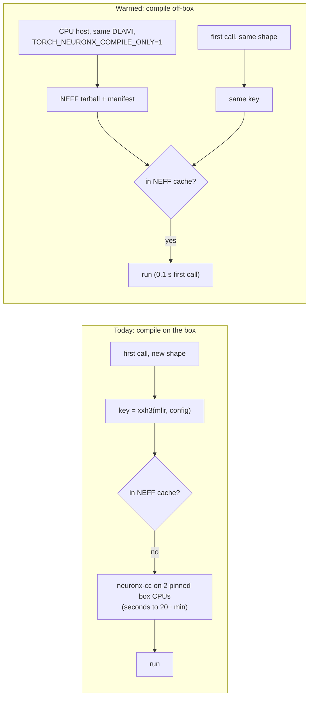

# trnsci: compile on a CPU host, run on Trainium. Neuron compile caches carry over

A feasibility test in [trnsci#118](https://github.com/trnsci/trnsci/issues/118) found that NEFFs compiled on a machine with no Neuron device are reused by a Trn2 box's persistent compile cache, with no `neuronx-cc` run, a fast first call and the same results. That works because the cache key is a pure function of the program and the compiler configuration, so compiling can move to cheaper CPUs ahead of a hardware window. The window that proved it also failed to keep most of its own cache, which is the practical half of this post. It is for anyone who pays for Trainium time and watches the first call compile.

<!-- more -->

!!! note "Scope"
    Everything here was measured on public Neuron SDK 2.33.0 (torch-neuronx 2.14.3, neuronx-cc 2.28.7631.0, NKI 0.7.0) on Trn2, LNC=2 unless stated. The cache internals described are what that toolchain does, not a documented contract, and may change in later SDKs. No trnsci library code changed for the experiment.

## The problem

On a GPU, the first call of a cuBLAS GEMM at a new shape costs about what the hundredth does. cuBLAS ships precompiled, shape-generic kernels, and the shape is a runtime argument. On Trainium every distinct static shape is a separate program: eager PyTorch lowers each op to StableHLO and `neuronx-cc` compiles it into a NEFF. The suite's device runs this window kept showing what that costs:

| workload | first call / cold compile | source |
|---|---|---|
| trnfft SHT, per-m loop of device matmuls, L = 511, F = 1 | more than 19 min (did not finish) | [trnfft#152](https://github.com/trnsci/trnfft/pull/152#issuecomment-6613524387) |
| the same SHT with problems padded into 10 size classes | 24–83 s | [trnfft#157](https://github.com/trnsci/trnfft/pull/157#issuecomment-6617354400), [summary](https://github.com/trnsci/trnfft/pull/152#issuecomment-6617357784) |
| trnfft SHT NKI kernels, LNC=1, L = 1023 | about 22 min cold; the test ran in 47.6 s on warm NEFFs once it freed its buffers | [trnfft#152](https://github.com/trnsci/trnfft/pull/152#issuecomment-6623689441) |
| trnfft FFT at N = 2²⁵ (Stockham), plain script | 276.5 s first call, 4.4 s second | [trnfft#140](https://github.com/trnsci/trnfft/pull/140#issuecomment-6603251214) |
| DF-RHF at 3508 AOs, first-iteration device ops | more than one 14.5-min slot, twice | [trnsci#115](https://github.com/trnsci/trnsci/issues/115#issuecomment-6590856086) |

Padding was the right fix for the SHT, and it is a library change. The rest of the table is compile time a window pays once per shape, on the box's own CPUs, with two pinned CPUs per test lane next to other lanes' compiles. If the box has compiled a shape before, the persistent NEFF cache skips all of it. The question #118 asked is whether the cache can be filled somewhere else.

## What the architecture suggests

Whole-program, ahead-of-time compilation is what lets `neuronx-cc` schedule four engines, SBUF tiles and DMA queues statically. The flip side is that a NEFF is fully determined by its inputs. If the cache key is too, then compiling is a pure function and can run on any host with the same compiler. #118 read the key out of the torch-neuronx sources and reproduced the box's key byte for byte from a captured `module.mlir`:

```
key = xxh3_128_hex( module.mlir bytes || 0xFF ||
        f"{target}_{lnc}_{opt}_{compiler_args}_v{NEURONXCC_VERSION}" [+ "_wlo"] )
```

For eager ops on the box, the config string was:

```
trn2_2_-O1_--model-type transformer --auto-cast=none --internal-disable-fma-on-ios_v2.28.7631.0+8f7b0cf5
```

No host name, path, PID or timestamp goes in. The cache itself is a flat directory of raw NEFF bytes sharded by the first four hex digits of the key, so installing an entry is a `cp`. The NEFFs are not quite byte-identical across hosts: 12 of 58 archive members differ, all `debug_info*` files that embed the workdir path. Every executable member matches.



## The approach

The experiment used two ways in.

**Offline compile.** Capture `module.mlir` and `compiler.txt` on the box (`TORCH_NEURONX_PRESERVE_COMPILATION_ARTIFACTS=1`), run the same `neuronx-cc compile` command elsewhere, and copy the NEFF in under the key. Copying a whole cache directory to a new path also works, because the key holds no location.

**Capture without a device.** TorchNeuron has a compile-only mode. It is documented for `torch.compile`, and it also covers eager dispatch. Every op lowers, compiles and lands in the NEFF cache under the key the box would compute, and device reads return placeholders. NKI kernels called through `wrap_nki` work the same way. The kernel is traced on the host and wrapped in a StableHLO custom call. The custom call is keyed like any aten op, and the Mac and the box produced byte-identical 911-byte StableHLO for the test kernel.

The deliberate tradeoff is in what not to ship. Two other caches look tempting and don't carry over:

- **The NKI trace cache** stores absolute `dep_files` paths and pins installed package versions (the Mac pinned setuptools 84.2.1, the box has 84.2.0). It only saves host tracing time, about 0.1 s for the test kernel, and [aws-neuron-sdk#1454](https://github.com/aws-neuron/aws-neuron-sdk/issues/1454) still applies to it.
- **The HLO cache** key includes a hash of the torch-neuronx sources and package versions. A `torch 2.14.0+cpu` host and a `torch 2.14.0` box never match. That costs milliseconds, because the HLO is rebuilt and the NEFF still hits.

Ship NEFFs, nothing else.

## Implementation

The device-free capture, exactly as run in #118:

```bash
export TORCH_NEURONX_COMPILE_ONLY=1 NEURON_PLATFORM_TARGET_OVERRIDE=trn2 \
       NEURON_LOGICAL_NC_CONFIG=2 NEURON_RT_FAKE_INSTANCE_TYPE=trn2.48xlarge \
       NKI_ENABLE_TRACE_CACHE=0 TORCH_NEURONX_NEFF_CACHE_DIR=$OUT/neff
python -P -O -m pytest -p cw_counters_plugin -m neuron tests/...   # see blockers re: asserts
```

`nrt_init` fails with "Neuron driver not loaded", and that is non-fatal. Verification on the box uses the `CompilationCache.PersistentHits` and `TotalCompilations` counters from `torch_neuronx.metrics`. The experiment scripts became [`scripts/warm_neuron_cache.py`](https://github.com/trnsci/trnsci/blob/main/scripts/warm_neuron_cache.py) ([#130](https://github.com/trnsci/trnsci/pull/130)) after this post was written; its end-to-end run waits for the next hardware window.

## What didn't work

**The toolchain has to match exactly.** The key includes the neuronx-cc version, and the HLO bytes depend on the torch-neuronx build. The public `torch-neuronx==2.14.3.0.281+dc70ffa` wheel needs glibc 2.43, won't import on Ubuntu 24.04, and isn't the build the DLAMI runs. #118 had to rebuild the box's environment by hand in a container. The simplest route is to boot the same DLAMI on a CPU instance. A mismatch is safe, though. It can't produce a wrong result. It only misses, and the box compiles as before, silently.

**Placeholder reads end tests early.** In compile-only mode `.item()`, convergence loops and assert-heavy tests take whatever path the placeholder data sends them down. The first trnblas pass captured only 6 of 14 NEFFs because tests stopped at their first failed assert. Stripping asserts with `python -O` and turning `torch.testing.assert_close` and `numpy.testing.assert_allclose` into no-ops captured all 14.

**Data-dependent shapes stay out of reach.** `nonzero`, sparse nnz, pivoting, and iterative solvers (SCF, eigh, CG) depend on values the host doesn't have. They need explicit shape lists, or a `module.mlir` corpus recorded on the box and replayed off it.

**Configuration is part of the key.** LNC=1 and LNC=2 give different keys, and so do `NEURON_CC_FLAGS`, the opt level and the int64 policy. `torch.compile` uses `-O2` and different flags from eager. NKI kernel keys include the module-qualified name, so warm from installed packages, not a renamed script.

**This window's cache mostly didn't survive.** The window built about 12 GB of compile caches across its lanes, and [about 1.1 GB was kept](https://github.com/trnsci/trnsci/issues/118#issuecomment-6636279685). The copy back from the box's region was too slow, and the box powered off mid-transfer. Every NEFF lost is a compile the next window pays for again on two pinned CPUs. The fix is boring: archive to storage in the same region, or start the copy well before the end of the window.

**Fit.** This is a place where Trainium's design works for the user once it's understood. Static whole-program compilation makes first calls expensive, and a CUDA programmer won't expect that. It also makes the result a cacheable, content-addressed artifact, which a JIT-at-launch model would not. The awkward part is the workloads whose shapes come from data, which are the scientific ones.

**Asks for AWS Neuron:**

- document the NEFF cache key and the eager compile-only mode as supported, versioned behaviour;
- publish a torch-neuronx wheel that matches the DLAMI build and imports on the DLAMI's own OS;
- keep workdir paths out of NEFF `debug_info`, so off-box NEFFs are byte-identical and checksums work;
- ship a supported "warm this cache" tool, so every team doesn't write its own.

## Numbers

All box runs are from #118 on 2026-11-03. Counters are `CompilationCache.*`.

| test | box cache before the run | first call / suite time | counters |
|---|---|---|---|
| `mm (37,211)@(211,53)`, cold | empty | 1.984 s | 1 compilation |
| same, NEFF compiled off-box from the captured `module.mlir` | 1 NEFF | 0.105 s, same rel. err 1.7e-7 | 1 hit, 0 compilations |
| same, whole cache dir copied to a new path | copied `neff/` + `hlo/` | 0.075 s | 1 hit |
| NKI `wrap_nki` kernel (128, 77), device-free capture | 1 NEFF | 0.130 s, max abs err 0 | 1 hit, 0 compilations |
| trnblas `test_nki_syrk.py` + `test_nki_trsm.py`, cold | empty | 24.35 s, 14 passed | 14 compilations |
| same, warmed device-free | 14 NEFFs | 8.27 s, 14 passed | 14/14 hits, 0 compilations |

The trnblas saving is about 16 s for 14 small kernels, or about 1.1 s per NEFF. Off-box on a Mac under amd64 emulation, the same 14 took 62 s, about four times slower per NEFF than the box. That is fine for spot checks and too slow for bulk warming. The gains that matter are in the first table, where single compiles run for minutes.

## What's next

#118 recommends two steps:

1. **Now, at no risk:** persist each lane's `TORCH_NEURONX_NEFF_CACHE_DIR` across windows. Tar it at window end, upload it keyed by `{neuronx-cc version}/{torch-neuronx build}/{target}-lnc{N}`, and restore it before first use. In-region, given the lesson above.
2. **`scripts/warm_neuron_cache.py`**, for new code and shapes before a window:
    - refuse to run unless the compiler version and torch-neuronx build hash match a manifest recorded on the box;
    - set the compile-only environment for each `(target, lnc)` pair in the plan;
    - run each library's `pytest -m neuron` list and the benchmark and exemplar entry points under `python -O`, with result checks turned off, in parallel workers;
    - optionally replay a `module.mlir` corpus for data-dependent paths;
    - emit `neff-<manifest>.tar.zst` plus a JSON index, and verify on the box with the hit counters.

Does a 64–96 vCPU CPU instance pay off? #118's answer is probably, for the big lanes, but measure first: one full-suite dry run for one lane, then the hit rate and wall time saved in the next window, before automating anything. Follow along on [trnsci#118](https://github.com/trnsci/trnsci/issues/118), the [Phase 3 milestone](https://github.com/trnsci/trnsci/milestone/3), the [roadmap](https://trnsci.dev/roadmap/) and the [suite-wide tracker](https://github.com/trnsci/trnsci/issues/1). More at [trnsci.dev](https://trnsci.dev).

## Takeaway

On Trainium, the first call of a new shape is a compile, and it can cost seconds to over 20 minutes. On SDK 2.33, the result is keyed only by the program and the compiler configuration, so it can be compiled anywhere the toolchain matches and copied in. That turns scarce device time into cheap CPU time, as long as the shapes are known ahead of the run and the toolchain matches. And once a window has paid for those compiles, copy the cache out early and in-region.
