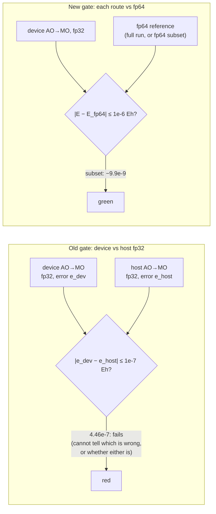

# trntensor and trnsolver: 3508-AO DF-MP2 on one Trn2 core, and what "accurate" means at the fp32 floor

The 3508-AO DF-RHF plus DF-MP2 run now goes end to end on one logical core of a Trn2 chip: SCF, AO→MO and MP2, with no host driver patches. It also failed its own accuracy gate. The device and host fp32 routes disagreed by 4.46e-7 Eh against a 1e-7 Eh target, and the fault turned out to be the gate. 1e-7 Eh is below what any fp32 route can resolve at this size, and comparing two fp32 routes with each other measures the wrong thing. This post is for chemists deciding what to trust from an fp32 accelerator, and for anyone who writes tolerance checks for one.

<!-- more -->

!!! note "Code status"
    The runs used window-5 hardware time on a trn2.3xlarge with public Neuron SDK 2.33.0 (neuronx-cc 2.28.7631, torch-neuronx 2.14.3), LNC=2, one logical core, fp32 on the device, and host work pinned to 2 CPUs with `OMP_NUM_THREADS=2`. The code was trntensor `main` @ 185ef7f and trnsolver `main` @ b576a20. Both commits are in the current releases, [trntensor 0.25.1](https://github.com/trnsci/trntensor/releases/tag/v0.25.1) and [trnsolver 0.22.1](https://github.com/trnsci/trnsolver/releases/tag/v0.22.1). The run used trnblas 0.11.1, and the current release is [trnblas 0.12.1](https://github.com/trnsci/trnblas/releases/tag/v0.12.1). The 0.25.1 and 0.12.1 patches row-block device matmuls with rows of 32 MiB or more ([trntensor#123](https://github.com/trnsci/trntensor/issues/123)). The largest B row in this run is 248 KB, so the patches don't touch it. The SCF and MP2 drivers live in trnsolver's `examples/` and `scripts/`, not in the installed package. Every unlabelled number below is from the [window-5 results comment](https://github.com/trnsci/trntensor/issues/122#issuecomment-6711936202) on trntensor#122. The [window-5 summary](https://github.com/trnsci/trnsci/issues/115#issuecomment-6711939379) on trnsci#115 restates it.

## The problem

The [ladder post](2026-11-05-dfmp2-ladder-3508.md) took density-fitted RHF and MP2 from about 500 to 3508 AOs on one trn2.3xlarge. Its top rung, alkane60 / cc-pVTZ (n_ao 3508, naux 8400, nocc 241, nvir 3267), finished with an asterisk. The AO→MO transform and the eigensolve ran on the host through driver patches. An SCF iteration took about 465 s. The blocked AO→MO kernel that fixed the SBUF wall ([trntensor#113](https://github.com/trnsci/trntensor/pull/113)) had only been checked on synthetic chunks, because the 207 GB integral store was gone.

[trntensor#122](https://github.com/trnsci/trntensor/issues/122) set the follow-up:

- rebuild the store;
- run `df_mp2` with the device AO→MO;
- require E_MP2 from the device route to match the host route to within 1e-7 Eh.

The last item is the cuBLAS-era habit: if the fast path matches the reference, ship it. The [silent-wrong-answers post](2026-11-04-suite-silent-wrong-answers.md) showed one way that habit fails: both paths share a bug and agree on the wrong answer. This run shows the other way. Both paths are right to the precision they compute in, and they still disagree by more than the gate allows.

## What the architecture suggests

The Trn2 compute engines do their arithmetic in fp32, and PSUM accumulates in fp32. The silicon has no fp64 path, and the suite's float64 work runs on the host. For an fp32 pipeline, the useful questions are where the rounding happens and whether it is biased.

In this pipeline B is stored in fp32. Each B_ia element is built from sums over n_ao = 3508 terms, accumulated in PSUM. A biased rounding would make the error grow like n·u, with u = 2⁻²⁴ ≈ 6e-8 the fp32 unit roundoff. That is about 2e-4. Random rounding grows like √n·u, about 3.5e-6. The measured maximum relative errors of B_ia against fp64 are 2.1e-6 on the device and 3.5e-6 on the host. That is this post's back-of-envelope comparison, and a maximum is a loose statistic, but it fits random rather than biased errors.

AWS documents the rounding controls the hardware offers. [Rounding modes](https://awsdocs-neuron.readthedocs-hosted.com/en/latest/general/arch/neuron-features/rounding-modes.html) says all NeuronCore generations support round-to-nearest-even (RNE). Stochastic rounding (SR) is selectable from NeuronCore-v2 on, which covers Trn1, Trn2 and Trn3, through `NEURON_RT_STOCHASTIC_ROUNDING_EN`. The page describes the problem SR solves: with RNE, "rounding can squash small values and prevent them from accumulating over time". Its example sums small increments. RNE stalls at 1024, and SR reaches 2056 against an exact 2048. The [Trainium3 architecture guide](https://awsdocs-neuron.readthedocs-hosted.com/en/latest/nki/guides/architecture/trainium3_arch.html) adds two things on NeuronCore-v4:

- `nc_matmul` can write BF16 into PSUM. The accumulation inside the array "is still performed using FP32 data", and the downcast before the write "can use the RNE (round nearest even) or SR (stochastic rounding) mode".
- MXFP8/MXFP4 inputs, at 315 TFLOPS, against 79 for BF16 and 20 for FP32.

That tells you where SR earns its place: long accumulations in a format narrow enough for RNE to stall, such as a BF16 running sum in PSUM. SR removes the bias there. It doesn't make any single operation more precise. Its per-operation error is at least as large as RNE's, and now random. The docs call SR "probabilistic" and say nothing about reproducibility. A probabilistic rounding can't give bit-identical reruns, and structural determinism is one of the suite's design rules ([trnsci#129](https://github.com/trnsci/trnsci/issues/129)). The B_ia errors here come from fp32 input and product rounding, and they already look random. SR has no bias to remove. It would trade one random error of this size for another, and lose reproducibility. Getting below the floor needs more bits per operation: error-compensated arithmetic built from fp32 passes, or fp64-class arithmetic.



## The approach

**Put the whole SCF on the device.** In window 4 the first-call compiles around the solve outlasted two 14.5-minute slots ([trnsolver#122](https://github.com/trnsci/trnsolver/issues/122)). With `solver=subspace` (`refresh=None`), J/K, Fock, energy, DIIS, eigh and the density all run on the device, and [part 1 of trnsolver#122 is resolved](https://github.com/trnsci/trnsolver/issues/122#issuecomment-6711939610). A pre-warm on synthetic B at the real shapes took 796 s for the first iteration cold (J/K 623 s, DIIS 163 s, eigh 7 s), against 145 s warm. The NEFF and HLO caches are kept for the next window.

**Measure everything on one set of orbitals.** Window 4 didn't keep its orbitals, so its energies aren't comparable at the 1e-7 level. Every window-5 energy below uses the device SCF's orbitals.

**Use an independent reference, sized to fit.** A full fp64 AO→MO at 3508 AOs means another 26 GB B_ia and hours of host time. Instead the check takes six occupied orbitals, i ∈ {0, 48, 96, 144, 192, 240}, which give 36 ordered pairs. It streams the packed store once, unpacks it in fp64, builds B_ia for those orbitals in fp64 on the host, and computes the subset pair-energy sum E_S in fp64 from each of the three B_ia. The deliberate tradeoff: the reference shares the fp32 store. It measures the AO→MO arithmetic, not the cost of storing B in fp32.

**Revise the gate in the open.** The [revised gate](https://github.com/trnsci/trntensor/issues/122#issuecomment-6714981609) is |E_MP2(device) − E_MP2(fp64 reference)| ≤ 1e-6 Eh, with the relative error recorded. The reference is a full fp64 run, or an fp64 subset check when a full run isn't practical. 1e-6 Eh is still about 1,600× below chemical accuracy (1 kcal/mol ≈ 1.6e-3 Eh). The 1e-7 Eh target stays, assigned to device fp64 ([trnblas#22](https://github.com/trnsci/trnblas/issues/22), [trnsci#129](https://github.com/trnsci/trnsci/issues/129)).

## Implementation

The device AO→MO is `AuxStream.ao_to_mo`. Each aux chunk's transform is issued on its owning core, and the previous result for that core is copied back and written into the `(nocc, nvir, naux)` output, a memmap here. From [`trntensor/stream.py` at v0.25.1](https://github.com/trnsci/trntensor/blob/v0.25.1/trntensor/stream.py):

```python
def drain(d):
    if d in pending:
        q0, q1, r = pending.pop(d)
        h = _dispatch._to_host(r, "cpu")
        if is_np:
            out[:, :, q0:q1] = h.numpy()
        else:
            out[:, :, q0:q1] = h

for i, q0, q1, Bc in self.chunks():
    d = self.owner[i]
    drain(d)
    pending[d] = (q0, q1, ao_to_mo_transform(Bc, co[d], cv[d]))
for d in list(pending):
    drain(d)
```

All 97 chunks (96 of 87 aux columns, one of 48) ran the blocked NKI kernel, and none fell back to aten. The `out[:, :, q0:q1]` line is where the time probably goes. More on that under the next heading.

## What didn't work

**The gate.** The device route gave E_corr = −11.455598345026 Eh and the host aten fp32 route −11.455597898923 Eh, a difference of −4.46e-7 Eh (3.9e-8 relative). Against the fp64 subset:

| B_ia | max rel. error vs fp64 | E_S − E_S(fp64), Eh |
|---|---|---|
| fp64 reference | – | E_S = −0.019149036007 |
| device blocked kernel (fp32) | 2.1e-6 | −9.9e-9 |
| host aten (fp32) | 3.5e-6 | +8.4e-9 |

Both routes are about 1e-8 Eh from fp64 on the subset, on opposite sides. The signs match the full gap, with the device route more negative. Two samples aren't statistics, but nothing points to a bias in either route. The gate asked for 1e-7 Eh at |E_corr| = 11.46 Eh. That is 8.7e-9 relative, below the fp32 unit roundoff of 6e-8. Two fp32 routes that sum in different orders can't be expected to agree that closely, however correct each one is.

Comparing two fp32 routes measures their difference, e_dev − e_host, and nothing about either one. It fails when both are right and rounded differently, as here. It passes when both share an error, as in the silent-wrong-answers post. Even on a fail, it can't say which route is closer to the answer. The fp64 reference measures each route on its own, and that is what the device needed: on this subset, the device AO→MO is at least as accurate as the host fp32 route it was being checked against.

**The limits of the new evidence.** The fp64 check covers 36 of 58,081 ordered pairs. The full-system error is inferred from the subset and the B_ia statistics, not measured against a full fp64 E_MP2. A later four-core MP2 run took [154.7 s against 296.9 s on one core](https://github.com/trnsci/trntensor/issues/122#issuecomment-6725609539) (1.92×, bit-identical E_corr); the scaling is likely limited by one host thread issuing every pair, which hasn't been measured.

**Device AO→MO time.** The device AO→MO took 731 s for 206.8 GB streamed, against 1242 s for the host route in the same driver. The kernel isn't the bound: 0.9 ms median issue per chunk. The disk isn't either: 376 s of loading in the background with 2 s waited on. Faulthandler samples point at `drain` → `_to_host` and the B_ia write. The hypothesis, unmeasured: each 87-wide chunk writes `out[:, :, q0:q1]` into the aux-last memmap, which is 787k strided runs of 348 bytes across a 26 GB file. Buffering several chunks per write, or wider chunks ([trntensor#122](https://github.com/trnsci/trntensor/issues/122) item 2: 87 columns fill 348 of the 512 moving columns), should help; neither is timed yet. The 673 s host route in window 4 used a different driver, and the difference from 1242 s wasn't chased.

**Fit.** The fp32 device pipeline is far inside chemical accuracy. The host still does the fp64 parts and the store build, and they now dominate. The canonical fp64 Fock is the longest stage, at 2255 s, ahead of the whole 1487 s SCF loop. The store build took 5824 s, 5341 s of it TRSM. The disk bound is a one-chip shape mismatch. 193.9 GB per iteration through instance NVMe is about 0.85 GB/s, because the 207 GB store is larger than the 124 GB host page cache.

The ask for AWS Neuron is documentation. The rounding-modes page should say which engines and dtypes `NEURON_RT_STOCHASTIC_ROUNDING_EN` affects (for example, whether fp32 PSUM results are ever rounded stochastically), and whether results with SR enabled are reproducible from run to run. A numerical library has to know both before it can promise determinism.

## Numbers

Time to energy at 3508 AOs, window 4 ([results](https://github.com/trnsci/trnsci/issues/115#issuecomment-6590856086)) against window 5. Same system and store layout, one logical core:

| stage | where (window 5) | window 4 | window 5 |
|---|---|---|---|
| store build (int3c 302 s, TRSM 5341 s, write 176 s) | host | 5597 s ([#122](https://github.com/trnsci/trntensor/issues/122)) | 5824 s |
| SCF per iteration | device | ≈ 465 s (≈ 0.5 GB/s) | 212–235 s J/K (0.83–0.97 GB/s), < 1.3 s everything else |
| eigh per iteration | device, `solver=subspace` | ≈ 15 s (host LAPACK, driver patch) | 5.0 s (it. 1), 0.14–0.57 s |
| SCF loop, 6 iterations from minao | device | three 2-iteration restarts | 1487 s (wall 1525 s) |
| canonical Fock, fp64 | host | 2141 s ([trnsci#129](https://github.com/trnsci/trnsci/issues/129)) | **2255 s** |
| AO→MO | device | 673 s (host, other driver) | 731 s (host route: 1242 s) |
| MP2, `mp2_energy_blocked` | device | 769 s | 297 s (291 s on host B_ia) |

The window-4 to window-5 MP2 difference wasn't analysed. Summed by this post, the window-5 stages come to about 10,600 s. The host's store build and fp64 Fock are 8,079 s of that, about 76%.

Cold compiles at the production shapes, measured in the pre-warm (the production run was warm throughout): SCF first iteration 796 s, AO→MO kernel 217 s (0.58 s warm), `mp2_energy_blocked` 528 s.

Energies, all from the window-5 device-SCF orbitals:

| quantity | value (Eh) |
|---|---|
| E_HF, host fp64 Fock and energy | −2343.966124365592 |
| E_corr, device AO→MO + device MP2 | −11.455598345026 |
| E_corr, host fp32 AO→MO + device MP2 | −11.455597898923 |
| window 4, for reference only (orbitals not kept) | E_HF −2343.96611, E_corr −11.4557450 (1.5e-4 away) |

Device kernels against fp64 at the real widths: J 5.8e-7, K 5.7e-7, AO→MO 4.8e-7, gemm 3.2e-7, syrk 1.4e-7 and the MP2 pair kernel 3.4e-8, all relative.

## What's next

The [window-5 summary](https://github.com/trnsci/trnsci/issues/115#issuecomment-6711939379) ranks the bottlenecks:

1. **The host fp64 canonical Fock, 2255 s.** [trntensor#116](https://github.com/trnsci/trntensor/issues/116) moves it to fp64-class J/K on the device, on the error-compensated GEMM of [trnblas#22](https://github.com/trnsci/trnblas/issues/22) (double-double and Ozaki splitting over fp32 PSUM), tracked in the [epic trnsci#129](https://github.com/trnsci/trnsci/issues/129). The same work is the route to the 1e-7 Eh gate.
2. **Disk-bound J/K, about 225 s per iteration.** [trnsolver#125](https://github.com/trnsci/trnsolver/issues/125) shards the integrals across trn2.48xlarge HBM, and [trnsci#132](https://github.com/trnsci/trnsci/issues/132) plans that window.
3. **The drain- and write-bound device AO→MO.** Items 2 and 3 of [trntensor#122](https://github.com/trnsci/trntensor/issues/122) are untouched.

Phase trackers: [Phase 2 — precision and numerical validation](https://github.com/trnsci/trnsci/milestone/2), trnsolver [Phase 3 #28](https://github.com/trnsci/trnsolver/issues/28) and trntensor [Phase 4 #30](https://github.com/trnsci/trntensor/issues/30). Suite context is at [trnsci.dev](https://trnsci.dev), the [roadmap](https://trnsci.dev/roadmap/) and the [suite tracker](https://github.com/trnsci/trnsci/issues/1).

## Takeaway

On an fp32 accelerator, a tolerance has to start from the precision floor, and the reference has to sit above it. A 1e-7 Eh gate between two fp32 routes asked for 8.7e-9 relative agreement from arithmetic with 6e-8 unit roundoff. It failed a device route that an fp64 check showed to be as good as the host's. Trainium's rounding controls address bias in narrow accumulations. Stochastic rounding is the tool for that, and this workload doesn't have that problem. Its errors are already random, so the only way below the floor is more bits per operation. The 3508-AO job now runs entirely on the device to within about 1e-8 Eh of fp64 on the checked subset, and the longest remaining stage is the host computing in fp64.
