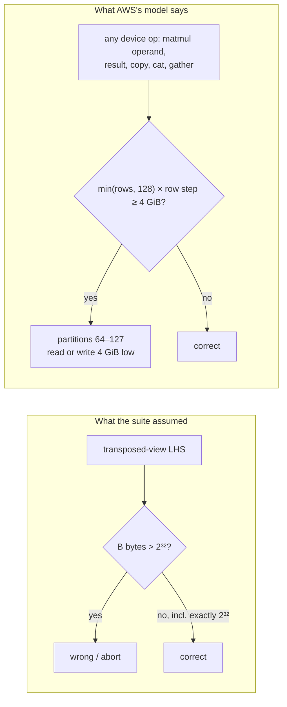

# trnsci: rows of 32 MiB, partitions 64–127, and the 4 GiB point that was right by luck

On Trn2, a device matmul or copy whose operand has rows of 32 MiB or more can return wrong numbers with no error, and trnblas 0.12.1 and trntensor 0.25.1 now block every such product into pieces the hardware gets right. Getting there meant retracting a data point the suite had published: "a right operand of exactly 2³² bytes is correct" was true only because the wrong addresses happened to hold an identical copy of the right data. AWS maintainers traced the fault to how a DMA spreads rows over the 128 SBUF partitions, and that model, not the suite's first guess, is what the guards now encode. This post continues [the suite's silent wrong answers](2026-11-04-suite-silent-wrong-answers.md), and it is for anyone moving tensors of more than 4 GiB through a NeuronCore.

<!-- more -->

!!! note "Code status"
    | library | fix | release | affected | Trn2 validation |
    |---|---|---|---|---|
    | trnblas | row-blocked device matmuls ([#112](https://github.com/trnsci/trnblas/issues/112), [PR #115](https://github.com/trnsci/trnblas/pull/115)), `df_mp2_energy` half-transform ([#116](https://github.com/trnsci/trnblas/issues/116)) | [v0.12.1](https://github.com/trnsci/trnblas/releases/tag/v0.12.1) | 0.6.0–0.12.0 | [240 passed](https://github.com/trnsci/trnsci/issues/35#issuecomment-6711392931) |
    | trntensor | row-blocked device matmuls ([#123](https://github.com/trnsci/trntensor/issues/123), [PR #124](https://github.com/trnsci/trntensor/pull/124)) | [v0.25.1](https://github.com/trnsci/trntensor/releases/tag/v0.25.1) | 0.17.0–0.25.0 | [122 passed](https://github.com/trnsci/trnsci/issues/35#issuecomment-6711392931) |
    | trntensor | device row gathers in ≤ 2 GiB blocks, for [aws-neuron-sdk#1459](https://github.com/aws-neuron/aws-neuron-sdk/issues/1459) ([#107](https://github.com/trnsci/trntensor/pull/107)) | [v0.24.0](https://github.com/trnsci/trntensor/releases/tag/v0.24.0) | 0.20.0–0.23.0 ([README](https://github.com/trnsci/trntensor#known-issues-in-earlier-releases)) | on the PR |

    Still open: the `df_mp2_energy` reduce-scatter ([trnblas#116](https://github.com/trnsci/trnblas/issues/116)), the trnsparse CG operand ([trnsparse#121](https://github.com/trnsci/trnsparse/issues/121)) and the elementwise audit ([trnsci#145](https://github.com/trnsci/trnsci/issues/145)). All device numbers are from a trn2.3xlarge on public Neuron SDK 2.33.0 (torch-neuronx 2.14.3, neuronx-cc 2.28.7631, runtime 2.35.30, NKI 0.7.0), eager aten, one process per case, LNC=2 unless stated. The upstream fault is open, with a runtime fix in review ([aws-neuron-sdk#1457](https://github.com/aws-neuron/aws-neuron-sdk/issues/1457#issuecomment-6639957251)).

## The problem

Density-fitted chemistry flattens its three-index integrals into matrices like `(nbasis, nbasis·naux)` and multiplies them by small coefficient matrices. That is a short, fat GEMM, which cuBLAS handles at any size because a GPU address is just a 64-bit pointer plus an offset. A straight port to Trainium is `torch.mm` on the `neuron` device, and for most shapes it is exactly right.

In late October, trnblas's DF-MP2 half-transform `C_occ.T @ eri_flat` aborted at 768/96/2304 with `NRT status: 1203, A DMA engine encountered an unrecoverable error` ([aws-neuron-sdk#1448](https://github.com/aws-neuron/aws-neuron-sdk/issues/1448)). It failed only with a transposed-view left operand and a right operand above 2³² bytes. The [DF-MP2 correction post](2026-10-31-trnblas-dfmp2-correction.md) said this "suggests 32-bit offset arithmetic somewhere in the transposed-operand DMA path". `gemm` started copying the left operand to row-major ([trnblas#57](https://github.com/trnsci/trnblas/issues/57)).

In window 3 the same product came back silent. When B had been produced on the device, by `clone`, `* 1` or `index_select`, `A.T @ B` returned relative error 1.06 in every element ([aws-neuron-sdk#1457](https://github.com/aws-neuron/aws-neuron-sdk/issues/1457)). The bisection reported "B at exactly 2^32 bytes is correct; at 2^32 + 512 KiB it is wrong." That boundary went into trntensor's guard comment and into the suite's model of the bug: an offset that overflows 32 bits, and a transposed-operand problem. Both parts turned out to be wrong.

## What the architecture suggests

A NeuronCore's engines read from SBUF, which is 128 partitions wide. A DMA that fills a tile moves one row of the source into each partition, and the distance between the rows feeding neighbouring partitions is the DMA's partition step. One DMA therefore covers 128 × step bytes of HBM. A CUDA programmer thinks of a load as a pointer and a stride; on Trainium that stride is fanned out over 128 partitions, and the fan-out is where this bug lives.

The maintainers compiled the failing cases and explained them in those terms ([first reply](https://github.com/aws-neuron/aws-neuron-sdk/issues/1457#issuecomment-6616873553), [hardware confirmation](https://github.com/aws-neuron/aws-neuron-sdk/issues/1457#issuecomment-6639957251)):

- With a transposed-view LHS and K a multiple of 128, B is read with a step of `B_bytes / 128`. With a contiguous LHS, the step is one row of B.
- When the step is 32 MiB or more, so that the 128 partitions together span 4 GiB or more, the rows for partitions 0–63 are read correctly. The rows for partitions 64–127 come from exactly 4 GiB below the right address.
- If that memory is unmapped, the DMA aborts (#1448). If it is mapped, the result is silently wrong (#1457).
- The LNC=1 `index_select` failures ([aws-neuron-sdk#1459](https://github.com/aws-neuron/aws-neuron-sdk/issues/1459#issuecomment-6616912106)) are the same edge on the write side, with an output step of `output_bytes / 128`. LNC=2 halves the step, which is why LNC=2 was exact.

That model makes predictions. The condition is about the step, not the byte count of the tensor and not the operand being transposed. A contiguous operand with rows of 32 MiB (8,388,608 fp32) should fail. 64 such rows should not, since they span only 2 GiB. And "exactly 2³²" was a step of exactly 32 MiB, which should be wrong.



## The approach

**Test the model, not the shape.** In window 5, lane B ran the maintainers' contiguous case and its controls ([trnsci#140](https://github.com/trnsci/trnsci/issues/140#issuecomment-6707174574), [upstream](https://github.com/aws-neuron/aws-neuron-sdk/issues/1457#issuecomment-6707171817)). A contiguous `(96,128) @ (128, 8,389,632)` fp32, rows of 32 MiB + 4 KiB, aborted with NRT 1203 on a host upload and returned relative error 1.01 with no error when B came from a device `clone`, at LNC=2 and LNC=1. At 32 MiB − 512 B it was correct, and so was K = 64 at the long rows.

The deciding control was the maintainers' suggestion: put a decoy underneath. Upload B first, then upload 2·B into a fresh buffer, and compare with 2·A@B. If partitions 64–127 read the decoy, the output is `2·A[:, :64] @ B[:64] + A[:, 64:] @ B[64:]`. At exactly 32 MiB rows the product was wrong (relative error 0.357), and against that model it matched to 1.15e-7, fp32 rounding, at both LNCs. The suite's original exactly-2³² point, `(128,64).T @ (128, 8,388,608)`, gave 1.15e-7 with a clone and 0.357 with the decoy. In the original repro, B was a clone sitting directly above the buffer it was cloned from. The bug read memory 4 GiB too low, and that memory held the right answer.

**Then find the cut that works.** The proposed fix in [trnblas#112](https://github.com/trnsci/trnblas/issues/112) was to chunk B by columns into separate tensors. Lane B's run had shown that column chunks built on the host, as two separate `(128, 4,194,816)` tensors, were correct. A second round of probes asked which cuts the device can make itself ([trnsci#140](https://github.com/trnsci/trnsci/issues/140#issuecomment-6710569884), [upstream](https://github.com/aws-neuron/aws-neuron-sdk/issues/1457#issuecomment-6710567596)); the results are under "What didn't work". The cut that works is blocks of whole rows. A block of rows is a contiguous view, so it needs no copy, and a block of at most 64 rows of up to 32 MiB + 16 KiB spans at most 2 GiB + 1 MiB, inside partitions 0–63.

The rule both libraries share: an operand or result is unsafe when `min(rows, 128) × row_bytes ≥ 2³²`. Then:

- long rows in B: split K into row blocks and sum the partial products;
- long rows in A, or in the result: split M and `cat` on dim 0;
- a transposed view whose memory rows are long: split K or N;
- a dim-1 `cat` into an unsafe result: assemble on the host and upload, as a fallback the blocking above never reaches in practice.

Below the rule nothing changes. The guard makes the old aten call, and the N = 8,388,480 control is bitwise equal to it. The deliberate cost is above the rule. A K split changes the fp32 summation order of those products and issues `ceil(K/64)` partial products plus adds. The host fallback would cost about 0.7 s per 4 GiB over the ~13 GB/s link. Blocks are near-equal (128 = 64 + 64, not 63 + 63 + 2) to limit distinct NEFF shapes.

## Implementation

The core is one recursive function, the same in [trnblas](https://github.com/trnsci/trnblas/pull/115) and [trntensor](https://github.com/trnsci/trntensor/pull/124). `_span_block` returns 0 for a safe operand, or the rows per block:

```python
# excerpt from trnblas/nki/dispatch.py (docstring dropped)
def _neuron_mm2d(a: torch.Tensor, b: torch.Tensor, mm=None) -> torch.Tensor:
    M, K = a.shape
    N = b.shape[1]
    ob = _out_block(M, N, a.element_size())
    if ob and ob < M:  # the result itself: blocks of output rows
        ob = _even_step(M, ob)
        return _neuron_cat([_neuron_mm2d(a[i : i + ob], b, mm) for i in range(0, M, ob)], 0)
    ab = _span_block(a)
    if ab:
        if _row_layout(a)[0] == 0 and ab < M:  # long rows of A: split M
            ab = _even_step(M, ab)
            return _neuron_cat([_neuron_mm2d(a[i : i + ab], b, mm) for i in range(0, M, ab)], 0)
        if _row_layout(a)[0] == 1 and ab < K:  # A = X.T, long rows of X: split K
            return _neuron_mm_ksum(a, b, ab, mm)
    bb = _span_block(b)
    if bb:
        if _row_layout(b)[0] == 0 and bb < K:  # long rows of B: split K
            return _neuron_mm_ksum(a, b, bb, mm)
        if _row_layout(b)[0] == 1 and bb < N:  # B = Y.T, long rows of Y: split N
            bb = _even_step(N, bb)
            return _neuron_cat([_neuron_mm2d(a, b[:, j : j + bb], mm) for j in range(0, N, bb)], 1)
    if mm is not None and not _neuron_mm_unsafe(a, b):
        return mm(a, b)
    return torch.matmul(_neuron_mm_lhs(a, b), b)
```

`_row_layout` decides which dimension holds the memory rows, so a transposed view is judged by its parent's rows. In trnblas it is wired into `gemm`, `batched_gemm`, `symm`, `syrk`, `trmm`, `gemv`, the `trsm` updates and every `nki_gemm` route. At unsafe sizes the NKI GEMM kernels are skipped in favour of the blocked aten product. In trntensor it covers `nki_matmul`, `nki_batched_matmul` and the contiguous `ao_to_mo_transform` route. The CPU tests lower the threshold by 2¹⁸ and spy on `torch.matmul` to assert that no issued product is unsafe.

## What didn't work

**Column chunks cut on the device.** Every case below is fp32 with N = 8,389,632 and the operand above a decoy ([trnsci#140](https://github.com/trnsci/trnsci/issues/140#issuecomment-6710569884)):

| case | result |
|---|---|
| `(96,128) @ (128,N)` / `bmm` | wrong, 0.79 / 0.79 |
| `(128,N) @ (N,64)`, long rows in the **left** operand | wrong, 0.80 |
| `B[:, :N//2].contiguous()`, a device column-slice copy | **wrong copy**, max abs err 13.4 (upload), 140 (clone) |
| strided view `B.view(128,2,N//2)[:, j, :]` as the operand | wrong, 0.79 |
| `torch.cat(dim=1)` of two correct halves into `(128,N)` | wrong, 0.71 |
| `torch.cat(dim=0)` of correct `(63,N)` row blocks | correct, 2.3e-7 |
| B as a transposed view of a `(N,128)` tensor (short memory rows) | correct, 2.3e-7 |
| K split into 63-row contiguous views at offsets up to ~6 GB, partial sums | correct, 2.8e-7 |
| long-row A in 63-row blocks, dim-0 `cat` | correct, 2.1e-6 |
| `index_select` row gather; `B.to("cpu")` of the 4 GiB tensor | exact; bit-exact |

The column-chunk plan needed the device to cut the chunks, and cutting them is a copy with the same bad step. A plain `.contiguous()` returning wrong data with no error is the line from this window most worth remembering. The maintainers had flagged the risk: they suggested building each chunk as its own tensor and noted they had "not checked how such slices are copied."

**It bit real code.** The [trnsci#145](https://github.com/trnsci/trnsci/issues/145#issuecomment-6710682652) audit, by code reading, found `trnblas.parallel.df_mp2_energy` building `part = (nocc_pad, nbasis·naux)`, which reaches the bad layout at nocc ≥ 128 and nbasis·naux ≥ 2²³, for example nbasis 1700, naux 5100, nocc 128. Its symmetric path does a strided in-place `+=` into `part`. On the device that was wrong at relative error 0.538. With PR #115's 64-row blocks it was 9.98e-8 ([trnblas#116](https://github.com/trnsci/trnblas/issues/116#issuecomment-6711139562)). Standard DF ratios (naux ≈ 3 × nbasis) on one 24 GiB core don't reach the rule; high naux/nbasis ratios do ([trntensor#123](https://github.com/trnsci/trntensor/issues/123)).

**Elementwise ops abort.** Trying the maintainers' `Bd = B.to("neuron") * 2` control aborted the `mul` before the matmul ran. `X * 2`, `X + X` and `torch.exp(X)` on fp32 `(128, ≥ 8,388,608)`, on a 1-D 2³⁰-element tensor, on `(2, 64, 8,388,608)` and on bf16 `(128, 16,777,216)` all hit NRT 1203 after a 30 s timeout. At 2³² − 64 KiB, or 4 GiB in 4 MiB or 16 MiB rows, they were correct, and so was `clone` ([trnsci#145](https://github.com/trnsci/trnsci/issues/145)). Every elementwise failure seen was loud. The audit rule is still "no single device elementwise op on a tensor of 4 GiB or more", since the matmul cases of the same family taught the suite not to rely on loudness.

**Fit, and the asks.** Long rows are rare in training: an 8.4M-element fp32 row is not a hidden dimension anyone picks. They are natural in science, from a flattened `nbasis·naux`, a wide right-hand side, a long signal or `k·128` blocks laid side by side. The 128-partition DMA is still the right transport for this hardware. The rule just makes its span a quantity a library has to check. The asks for AWS Neuron, on [aws-neuron-sdk#1457](https://github.com/aws-neuron/aws-neuron-sdk/issues/1457#issuecomment-6707171817):

- ship the runtime fix, and say whether it covers elementwise kernels and copies as well as matmul;
- until then, refuse at compile or load time any DMA whose partition span reaches 4 GiB, which would turn this whole family loud;
- document the partition-step limit next to the DMA and SBUF documentation.

## Numbers

Device regression tests at N = 8,389,632 fp32, before and after the fix, from the PR validation runs ([trnblas#115](https://github.com/trnsci/trnblas/pull/115#issuecomment-6711139114), [trntensor#124](https://github.com/trnsci/trntensor/pull/124#issuecomment-6711139329)):

| test | before (`main`) | after (trace cache off and on) |
|---|---|---|
| trnblas `gemm` `(96,128) @ (128,N)`, B above a decoy | rel err 1.010 | pass (< 1e-5) |
| trnblas `gemm` `(128,64).T @ (128,N)` | 1.008 | pass |
| trnblas `gemm` `(128,N) @ (N,64)` | 0.995 | pass |
| trnblas `gemm` `(128,128) @ (128,N)` (long-row result) | DMA abort | pass |
| trntensor `einsum("ij,jk->ik")` `(96,128) @ (128,N)` | 1.010 | pass |
| trntensor contiguous `ao_to_mo` route, nbasis 128, naux 65,544 | 1.017 | pass |
| trnblas `_half_transform_part` symmetric, nbasis 64, naux 131,088, nocc 128 | 0.538 | 9.98e-8 |
| N = 8,388,480 control | – | bitwise equal to the plain aten call |

The new device files passed 13/13 (trnblas) and 7/7 (trntensor) with the trace cache off and on. The existing device suites passed as well: 227 passed, 14 skipped in trnblas and 115 passed, 3 skipped in trntensor. Release smoke tests of the installed wheels were 240/240 and 122/122 ([trnsci#35](https://github.com/trnsci/trnsci/issues/35#issuecomment-6711392931)). The public `gemm` on 0.11.1 had returned 0.798 on both the `auto` and `nki` backends, with no error ([trnblas#112](https://github.com/trnsci/trnblas/issues/112#issuecomment-6707156270)).

## What's next

- [trnblas#116](https://github.com/trnsci/trnblas/issues/116): the `df_mp2_energy` reduce-scatter over a `part` in the bad layout needs a multi-rank device run.
- [trnsparse#121](https://github.com/trnsci/trnsparse/issues/121): `FusedCGOperator`'s `(128, k·128)` block operand reaches the layout at k ≥ 65,536 blocks.
- [trnsci#145](https://github.com/trnsci/trnsci/issues/145): one shared guard for trnblas `_scale_add`, `trsm` and `ger`, plus boundary tests for copies, collectives and NKI-kernel DMA, which the audit rated by inference only. trntensor's generic `"torch"` einsum strategy is not covered yet ([PR #124](https://github.com/trnsci/trntensor/pull/124)).
- [trnsci#135](https://github.com/trnsci/trnsci/issues/135): the upstream tracker. The guards come out once a public SDK ships the fix and the decoy tests pass without them.
- [Phase 1 — single-chip correctness](https://github.com/trnsci/trnsci/milestone/1), the [roadmap](https://trnsci.dev/roadmap/) and the [suite-wide tracker](https://github.com/trnsci/trnsci/issues/1). More at [trnsci.dev](https://trnsci.dev).

## Takeaway

On Trainium a DMA is not one stride but 128 of them, and the safe size of a tensor depends on how its rows fall across those partitions, not on its byte count. The suite's first boundary was a single passing point, and it passed because the wrong memory held a copy of the right data. Four habits came out of it: test at the byte boundary and one row either side; put a decoy under the operand so that a wrong address can't read the right answer; treat one green point as one data point; and build the guard from the vendor's model of the fault, then test the model's predictions, which is how the contiguous-operand case and the bad copy were found.
