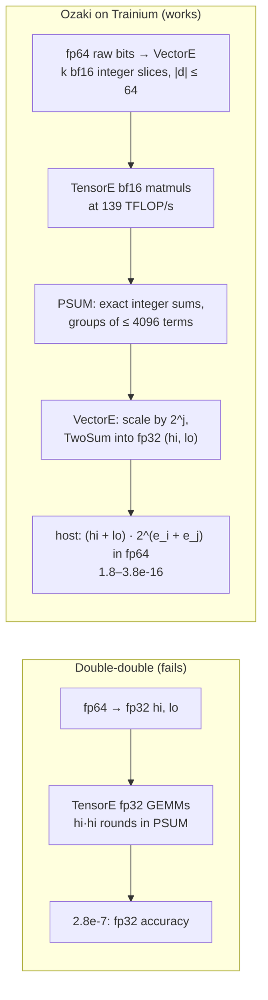

# trnblas: fp64-accurate GEMM on a Tensor Engine with no fp64, and the end-to-end number that lost first

trnblas now has `gemm_fp64`, a GEMM that matches host fp64 BLAS to 1.8–3.8e-16 on a Trn2 chip whose engines have no fp64 arithmetic. The arithmetic works because fp32 PSUM, fed 7-bit integers, is an exact integer accumulator. The first end-to-end measurement still lost to the host CPU: the time went into cutting fp64 numbers into those integers on the host, until that moved to the device as bit manipulation. This post is for anyone with an fp64 step stuck on the host of a Trainium job, and for anyone who assumed double-double was the obvious way to get it off.

<!-- more -->

!!! note "Code status"
    `trnblas.gemm_fp64(A, B, slices=8)` is released in [trnblas 0.13.0](https://pypi.org/project/trnblas/0.13.0/) ([release notes](https://github.com/trnsci/trnblas/releases/tag/v0.13.0)), [validated on Trn2](https://github.com/trnsci/trnsci/issues/35#issuecomment-6756567385): 263/0 device tests, with the trace cache off and on. It contains the kernel ([trnblas#124](https://github.com/trnsci/trnblas/pull/124)) and the device-side split ([trnblas#125](https://github.com/trnsci/trnblas/pull/125), which fixes [#123](https://github.com/trnsci/trnblas/issues/123)). All device numbers are from a trn2.3xlarge on public Neuron SDK 2.33.0 (torch-neuronx 2.14, neuronx-cc 2.28, NKI 0.7), eager mode, one logical core at LNC=2, normal(0, 1) data and a warm NEFF cache. Host baselines are torch fp64 `A @ B` on 2 pinned vCPUs (one physical core) and on all 12. The error metric throughout is `max_cw` = max |C − C_exact| / (|A||B|), against an independent near-correctly-rounded reference.

## The problem

On Trn2, a float64 tensor can live on the device, but arithmetic on it is fp32. The [silent-wrong-answers post](2026-11-04-suite-silent-wrong-answers.md) traced where the line falls: copies keep their bits, while `torch.cat`, `index_select` and even `x * 1.0` round to fp32. So the suite's float64 policy computes float64 on the host. That keeps answers honest and puts the host on the critical path. The epic [trnsci#129](https://github.com/trnsci/trnsci/issues/129) lists the workloads waiting:

| application | fp64 step on the host today | measured cost |
|---|---|---|
| DF-RHF + DF-MP2 ([trnsci#115](https://github.com/trnsci/trnsci/issues/115)) | canonical Fock and energy at the converged orbitals ([trntensor#116](https://github.com/trnsci/trntensor/issues/116)) | 364 s at 1658 AOs to 2744 s at 2501 AOs; [2255 s at 3508 AOs](2026-11-08-dfmp2-fp32-floor.md), the longest stage |
| DF-MP2 accuracy gate ([trntensor#122](https://github.com/trnsci/trntensor/issues/122)) | 1e-7 Eh, which no fp32 route can resolve at 3508 AOs | assigned to device fp64 |
| exact GP regression ([trnsci#109](https://github.com/trnsci/trnsci/issues/109)) | pivoted-Cholesky preconditioner build ([trnsolver#123](https://github.com/trnsci/trnsolver/issues/123)); fp64 residual for refinement ([trnsparse#114](https://github.com/trnsci/trnsparse/issues/114)) | 141 s at n = 10⁶ on 2 vCPUs; full-n refinement only affordable to n ≈ 10⁵ |

cuBLAS answers with DGEMM on fp64 units. Trainium has none, so the question is what can be assembled from the units it has.

## What the architecture suggests

The obvious answer is double-double: hold each fp64 value as an fp32 (hi, lo) pair and run three or four fp32 GEMMs. That was the plan in the body of [trnblas#22](https://github.com/trnsci/trnblas/issues/22). It needs the leading product hi·hi to be computed without error, and on an fp32 accumulator it isn't: two 24-bit significands make a 48-bit product, and each accumulation rounds it back to 24. The [CPU prototype](https://github.com/trnsci/trnblas/issues/22#issuecomment-6718019677) measured fp32, dd3 and dd4 all at 2.8e-7 max_cw at (512, 4096, 512). On the device, [dd3 and dd4 stayed at 4.5–5.7e-8](https://github.com/trnsci/trnblas/issues/22#issuecomment-6739395324), the same as one fp32 GEMM. The [device probe](https://github.com/trnsci/trnblas/issues/22#issuecomment-6739323395) added another reason: the fp32 matmul path rounded only 75% of single products correctly.

The route that works treats PSUM as an integer accumulator. fp32 represents every integer up to 2²⁴ exactly. With small-integer operands, nothing rounds. With b-bit signed slices, |I| ≤ 2^(b−1), a K-term sum stays exact when K·2^(2b−2) ≤ 2²⁴. bf16 has an 8-bit significand, so it holds those integers exactly up to |I| ≤ 256. The probe confirmed the pieces on Trn2:

- bf16 `torch.mm(..., out_dtype=torch.float32)` is bit-exact on integer slices up to the worst-case bound, and wrong by 1 to 4 one bit past it;
- the TensorEngine runs bf16 at 139 TFLOP/s against 37.6 for fp32 at n = 4096, and the fp32 output costs nothing;
- a VectorE TwoSum is exact in 100% of 2²⁰ trials, so the compiler doesn't reassociate it away.

That is the Ozaki scheme, and Trainium's engines map onto it one stage each:



The (hi, lo) pair carries about 48 bits, so the output floor is about 2⁻⁴⁸ of |C|. Every element sees the same fixed sequence of exact sums and TwoSums, whatever the tiling, so the result is deterministic by construction, which is the suite's [structural-determinism rule](https://github.com/trnsci/trnsci/issues/129) with no extra work.

This isn't trnsci's first Ozaki attempt. trnfft's bf16 modes [measured no gain on hardware](2026-04-30-trnfft-ozaki-hardware-correction.md). They split floats into bf16 high and low parts, so nothing guaranteed exact products and sums. Here every slice is an integer, every sum is provably below 2²⁴, and the probe checked exactness directly.

## The approach

A is split per row and B per column. Each gets a power-of-two scale, then k balanced 7-bit digits, |d| ≤ 64. Slice pairs (s, t) with s + t ≤ k − 1 are kept, which gives k(k+1)/2 bf16 GEMMs, summed smallest diagonal first. At b = 7 a PSUM group can span 4096 terms (4096 · 64 · 64 = 2²⁴). When K is shorter than that, pairs on the same diagonal share a scale and are concatenated along K, so each group still covers about 4096 terms. `slices` is the precision knob:

| k | slice GEMMs | max_cw at 4096³ ([final kernel](https://github.com/trnsci/trnblas/issues/22#issuecomment-6752740062)) |
|---|---|---|
| 6 | 21 | 1.2e-12 |
| 7 | 28 | 9.8e-15 |
| 8 (default) | 36 | 1.9e-16 (host fp64 BLAS: 5e-17 to 2.4e-16 across shapes) |

The deliberate tradeoff is the slice width. Wider slices need fewer GEMMs (b = 9 reaches the fp64 level with 21), but b = 9 caps a PSUM group at 256 terms, and each group close costs a TwoSum sweep on VectorE. The [micro-kernel](https://github.com/trnsci/trnblas/issues/22#issuecomment-6739587240) priced that. One TwoSum over a 2048² output takes about 0.17 ms of VectorE, while TensorE spends 0.026 ms per 256 terms of K on the same output. The eviction hides only once a group spans about 2048 terms. So b = 7 with 36 GEMMs costs 36 GEMM-equivalents, against 28 × 1.75 = 49 for b = 8 and 21 × 6.5 = 137 for b = 9. The kernel spends GEMMs to keep VectorE off the critical path.

The second tradeoff is per-row and per-column scaling: entries far below their row's maximum lose relative precision. On data spread over 10^±4, [k = 8 gives 1e-14](https://github.com/trnsci/trnblas/issues/22#issuecomment-6739697067), and k = 10 (55 GEMMs) is needed for host-fp64 parity. That is why k is an argument, not a constant.

`gemm_fp64` is a separate function, not a `precision=` option on `gemm`: it always returns float64 and has its own cost and accuracy contract ([PR #124](https://github.com/trnsci/trnblas/pull/124)).

## Implementation

Inside a diagonal, each group is up to 32 K tiles of 128 rows accumulated into PSUM, and then one eviction. The eviction scales the exact group sum by a power of two, then folds it into the SBUF (hi, lo) tiles by Knuth TwoSum, in the host reference's op order. From [`trnblas/nki/dispatch.py` at v0.13.0](https://github.com/trnsci/trnblas/blob/v0.13.0/trnblas/nki/dispatch.py):

```python
# excerpt: one PSUM group per 32 K tiles, then the TwoSum eviction
for g in nl.sequential_range(G):
    ps = _oz_psum(TM, nsizes)
    for kk in nl.affine_range(32):
        _oz_mm(at, b, ps, jp, d - jp, (g * 32 + kk) * 128, m0, TM, n0, nsizes)
    _oz_evict(ps, hi, lo, scale, TM, nsizes)

# inside _oz_evict, per (128, n) tile: p = group * 2^j, then (h, w) += p
nisa.tensor_scalar(dst=p, data=ps[i][j], op0=nl.multiply, operand0=scale)
nisa.tensor_tensor(dst=s, data1=h, data2=p, op=nl.add)
nisa.tensor_tensor(dst=bb, data1=s, data2=h, op=nl.subtract)
nisa.tensor_tensor(dst=t, data1=s, data2=bb, op=nl.subtract)
nisa.tensor_tensor(dst=e1, data1=h, data2=t, op=nl.subtract)
nisa.tensor_tensor(dst=e2, data1=p, data2=bb, op=nl.subtract)
nisa.tensor_tensor(dst=t, data1=e1, data2=e2, op=nl.add)
nisa.tensor_tensor(dst=w, data1=w, data2=t, op=nl.add)
nisa.tensor_copy(src=s, dst=h)
```

From the caller's side:

```python
import trnblas

C = trnblas.gemm_fp64(A, B, slices=8)  # float64 on A's device, any real float input
```

`trnblas.ozaki.reference_gemm` is the same arithmetic on the host, op for op. The device result equals it bit for bit. Digests are identical at LNC=1 and LNC=2, for the [micro-kernel](https://github.com/trnsci/trnblas/issues/22#issuecomment-6739751269) and for `gemm_fp64` end to end ([#125](https://github.com/trnsci/trnblas/pull/125)).

## What didn't work

**Double-double, as already covered.** It was the written plan, with a "≤ 6× fp32" budget in the issue body. It fails on any accumulator whose leading product isn't error-free.

**The first kernel recommendation was 6.5× too slow.** The [window-5 design note](https://github.com/trnsci/trnblas/issues/22#issuecomment-6718019677) came from CPU emulation and recommended b = 9 with a PSUM group closed every 256 terms, because that minimises GEMMs. The NKI micro-kernel measured that schedule at 12.8 TFLOP/s against 84 for one group: VectorE, not TensorE, was the bottleneck. The [updated recommendation](https://github.com/trnsci/trnblas/issues/22#issuecomment-6739697067) superseded it in the open. A CPU emulation can tell you the arithmetic is right. It can't tell you which engine is the bottleneck.

**The first end-to-end result lost.** The kernel in [#124](https://github.com/trnsci/trnblas/issues/22#issuecomment-6752740062) ran at 87–96 TFLOP/s on squares, 35–41× host fp64 on 2 vCPUs. The split ran on the host in numpy, at about 11 ns per element at k = 8 on one core. End to end, squares were 1.4–2.4× faster than 2 vCPUs but 0.5–0.9× the 12-vCPU host. The DF-MP2 shapes were 2.8× *slower* than 2 vCPUs. In (3267, 8400) @ (8400, 241), A gets only 2N = 482 flops per element, so splitting A alone costs more than the host GEMM.

**Device fp64 arithmetic rounds, so the device split can't use it.** [#125](https://github.com/trnsci/trnblas/pull/125) uploads each operand as raw bits, an int32 pair per element, and builds the digits with VectorE bitvec ops and exact fp32 only. Three disjoint fp32 pieces of the mantissa, an exact floor chain and shifts give the 7-bit fields, and round-half-even carries balance them. The split costs 0.50–0.76 ns per element, about 20× cheaper than the host. Three things on the way:

- **A device transpose of int32 data is not a copy.** `permute(...).contiguous()` on the raw bits corrupted the digits. The minimal repro is a 2×2 int32 tensor holding 2²⁴ + 1: transposes of int32 and int64 return `int32(float32(x))`, silently, while uint32 and float32 views of the same bytes are exact ([aws-neuron-sdk#1466](https://github.com/aws-neuron/aws-neuron-sdk/issues/1466)). For fp64 bit patterns about 98% of the words came back wrong. trnblas splits B per column in its own layout instead, so no raw transpose runs. trntensor 0.25.2 [fixes another case of it](https://github.com/trnsci/trnsci/issues/35#issuecomment-6761384230), in integer `out=` copies of transposed results.
- `tensor_scalar(op=mod)` fails MLIR verification on Trn2, so the floor is a corrected fp32→uint32 cast, right whether the cast rounds or truncates.
- Eager uploads don't overlap queued kernels: an upload behind a 16 ms split kernel took 24 ms. So pipelining buys nothing.

**Compile time scaled with the problem.** One uncapped 4096³ launch took 240 s to compile. Launches are now capped at 1024 × 1024 outputs, which brings the first call to 15 s with the same kernel time and the same bits.

**Fit.** Large-K, square-ish GEMMs are a natural fit. An exact 7-bit integer product is what a bf16 systolic array computes anyway, and PSUM's fp32 width fixes the 4096-term group. The narrow (·, 241) DF-MP2 shapes are not, on one core. They run as Cᵀ at 39–49 TFLOP/s and look DMA-bound, and their end-to-end time is mostly moving and cutting A. The asks for AWS Neuron:

- fix #1466: a transpose should be bit-exact for every dtype;
- let eager uploads overlap queued kernels;
- document that the fp32 matmul path doesn't round every product correctly, and that bf16 integer products accumulate exactly to 2²⁴;
- a future chip with an integer or wider accumulator mode would let b grow, and the group size with it.

## Numbers

k = 8, one logical core, from [#125](https://github.com/trnsci/trnblas/pull/125). Every row is bitwise equal to the host reference. "split" is the raw upload plus the four split kernels, for A and B:

| shape (M, K, N) | max_cw | kernel ms (bf16 TFLOP/s) | split ms | e2e, host split ms | **e2e, device split ms** | host fp64, 2 vCPU ms | vs 2 vCPU | host fp64, 12 vCPU ms | vs 12 vCPU |
|---|---|---|---|---|---|---|---|---|---|
| 1024³ | 3.8e-16 | 0.86 (89) | 3.0 | 40 | **8.9** | 29 | 3.23× | 5 | 0.54× |
| (3267, 8400, 241) | 2.2e-16 | 12.94 (39) | 36.2 | 562 | **65.5** | 198 | 3.03× | 35 | 0.51× |
| (8192, 3508, 241) | 1.8e-16 | 10.99 (49) | 34.7 | 587 | **78.4** | 206 | 2.63× | 35 | 0.44× |
| 2048³ | 2.4e-16 | 6.60 (94) | 10.0 | 185 | **39.0** | 235 | 6.02× | 46 | 1.53× |
| 3072³ | 2.4e-16 | 22.11 (94) | 21.9 | 397 | **93.1** | 774 | 8.31× | 147 | 1.95× |
| 4096³ | 1.9e-16 | 51.55 (96) | 38.4 | 739 | **180.8** | 1829 | 10.12× | 331 | 2.15× |

The kernel at 4096³ is 2.67 TFLOP/s of fp64-equivalent work on one logical core. k = 6 (1.2e-12) brings 4096³ to 157 ms, 11.65× the 2-vCPU host.

The limit is in the narrow rows. On one logical core, the DF-MP2 shapes are 3.0× faster than 2 vCPUs and half the speed of 12. The raw upload of A (18 ms) plus its split (16 ms) already take as long as the 12-vCPU host GEMM. The rest of the 65 ms is the kernel (13 ms), device transposes of A's digits (4 ms) and the host combine and download (about 7 ms). Beating 12 vCPUs there needs several logical cores, or operands that stay resident on the device and are split once. On squares, the next bottleneck is the host fp64 combine, about 4 ns per element on 2 vCPUs: 66 of the 181 ms at 4096³.

## What's next

- **The consumers** ([trnsci#129](https://github.com/trnsci/trnsci/issues/129)): SCF fp64 J/K for the canonical Fock ([trntensor#116](https://github.com/trnsci/trntensor/issues/116)), the DF-MP2 AO→MO and its 1e-7 Eh gate ([trntensor#122](https://github.com/trnsci/trntensor/issues/122)), the GP Schur update and LᵀL ([trnsolver#123](https://github.com/trnsci/trnsolver/issues/123)) and the GP fp64 residual ([trnsparse#114](https://github.com/trnsci/trnsparse/issues/114)). The epic's notes put k = 6–7 as probably enough for an SCF polish, and suggest a fixed scale with on-the-fly slices for kernel matrices bounded by σ².
- **Resident operands and more cores**, for the narrow shapes: a reused factor is uploaded and split once.
- **The combine on the device**, the next host bottleneck on squares.
- **The rest of [trnblas#22](https://github.com/trnsci/trnblas/issues/22)**, the Phase 2 tracker, whose done-means still lists DF-MP2 energies validated against fp64 to nanohartree tolerance. trntensor's planned `precision="dd"` can dispatch to `gemm_fp64` unchanged. See also the [Phase 2 milestone](https://github.com/trnsci/trnsci/milestone/2) and trnblas [Phase 5](https://github.com/trnsci/trnblas/issues/25).

Suite context is at [trnsci.dev](https://trnsci.dev), the [roadmap](https://trnsci.dev/roadmap/) and the [suite tracker](https://github.com/trnsci/trnsci/issues/1).

## Takeaway

Trainium has no fp64 hardware, but its fp32 PSUM is an exact integer accumulator up to 2²⁴, and bf16 integer products feed it at the TensorEngine's full bf16 rate. Ozaki splitting turns fp64 GEMM into a schedule built for that fact: 7-bit slices so 4096-term groups stay exact, and groups long enough that the VectorE TwoSum hides behind the matmuls. The result matches host fp64 BLAS and is bitwise deterministic across LNC settings. The hardest part was getting fp64 values into integers on a device that can't do fp64 arithmetic: bit manipulation on VectorE. That moved the narrow DF-MP2 shapes from 2.8× slower than two host vCPUs to 3.0× faster, and they're still slower than twelve.
