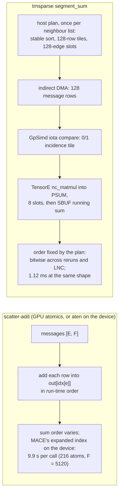

# trntensor and trnsparse: a MACE force step on Trainium, from 14 s to 40 ms

One energy-plus-forces step of the open MACE-MP-0b2 potential on a 216-atom slab takes [14.2 s](https://github.com/trnsci/trnsci/pull/171#issuecomment-7133104908) on a Trn2 logical core when the model runs unmodified, [118 ms](https://github.com/trnsci/trnsci/issues/178#issuecomment-7139276175) with its contractions on trntensor kernels and its graph sums on trnsparse kernels, and 39.3 ms once the rest of the model is fused and the edge count padded to a bucket. The kernels looked like the work, but at 118 ms they were a quarter of the step. And the size guard the suite added for safety was wrong: at 4096 atoms the kernel was exact, and the aten fallback it routed to broke. This post is for anyone running machine-learned interatomic potentials who wants to know what Trainium asks of a model, and what it gives back: bitwise-reproducible forces.

<!-- more -->

!!! note "Code status"
    | piece | PR | release |
    |---|---|---|
    | `conv_tp`, `symmetric_contraction`, forward and input gradients | [trntensor#139](https://github.com/trnsci/trntensor/pull/139) | [trntensor v0.26.0](https://github.com/trnsci/trntensor/releases/tag/v0.26.0) |
    | PyTorch-path symmetric-contraction backward as GEMMs | [trntensor#140](https://github.com/trnsci/trntensor/issues/140) | v0.26.0 |
    | `segment_plan`, `segment_sum`, `gather` | [trnsparse#140](https://github.com/trnsci/trnsparse/pull/140) | [trnsparse v0.17.0](https://github.com/trnsci/trnsparse/releases/tag/v0.17.0) |
    | one launch up to 2³⁴ bytes, padding mask | [trnsparse#144](https://github.com/trnsci/trnsparse/pull/144) | v0.17.0 |
    | `examples/mlip/`: captures, checker, MACE step script, fusion prototypes | [trnsci#171](https://github.com/trnsci/trnsci/pull/171) | draft PR |

    The 40 ms configuration uses fusion prototypes and edge padding from the exemplar scripts, not library API. All device numbers: trn2.3xlarge, Neuron SDK 2.33.1 DLAMI (torch-neuronx 2.14.3, neuronx-cc 2.28.7631, NKI 0.7.0), eager native TorchNeuron, one logical core at LNC=2, fp32. Model: mace-torch 0.3.15 and e3nn 0.4.4 with the public [MACE-MP-0b2 medium checkpoint](https://github.com/ACEsuit/mace-mp/releases/tag/mace_mp_0b2), sha256 `a90be07c…`.

Five caveats before any number:

- **The CPU baseline is weak:** unmodified MACE on the box's own host, pinned to one physical core (2 threads) because the box was shared. No full socket.
- **No GPU comparison yet**, which for MLIPs is the one that matters ([trnsci#178](https://github.com/trnsci/trnsci/issues/178), item 4).
- **One structure at a time.** Step times are latency to forces on the host, not batched throughput. The host neighbour list (3.4 ms at 216 atoms) is outside the step.
- **Trn2 only.** trn1 passes MLIR verification; nothing ran there.
- **Validation is per block and against CPU MACE.** Model-level checks, rotational invariance and finite-difference forces, are pending.

## The problem

A conservative MLIP computes forces as F = −∂E/∂r, so every MD step is a forward pass plus its gradient with respect to positions. The [CPU trace in trnsci#170](https://github.com/trnsci/trnsci/issues/170) splits a MACE-MP-0b2 step into three kernel-shaped blocks: the interaction tensor product (`conv_tp`), the symmetric contraction, and graph gather and segment sum. The contractions are 61–86% of the CPU step; the graph block is 2.5–6%.

The number that matters most is not a share: a step makes **1,861 top-level ATen calls**, whatever the system size. At the measured device floor of about 0.02 ms per call, that is 37 ms of dispatch, more than the whole 16-atom CPU step. In practice, unmodified MACE dispatches 2,413 ops on the device and takes 14,248 ms at 216 atoms, after 826 s of cold compiles. As the [launch-cost post](2026-10-27-trnfft-launch-cost.md) argued in general, fusion here is a precondition, not an optimisation.

GPU codes use fused tensor-product kernels and atomic scatter-adds, whose summation order varies from run to run. Ported directly to the `neuron` device, MACE's own scatter, `scatter_add_` with a stride-0 expanded `[E, F]` index, took [9.9 s per call](https://github.com/trnsci/trnsparse/pull/140#issuecomment-7144005224) at 216 atoms and F = 5120.

## What the architecture suggests

**Equivariant contractions: edges on partitions, couplings in SBUF.** The tensor product contracts over the 2l + 1 components of each irrep, 1 to 7 terms, far too short for the Tensor Engine's 128-row array. Trainium offers instead 128 partitions that each take their own scalar operand, and three engines (Vector, Scalar, GpSimd) with independent instruction streams.

So trntensor puts one edge on each partition and the 128 channels on the free axis. The Clebsch–Gordan coefficients, with the path normalisations folded in, form a fixed `[16, 88]` matrix at layer 1 that stays in SBUF for the whole kernel. One Tensor Engine matmul per 128-edge tile, `y_tile @ cg`, gives every edge's coupling block G. Each column of G is one scalar per partition, so each term is a single `[128, 128]` instruction: GpSimd forms x ⊙ w, the Scalar Engine writes each output component's first term, and the Vector Engine accumulates the rest. HBM sees only the inputs and the 20 KiB-per-edge output. The backward recomputes G rather than storing it, and sends the one long reduction, ∂y over 128 channels, back to the Tensor Engine as `∂G @ cgᵀ`.

The symmetric contraction is the opposite shape. Its coupling tensors are 0.37–1.6% non-zero, so trntensor folds them onto the monomials that actually couple (410 of 968 at layer 0). Every stage is then a Tensor Engine matmul accumulating in PSUM, 7 of the 8 banks, with all constants in under 16 KiB of SBUF per partition.

**Scatter as a 0/1 matmul.** A segment sum, out[i] = Σ m[e] over the edges with receiver i, is a product with an incidence matrix. trnsparse builds it one 128 × 128 tile at a time on chip and never stores it, like the [GP kernel's](2026-11-04-gp-million-points.md) kernel matrix. A host plan, built once per neighbour list, sorts edges by segment and fills each 128-row output tile's edges into slots of 128. Per slot, an indirect DMA gathers 128 message rows, GpSimd builds the 0/1 tile from an iota, and one `nc_matmul` per 512 columns accumulates into PSUM.

Multiplying by 0 or 1 is exact, so the only rounding is the fp32 accumulation, in an order the plan fixes. With no atomics, one writer per output tile and the same instructions on both physical cores, reruns are bitwise identical by construction, and so are LNC=1 and LNC=2. The device computes no index, only moving int32 row ids, which avoids the int64 hazards in [aws-neuron-sdk#1466](https://github.com/aws-neuron/aws-neuron-sdk/issues/1466)–[#1468](https://github.com/aws-neuron/aws-neuron-sdk/issues/1468).



Both follow the suite's [architecture-native rules](https://github.com/trnsci/trnsci/issues/176): treat exactness as a resource, recompute instead of store, turn irregular work into matmuls.

## The approach

Each kernel is an `nki_op` custom op with `register_autograd`. The gather and the segment sum are each other's backward over the same plan; the contractions call their own backward kernels. The exemplar swaps all three blocks inside MACE's own forward, including the edge vectors pos[r] − pos[s], whose backward is the force assembly, and forces come from `torch.autograd.grad`. `TRNTENSOR_REQUIRE_NKI=1` and `TRNSPARSE_REQUIRE_NKI=1` made any silent fallback raise.

Two tradeoffs were deliberate. **`conv_tp` keeps unrolled loops.** NKI 0.7 unrolls `affine_range` at trace time, so the first call grows with E, to 18 s with warm caches at 98,304 edges. A rolled `nl.fori_loop` was bitwise identical and cut a first call from 7.8 s to 2.1 s, but ran 40–57% slower warm, and the kernel runs every step. trnsparse chose rolled loops, so its compile time is flat in E. **Edges are padded to buckets**, so a 0.05 Å rattle (10,392 → 10,378 edges) reuses the compiled kernels. The pads cost 20–40% of each `conv_tp` call.

With the kernels in, the step was 118.2 ms, and the three blocks were about 24% of it. Replaying every MACE module call in isolation ([trnsci#178](https://github.com/trnsci/trnsci/issues/178#issuecomment-7139276175)) found the per-edge chain at 60 ms in about 560 launches, all a function of the edge vectors alone, with species constants rebuilt from integer gathers every step. Three exemplar changes followed:

| change | what it does | effect |
|---|---|---|
| `edge` | the per-edge chain (radial basis, ZBL, spherical harmonics, radial and density MLPs) as one `torch.compile(backend="neuron")` region calling MACE's own modules; species constants once per neighbour list | 3.6 ms fwd + bwd in isolation, against 60 ms eager |
| `dense` | each e3nn `Linear` as `x @ M`, M probed once (block-diagonal W_l ⊗ I); the one-hot skip tensor product as a GEMM plus a species mask | exact: energy unchanged, forces move by 1e-7 |
| padded E | extra edges are self-edges on node 0, shifted by (0, 0, 3 r_max): 15 Å, past both cutoffs, so they add exactly zero | unfused step 118 → 93 ms, since per-edge aten ops were slower at E = 10,392, not a multiple of 128 |

## Implementation

The heart of the segment sum is its slot loop, from [`trnsparse/nki/kernels.py` at v0.17.0](https://github.com/trnsci/trnsparse/blob/v0.17.0/trnsparse/nki/kernels.py):

```python
# excerpt from _segment_sum_kernel, comments added
for j in range(_SEG_CHUNK):  # 8 slots of 128 edges per PSUM partial
    rows = nl.ndarray((_SEG_P, gw), dtype=nl.float32, buffer=nl.sbuf)
    nisa.dma_copy(  # gather this slot's 128 message rows by edge id
        dst=rows,
        src=m.ap(pattern=[[F, _SEG_P], [1, gw]], offset=g0,
                 vector_offset=ix[:, j : j + 1], indirect_dim=0),
    )
    oh = nl.ndarray((_SEG_P, _SEG_P), dtype=nl.float32, buffer=nl.sbuf)
    nisa.tensor_scalar(dst=oh, data=io, op0=nl.equal, operand0=lc[:, j : j + 1])
    for t, (f0, w) in enumerate(cols):  # one matmul per 512-column PSUM bank
        nisa.nc_matmul(ps[t], stationary=oh, moving=rows[:, f0 : f0 + w], accumulate=j > 0)
```

`io` is the iota tile and `lc` each slot's local row offsets; padding slots carry −1 and match no row. In `conv_tp`, from [`trntensor/nki/_equivariant_kernels.py` at v0.26.0](https://github.com/trnsci/trntensor/blob/v0.26.0/trntensor/nki/_equivariant_kernels.py), a column of G is the per-partition scale:

```python
# excerpt from conv_tp_fwd_kernel, comments added
for k in range(d3):
    for i in range(d1):
        q = q_off + i * d3 + k
        if i == 0 and not acc:  # first term on the Scalar Engine
            nisa.activation(dst=ov[0:T, 0:U, k], op=nl.copy, data=xw[0], scale=G[0:T, q : q + 1])
        else:  # the rest accumulate on the Vector Engine
            nisa.scalar_tensor_tensor(
                dst=ov[0:T, 0:U, k], data=xw[i], op0=nl.multiply,
                operand0=G[0:T, q : q + 1], op1=nl.add, operand1=ov[0:T, 0:U, k],
            )
```

From the caller's side, the force assembly is two segment sums:

```python
plan_s = trnsparse.segment_plan(sender, N)    # once per neighbour list, host int64
plan_r = trnsparse.segment_plan(receiver, N)
F = trnsparse.segment_sum(g, sender, N, plan=plan_s) - trnsparse.segment_sum(g, receiver, N, plan=plan_r)
```

## What didn't work

**The 2³¹-byte guard.** trnsparse#140 shipped with a host check that sent any launch indexing 2³¹ bytes or more to device aten `index_add_` / `index_select`: caution learned from the suite's [silent wrong answers](2026-11-04-suite-silent-wrong-answers.md) and [32 MiB rows](2026-11-08-dma-32mib-rows.md). The layer-1 messages cross it at 4096 atoms (4.7e9 bytes), and [trnsparse#141](https://github.com/trnsci/trnsparse/issues/141) asked for the feature axis to be split under the limit. The [first 4096-atom run](https://github.com/trnsci/trnsci/issues/178#issuecomment-7154260784) gave NaN energies, because the fallback had failed: device `index_add_` with a source above 4 GiB hits an execution timeout and a DMA abort, `TX_DATA_AXI_TIMEOUT_ERROR` ([aws-neuron-sdk#1503](https://github.com/aws-neuron/aws-neuron-sdk/issues/1503)).

The kernel, in one launch, was [bitwise equal to 2³¹-byte chunks](https://github.com/trnsci/trnsparse/pull/144) at 4.7e9 bytes and matched fp64 to 3.25e-8 at 9.4e9 bytes. At 8000 atoms the requested chunking was worse than unnecessary: each chunk was exact, but assembling the 9.4e9-byte result with device `torch.cat` silently returned 1,486,199,911 wrong elements of 2,348,810,240, and the same call is exact at 8.7e9 bytes ([aws-neuron-sdk#1502](https://github.com/aws-neuron/aws-neuron-sdk/issues/1502)). trnsparse 0.17.0 raises the bound to 2³⁴ bytes, more than a trn2 logical core can allocate, so everything stays in one launch. The guard protected the kernel from a hazard it didn't have by handing the work to code that did. Why one launch is exact where aten isn't is not established; the bound rests on measurement.

The rest, more briefly:

| what | detail |
|---|---|
| the gather lost to aten | one 128-row indirect DMA costs about 7 µs, bound by software descriptor generation: 6.5 ms at 96k edges, against about 1.1 ms for `index_select`. An HBM-to-HBM indirect DMA passed MLIR verification and died in the backend (`NCC_IBIR829`). Batching up to 32 × 128 rows per DMA with a 2-D `vector_offset` gave 0.47 ms. Its first version padded E to multiples of 8192 and pushed a test shape over the guard |
| a kernel the simulator passed didn't build | all four symmetric-contraction kernels failed on trn2 with `NCC_IBFD004 non-PSUM engine accesses PSUM memloc`: neuronx-cc removed a PSUM→SBUF copy and fed PSUM to GpSimd. The products moved to Vector |
| e3nn on the device | the layer-1 tensor product at 1728 atoms compiled for 70 min on its first call, one neuronx-cc job at 9.3 GB RSS |
| trntensor's own PyTorch path | its symmetric-contraction backward took 1–37 s per call through `index_add_` with repeated indices; as GEMMs, 4.5 s → 5 ms ([trntensor#140](https://github.com/trnsci/trntensor/issues/140)) |
| padding piled on node 0 | the plan's fullest tile sets the slot count: 56 → 72 at 1728 atoms, 2.9× at 8000. `segment_plan(..., padding=mask)` now skips padded edges, bitwise |
| harness gaps | the 1728-atom force comparison never ran (reported 0 with an empty reference), so no force accuracy is claimed there; in 2 of about 25 runs the *CPU* reference energy came out about 0.11 eV off, with device energies bit-identical throughout, not chased |

**Asks for AWS Neuron:** fix #1502, or raise instead of returning wrong data; fix #1503; make 128-row indirect DMAs cheaper than 7 µs, or document batching; catch the PSUM-to-GpSimd elision in the simulator; and a rolled NKI loop without the 40–57% penalty.

### Fit

Much of this fits. The 9.1 M parameters stay resident, a step moves only positions (and the neighbour list when it changes), determinism is nearly free, and process-per-core scaling is [4.00× on 4 cores](https://github.com/trnsci/trntensor/pull/139#issuecomment-7147182408). The tensor product is the awkward part: a profile of the layer-1 kernels has the Tensor Engine busy 6% of the forward and 4% of the backward, with Vector and GpSimd at 88–98%. With l ≤ 3 the couplings are short, so the bound is the instruction stream, not HBM or FLOPs. At F ≤ 3 the launch floor (0.25–0.45 ms) lets the 2-thread host win. A future Tensor Engine that ran many independent contractions of depth 7 or less at once would suit equivariant models, as it would the low-dimensional GP.

## Numbers

| Setup | |
|---|---|
| Hardware | trn2.3xlarge, LNC=2, one logical core (2 physical) |
| Software | Neuron SDK 2.33.1 DLAMI: torch-neuronx 2.14.3, neuronx-cc 2.28.7631, NKI 0.7.0; eager |
| Model | MACE-MP-0b2 medium, fp32; mace-torch 0.3.15, e3nn 0.4.4 |
| Step | energy + forces, call to forces on host; median of 10–20 steps |
| CPU baseline | unmodified MACE, same box's host, one physical core (2 threads); no full socket, no GPU |

**The 216-atom step** (TiC(001) slab, 10,392 edges; [#171](https://github.com/trnsci/trnsci/pull/171#issuecomment-7133104908), [#178](https://github.com/trnsci/trnsci/issues/178#issuecomment-7139276175)). Errors are against CPU MACE in fp32.

| configuration | step | dispatched ops | \|ΔE\| per atom | forces, rel. |
|---|---|---|---|---|
| unmodified MACE, host CPU, 2 threads | 2,948 ms | 2,473 | – | – |
| unmodified MACE, device aten | 14,248 ms | 2,413 | – | – |
| trnsci kernels for the three blocks | 118.2 ms | 1,530 | 0.0023 meV | 1.09e-5 |
| + padded E | 92.8 ms | 1,530 | 0.0023 meV | 1.08e-5 |
| + `dense` | 97.5 ms | ≈ 890 | 0.0023 meV | 1.08e-5 |
| + `edge` | 60.0 ms | ≈ 490 + 2 graphs | 0.0023 meV | 1.08e-5 |
| + `edge` + `dense` | 45.6 ms | ≈ 490 | 0.0023 meV | 1.07e-5 |
| **+ `edge` + `dense` + padded E** | **39.3 ms** (38.7–40.2) | ≈ 490 | 0.0017 meV | 1.09e-5 |

**Where the 40 ms goes** (one profiled run at 40.2 ms; isolated times, so upper bounds):

| part | fwd + bwd | share |
|---|---|---|
| `conv_tp` (layer 1: 8.7 ms) | 11.5 ms | 29% |
| `gather` / `segment_sum`, 8 calls | 9.8 ms | 24% |
| `symmetric_contraction` | 5.6 ms | 14% |
| compiled per-edge region | 3.6 ms | 9% |
| dense linears, skip, readouts | 5.5 ms | 14% |
| glue and autograd bookkeeping | ≈ 4.2 ms | 10% |

**Scale** (TiC bulk; [#178](https://github.com/trnsci/trnsci/issues/178#issuecomment-7154260784)). "Best" is `edge` + `dense` + padded E, with the padding spread across nodes. "New geometry" is the first call for a second rattled structure (seed 1) after the first has compiled.

| atoms / edges | config | step | first call, new geometry | cold compile | \|ΔE\| per atom | forces, rel. |
|---|---|---|---|---|---|---|
| 216 / 10,392 | kernels, unpadded | 118.2 ms | 136 s | – | 0.0023 meV | 1.09e-5 |
| 216 / 10,392 | best | 39.3 ms | **0.05 s** | 26.7 s | 0.0017 meV | 1.09e-5 |
| 1728 / 96,278 | kernels, unfused | 443 ms | 336 s | 504 s | 0.027 meV | not checked |
| 1728 / 96,278 | best | **165 ms** | **0.18 s** | 181 s | 0.027 meV | not checked |
| 4096 / 228,156 | kernels, unfused | device out of memory | – | – | – | – |
| 4096 / 228,156 | best | **361 ms** | **0.38 s** | 221 s | 0.031 meV | 1.19e-5 |

The 2-thread host takes 64.9 s at 4096 atoms: about 180× the device step, against a weak baseline (75× at 216 atoms). From 1728 to 4096 atoms, 2.4× the edges cost 2.2× the time, and the unfused model no longer fits.

**The blocks against device alternatives**, 1728 atoms, warm medians, forward + backward unless noted ([trntensor#139](https://github.com/trnsci/trntensor/pull/139#issuecomment-7147182408), [trnsparse#140](https://github.com/trnsci/trnsparse/pull/140#issuecomment-7144005224)):

| block | trnsci kernel | device alternative |
|---|---|---|
| `conv_tp` layer 1 | 68.0 ms | e3nn 3,569 ms; trntensor PyTorch path 530.8 ms |
| `symmetric_contraction` layer 0 | 18.3 ms | per-path einsum 662.5 ms |
| `segment_sum`, F = 5120 | 13.6 ms | aten `index_add_` 101.6 ms |
| `gather`, F = 5120, forward | 6.48 ms | aten `index_select` 6.49 ms |

Every kernel output and input gradient matched MACE's captured tensors to at most 2.8e-7 relative, against a 2e-5 bar, and every output and gradient was bitwise equal at LNC=1 and LNC=2.

## What's next

- **[trnsci#178](https://github.com/trnsci/trnsci/issues/178)**: the `conv_tp` layer-1 backward (about 6.3 ms); batching the five trnsparse calls with F ≤ 3; one compiled model with the kernels as opaque ops; 8000 atoms; a full-socket CPU baseline, a GPU reference and the model-level checks.
- **Gather → tensor product → segment sum in one kernel** ([trntensor#138](https://github.com/trnsci/trntensor/issues/138)), so the 20 KiB-per-edge messages never reach HBM and the pads go away.
- **Architecture-native graph options** ([trnsci#170](https://github.com/trnsci/trnsci/issues/170#issuecomment-7119610678), direction 5 of [trnsci#176](https://github.com/trnsci/trnsci/issues/176)): a DMA scatter-add arm to compare with the incidence matmul, `is_stationary_onezero` on the 0/1 tiles, and an on-device neighbour list.
- Merging the exemplar ([trnsci#171](https://github.com/trnsci/trnsci/pull/171)). Phase trackers: trntensor [Phase 5 #31](https://github.com/trnsci/trntensor/issues/31), trnsparse [Phase 3 #15](https://github.com/trnsci/trnsparse/issues/15), and the suite's [Phase 3 milestone](https://github.com/trnsci/trnsci/milestone/3).

Suite context: [trnsci.dev](https://trnsci.dev), the [roadmap](https://trnsci.dev/roadmap/) and the [suite tracker](https://github.com/trnsci/trnsci/issues/1).

## Takeaway

On Trainium an MLIP force step is a launch-count problem before it is a FLOP problem: 1,861 small ops cost more in dispatch than in arithmetic, so the model has to arrive as a few large launches. The two kernel families that allow that use the hardware as built. The tensor product keeps its Clebsch–Gordan blocks in SBUF and spreads per-partition scalar work over three engines. The scatter is a 0/1 matmul in an order the plan fixes, so forces are bitwise identical across reruns and core layouts. The one piece that failed at scale was the guard around them, because the hazard it guarded against lived in the fallback.
