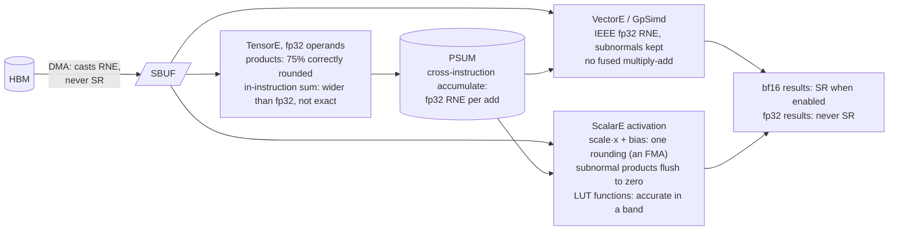

# trnsci: what Trainium's arithmetic actually does

The suite's next precision step, fp64-class sums and dot products on the device, depends on how each NeuronCore engine rounds, and the Neuron documentation doesn't say. So one Trn2 window measured it: VectorE and GpSimd are textbook IEEE fp32, ScalarE has a fused multiply-add the docs don't mention, the fp32 TensorE path isn't correctly rounded, and stochastic rounding is deterministic per process. The same window also produced an accuracy table that mistook the worst corner of a range for the whole range, filed it upstream, and corrected it in public that night. This post is for anyone writing NKI kernels that need more than ML accuracy, and for anyone porting double-word or compensated algorithms to Trainium.

<!-- more -->

!!! note "Code status"
    `trnblas.fp64`, double-word and integer-emulated reductions plus the device probes, is released in [trnblas 0.14.0](https://github.com/trnsci/trnblas/releases/tag/v0.14.0) ([trnblas#134](https://github.com/trnsci/trnblas/pull/134), for [trnsci#169](https://github.com/trnsci/trnsci/issues/169)). The LUT call-site fixes are in [trnsparse 0.17.0](https://github.com/trnsci/trnsparse/releases/tag/v0.17.0) ([trnsparse#142](https://github.com/trnsci/trnsparse/pull/142)). All device numbers are from a trn2.3xlarge on public Neuron SDK 2.33.1 (neuronx-cc 2.28.7631, runtime 2.35.33, NKI 0.7.0), one logical core at LNC=2. The probes are `scripts/probe_fp64.py`, `probe_lut_ulp.py` and `probe_sr_scope.py` in trnblas. The upstream report is [aws-neuron-sdk#1501](https://github.com/aws-neuron/aws-neuron-sdk/issues/1501).

## The problem

[trnsci#169](https://github.com/trnsci/trnsci/issues/169) wants fp64-class reductions without a host round trip. Today, under the suite's [float64 policy](../../precision_and_platform_limits.md#fp64-policy), every fp64 dot product, norm and sum in the CG, GP-refinement and SCF paths pays a device-to-host round trip. The candidate is double-word arithmetic: each value as an fp32 (hi, lo) pair, with error-free transformations (Knuth TwoSum, Dekker TwoProd) carrying the rounding error of every operation. Those algorithms are exact only if every fp32 add, subtract and multiply rounds to nearest even. The suite's tests add a second dependency: the pytorch backend issues the kernel's fp32 operations one for one, so device and CPU agree bit for bit only if each device op rounds the IEEE way.

On a GPU this is all in the spec. CUDA fp32 add and multiply are IEEE-754 round to nearest, `fmaf` rounds once, and the [CUDA programming guide](https://docs.nvidia.com/cuda/cuda-c-programming-guide/index.html#mathematical-functions-appendix) gives a maximum ULP error for every single-precision math function. The Neuron [rounding-modes page](https://awsdocs-neuron.readthedocs-hosted.com/en/latest/about-neuron/arch/neuron-features/rounding-modes.html) says that every NeuronCore supports round-to-nearest-even and that, from NeuronCore-v2 on, stochastic rounding (SR) is a runtime switch. The [NKI activation table](https://awsdocs-neuron.readthedocs-hosted.com/en/latest/nki/api/nki.api.shared.html) gives ScalarE a ULP bound per function: 65,536 for `sqrt`, 40,000 for `rsqrt`, 400 for `exp` and `reciprocal`. Nothing says how each engine rounds, whether any instruction fuses a multiply-add, how the fp32 matmul rounds its products, or which operations SR touches.

This is the next step in the precision thread of the [silent-wrong-answers](2026-11-04-suite-silent-wrong-answers.md) and [fp32-floor](2026-11-08-dfmp2-fp32-floor.md) posts: state what precision a result has, and measure it rather than assume it. The suite has guessed here before and lost. The [fp64 GEMM post](2026-11-10-trnblas-fp64-ozaki.md) planned double-double on TensorE. It failed because the fp32 accumulator rounds the leading product, and a probe then found only 75% of single fp32 products correctly rounded. This time the measurement came first.

## What the architecture suggests

A NeuronCore is four compute engines with separate instruction streams, and the probes show they don't share one arithmetic contract. Each was built for a different job, and the rounding follows the job:



| engine / form | fp32 add, sub, mul | fused multiply-add? | notes |
|---|---|---|---|
| VectorE `tensor_tensor` | IEEE RNE, 0 mismatches in 65,536 per family | n/a | TwoSum and Dekker TwoProd, as the reduction kernels issue them, exact in every family |
| GpSimd | IEEE RNE, all families | no: `tensor_scalar` (mul, add) rounds twice | |
| VectorE `tensor_scalar`, `scalar_tensor_tensor` | IEEE RNE | no: two roundings | |
| ScalarE `activation(scale·x + bias)` | RNE, except subnormal products flush to zero (14,773 of 65,536 in that family) | **yes**, with per-partition (P,1) scale and bias: 65,536 / 65,536 single-rounded | LUT functions below |
| TensorE, fp32 operands | products RN in 12,341 / 16,384 cases; max relative error 1.13e-7, about 1–2 ulp | n/a | 127 ties of 2⁻²⁴ onto 1.0 sum to 1.0000057 (exact 1.0000076, fp32 1.0) |
| PSUM `accumulate=True` across instructions | fp32 RNE per add, 16,384 / 16,384 | n/a | |

The families were random, ties, near-overflow, subnormal, cancellation and Veltkamp-split edges ([E0, trnsci#169](https://github.com/trnsci/trnsci/issues/169#issuecomment-7130733645)).

So exactness on Trainium is a property of the engine, not of the dtype. VectorE and GpSimd are where error-free transformations work. ScalarE adds a fused multiply-add, but only in its per-partition scale-and-bias form. TensorE is exact only where its inputs make it exact: bf16 or small-integer pieces whose products are representable and whose sums stay below 2²⁴ in fp32 PSUM. That is the Ozaki I and II design in trnblas, now with a measured reason, and it is design rule 2 of the [architecture-native epic](https://github.com/trnsci/trnsci/issues/176): treat exactness as a resource. In-instruction accumulation is wider than fp32 and still isn't exact, so it can't stand in for an exact sum.

## The approach

**Probe as a gate, not a benchmark.** E0 computed each candidate operation on 65,536 inputs per family and compared the bits with an IEEE result emulated on the host. The fp64 work had a written go / no-go. If VectorE add, subtract and multiply are RNE outside the subnormal family, and TwoSum and TwoProd are exact, the double-word arms go ahead. Otherwise the reference gets re-derived for that engine first. The whole E0 run took 7.3 s.

It passed, and the rest of the window ran on that result ([trnblas#134](https://github.com/trnsci/trnblas/pull/134#issuecomment-7142780675)). Every reduction kernel is bitwise equal to its CPU reference. All 18 digest cases are identical at LNC=1 and LNC=2 ([LNC run](https://github.com/trnsci/trnblas/pull/134#issuecomment-7150240757)). Double-word reductions reach 53 bits at n = 1e6–1e7. End to end they are 2× faster than the host fp64 round trip at 1e6 and 32× faster at 1e7. The `gemm_fp64` combine moves to the device, bitwise, at 5.45× the host route at 4096².

**The deliberate tradeoff** is what the bitwise claim covers. Double-word gives about 48 bits in fp32's exponent range, not fp64's 53 bits and range. It breaks below 2⁻¹⁰², where lo is subnormal, and past 2¹²⁸. ScalarE's flush-to-zero narrows any claim that uses its FMA to the normal range. trnblas keeps an integer-emulated exact arm alongside: GpSimd int32 adds, exact mod 2³², with a 126-bit window and a host fallback outside it. It is right at any condition number and costs 1.3–3.1× the double-word arm.

## Implementation

The FMA question needs inputs on which one rounding and two roundings give different bits. The probe takes a per-partition b and chooses c so that a·b + c cancels heavily, close to −RN(a·b). Each candidate form computes the same a·b + c, from [`trnblas/nki/fp64_kernels.py` at v0.14.0](https://github.com/trnsci/trnblas/blob/v0.14.0/trnblas/nki/fp64_kernels.py):

```python
# excerpt from _fp64_probe_fma_kernel (buffer allocation and stores dropped):
# four ways to ask for a * b + c, with bcol, ccol the (P, 1) columns of b, c
for i, eng in ((0, nisa.vector_engine), (1, nisa.gpsimd_engine)):
    nisa.tensor_scalar(dst=r, data=at, op0=nl.multiply, operand0=bcol,
                       op1=nl.add, operand1=ccol, engine=eng)
nisa.scalar_tensor_tensor(dst=r, data=at, op0=nl.multiply, operand0=bcol,
                          op1=nl.add, operand1=ct)
nisa.activation(dst=r, op=nl.copy, data=at, bias=ccol, scale=bcol)  # ScalarE
```

The host compares each output bit for bit with RN(a·b + c) and with RN(RN(a·b) + c). Only the ScalarE `activation` matched the single rounding, with both scale and bias per partition. Where a kernel's operands fit that form, TwoProd's error term `e = fma(a, b, −RN(a·b))` is one ScalarE instruction, against 17 VectorE operations for Dekker's FMA-free split. Which reduction kernels fit it is still to be worked out.

## What didn't work

**The LUT table overstated the problem.** The audit in [trnsci#173](https://github.com/trnsci/trnsci/issues/173) measured the ScalarE activation-table functions on 262,144 inputs spread log-uniformly over each function's documented range. The [first table](https://github.com/trnsci/trnsci/issues/173#issuecomment-7147618897) reported `rsqrt` at 348,900 ULP, 2.9% relative error, against the documented 40,000. It read the p99.9 of 2.8e5 as evidence that "the error is not confined to the range edges", and the suite filed [aws-neuron-sdk#1501](https://github.com/aws-neuron/aws-neuron-sdk/issues/1501) saying so. The maximum was real. The reading wasn't.

The range is [2⁻⁸⁷, 2⁹⁷], 184 binades, and the bad band at the bottom is 23 of them, so log-uniform sampling put 12.5% of the inputs inside it. A p99.9 can't tell you where the errors are when an eighth of the samples sit in one band. Measuring by band ([correction on #1501](https://github.com/aws-neuron/aws-neuron-sdk/issues/1501#issuecomment-7151724144), [on #173](https://github.com/trnsci/trnsci/issues/173#issuecomment-7151724446)), about three and a half hours later, gave this:

| ScalarE `rsqrt` input band | max ULP | max relative error |
|---|---|---|
| [2⁻⁸⁷, 2⁻⁶⁴] | **349,157** | 2.94e-2 |
| [2⁻⁶⁴, 2⁻⁵²] | 10,904 | 6.5e-4 |
| [2⁻⁵², 2⁻³²] | 10,860 | 6.5e-4 |
| [2⁻³², 2³²] | **7** | 4.5e-7 |
| [2³², 2⁵²] | 1,044 | 6.5e-5 |
| [2⁵², 2⁸⁰] | 21,408 | 1.35e-3 |
| [2⁸⁰, 2⁹⁷] | 32,878 | 2.08e-3 |

ScalarE `sqrt` follows the same pattern, measured with a sibling probe in trnsparse: 8.4e-7 relative over [2⁻⁵², 2⁵²], 2.2e-5 down to 2⁻⁸⁴, and its 6.2e-3 full-range maximum only above 2⁹². The documented 40,000-ULP bound is exceeded only in the bottom band.

The first table came with a fix for each call site:

| call site | argument | first recommendation | after the per-band data |
|---|---|---|---|
| trnsparse Matérn GP tiles, `sqrt` of every kernel entry | a·D, inside the band | replace: ScalarE + one Heron step, or GpSimd power x^0.5 | **LUT kept**: 7.98e-6 per entry, and the fastest variant |
| trnsparse fused-CG power-iteration normaliser | a squared norm of any size | GpSimd rsqrt | GpSimd rsqrt, ≤ 1 ULP at any input (trnsparse 0.17.0) |
| trnsolver Jacobi rotations, x·rsqrt(x) | `1+t²` in band; `gs²+h²` can fall below 2⁻³² | GpSimd rsqrt or two Newton steps | **unchanged**: 40 cases, n = 3–128, no difference from GpSimd or Newton variants; the 1.5e-5 residual floor at n = 128 comes from the fp32 sweeps ([verdict](https://github.com/trnsci/trnsci/issues/173#issuecomment-7152353284)) |

The Matérn-1/2 error that started the audit wasn't the LUT at all. For the square operator, the augmented-GEMM distance D_ii = |x_i|² + |x_i|² − 2x_i·x_i is fp32 cancellation noise of order u·|x|², not zero. Matérn-1/2 has a cusp at D = 0, and `sqrt` there turns the noise into about √u·|x|. Setting the diagonal exactly ([trnsparse#143](https://github.com/trnsci/trnsparse/issues/143), fixed in [#142](https://github.com/trnsci/trnsparse/pull/142)) took the bench error from 6.5e-4 to 1.4e-5, at 0.2–0.5% of throughput. For the Matérn tiles, trusting the first table would have cost speed and fixed nothing: on the bench, the Heron variant runs at 1.705e10 entries/s and GpSimd power at 1.528e9, against 3.668e10 for the kept LUT. The rule now in #173: a LUT function is acceptable only where the call site's argument range is known to be inside its accurate band, and each LUT call documents that band.

**Two of the suite's own statements on SR were wrong.** The [precision page](../../precision_and_platform_limits.md) says results with SR on "aren't bitwise reproducible", and the [fp32-floor post](2026-11-08-dfmp2-fp32-floor.md) said a probabilistic rounding "can't give bit-identical reruns". The [SR probe](https://github.com/trnsci/trnsci/issues/174#issuecomment-7142767117) ran seven processes of eight repeats each. Two unseeded SR processes produced identical results, repeat by repeat, on every op. The SR stream starts from a fixed state at process start and advances with each launch, so reruns are bit-identical, and repeated launches within one process are not. The undocumented `NEURON_RT_STOCHASTIC_ROUNDING_SEED` picks the stream: two processes with seed 1234 match, and changing it to 5678 changes the VectorE results but not the GpSimd or ScalarE ones. In-kernel `nisa.set_rng_seed` doesn't control SR at all: two launches seeded 42 differed.

**Smaller toolchain notes.** The VectorE `tensor_tensor` divide arm of the LUT probe fails trn2 ISA validation with `NCC_IINAR001 s3s3d3_tt_valid_op`, so the first LUT run didn't compile, and the arm was dropped. For 1/x, VectorE `nisa.reciprocal` is correctly rounded. E0's own verdict code needed a one-line fix, `float(np.float32(wide))`, before its table could be trusted.

**Fit, and the asks.** Little of this should matter for the workload Trainium was built for. ML training is unlikely to notice a 1–2 ulp product, and a normalisation's arguments usually sit inside the LUT's accurate band. Scientific kernels hit the edges: squared norms of any size, tiny off-diagonals, subnormal error terms. The asks for AWS Neuron: the first is on [#1501](https://github.com/aws-neuron/aws-neuron-sdk/issues/1501), the SR one is the upstream request planned in [trnsci#174](https://github.com/trnsci/trnsci/issues/174), and the middle one is this post's:

- publish LUT accuracy per input sub-range, or start `rsqrt`'s valid range on v3 at 2⁻⁶⁴;
- document per-engine rounding: VectorE and GpSimd IEEE RNE, ScalarE's FMA and its flush to zero, and that fp32 TensorE products are not correctly rounded;
- document `NEURON_RT_STOCHASTIC_ROUNDING_SEED`, apply it to every engine, and offer per-kernel SR control.

## Numbers

ScalarE LUT functions against the alternatives on Trn2, full-range maxima over each documented range ([#173](https://github.com/trnsci/trnsci/issues/173#issuecomment-7147618897)). For ScalarE `rsqrt` and `sqrt`, the maximum comes from the worst band:

| function | implementation | max ULP (doc) | correctly rounded |
|---|---|---|---|
| rsqrt | ScalarE `activation` | 348,900 (40,000) | 22.7% |
| rsqrt | ScalarE + 2 VectorE Newton steps | 29.6 | 72.2% |
| rsqrt | GpSimd `tensor_scalar(op0=rsqrt)` | 0.97 | 87.5% |
| sqrt | ScalarE `activation` | 65,520 (65,536) | 33.6% |
| sqrt | GpSimd power x^0.5 | 0.99 | 92.5% |
| reciprocal | ScalarE `activation` | 122 (400) | 13.0% |
| reciprocal | VectorE `nisa.reciprocal` | 0.5 | **100%** |
| exp | ScalarE `activation` | 21.7 (400) | 18.7% |
| log | ScalarE `activation` | 8,445 near x = 1, 396 elsewhere (40) | 41.9% |

Where SR applies under `NEURON_RT_STOCHASTIC_ROUNDING_EN=1` ([#174](https://github.com/trnsci/trnsci/issues/174#issuecomment-7142767117)). With SR off, every row is RNE:

| op | fraction differing from RNE | P(round up) at 1/4 ulp |
|---|---|---|
| fp32→bf16 cast: VectorE / GpSimd / ScalarE | 0.25 / 0.25 / 0.25 | 0.249 / 0.256 / 0.254 |
| fp32→bf16 cast by DMA (HBM→SBUF, HBM→HBM) | **0** | 0 |
| bf16 add / multiply, VectorE | 0.22 / 0.25 | n/a |
| PSUM fp32→bf16 eviction, VectorE / ScalarE | 0.25 | n/a |
| fp32 arithmetic on any engine, fp32 PSUM results | **0** | n/a |

The round-up probability tracks the input's position between bf16 neighbours, so SR is unbiased. It applies only where a compute engine produces bf16.

Double-word reductions on the device, dot products, correct bits and end-to-end ms ([trnblas#134](https://github.com/trnsci/trnblas/pull/134#issuecomment-7142780675)):

| n | plain fp32 | double-word (accurate) | integer exact | host fp64 round trip |
|---|---|---|---|---|
| 1e5 | 30.4 b, 0.43 | 52.5 b, 0.52 | 53 b, 0.77 | **52.5 b, 0.25** |
| 1e6 | 30.3 b, 1.06 | 53 b, **1.26** | 53 b, 2.00 | 51.8 b, 2.49 |
| 1e7 | 30.1 b, 0.95 | 53 b, **2.53** | 53 b, 7.86 | 49.6 b, 81.1 |

At 1e5 the host round trip still wins, and 0.4–0.8 ms of layout and padding dominate the device time. The device `gemm_fp64` combine is bitwise equal to the host's at every shape, 14.5 against 79.4 ms at 4096².

## What's next

- [trnsci#169](https://github.com/trnsci/trnsci/issues/169): trnsolver `reduction="ff"` (the high-precision default above about 5e5) and `"exact"` (n ≤ 1e6), and the device combine inside `gemm_fp64`, as follow-up PRs. A ScalarE FMA TwoProd variant is on the list.
- [trnsci#173](https://github.com/trnsci/trnsci/issues/173): a documented band at every LUT call site, and a lint for LUT functions in accuracy-critical kernels.
- [trnsci#174](https://github.com/trnsci/trnsci/issues/174): SR as an error estimator. Software tools such as Verificarlo, CADNA and Verrou randomise rounding at 10–100× cost; the hardware does it for free. An ensemble is k launches in one process, or varied seeds across processes for VectorE-heavy kernels. It only sees bf16 rounding steps, such as bf16-split GEMM pieces and bf16 PSUM evictions, so it is blind to fp32 arithmetic. The first prototype is trntensor's bf16-split einsum, as the measured "achieved error" in the [`target_forward_error` contract](https://github.com/trnsci/trnsci/issues/38).
- [trnsci#176](https://github.com/trnsci/trnsci/issues/176), the architecture-native epic; the [Phase 2 milestone](https://github.com/trnsci/trnsci/milestone/2), the [roadmap](https://trnsci.dev/roadmap/) and the [suite tracker](https://github.com/trnsci/trnsci/issues/1). More at [trnsci.dev](https://trnsci.dev).

## Takeaway

A NeuronCore doesn't have one floating-point contract. It has one per engine, and the precision a kernel gets depends on which engine each step runs on. For kernel authors, as measured on Trn2 with SDK 2.33.1:

| you need | use | avoid |
|---|---|---|
| exact fp32 add, sub, mul; TwoSum, TwoProd, double-word | VectorE or GpSimd | |
| a fused multiply-add | ScalarE `activation(op=copy, scale=(P,1), bias=(P,1))` | subnormal products: prescale or range-check |
| exact products and sums on TensorE | bf16 or small-integer pieces, sums ≤ 2²⁴ in fp32 PSUM | fp32 operands in an error-free transform |
| fp32 accumulation across matmuls | PSUM `accumulate=True` (fp32 RNE per add) | assuming one instruction's sum is fp32 or exact |
| sqrt / rsqrt, argument range known | ScalarE LUT inside its band: rsqrt 7 ULP on [2⁻³², 2³²], sqrt 8.4e-7 on [2⁻⁵², 2⁵²] | the LUT on unbounded arguments, e.g. squared norms |
| sqrt / rsqrt at any magnitude | GpSimd `rsqrt` or power, ≤ 1 ULP | |
| an accurate 1/x | VectorE `nisa.reciprocal`, correctly rounded | ScalarE LUT `reciprocal` (122 ULP) |
| unbiased bf16 rounding | `NEURON_RT_STOCHASTIC_ROUNDING_EN=1`, process-wide | expecting SR in fp32 ops or DMA casts |
| a reproducible SR ensemble | k launches in one process; `..._SEED` across processes (VectorE only) | `nisa.set_rng_seed` |

Most of the fp32 arithmetic is plain IEEE, which is what double-word arithmetic needs, and its edges are now measured rather than guessed. And when a table's worst case comes from the corner of a range, measure the range by band before filing it.
