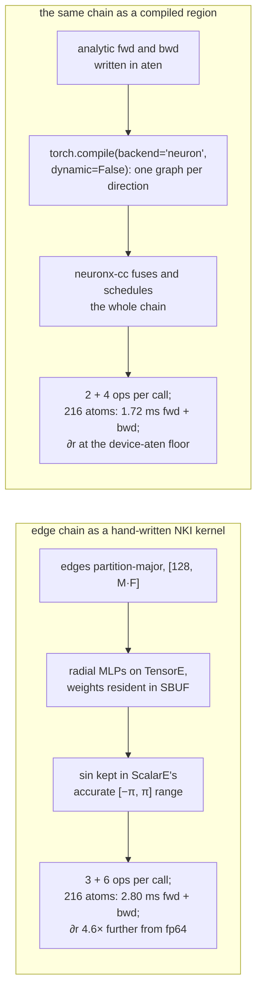

# trntensor: a batched MACE step on Trn2, and the hand kernels the compiler made redundant

Batched eight structures at a time, the MACE-MP-0b2 energy-plus-forces step takes 21.05 ms per 216-atom structure on one Trn2 logical core, 31× unmodified MACE on all 12 of the same box's host CPUs, with forces within 1.21e-5 of CPU MACE up to 1728 atoms. For the rest of the step, [trntensor 0.27.0](https://github.com/trnsci/trntensor/releases/tag/v0.27.0) shipped two hand-written NKI kernels and a way to run the same PyTorch bodies as compiled graphs, and the compiled graphs won: as fast as the kernels (39.8 against 41.9 ms per step), with a backward 4.6× closer to fp64. So `"auto"` leaves the kernels off. This post is for anyone deciding where hand-written kernels pay on Trainium. The answer here was the equivariant and graph blocks, and not the elementwise chains between them.

<!-- more -->

!!! note "Code status"
    | piece | PR | release |
    |---|---|---|
    | `spherical_harmonics`, `edge_chain`, `equivariant_linear` with analytic backwards; `set_region_backend`; opt-in NKI kernels for the first two | [trntensor#142](https://github.com/trnsci/trntensor/pull/142) | [trntensor v0.27.0](https://github.com/trnsci/trntensor/releases/tag/v0.27.0) |
    | PSUM accumulation groups open with a matmul write | [trntensor#143](https://github.com/trnsci/trntensor/pull/143) | v0.27.0 |
    | `examples/mlip/`: batching into shape buckets, CPU-reference cache, `--fuse all`, measured dispatch counts | [trnsci#171](https://github.com/trnsci/trnsci/pull/171) | [trnsci v0.2.4](https://github.com/trnsci/trnsci/releases/tag/v0.2.4) |

    The device runs used trntensor 0.26.0 with #143 and #142 (at `8f6fa18`) merged locally, trnsparse 0.17.0, and the exemplar at `da70ea8`. Everything has merged since. All device numbers: trn2.3xlarge, public Neuron SDK 2.33.1 (neuronx-cc 2.28.7631, torch 2.14.0, NKI 0.7.0), eager TorchNeuron, one logical core at LNC=2, host threads pinned to one physical core (2 CPUs), fp32. Model: mace-torch 0.3.15 and e3nn 0.4.4 with the public MACE-MP-0b2 medium checkpoint (sha256 `a90be07c…`). Step timings come from an exclusive whole-chip block, 30 reps, median; min to p90 is within ±3% of the median in every row.

!!! warning "Update (2026-11-28) to the 2026-11-25 post"
    The [MACE force-step post](2026-11-25-mlip-mace-force-step.md) claimed no force accuracy at 1728 atoms: its harness compared against an empty reference and reported 0, so the scale table says "not checked". That gap is closed. At 1728 atoms each row now carries a timed CPU reference: forces are within 1.21e-5 (seed 0) and 1.17e-5 (seed 1) relative, and energies within 0.0028 and 0.0113 meV/atom ([trnsci#183](https://github.com/trnsci/trnsci/issues/183#issuecomment-7197197132)). The model-level checks that post listed as pending have also run on the device: all 53 invariance, equivariance and finite-difference cases are accepted by both the device and CPU MACE. Its first caveat, the weak CPU baseline, is half addressed: there is now a full-host baseline, and still no GPU one.

## The problem

The [2026-11-25 post](2026-11-25-mlip-mace-force-step.md) left the MACE step at 39.3 ms per 216-atom structure with four things open. The step ran one structure at a time. The fusions that got it there were exemplar prototypes, not library API. The 1728-atom forces were unchecked. And the CPU baseline was 2 threads on a shared box.

Most MLIP workloads are not a single trajectory. Dataset relabelling, high-throughput screening and replica ensembles all evaluate many independent structures, so throughput per structure matters as much as latency per step. A GPU code batches by concatenating graphs into one disjoint graph, and nothing about Trainium changes that. Two things are Trainium-specific. Every compiled graph has static shapes, so a batch has to land in a shape someone has compiled before. And the step had been launch-bound: unmodified MACE makes 1,861 top-level ATen calls per step, and with the trnsci kernels in, the device still saw 1,530 dispatched ops, so the remaining aten glue was the first thing to fuse.

That fusion is where this release spent its kernel effort, and it is where the result came out differently than planned.

## What the architecture suggests

**Batching is free in the graph and expensive in memory.** Eight 216-atom slabs are one graph of 1,728 atoms with no edges between them, padded to a bucket of 1,792 atoms and 86,016 edges. The kernels don't know there is a batch. The trnsparse segment-sum plan already sorts edges by receiver into 128-row tiles, and the `conv_tp` kernel already puts one edge per partition. A batch just means more 128-edge tiles per launch, and the fixed cost of each launch is spread over eight structures. What grows with the batch is every per-edge tensor in HBM, and one of them is 20 KiB per edge.

**Static shapes make buckets the unit of compilation.** A compiled NEFF is specialised to its shapes. If edge counts are padded to a bucket, and the padding edges are placed past the cutoff so they contribute exactly zero, any geometry that fits the bucket reuses every compiled graph. The cost is padding work and one long compile per bucket.

**Two kinds of work, and the compiler can only find one of them.** The step's equivariant and graph blocks are irregular. In `conv_tp`, each partition takes its own scalar per term, spread over GpSimd, the Scalar Engine and the Vector Engine. The segment sum is an indirect DMA gather plus a 0/1 matmul accumulated in PSUM in an order the host plan fixes. Neither structure can be recovered from the aten ops a model is written in: the 11-25 post measured e3nn's layer-1 tensor product at 3,569 ms on the device against 68.0 ms for the kernel, and aten `index_add_` at 101.6 ms against 13.6 ms for `segment_sum`.

The remainder is different. The radial basis, the per-edge MLPs, the spherical-harmonic polynomials and the dense linears are short chains of elementwise ops and small matmuls with static shapes. That is the case neuronx-cc is built for. Given the chain as one graph, it compiles one NEFF, so one launch per direction, and it schedules the engines itself. One launch per direction, instead of 45 + 192 eager ops for the edge chain, was most of what the hand kernels offered over aten.



**Memory per logical core is the hard ceiling.** At LNC=2 a logical core has 24 GiB of HBM. The interaction-1 messages that feed the receiver segment sum are an `[E, 5120]` fp32 tensor, 20,480 bytes per padded edge. They are materialised in HBM because `conv_tp` writes them and `segment_sum` reads them back. At some edge count, that tensor plus everything else the step keeps per edge stops fitting.

## The approach

trntensor 0.27.0 adds three ops for the remainder: `spherical_harmonics` (e3nn's real harmonics for l ≤ 3), `edge_chain` (radial basis, cutoff, and every radial and density MLP that reads them) and `equivariant_linear` (an e3nn `Linear` as one matmul per irrep type, plus MACE's one-hot `skip_tp` as a per-species map). Each is one autograd node. Its backward is written by hand as differentiable aten, not traced by autograd, so a step sees one node per op and double backward still works.

There are then two ways to run each body on the device:

- **as a compiled region:** `set_region_backend("neuron")` runs the forward and the backward bodies as one `torch.compile(dynamic=False, fullgraph=True)` graph per direction and call site;
- **as an NKI kernel**, for `spherical_harmonics` and `edge_chain`: one launch per direction, with edges laid out partition-major and the radial-MLP weights resident in SBUF.

The deliberate tradeoff is `dynamic=False`. Static graphs are what neuronx-cc compiles well, and they make bucket reuse exact. They also mean every new bucket pays a full compile: 150 to 630 s the first time in a process.

The exemplar's batching ([trnsci#171](https://github.com/trnsci/trnsci/pull/171)) builds the disjoint graph, pads atoms and edges to a bucket, and compares each structure against unmodified MACE on the host, run alone and unpadded. `--split-check report` reruns each structure alone at the batch's shapes. At B = 8 the forces match the structure's slice of the batch to ≤ 8.1e-6 eV/Å. The energies are bitwise for 7 of 8 structures. The eighth differs by 2.4e-4 eV, 2 ulp at 1972 eV. So batching is close to bitwise on the device, but not bitwise.

The decision on [trntensor#142](https://github.com/trnsci/trntensor/pull/142#issuecomment-7202518067) after the device run:

- `"auto"` stays as it is, with the NKI edge kernels opt-in (`set_backend("nki")` or `TRNTENSOR_EDGE_NKI=1`).
- `set_region_backend("neuron")` is the recommended MLIP configuration on the device. The library default stays eager: shapes are static per compiled graph, so a region pays only where the caller pads to buckets, as the exemplar does.

## Implementation

The fused op is an `autograd.Function` whose two bodies each go through `region`, from [`trntensor/edge.py` at v0.27.0](https://github.com/trnsci/trntensor/blob/v0.27.0/trntensor/edge.py):

```python
# excerpt from _EdgeChainTorch, comments added
@staticmethod
def forward(ctx, r, r0, spec):
    c = spec.constants(r.device, r.dtype)
    st = spec.static
    Ws = [w for hw in c["W"] for w in hw]
    ctx.spec = spec
    ctx.save_for_backward(r, r0)
    # one compiled graph per call site (id(spec)) when a region backend is set
    return region(_edge_chain_forward_torch, id(spec))(r, r0, c["w"], Ws, st)

@staticmethod
def backward(ctx, *gs):
    r, r0 = ctx.saved_tensors
    spec = ctx.spec
    c = spec.constants(r.device, r.dtype)
    Ws = [w for hw in c["W"] for w in hw]
    WTs = [w for hw in c["WT"] for w in hw]
    gs = [None if g is None else g.contiguous() for g in gs]
    # the analytic backward is aten too, so it compiles the same way
    dr = region(_edge_chain_backward_torch, id(spec))(gs, r, r0, c["w"], Ws, WTs, spec.static)
    return dr, None, None
```

`region` itself is short. The device-only guard came out of the device run (see below), from [`trntensor/_region.py` at v0.27.0](https://github.com/trnsci/trntensor/blob/v0.27.0/trntensor/_region.py):

```python
# excerpt from region() and _on_device_only, comments added
c = torch.compile(
    _site_copy(fn, len(_compiled)), backend=name, dynamic=False, fullgraph=True
)
if name in _DEVICE_BACKENDS:
    c = _on_device_only(fn, c, _DEVICE_BACKENDS[name])

def call(*args, **kwargs):  # inside _on_device_only
    ts = [t for t in tree_leaves((args, kwargs)) if isinstance(t, torch.Tensor)]
    if any(t.device.type == device_type for t in ts):
        return compiled(*args, **kwargs)  # device step: always the compiled graph
    return fn(*args, **kwargs)            # host-only call: eager, stays on the host
```

From the exemplar's side, the configuration in the headline is below. The step script's `--backend` defaults to `nki`, and the kernels take precedence over regions, so the regions row needs `auto`:

```bash
python mace_trnsci_step.py --mode trnsci --device neuron --fuse all --backend auto \
    --region-backend neuron --batch 8 --json fused_b8.json
```

## What didn't work

**The hand kernels didn't beat the compiler, and one was less accurate.** Per step, the regions ran at 39.8 ms (B = 1) and 168.4 ms (B = 8), against 41.9 and 171.6 ms for the NKI kernels. Per op, the edge chain was faster as a region at 216 atoms (1.72 against 2.80 ms forward + backward) and at 1728 atoms (14.41 against 16.84 ms). Spherical harmonics went each way: the region won at 216 atoms (0.87 against 1.35 ms) and lost at 1728 (4.93 against 1.53 ms). The one place the kernel clearly won is not worth an extra launch at the 216-atom buckets.

On accuracy, `check_fused.py` against fp64 put the region path's edge-chain gradient at 3.25e-6, the same distance from fp64 as MACE fp32 on the host (3.2e-6). The NKI edge-chain backward was at 1.49e-5, 4.6× further. At the step level that shows up in the forces: 1.77e-5 relative for the kernel configuration against 1.07e-5 for regions at 216 atoms, and 2.09e-5 against 1.21e-5 at 1728 atoms. Split by cotangent head on the 216-atom slab, the error sits in interaction 1's tensor-product weights (`tp_w1`): 8.7e-6 on the kernel against 1.89e-6 for device aten. It also concentrates at short edges, 7.8e-6 of the gradient scale for r in [1.98, 2.35) Å against ≤ 1.6e-6 above 3.5 Å. The kernel's *forward* for those heads is more accurate than aten's (1.3e-5 against 2.4e-5), so the loss is in the backward chain: most likely the transposed-pack matmuls, or the SiLU derivative at large pre-activations. It has not been localised further. The matmuls run on TensorE, whose fp32 products the [arithmetic post](2026-11-25-trainium-arithmetic.md) found correctly rounded in only 12,341 of 16,384 cases, but no probe has connected that to this error.

**The device's own floor fails the host rule.** `check_fused.py` passes an op if its output is within 1e-6 of MACE fp32. On the device, every path fails that rule for the edge chain and the ZBL term, plain aten included. The device transcendentals are less accurate than the host's, so device aten is already about 1e-5 on the edge-chain outputs and 2e-6 on the spherical-harmonic gradient against fp64. trntensor's own fixture test failed first for the same reason, at 2.21e-6 against a 2e-6 bar. The bar is now `max(3 × MACE32, 1.5 × device aten, 2e-6)`, which measures the kernels against what the device can do rather than what the host does.

**Device memory, at three sizes.** 216 × 32, 1728 × 8 and 8000 atoms all ran out of device memory, both with and without fusion. Each failure was a single allocation of 20,480 bytes per padded edge, the `[E, 5120]` interaction-1 messages: 9.40 GB at 458,752 edges (8000 atoms) and 16.1 GB at 786,432 (1728 × 8). At 216 × 32 (344,064 edges), 16.2 GB was already allocated when the request came. That puts the ceiling at roughly 300k edges per logical core: about 5,500 TiC atoms, or 216 × ~28. Both runs that hit it stopped responding, and the harness now kills any run that stays silent for 180 s after an OOM.

**A compiled graph moved host data to the device.** On TorchNeuron, a graph compiled with `backend="neuron"` and called with host tensors runs on the device and returns device tensors. The fp64 host references in the region tests came back on `neuron:0`, and autograd said so: `invalid gradient at index 0 - expected device neuron:0 but got cpu`. A `neuron` region now runs host-only calls eagerly. Any call that touches a device tensor still takes the compiled graph, so the device step never drops to eager without notice.

**800 `aten::item` calls hiding in a constant.** `spherical_harmonics`' NKI path rebuilt its coefficient tables on every call with a per-element `float()`: 800 host `aten::item` dispatches per call, the single largest item in the measured step. Caching them took the kernel step from 1,260 measured host dispatches to 455 and spherical-harmonic forward + backward at 1728 atoms from 4.0 to 1.5 ms, with bit-identical tables. The dispatch-count estimate missed it, because the estimate counts each fused call as one launch. The new profiler counter on #171 found it.

**Smaller harness notes.** TorchDynamo does not trace under a PyTorch dispatch mode, so the exemplar's dispatch counters failed after the timing whenever regions were on. They now run with regions off, and the profiler supplies the counts with regions on. One 1728-atom CPU reference takes about 40 s on 2 threads, so batch 32 would have needed about 21 minutes of CPU before the device step, more than a 19-minute device slot. The references are now cached by exact inputs, model parameters and thread count, and keep their measured `cpu_ref_s`.

**Asks for AWS Neuron:**

- After an HBM allocation failure, raise and leave the process usable. Here, both processes hung.
- Document how a `torch.compile(backend="neuron")` graph places its outputs when called with host tensors.
- Publish per-function accuracy for the device transcendentals that eager aten lowers to, so that a "device floor" can be looked up instead of measured.

### Fit

**Where hand kernels pay.** The equivariant tensor product and the graph scatter use the hardware in ways no aten graph expresses: one edge per partition with a per-partition scalar per term, an incidence matrix built on chip from an iota, an accumulation order fixed by a host plan. At 1728 atoms, the 11-25 post measured them 7.5× (segment sum against `index_add_`) to 52× (`conv_tp` against e3nn) faster than the device alternatives, and the compiler is not going to find them. The gather only tied aten.

The elementwise chains are where the compiler already does the job. A radial MLP over a few basis functions per edge, a polynomial in three coordinates and a `tanh(z²)` are exactly the static-shape fusions neuronx-cc does well. Handed the chain as one graph, it matched a hand kernel on speed, and with fewer host ops per call (edge chain: 2 + 4 against 3 + 6). It also inherited device aten's accuracy, where the hand kernel came out worse. This is the second time trntensor has learned it: the [2026-10-31 post](2026-10-31-trntensor-planning-not-kernels.md) found its plain contraction kernels no faster than device aten, and moved the default to aten. The lesson for the suite is not "don't write NKI". Write NKI where the data movement is the algorithm, and give the compiler a whole graph everywhere else.

**What batching buys, and where it stops.** Batching gave 3.2× per structure on the kernels-only path (92.9 ms at B = 1, 29.4 ms per structure at B = 8) and 1.9× once the remainder was fused (39.8 → 21.05 ms). Fusion had already removed most of the per-launch cost that batching amortises. At B = 8 the step is `conv_tp` layer 1's job: 62.5 of 168 ms, which the 11-25 profile showed bound by the Vector and GpSimd instruction streams, not by TensorE or HBM. Process per core scales at 0.99 efficiency, with each process on its own logical core and its own pair of host CPUs.

**The memory ceiling is architectural, and so is the fix.** A step that writes per-edge messages to HBM and reads them back is capped by HBM per core, at about 300k edges. The segment sum already accumulates 128-edge slots into PSUM. If `conv_tp` layer 1 produced each tile's messages in SBUF and handed them straight to the incidence matmul, the `[E, 5120]` tensor would never exist. That is the gather → tensor product → segment sum fusion ([trntensor#138](https://github.com/trnsci/trntensor/issues/138)), and it also goes after the largest remaining share of the step. The cheaper fallback is chunking the edges. The plan already groups edges by receiver tile, so a run of receiver tiles is a self-contained slice that can be computed and summed without the whole tensor. Neither has been built or measured.

## Numbers

| Setup | |
|---|---|
| Hardware | trn2.3xlarge, LNC=2, one logical core (24 GiB); host threads on one physical core (2 CPUs) |
| Software | Neuron SDK 2.33.1: neuronx-cc 2.28.7631, torch 2.14.0, NKI 0.7.0; eager TorchNeuron |
| Model | MACE-MP-0b2 medium, fp32; mace-torch 0.3.15, e3nn 0.4.4 |
| Step | energy + forces; exclusive whole-chip block, 30 reps, median |
| CPU baseline | unmodified MACE on the same box's host, one structure at a time, nothing else running; no GPU |

**The 216-atom step** (TiC(001) slab, bucket 224 atoms / 10,752 edges at B = 1; [#171](https://github.com/trnsci/trnsci/pull/171#issuecomment-7202518364), [trntensor#142](https://github.com/trnsci/trntensor/pull/142#issuecomment-7202518067)):

| configuration | B = 1 step | B = 8 step | B = 8 per structure | batching gain | forces vs CPU MACE |
|---|---|---|---|---|---|
| trnsci blocks on kernels, rest as MACE aten | 92.9 ms | 235.4 ms | 29.4 ms | 3.2× | 1.08e-5 |
| + `--fuse edge,dense` (11-25 prototypes) | 38.3 ms | 170.3 ms | 21.3 ms | 1.8× | 1.07e-5 |
| + `--fuse all`, compiled regions | **39.8 ms** | **168.4 ms** | **21.05 ms** | 1.9× | 1.07e-5 |
| + `--fuse all`, #142 NKI kernels | 41.9 ms | 171.6 ms | 21.4 ms | 1.8× | 1.77e-5 |
| unmodified MACE, host, all 12 CPUs | 657 ms | | | | |
| unmodified MACE, host, 2 pinned CPUs | 1,664 ms | | | | |

Per 216-atom structure, the device at B = 8 is 31× the full 12-CPU host and 79× the 2 pinned CPUs. At B = 1 it is 16.5× the full host. The 11-25 post's 2-thread figure, 2,948 ms, came from a shared box. In this window's exclusive block, the same 2 CPUs took 1,664 ms uncontended, so that post's 75× overstated the device's advantage. At 1728 atoms (B = 1, shared box, not clean): kernels-only 229 ms, `edge,dense` 168 ms, regions 166 ms.

**Accuracy** against unmodified MACE on the host, worst per structure over the kernels-only and kernels + `edge,dense` configurations, each with a timed CPU reference. The regions configuration is at 1.07e-5 (216 atoms) and 1.21e-5 (1728 atoms) in forces ([#171](https://github.com/trnsci/trnsci/pull/171#issuecomment-7202518364)):

| structure × batch | bucket (atoms, edges) | dE (meV/atom) | forces (rel.) | max \|ΔF\| (eV/Å) |
|---|---|---|---|---|
| 216 × 1 | 224, 10,752 | 0.0011 | 1.08e-5 | 3.4e-5 |
| 216 × 8 | 1,792, 86,016 | 0.0045 | 1.15e-5 | 3.7e-5 |
| 1728 × 1 | 1,792, 98,304 | 0.0113 | 1.21e-5 | 3.6e-5 |
| 216 × 32 | 7,168, 344,064 | device out of memory | | |
| 8000 × 1 | 8,192, 458,752 | device out of memory | | |
| 1728 × 8 | 14,336, 786,432 | device out of memory (1728 × 32 not run) | | |

Model-level acceptance ([#183](https://github.com/trnsci/trnsci/issues/183#issuecomment-7197197132)): 24 of 24 cases with kernels at B = 8, 24 of 24 with kernels plus fusion at B = 8, and 5 of 5 at 1728 atoms, each accepted by both the device and CPU MACE. No case was accepted by only one side.

**Bucket reuse**, first step of each geometry in one process (`first_s`):

| batch | seed 0 (compiles) | seed 1 (same bucket) |
|---|---|---|
| 216 × 1 | 202.7 s | 0.11 s |
| 216 × 8 | 632.9 s | 0.2 s |
| 1728 × 1 | 149.5 s | 0.2 s |

In a fresh process with a warm NEFF cache, the first step is 12–15 s at 216 × 1 and 82–95 s at 216 × 8, spent re-tracing the regions and loading NEFFs.

**Process per core** (kernels-only path, B = 8, 216 atoms, a different geometry on every core):

| logical cores | step per process (ms) | structures/s, chip | scaling efficiency |
|---|---|---|---|
| 1 | 232.5 | 34.4 | 1.00 |
| 2 | 235.1 / 234.9 | 68.1 | 0.99 |
| 4 | 235.4 / 237.8 / 235.3 / 234.1 | 135.8 | 0.99 |

Forces on every core are within 1.15e-5 of CPU MACE. The fused configuration on four cores should give about 190 structures/s per chip. That has not been measured.

**Per op**, warm medians, ms, forward / forward + backward (shared box, other three cores busy; [trntensor#142](https://github.com/trnsci/trntensor/pull/142#issuecomment-7202518067)):

| op | atoms | NKI kernel | compiled region | device aten | e3nn |
|---|---|---|---|---|---|
| `spherical_harmonics` | 216 | 0.57 / 1.35 | **0.47 / 0.87** | 1.49 / 3.98 | 4.62 / 12.72 |
| `spherical_harmonics` | 1728 | **0.62 / 1.53** | 2.71 / 4.93 | 4.51 / 11.47 | 11.33 / 31.31 |
| `edge_chain` | 216 | 1.12 / 2.80 | **0.87 / 1.72** | 9.21 / 37.13 | |
| `edge_chain` | 1728 | **4.78** / 16.84 | 5.28 / **14.41** | 54.91 / 179.06 | |

Ops per call, forward + backward: edge chain NKI 3 + 6, region 2 + 4, device aten 45 + 192; spherical harmonics NKI 2 + 4, region 3 + 7, device aten 9 + 27, e3nn 51 + 154.

**Dispatches per step** (216 atoms, B = 1, PyTorch profiler, top-level host dispatches). Unmodified MACE makes 1,861 top-level ATen calls ([11-25 post](2026-11-25-mlip-mace-force-step.md)). The exemplar's estimate for the bucketed step with the trnsci kernels but no fusion is 1,523.

| | compiled regions | NKI kernels |
|---|---|---|
| all host dispatches | 426 | 455 |
| excluding views and copy-free composites | **172** | 178 |
| compiled-region calls / trnsci kernel calls | 27 / 21 | 23 / 25 |

About 250 of the 426 are views, reshapes and no-op `to`s that launch nothing. The remaining 172 operators are an upper bound on device launches, plus 27 region graphs.

**Where the fused step's time goes** (regions; each call replayed alone, so upper bounds):

| family | B = 1 (39.3 ms) | B = 8 (168.0 ms) |
|---|---|---|
| `conv_tp` | 11.0 ms (28%) | 76.9 ms (46%); layer 1 alone 62.5 ms |
| fused ops (SH, edge chain, ZBL, linears, skip) | 11.6 ms (29%) | 26.2 ms (16%) |
| gather / segment sum | 8.9 ms (23%) | 29.3 ms (17%) |
| symmetric contraction | 5.3 ms (13%) | 26.4 ms (16%) |
| rest (MACE aten) | 6% | 5% |

## What's next

- **Never materialise the messages** ([trnsci#178](https://github.com/trnsci/trnsci/issues/178#issuecomment-7202527878)). Fuse `conv_tp` layer 1 with the receiver segment sum ([trntensor#138](https://github.com/trnsci/trntensor/issues/138)), or chunk the edges by receiver tile. Either lifts the ~300k-edge ceiling and goes after the 46% share at B = 8.
- **The tp-head backward accuracy** of the NKI edge-chain kernel, and an SH-only `"auto"` rule above about 50k edges, where the kernel wins (trntensor#142 follow-ups).
- **Measure what was estimated:** the fused configuration on four cores, and a GPU reference for MACE ([#178](https://github.com/trnsci/trnsci/issues/178), item 4).
- **Not attempted:** compiling the whole model as one graph. With the aten remainder at 5–6% of the step, there is little left for it to recover. `conv_tp` is the better target.
- MLIP exemplar tracker: [trnsci#170](https://github.com/trnsci/trnsci/issues/170#issuecomment-7202528263). Phase trackers: trntensor [Phase 5 #31](https://github.com/trnsci/trntensor/issues/31), and the suite's [Phase 3 milestone](https://github.com/trnsci/trnsci/milestone/3).

Suite context: [trnsci.dev](https://trnsci.dev), the [roadmap](https://trnsci.dev/roadmap/) and the [suite tracker](https://github.com/trnsci/trnsci/issues/1).

## Takeaway

On Trainium, the hand-written kernel earns its keep where the data movement is the algorithm: per-partition scalars for the equivariant tensor product, an on-chip incidence matmul in a fixed order for the scatter. For a static-shape chain of elementwise ops and small matmuls, neuronx-cc given the whole graph matched the hand kernel on speed and kept the device's own accuracy, so trntensor ships both and leaves the kernels off by default. With the launches gone, a batched MACE step runs at 21 ms per 216-atom structure. What limits it now is HBM, at 20 KiB per edge for messages that only exist so the next kernel can read them back.
