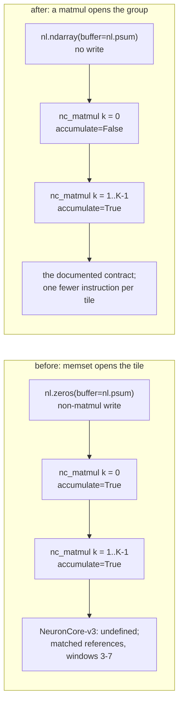

# trnsci: the PSUM bug that never showed

Five trnsci libraries opened their matmul accumulation groups in a way the NKI documentation calls undefined behaviour on NeuronCore-v3, the core in Trn2. Device conformance in Trn2 windows 3 to 7 had passed with it. The fix, validated in Trn2 window 8, changed no output bit the suite measured and no timing beyond run-to-run noise. This post explains why that was still worth a suite-wide fix, what PSUM's accumulation groups are, and why the NKI simulator in CI never warned. It is for NKI kernel authors and for anyone who relies on the suite's bitwise-reproducibility promise.

<!-- more -->

!!! note "Code status"
    Released in [trnblas 0.15.0](https://github.com/trnsci/trnblas/releases/tag/v0.15.0) ([#140](https://github.com/trnsci/trnblas/pull/140)), [trnfft 0.30.0](https://github.com/trnsci/trnfft/releases/tag/v0.30.0) ([#174](https://github.com/trnsci/trnfft/pull/174)), [trnsolver 0.24.0](https://github.com/trnsci/trnsolver/releases/tag/v0.24.0) ([#155](https://github.com/trnsci/trnsolver/pull/155)), [trnsparse 0.18.0](https://github.com/trnsci/trnsparse/releases/tag/v0.18.0) ([#149](https://github.com/trnsci/trnsparse/pull/149)) and [trntensor 0.27.0](https://github.com/trnsci/trntensor/releases/tag/v0.27.0) ([#143](https://github.com/trnsci/trntensor/pull/143)), tracked in [trnsci#185](https://github.com/trnsci/trnsci/issues/185). trnrand has no PSUM sites. Device numbers are from a trn2.3xlarge on public Neuron SDK 2.33.1 (neuronx-cc 2.28.7631, NKI 0.7.0), eager, one logical core at LNC=2 on a shared chip unless stated. The LNC=1 runs used exclusive whole-chip blocks.

## The problem

A tiled GEMM on Trainium accumulates its K loop in PSUM. Every library in the suite wrote that loop the same way: zero a PSUM tile, then issue every K step as an accumulating matmul. This is trnblas's 64 × 128 × 128 GEMM tile kernel at [v0.14.0](https://github.com/trnsci/trnblas/blob/v0.14.0/trnblas/nki/dispatch.py):

```python
psum = nl.zeros((TILE_M, TILE_N), dtype=nl.float32, buffer=nl.psum)
for k in nl.affine_range(K // TILE_K):
    k_off = k * TILE_K
    a_t = nl.load_transpose2d(a[m_off : m_off + TILE_M, k_off : k_off + TILE_K])
    b_tile = nl.load(b[k_off : k_off + TILE_K, n_off : n_off + TILE_N])
    nisa.nc_matmul(dst=psum, stationary=a_t, moving=b_tile, accumulate=True)
```

It reads like a CUDA kernel's `float acc = 0.0f; for (...) acc += ...`, and on a GPU that is all it would be: a register and an add. The [`nki.isa.nc_matmul` documentation](https://awsdocs-neuron.readthedocs-hosted.com/en/latest/nki/api/generated/nki.isa.nc_matmul.html) says otherwise for Trainium:

> On NeuronCore-v3, matmul accumulating into a PSUM location that was value-initialized by a non-matmul instruction (e.g., memset, tensor_copy) is not supported and is undefined behavior on hardware.

The same page says that the first matmul into a PSUM location must use `accumulate=False`, and that `accumulate=True` on uninitialised PSUM is undefined on all targets. `nl.zeros(..., buffer=nl.psum)` is a memset. A grep on 2026-11-26 counted [89 `nl.zeros` PSUM sites](https://github.com/trnsci/trnsci/issues/185): 22 in trnblas, 27 in trnsparse, 20 in trntensor, 13 in trnfft and 7 in trnsolver. The issue's own summary: device results had matched independent references from window 3 to window 7, "but the pattern relies on undefined behaviour and can break with a compiler or runtime change."

## What the architecture suggests

PSUM isn't a register file. It is the fp32 accumulator memory next to the Tensor Engine, and the matmul instruction carries a flag that says whether to overwrite a location or add to it. The [arithmetic post](2026-11-25-trainium-arithmetic.md) measured the add: cross-instruction `accumulate=True` is fp32 round-to-nearest-even per add, 16,384 of 16,384 cases. The overwrite-or-add choice is part of the matmul instruction's contract with PSUM. The NeuronCore-v3 note reads as if an accumulation group exists only once a matmul has opened it, and a memset, a non-matmul instruction, doesn't count. The documentation doesn't give the mechanism, and the suite hasn't probed it. What it does say is that the group's state belongs to the hardware and toolchain, not to the kernel.



Undefined behaviour that works today has a specific risk on Trainium. Kernels go through a whole-program compiler and a runtime that are both versioned with each SDK, and both are free to schedule instructions under the documented rules. If the rule says a memset can't open a group, a future version may legally act on it. The symptom wouldn't be a crash. It would be wrong numbers from the most-used kernels in the suite, the kind of [silent wrong answer](2026-11-04-suite-silent-wrong-answers.md) that three hardware windows of audits went looking for. A library that promises bitwise results and LNC invariance, as [trnblas#141](https://github.com/trnsci/trnblas/issues/141) puts it, can't build that promise on behaviour the toolchain doesn't promise.

## The approach

Open every group with a matmul, in one of two forms the issue set out:

- **Peel the first K step.** K step 0 moves out of the loop with `accumulate=False` and the loop runs from 1. The plan assumed `nl.affine_range` made the index symbolic, so this was to be the general form. trnblas uses it, and trntensor does through a small `_psum_legs` helper.
- **`accumulate=(k > 0)` over a static range**, as the `nc_matmul` page's own example does. trnsolver's five `subspace.py` sites and trntensor's MACE kernels use it.

The assumption behind the first form was wrong: in NKI 0.3.0 and 0.7.0, `nl.affine_range` is a deprecated alias of Python `range`, in both the tracer and the simulator, so `k > 0` sees a concrete integer ([trnsci#185](https://github.com/trnsci/trnsci/issues/185)). The peel is harmless, and the trnsparse and trnfft fixes switched those loops to plain `range`.

The PSUM tiles become `nl.ndarray`, with no memset. Since fp32 0 + x = x exactly, the old and new kernels should give the same bits whenever the hardware honoured the memset, and the device was the place to check that.

**The deliberate tradeoff is in trnsparse's fused CG.** Its matvec PSUM tiles hold many groups at once: one per block row, interleaved, overlapping in the spread layout, and none for an empty row. There is no single "first K step" to peel. Instead a K = 1 matmul of bf16 zeros opens the whole view, so the zeroing stays and becomes a matmul write. That is one extra Tensor Engine instruction per matvec PSUM tile, inside an iteration loop where the 8-tile cases run at about 10 µs per iteration. The Numbers section shows what it cost.

Each repo also gained `tests/test_psum_accumulate_lint.py`, a CPU-only AST check that fails when a PSUM tile gets `accumulate=True` before an opening matmul. On trnblas it flags all 27 pre-fix tiles and none after.

## Implementation

The same trnblas kernel at [v0.15.0](https://github.com/trnsci/trnblas/blob/v0.15.0/trnblas/nki/dispatch.py):

```python
psum = nl.ndarray((TILE_M, TILE_N), dtype=nl.float32, buffer=nl.psum)
# The first K step opens the accumulation group (trnsci#185).
a_0 = nl.load_transpose2d(a[m_off : m_off + TILE_M, 0:TILE_K])
b_0 = nl.load(b[0:TILE_K, n_off : n_off + TILE_N])
nisa.nc_matmul(dst=psum, stationary=a_0, moving=b_0, accumulate=False)
for k in nl.affine_range(K // TILE_K - 1):
    k_off = (k + 1) * TILE_K
    a_t = nl.load_transpose2d(a[m_off : m_off + TILE_M, k_off : k_off + TILE_K])
    b_tile = nl.load(b[k_off : k_off + TILE_K, n_off : n_off + TILE_N])
    nisa.nc_matmul(dst=psum, stationary=a_t, moving=b_tile, accumulate=True)
```

And trnsparse's fused-CG opener, from [`trnsparse/nki/_kernels.py` at v0.18.0](https://github.com/trnsci/trnsparse/blob/v0.18.0/trnsparse/nki/_kernels.py):

```python
def psum_zeros(name, width):
    """A zeroed PSUM view for the matvecs, whose matmuls all accumulate.
    ... a matmul of zeros opens the whole view: on NeuronCore-v3 a matmul
    must not accumulate onto PSUM that a non-matmul instruction such as
    memset initialised (trnsci/trnsci#185). 0 * 0 sums to +0.0, as memset wrote."""
    v = psum_tile(name, width)
    nisa.nc_matmul(v, zop[:, 0:P], zop[:, 0:width], accumulate=False)
    return v
```

## What didn't work

**CI couldn't see the bug, because the simulator was targeting a different chip.** On a CPU host, the NKI simulator defaults to the trn3 target, where the pattern is allowed. With `NEURON_PLATFORM_TARGET_OVERRIDE=trn2` it warns on exactly this undefined behaviour ([trnsci#185](https://github.com/trnsci/trnsci/issues/185)). The suite's `nki-simulator` CI jobs never set it, so every simulated test ran under the rules of a target the suite's hardware runs don't use. With the override, the [trnsolver subspace tests](https://github.com/trnsci/trnsolver/pull/155) raised 501 warnings on `main` and 0 on the fix branch, and [trntensor](https://github.com/trnsci/trntensor/pull/143) 55 + 32 and 0. The compiler accepted the pattern and the device ran it. The follow-up, still open on #185, is to run every library's simulator job at the trn2 target with that warning made fatal, so the lints have a runtime backstop.

**Device conformance couldn't see it either.** Five windows of conformance against independent references passed, because the hardware happened to honour the memset. A reference test checks the answer, not the contract the answer came from.

**A warning in the code turned out to be folklore.** trnfft's four-step kernel had a comment saying that `accumulate=False` on column slices of one PSUM tile loses terms on Trn2, "only the last row of each group was right". The fix needed exactly that, one overwriting matmul per column slice, so the four-step kernel was window 8's watch case. On the device, all 29 cases were bitwise equal to `main`, at up to Q = 32 slices per tile, and no row exceeded 1e-5 relative error against complex128 `torch.fft` ([trnfft#174](https://github.com/trnsci/trnfft/pull/174#issuecomment-7199403173)). Whatever the comment saw, it doesn't reproduce on SDK 2.33.1.

**The audit found a real race next door.** Checking trnblas#140 bitwise in the simulator gave 66 of 66 equal cases at LNC=1 but 24 of 26 at LNC=2. The two exceptions are [trnblas#141](https://github.com/trnsci/trnblas/issues/141): at M = 301, both LNC programs of `gemm_lnc` and `gemm_lnc_tn` compute and store overlap row 150, and the last writer wins. On `main`, 2 elements varied by 1 ulp across 12 + 12 simulator runs, the same set of values before and after the PSUM fix. On the device, the odd-M-tile shapes (M = 301 and 385) were stable over 3 runs at both LNCs. Three runs don't rule a race out, so #141 stays open. Its fix gives each output row exactly one owning program.

**LNC=1 coverage is incomplete.** Cold LNC=1 compiles on 2 host CPUs ate most of each slot. The full trnblas `-m neuron` suite stopped after 30 tests, all passing, and its Level 1/2 and triangular conformance chunks didn't run at LNC=1. trnsolver's LNC=1 suite reached about 75% (103 passed, 0 failed). trntensor skipped its two equivariant timing tests at LNC=1. The kernel changes were a few lines per site. Compiling them cold for the other LNC setting was the part that didn't fit in the slot.

**Asks for AWS Neuron.** Since the simulator already detects the pattern for trn2, the compiler could too: a diagnostic from neuronx-cc when it compiles for trn2 and a matmul accumulates onto a memset-initialised PSUM tile would have caught the pattern at the first build. A sentence on why a memset doesn't open an accumulation group on NeuronCore-v3 would help authors reason about the neighbouring cases, such as the `tensor_copy` the note also names.

## Numbers

Per-library device checklists, fix branch against `main` on the same box:

| library | sites changed | `-m neuron` LNC=2 | `-m neuron` LNC=1 | conformance, NEW (LNC=2 / LNC=1) | bitwise check |
|---|---|---|---|---|---|
| [trnblas#140](https://github.com/trnsci/trnblas/pull/140#issuecomment-7195104707) | 27 tiles | 287 passed, 14 skipped, as `main` | [partial](https://github.com/trnsci/trnblas/pull/140#issuecomment-7204077341): 117 kernel and Ozaki tests passed | 0 / 0 (LNC=1: GEMM and SYMM/SYRK chunks) | 10 Ozaki digests and 24 fp32 output hashes equal to `main`, stable over 3 runs, equal at LNC=1 and 2 |
| [trntensor#143](https://github.com/trnsci/trntensor/pull/143#issuecomment-7202517743) | 20 | 154 passed | 152 passed, timing tests not run | 0 / 0, 1664 passed each | conformance counts as window 7 on `main` |
| [trnsolver#155](https://github.com/trnsci/trnsolver/pull/155#issuecomment-7191752407) | 5 | 137 passed, 8 skipped | [partial](https://github.com/trnsci/trnsolver/pull/155#issuecomment-7206248747): 103 passed | 0 / 0, 617 passed each | only the two re-marked `test_cg_maxiter` cases changed state |
| [trnsparse#149](https://github.com/trnsci/trnsparse/pull/149#issuecomment-7199391118) | 27 `nl.zeros`, 39 `accumulate=True` checked | 352 passed | 351 passed, 1 failed, also on `main` ([trnsparse#150](https://github.com/trnsci/trnsparse/issues/150)) | 0 / 0, 659 passed each | 15 CG and power-iteration configurations: iteration counts and solutions bitwise equal |
| [trnfft#174](https://github.com/trnsci/trnfft/pull/174#issuecomment-7199403173) | 15 `nl.zeros`, 25 `accumulate=True` checked | 250 passed | 250 passed | 0 / 0, 1281 passed each | 29 four-step cases bitwise equal |

trntensor's six LNC=2 failures in `TestSpan4GiB` were device out-of-memory errors after earlier tests in the same process, and the file passes 7/7 alone. These tests involve no PSUM kernel.

Timing, trnblas, best of 7, device-resident fp32 operands ([source](https://github.com/trnsci/trnblas/pull/140#issuecomment-7195104707)):

| case | `main` (ms) | fix (ms) | fix / main |
|---|---|---|---|
| GEMM tile 4096³ | 11.17 | 11.30 | 1.01 |
| `gemm_lnc` 4096³ | 3.827 | 3.787 | 0.99 |
| `syrk` 2048×4096 | 1.211 | 1.218 | 1.01 |
| `pair_energy_sym` 32×512×1024 | 30.83 | 29.89 | 0.97 |
| `pair_energy_sym` 64×512×2048 | 130.1 | 126.9 | 0.98 |
| `gemm_fp64` 2048³, host operands | 37.12 | 37.48 | 1.01 |

All ten measured cases fall within ±3%, the run-to-run noise on a shared chip.

trnsparse fused CG, marginal µs per iteration, median of 5, with the extra zero matmul per matvec tile ([source](https://github.com/trnsci/trnsparse/pull/149#issuecomment-7199391118)):

| T (n = 128 T), matvec, R | iterations | `main` | fix |
|---|---|---|---|
| 8, row, 1 | 36 | 13.1 | 13.2 |
| 8, column, 1 | 36 | 10.4 | 9.5 |
| 8, column, 4 | 36 | 11.1 | 12.4 |
| 32, column, 1 | 66 | 17.5 | 17.2 |
| 32, column (ran row), 128 | 69 | 110.7 | 106.4 |

Across the 15 configurations the differences run from −4% to +12% in both directions, with no sign pattern. The extra instruction isn't measurable at this resolution. Not measured: timing for trnfft, trnsolver and trntensor beyond their suites' own timing tests, and any shape outside the test and benchmark sets.

## What's next

- [trnsci#185](https://github.com/trnsci/trnsci/issues/185) stays open for the CI change: `NEURON_PLATFORM_TARGET_OVERRIDE=trn2` in every `nki-simulator` job, with the warning fatal.
- [trnblas#141](https://github.com/trnsci/trnblas/issues/141): one owning program per output row in `gemm_lnc` at odd M-tile counts, plus a bitwise test at M = 129, 301 and 385 across reruns and LNC settings.
- [trnsparse#150](https://github.com/trnsci/trnsparse/issues/150), the forced `gather` feature split at LNC=1, and [trnsolver#156](https://github.com/trnsci/trnsolver/issues/156), the device-RNG fallback without trnrand, both surfaced in the same window.
- The [roadmap](https://trnsci.dev/roadmap/), the [suite tracker](https://github.com/trnsci/trnsci/issues/1) and [trnsci.dev](https://trnsci.dev).

## Takeaway

PSUM accumulation looks like `acc += x`, but on Trainium it's a protocol between the Tensor Engine and its accumulator memory, and a memset isn't part of it on NeuronCore-v3. The suite broke that protocol across five libraries, at about 89 sites by the first grep, and window 8 showed the hardware forgave it at every measured shape: same bits, same timings. That is the best outcome a fix like this can have. It is evidence that earlier results on SDK 2.33.1 weren't affected at those shapes, and it moves the determinism promise onto behaviour the toolchain documents. For a library whose claim is bitwise reproducibility, "it works" isn't enough; the result also has to rest on the toolchain's stated contract. If you write NKI kernels for Trn2, set the simulator target to trn2.
