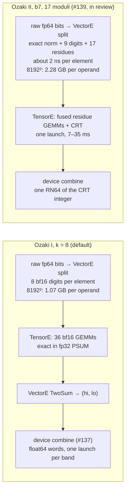

# trnblas: moving fp64-class GEMM onto the device, where the combine paid and the split didn't

trnblas's `gemm_fp64` now runs its last host step, the (hi, lo) combine, on the device. It is bitwise equal to the host combine and 9–34% faster end to end on Trn2. A second change in the same window went further and was slower. It runs Ozaki scheme II entirely on the device, with integer residues and a Chinese-remainder rebuild, and reaches host-fp64 accuracy. But it loses to Ozaki I by 10–38%, because building 17 residues per element on VectorE costs more than the shorter GEMM saves. This post follows the [2026-11-10 Ozaki post](2026-11-10-trnblas-fp64-ozaki.md). It is for anyone weighing the integer-residue route to fp64 emulation on hardware without an INT8 matrix path, and for anyone who wants to know where the bytes and launches of an emulated GEMM go.

<!-- more -->

!!! note "Code status"
    The device combine ([trnblas#137](https://github.com/trnsci/trnblas/pull/137)) is released in [trnblas 0.15.0](https://github.com/trnsci/trnblas/releases/tag/v0.15.0) and is the default combine of `gemm_fp64` on the device. The all-device Ozaki II route, `gemm_fp64(scheme="ozaki2")` ([trnblas#139](https://github.com/trnsci/trnblas/pull/139)), is in review and held. It is correct on hardware, and the decision in [trnblas#138](https://github.com/trnsci/trnblas/issues/138) is to keep `ozaki1` as the default. All device numbers are from a trn2.3xlarge on public Neuron SDK 2.33.1 (neuronx-cc 2.28.7631, NKI 0.7.0, torch-neuronx 2.14.3), eager native path, `NEURON_CC_FLAGS` unset, one logical core at LNC=2, with host threads pinned to one physical core (2 vCPUs). Timings are ms, best of 3, from an exclusive whole-chip block. The 12-thread host fp64 baselines ran unpinned on all 12 vCPUs in the same block. Sources: [#137 device results](https://github.com/trnsci/trnblas/pull/137#issuecomment-7203465830), [#139 device results](https://github.com/trnsci/trnblas/pull/139#issuecomment-7203474593), [#138 decision input](https://github.com/trnsci/trnblas/issues/138#issuecomment-7203481766), [#132 summary](https://github.com/trnsci/trnblas/issues/132#issuecomment-7203482088), [#125 summary](https://github.com/trnsci/trnblas/pull/125#issuecomment-7203482397).

## The problem

The [previous post](2026-11-10-trnblas-fp64-ozaki.md) ended with `gemm_fp64` matching host fp64 BLAS on a chip with no fp64 arithmetic. It cuts fp64 operands into 7-bit integer slices on VectorE, multiplies them exactly as bf16 on TensorE, and accumulates exactly in fp32 PSUM. Two costs were left on the table.

1. **The combine ran on the host.** The kernel returns each output as an fp32 (hi, lo) pair, and the host turned that into float64 at about 4 ns per element on 2 vCPUs: 66 of the 181 ms at 4096³.
2. **The GEMM count is quadratic in the slice count.** k = 8 slices means k(k+1)/2 = 36 bf16 GEMMs. Ozaki scheme II ([*Ozaki Scheme II: A GEMM-oriented emulation of floating-point matrix multiplication using an integer modular technique*](https://arxiv.org/abs/2504.08009), arXiv 2504.08009) replaces slices with residues modulo several coprime moduli. It needs one product per modulus and rebuilds the result by the Chinese remainder theorem (CRT). The count grows linearly. [trnblas#132](https://github.com/trnsci/trnblas/issues/132) proposed it for Trainium, and in window 7 the fused b7 residue kernel took 0.53–0.57× of Ozaki I's kernel time at 4096³ and above, and on the DF-MP2 shapes ([#138](https://github.com/trnsci/trnblas/issues/138)). End to end it still lost, because its split ran on the host.

So window 8 tested both moves on hardware: the combine onto the device for Ozaki I ([#137](https://github.com/trnsci/trnblas/pull/137)), and the whole Ozaki II pipeline onto the device ([#139](https://github.com/trnsci/trnblas/pull/139)). The workloads waiting on them are the ones in [trnsci#129](https://github.com/trnsci/trnsci/issues/129): the DF-MP2 AO→MO step and its 1e-7 Eh gate ([trntensor#122](https://github.com/trnsci/trntensor/issues/122)), which is where the two narrow shapes (3267, 8400, 241) and (8192, 3508, 241) come from, the SCF Fock build and the GP refinement path.

## What the architecture suggests

Both changes are questions about where the bytes and the VectorE instructions go.

**The combine moves arithmetic, not bytes.** The (hi, lo) pair is two fp32 words, 8 bytes per output element, and a float64 is also 8 bytes. Building the float64 bit pattern on the device sends the same number of bytes over the host link. What disappears is the host pass, about 4 ns per element on 2 vCPUs. The device builds the pattern from a TwoSum and exact fp32 exponent arithmetic on VectorE, whose IEEE round-to-nearest the [arithmetic post](2026-11-25-trainium-arithmetic.md) measured, plus shifts, ANDs and ORs on uint32 views for the fields. It needs no fp64 arithmetic, which the device doesn't have, and no integer values above 2²⁴ in fp32 arithmetic, where they lose bits ([aws-neuron-sdk#1308](https://github.com/aws-neuron/aws-neuron-sdk/issues/1308)). Everything is elementwise, so the bits can't depend on how LNC splits the rows. One launch per band of output rows writes the band's words, and they download straight into the result's storage.

**Ozaki II trades TensorE work for VectorE work and HBM bytes.** Its fused kernel runs the residue GEMMs and the CRT in one launch, so it is cheap on TensorE. The split in front of it is not cheap. For every operand element, the device split has to:

- read the raw fp64 bits (8 bytes) and find the exponent maxima, as Ozaki I does;
- compute an exact integer bound on each row's or column's 2-norm, summed in 9-bit limbs so that every partial sum stays an integer below 2²⁴;
- cut k = 9 balanced base-128 digits;
- for each of the 17 moduli, form a dot product of the digits with the residues of powers of two, then reduce it exactly: q = rint(t·fl(1/m)), r = t − q·m, with each rint issued as two instructions;
- write 17 bf16 residues (34 bytes) back to HBM.

Ozaki I writes 8 bf16 digits per element. Ozaki II writes 17 residues and does a modular reduction for each. #139's own model put the device split's VectorE work at about twice Ozaki I's per element ([#138](https://github.com/trnsci/trnblas/issues/138)).

**This is a fixed tax on Trainium.** The paper targets INT8 matrix engines: integer residues, integer accumulation, integer arithmetic for the reductions. trnblas has no INT8 TensorE path to target. So the residues are integers stored in bf16, which holds them exactly, and PSUM's fp32 is the exact integer accumulator below 2²⁴, as in Ozaki I. The residue arithmetic is the expensive part. A device `mod` doesn't pass verification on Trn2, integers above 2²⁴ lose bits in fp32 arithmetic, and int32 transposes aren't bit-exact ([aws-neuron-sdk#1466](https://github.com/aws-neuron/aws-neuron-sdk/issues/1466)). So every residue is built from exact fp32 steps and bit operations. That cost scales with the number of operand elements, not with M·N·K, and nothing in the fused kernel can win it back when one dimension is small.



## The approach

**The combine (#137).** `_fp64_ff_bits_kernel`, from the `trnblas.fp64` module of [trnblas 0.14.0](https://github.com/trnsci/trnblas/releases/tag/v0.14.0) ([trnblas#134](https://github.com/trnsci/trnblas/pull/134)), computes the float64 words of RN64(hi + lo)·2^(e_i + e_j + offset). The (hi, lo) blocks of a band (up to `LAUNCH_M` rows, every N block) are joined along N on the device, and one launch writes the band. The result is an int32 (Mp + 128, 2N) buffer read as float64 with no host copy. The 128 extra rows carry per-row flags, which the next band overwrites. The deliberate tradeoff is a narrow range. The kernel handles finite results in the normal float64 range and flags everything else. Flagged rows (a non-finite element, overflow or gradual underflow), products with several K blocks (K beyond about 1M at k = 8), and a band whose words would pass 2 GiB all fall back to the host combine, which gives the same bits. Rare edge cases on the slow path keep the kernel's fast path simple and its bits easy to verify.

**The split (#139).** Each operand is uploaded once as raw bits and split in its own layout, per row or per column, so no int32 data is ever transposed on the device. The norm bound is an exact integer sum rather than a float sum, because a float sum's value depends on its order, and the order depends on layout and LNC. With an integer sum, the device and host scales agree bit for bit. The tradeoff is the residency guard. The split returns `None`, which means "use the host split", when the residue stack 2·n·Rp·Cp would reach 2 GiB, the `_OZ_RESIDENT_BYTES` limit behind the size guards that came out of [#112](https://github.com/trnsci/trnblas/issues/112) and the [32 MiB rows post](2026-11-08-dma-32mib-rows.md). The fallback gives the same bits. It does not give the same speed.

## Implementation

The end of the combine tile, from [`trnblas/nki/fp64_kernels.py` at v0.15.0](https://github.com/trnsci/trnblas/blob/v0.15.0/trnblas/nki/fp64_kernels.py). Earlier in the tile, a TwoSum gives (s, t), the exponent is computed in exact fp32, every rint is two separate fp32 instructions, and the significand ends up as Au (the top 23 fraction bits) and B (the low 29). Then the two words are plain bit packing:

```python
# excerpt from _fb_tile: rint by adding and subtracting 2^23, in two
# separate instructions, so each one rounds
r1 = _fb_ts(av, nl.add, 8388608.0, sh)  # two instructions: both round
r = _fb_ts(r1, nl.subtract, 8388608.0, sh)
...
# high word: sign | 11-bit exponent | top 20 fraction bits
Eu = _fb_ts(_fb_cvt(E64c, u32, sh), nl.left_shift, 20, sh, dtype=u32)
hw = _fb_ts(sign_u, nl.left_shift, 31, sh, dtype=u32)
nisa.tensor_tensor(dst=hw, data1=hw, data2=Eu, op=nl.bitwise_or)
a3 = _fb_ts(Au, nl.right_shift, 3, sh, dtype=u32)
nisa.tensor_tensor(dst=hw, data1=hw, data2=a3, op=nl.bitwise_or)
# low word: the last 3 bits of Au, then B's 29
lw = _fb_ts(Au, nl.bitwise_and, 7, sh, op1=nl.left_shift, operand1=29, dtype=u32)
nisa.tensor_tensor(dst=lw, data1=lw, data2=B, op=nl.bitwise_or)
```

The guard that decides whether an Ozaki II operand is split on the device, from [`trnblas/nki/ozaki2_kernels.py` on the #139 branch](https://github.com/trnsci/trnblas/blob/5f87b44/trnblas/nki/ozaki2_kernels.py):

```python
# excerpt from _oz2_device_split: None sends X to the host split
Rp, Cp = _oz._round_up(R, 128), _oz._round_up(C, 128)
if 8 * R * C >= D._OZ_RESIDENT_BYTES or 2 * n * Rp * Cp >= D._OZ_RESIDENT_BYTES:
    return None
```

At n = 17 and 8192 × 8192, the second term is 2·17·8192² = 2.28 GB, which is over 2 GiB. Ozaki I's k = 8 digit stack for the same operand is 1.07 GB. That one inequality is most of the 8192³ story below.

From the caller's side nothing changes for Ozaki I. `trnblas.gemm_fp64(A, B)` takes the device combine by default, and `TRNBLAS_OZAKI_DEVICE_COMBINE=0` restores the host one.

## What didn't work

**The all-device Ozaki II route is slower than Ozaki I at every measured shape.** It is correct. Every route is bitwise equal to its host reference on 256 sampled rows and to the other route of its scheme. All 15 Ozaki II digests are equal at LNC=1 and LNC=2, and the `ozaki2_lnc` kernel digest is still the window-7 value. It is also more accurate: 0.8–1.2e-16 max componentwise error, at the level of host fp64 (0.5–1.0e-16), against 1.8–2.3e-16 for Ozaki I at k = 8. But end to end it is 1.10× Ozaki I's time at 4096³ and 1.38× on both DF-MP2 shapes.

The stage times show why. Each stage was timed separately, and each split includes a one-row or one-column partner split, so the stages sum to more than the end-to-end time (158 ms against 124.9 ms at 4096³). Read them as relative weights, not a breakdown:

| shape | split A | split B | fused | combine + download | e2e |
|---|---|---|---|---|---|
| 4096³ | 33.8 | 34.7 | 35.2 | 54.2 | 124.9 |
| (3267, 8400, 241) | 59.0 | 10.0 | 7.1 | 1.6 | 79.2 |
| (8192, 3508, 241) | 56.5 | 5.4 | 6.5 | 3.5 | 81.4 |

The split runs at about 2.0–2.2 ns per element of A, 16.8M elements at 4096³ and 27.4M at (3267, 8400). The fused kernel takes 7–35 ms, against about 54 ms for Ozaki I's kernel at 4096³ in window 7. That saving is real, and the split spends all of it. On the DF-MP2 shapes, splitting A alone (56.5–59.0 ms) takes as long as the whole Ozaki I route (57.3–58.9 ms). The forecast was low, too: #139's model expected about twice Ozaki I's per-element split cost. The Ozaki I device split measured 0.50–0.76 ns per element in the [previous post](2026-11-10-trnblas-fp64-ozaki.md), in an earlier window on SDK 2.33.0, so the measured ratio looks closer to three or four. Those two numbers come from different windows and weren't measured side by side.

**At 8192³, `scheme="ozaki2"` quietly becomes 35× slower.** The residue stack trips the 2 GiB guard, so both operands take the host split, about 11 s and 9.6 s on 2 threads. The route takes 23,180 ms against 660.7 ms for Ozaki I. The bits are the same and nothing raises. This is the guard working as designed, and it's a guard that spends 22 seconds without a word. Lifting it needs the split to emit residues in row bands below the guard, the way the launcher already blocks its launches. Until that lands, `auto` must never pick `ozaki2` when 2·n·R·C ≥ 2 GiB for either operand ([#138](https://github.com/trnsci/trnblas/issues/138#issuecomment-7203481766)).

**The split is also the expensive compile.** With an empty NEFF cache, the device split compiled in 99.7–124.4 s per new pair of operand shapes at 4096³ and the DF-MP2 shapes, and 25.9 s at 2048³. The fused kernel took 13.6–16.4 s and the combine 3.2–5.8 s. The 17-modulus split does fit in SBUF: it compiles and runs at every shape with no allocation error. With the NEFF cache warm, a new process still spends 26–37 s on its first `scheme="ozaki2"` call, against 13–20 s for Ozaki I, spent in kernel tracing, with the trace cache off.

**The probe's first stage table timed the compiler.** The `split_a_ms` and `split_b_ms` stages were timed on their first call. The one-row partner operand is a new shape, so that call compiled, and a single stage read 5–11 s inside a route that took 80–125 ms. The fix, [5f87b44](https://github.com/trnsci/trnblas/commit/5f87b44bfc2777a670c78e14b3d4895bf175310b), warms each split and times it as best of 2, like the other stages. It changed only the probe, and the stage table above is from the fixed probe. The rule applies to any per-stage timing on Neuron: a new shape anywhere in a stage means a compile in that stage.

**What wasn't measured.** The fair accuracy comparison is still open. Ozaki II at 17 moduli reaches host-fp64 accuracy and Ozaki I at k = 8 doesn't quite. A caller who asks for host-fp64 level should be compared against Ozaki I at k = 9 or 10 (45 or 55 slice GEMMs), and that wasn't timed this window. At 4096³, where the gap is only 10%, that comparison may favour Ozaki II. Nothing ran at LNC=1 for timing beyond the combine test, and nothing ran on more than one logical core.

**Fit.** The integer-residue route on Trainium pays per element of the operands, on VectorE, before TensorE does any work. That is a poor fit wherever an operand has many elements and the product has little work per element, which is exactly the DF-MP2 case: A at (3267, 8400) gets only 2N = 482 flops per element. It is a better fit for large square products, where the fused kernel's saving grows with K and the split doesn't. Even there, at 4096³, the split still costs more than the fused kernel saves. On hardware with an INT8 matrix path and native integer arithmetic, the residues and their reductions are plain integer operations, with none of the fp32 workarounds. trnsci hasn't measured such hardware, so this post doesn't put a number on the difference. The asks for AWS Neuron:

- fix [aws-neuron-sdk#1466](https://github.com/aws-neuron/aws-neuron-sdk/issues/1466) (int32/int64 transposes round through fp32) and [#1467](https://github.com/aws-neuron/aws-neuron-sdk/issues/1467) (nonzero and mask indexing round flat indices through fp32), both of which shaped how these kernels lay out and move data;
- an exact int32 multiply and `mod` on VectorE or GpSimd that passes Trn2 verification, so a residue doesn't need a reciprocal multiply and a two-instruction rint;
- an integer-accumulate matmul mode in NKI, on this chip if the silicon has one, or on a future one. Ozaki II would use it directly.

## Numbers

Ozaki I `gemm_fp64` end to end (k = 8), device combine (#137, now the default) against the host combine (`main` before it), from [#137](https://github.com/trnsci/trnblas/pull/137#issuecomment-7203465830). Every result is bitwise equal to `ozaki.reference_gemm` on 256 sampled rows and between the two routes:

| shape (M, K, N) | **device combine** | host combine | saved | host fp64, 2 t | host fp64, 12 t | vs 2 t | vs 12 t |
|---|---|---|---|---|---|---|---|
| 4096³ | **113.7** | 171.4 | 57.7 (−34%) | 1387.6 | 239.1 | 12.2× | 2.10× |
| 8192³ | **661.0** | 899.7 | 238.7 (−27%) | 10902 | 1848 | 16.5× | 2.80× |
| (3267, 8400, 241) | **56.7** | 62.0 | 5.3 (−9%) | 151.0 | 25.0 | 2.66× | 0.44× |
| (8192, 3508, 241) | **59.2** | 69.8 | 10.6 (−15%) | 158.2 | 25.1 | 2.67× | 0.42× |

- **Against the forecast.** #137 expected about 50 ms saved at 4096³, and measured 58 ms. The narrow shapes save less because their outputs are only M × 241, so there was less combine to move.
- **Against 12 host threads,** the device wins 2.1–2.8× on the squares and is still about 2.3× slower on the DF-MP2 shapes.
- **Since the last post.** 4096³ went from 180.8 ms (SDK 2.33.0, earlier window) to 113.7 ms. The ratio against 12 threads barely moved, from 2.15× to 2.10×, because the 12-thread host baseline also measured faster this window: 239.1 ms against 331 ms. The two baselines come from different windows, so the ratio is the fairer number to carry forward.
- **Bits.** `test_device_combine_equals_host_combine` passes at LNC=1 and LNC=2 for bands, narrow and wide shapes, including flagged rows (overflow to inf, subnormal). All 12 Ozaki I digests are equal at both LNCs, and the pre-existing digests are identical to `main`'s.
- **LNC=1**, at 4096³: 190.0 ms device combine against 243.3 ms host, bitwise.
- **Compile.** The combine adds 3–5 s of first-call compile per band shape (2.9–5.2 s estimated), small next to the split and Ozaki kernel's 29.7–72.8 s.

Ozaki II all on the device against Ozaki I, from [#139](https://github.com/trnsci/trnblas/pull/139#issuecomment-7203474593):

| shape | `ozaki2` all device | `ozaki2_host_split` | **`ozaki1`** | `ozaki1_host_combine` | host fp64 2 t | host fp64 12 t | ozaki2 / ozaki1 |
|---|---|---|---|---|---|---|---|
| 4096³ | 124.9 | 5329 | **113.9** | 168.6 | 1383 | 239.1 | 1.10 |
| 8192³ | 23180 (host-split fallback) | (same route) | **660.7** | 907.2 | 10876 | 1848 | 35 |
| (3267, 8400, 241) | 79.2 | 4319 | **57.3** | 61.8 | 153.0 | 25.0 | 1.38 |
| (8192, 3508, 241) | 81.4 | 4413 | **58.9** | 71.1 | 159.4 | 25.1 | 1.38 |

The `ozaki1` column is the same route as the device-combine column above, measured in the #139 run; the two agree to within 0.6 ms. Moving the Ozaki II split from the host to the device took 4.2–5.2 s off the route (`ozaki2_host_split` against `ozaki2`), and the route is still slower than Ozaki I.

## What's next

- [trnblas#138](https://github.com/trnsci/trnblas/issues/138): `scheme="auto"` stays Ozaki I. No measured shape favours Ozaki II, so a cost model fitted to this table would always pick `ozaki1`. Three things could change the table: a cheaper split, residues emitted in row bands under the 2 GiB guard, and the matched-accuracy timing against Ozaki I at k = 9–10.
- **A cheaper split.** For DF-MP2, one operand is reused over many products, so its residues can be cached across calls and the split paid once. Separately, the 17-modulus dot product can be done in fewer VectorE passes.
- [trnblas#139](https://github.com/trnsci/trnblas/pull/139) stays in review until one of those lands. [trnblas#132](https://github.com/trnsci/trnblas/issues/132) tracks the Ozaki II evaluation, including the Trn3 question of MXFP8 residues.
- The consumers in [trnsci#129](https://github.com/trnsci/trnsci/issues/129) and the fp64 emulation plan in [trnsci#169](https://github.com/trnsci/trnsci/issues/169) take the 0.15.0 combine as it is. The narrow DF-MP2 shapes still need several logical cores or resident, pre-split operands to beat 12 host threads. See also [trnblas#22](https://github.com/trnsci/trnblas/issues/22), the [Phase 2 milestone](https://github.com/trnsci/trnsci/milestone/2), the [roadmap](https://trnsci.dev/roadmap/) and the [suite tracker](https://github.com/trnsci/trnsci/issues/1).

## Takeaway

Moving a step onto a Trainium device pays when it removes host arithmetic and the device can do the same work exactly with VectorE bit operations. The combine did that: the same 8 bytes per element cross the link, the host pass is gone, and `gemm_fp64` got 9–34% faster with the same bits. Moving a step pays less when it adds per-element VectorE work that the TensorE savings can't cover. Ozaki II's 17 residues per element are cheap to multiply and expensive to make on an engine without exact integer `mod`, and at 2.28 GB per 8192² operand they don't fit under the residency guard either. Fewer GEMMs is a GPU-shaped goal. On Trainium, the cost to count is the VectorE instructions and the HBM bytes per operand element.
