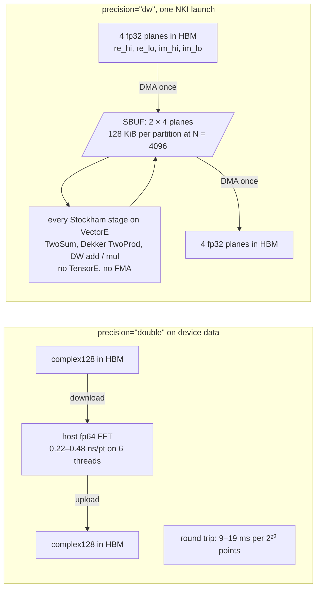

# trnfft: an fp64-class FFT from fp32 arithmetic, and where it loses

trnfft 0.30.0 adds `precision="dw"`, a complex FFT that gets 47.4–49.9 correct bits on a Trn2 chip whose engines have no fp64. It is a double-word Stockham FFT, one launch, entirely in SBUF on the Vector engine, and it works because that engine's fp32 arithmetic rounds to nearest even, so error-free transformations are exact there. The concession comes first: host fp64 on 6 threads is faster per point, and the kernel wins only for large batches already on the device. This post is for anyone with an fp64 FFT inside a Trainium pipeline who wants to know when the host round trip can go.

<!-- more -->

!!! note "Code status"
    Released in [trnfft 0.30.0](https://github.com/trnsci/trnfft/releases/tag/v0.30.0) ([trnfft#173](https://github.com/trnsci/trnfft/pull/173), the first arm of [trnfft#172](https://github.com/trnsci/trnfft/issues/172)). Device numbers are from the [window-8 run](https://github.com/trnsci/trnfft/pull/173#issuecomment-7205420347): trn2.3xlarge, public Neuron SDK 2.33.1 DLAMI (neuronx-cc 2.28.7631, torch-neuronx 2.14.3, NKI 0.7.0, runtime 2.35.33), eager native path, an exclusive whole-chip block, one logical core at LNC=2 unless stated. Host fp64 ran on 2 threads and on 6, the host's physical cores and torch's cap.

## The problem

The suite's [float64 policy](../../precision_and_platform_limits.md#fp64-policy) is honest and slow: device float64 arithmetic computes at fp32, so a float64 FFT on the device is copied to the host, transformed there and copied back. For `precision="double"` that round trip costs 9–19 ms per 2²⁰ points. trnfft's device modes are fp32-class, including `ozaki_hq` ([two-level Ozaki post](2026-04-28-trnfft-two-level-ozaki.md)).

The workload that needs it is the plane-wave DFT exemplar ([trnsci#110](https://github.com/trnsci/trnsci/issues/110)), where FFTs dominate applying the Hamiltonian. In the suite's fp64 plan ([trnsci#169](https://github.com/trnsci/trnsci/issues/169)) the FFT is experiment E1; [E0](https://github.com/trnsci/trnsci/issues/169#issuecomment-7130733645) measured how each engine rounds.

On a GPU this is a library call: cuFFT's Z2Z transforms run on fp64 units. Without fast fp64, the fallback is double-word arithmetic, and the preprint *[Lord of the Precision, the Two Floats: Double-Word Arithmetic for Complex Numbers](https://arxiv.org/abs/2611.08371)* (arXiv:2611.08371) analyses complex double-word multiplication, the product every twiddle needs, and finds that the cheaper sloppy addition suffices. A different route on Trainium is *[Double-Precision Floating-Point on AWS Trainium Using Integer Units: A First Look](https://spiral.ece.cmu.edu/pub-spiral/pubfile/2026_HPEC_Yunhao_397.pdf)* (HPEC 2026). It emulates IEEE fp64 with integer operations on trn1 through the custom C++ operator flow, and reports batched radix-4 butterflies at 4 points faster than host MKL. That flow is documented for NeuronCore-v2 only, so on Trn2 the integer route, arm 3 of #172 and not yet measured, has to go through NKI.

## What the architecture suggests

Three facts from the [arithmetic post](2026-11-25-trainium-arithmetic.md) decide where a double-word FFT can run.

- **VectorE and GpSimd are IEEE fp32.** In E0, add, subtract and multiply rounded to nearest even with 0 mismatches in 65,536 per input family, subnormals included. TwoSum and Dekker's TwoProd were exact in every family. A double-word butterfly needs nothing else.
- **TensorE is out.** Its fp32 products were correctly rounded in 12,341 of 16,384 cases. An error-free transformation that is right 75% of the time is just an expensive error. This is the opposite of the fp32 path, where the [launch-cost post](2026-10-27-trnfft-launch-cost.md) put the FFT on TensorE as one GEMM up to N = 1024.
- **No usable FMA.** VectorE has none. ScalarE's fused multiply-add works only with a per-partition factor and flushes subnormal products to zero. Twiddles vary along the free axis, so every TwoProd uses Dekker's FMA-free form with a Veltkamp split.

Two more facts shape the kernel. SBUF is [224 KiB per partition](https://github.com/trnsci/trnfft/pull/169) on Trn2, and a 4096-point double-word transform is four fp32 planes of 16 KiB per partition. A ping-pong pair of buffers is 128 KiB, so every stage reads and writes SBUF, and the data crosses HBM once in and once out. And each partition row holds whole transforms, while a VectorE instruction works on all 128 partitions at once: rows are free until the partitions run out.



## The approach

**A Stockham autosort FFT in double-word.** Every value is hi + lo in fp32: about 48 significant bits, in fp32's exponent range. The transform is decimation in time, radix 4, with one leading radix-2 stage when log₂ N is odd. Each stage writes the next stage's input layout, so there is no permutation pass. The inverse is the forward transform on swapped real and imaginary parts, which is exact. Sizes are powers of two from 2 to 4096; others take the `"double"` host route. There is no autograd.

**Arithmetic from published building blocks.** Addition is AccurateDWPlusDW (20 fp32 ops) or SloppyDWPlusDW (11), and multiplication is DWTimesDW (16 ops, plus 4 per Veltkamp split), all from *[Tight and rigorous error bounds for basic building blocks of double-word arithmetic](https://doi.org/10.1145/3121432)* (ACM TOMS 44(2), 2017). Each component of a complex twiddle product is a sum of two double-word products, after the arXiv preprint. A twiddled radix-4 stage costs 164 fp32 operations per point (115 sloppy), and a 4096-point transform 900 (616 sloppy).

**Twiddles from the host, exactly.** They are computed in fp64 with an octant reduction, so zeros, ones and ±√½ are exact and every symmetry holds bit for bit, then split into hi = RN32(w) and lo = RN32(w − hi). A stride-0 DMA copies them to every partition, and the butterflies read them as broadcast views.

**Deterministic by construction.** Each output element's operation sequence depends only on N and the addition mode, not on the batch, the tiling or the LNC setting. Given IEEE rounding, the CPU reference and the kernel must agree bit for bit, so the bitwise test doubles as a rounding probe.

**The deliberate tradeoffs.** Range first: Dekker's TwoProd needs operands below 2¹¹⁵ and products above the fp32 subnormal range, so with FFT growth bounded by N, inputs should satisfy max|x| ≤ 2¹⁰⁰. Values below about 2⁻¹⁰² lose relative precision gradually, and inputs past fp32's range raise `OverflowError`. This is fp64-class precision, not fp64. Second, the six error-free primitives, about 60 lines, are vendored rather than taken from `trnblas.fp64`, because the kernel issues them on its own 4-D tile views. A test pins them bit for bit to trnblas 0.14.0.

## Implementation

The kernel doesn't reimplement the butterfly. It runs the CPU reference's own `_butterfly` through an ops object that issues one engine instruction per fp32 operation, where the reference's issues one torch fp32 op, so the two can't drift apart in operation order. From [`trnfft/nki/dw_fft.py` at v0.30.0](https://github.com/trnsci/trnfft/blob/v0.30.0/trnfft/nki/dw_fft.py):

```python
# abridged: __init__ (engine choice) and part() (the split variant) dropped
class _Ops:
    """``dw`` ops object: one instruction per fp32 operation, results in
    new SBUF tiles of ``shape`` (or ``out``)."""

    def _tt(self, a, b, op, out):
        d = nl.ndarray(self.shape, dtype=nl.float32, buffer=nl.sbuf) if out is None else out
        nisa.tensor_tensor(dst=d, data1=a, data2=b, op=op, engine=self.engine)
        return d

    def add(self, a, b, out=None):
        return self._tt(a, b, nl.add, out)

    def mul(self, a, b, out=None):
        return self._tt(a, b, nl.multiply, out)
    # sub is the same with nl.subtract; mulc (the Veltkamp constant) is one tensor_scalar
```

And the product those instructions build, from [`trnfft/dw.py`](https://github.com/trnsci/trnfft/blob/v0.30.0/trnfft/dw.py). `xs` and `ys` are the 12-bit halves from the Veltkamp split. The four lines after `p` are Dekker's TwoProd error term, which an FMA would compute in one instruction:

```python
def _dw_mul(o, x, xs, y, ys):  # docstring dropped
    p = o.mul(x[0], y[0])
    t = o.sub(p, o.mul(xs[0], ys[0]))
    t = o.sub(t, o.mul(xs[1], ys[0]))
    t = o.sub(t, o.mul(xs[0], ys[1]))
    e = o.sub(o.mul(xs[1], ys[1]), t)
    tl1 = o.mul(x[0], y[1])
    tl2 = o.mul(x[1], y[0])
    cl2 = o.add(tl1, tl2)
    cl3 = o.add(e, cl2)
    return _fast_two_sum(o, p, cl3)
```

`trnfft.set_precision("dw")` routes `fft_core` through this; `trnfft.dw.fft_dw_raw` keeps the four planes on the device, so transforms chain without a host round trip.

## What didn't work

**Splitting the work across engines.** `engines="split"` puts the butterfly's independent real chains on VectorE and imaginary chains on GpSimd. The bits came out identical, and it was 1.05–2.8× slower at every shape measured, for example 12.7 against 5.19 ms at N = 4096, B = 256. The explanation in the PR is that GpSimd and VectorE share an SBUF port, so the second engine adds instruction streams, not throughput. `"auto"` stays the default.

**A single row.** At N = 4096 one row takes 5.10 ms and 256 rows take 5.19 ms, because one row occupies 1 of 128 partitions, and the round trip for one row is 0.55 ms. From N = 128 up a single row loses, by 1.08× at N = 128 and 9.3× at N = 4096.

**Host-resident data.** Starting and ending on the host, `dw` was 23–280× slower than host fp64 at every shape.

**Sloppy addition is a speed knob, not a free lunch.** It is 1.3–1.4× faster at N ≥ 1024 and costs 0.1 bits on the device. That moves 4096 × 128 from a loss against the round trip (1.12) to a win (0.82). The default is `accurate`: sloppy addition's error bound holds only when its operands don't nearly cancel.

**The window's first device failure never reached the device.** Four `test_device_accuracy_vs_mpmath` cases failed before any kernel ran: for a zero exponent spread the input helper called `rng.integers(-0, 0)`, which raises `ValueError: high <= 0`. The helper now skips the spread ([f1df7a9](https://github.com/trnsci/trnfft/commit/f1df7a9)).

**A simulator shape that may or may not be real.** Under `nki.simulate` at LNC=2, a second-program tile of fewer than 128 partition rows that started below HBM row 128 came back zero from row 128 on (P = 65–100, M > 128). The layout now never generates that shape, and the device batch tails (B = 129, 300, 4096) are bitwise, which also means the device can't say whether it was a simulator artifact.

**Fit.** Double-word turns each fp64 addition into 11 or 20 fp32 operations and each multiplication into 16 plus its splits, 900 operations per point at N = 4096. A wide fp32 engine pays that bill per point; the host's fp64 units don't. Trainium suits this FFT when the batch fills the partitions and the data stays on the chip, not for a single transform or host data. Asks for AWS Neuron, from this work and not yet filed:

- an fp32 FMA on VectorE or GpSimd with an elementwise operand, or ScalarE's fused form with a free-axis factor and no subnormal flush, turning Dekker's error term into one instruction;
- documented engine-to-SBUF port sharing, which would have ruled out the split variant before it was built;
- whether the LNC=2 partial-tile behaviour above is simulator-only.

## Numbers

Accuracy on CPU against a 200-bit mpmath FFT ([trnfft#173](https://github.com/trnsci/trnfft/pull/173)), normwise, worst of 8 rows of double-word-exact random inputs, so every arm sees identical numbers; the kernel gives the dw columns' bits. On the device the bench rows measured 47.5 (N = 4096) to 49.9 bits (N = 4) accurate, and 47.4–48.1 sloppy.

| N | dw accurate | dw sloppy | host fp64 | fp32 (pocketfft c64) |
|---|---|---|---|---|
| 4 | 48.9 | 48.7 | 53.0 | 23.8 |
| 64 | 48.0 | 47.9 | 52.4 | 23.4 |
| 1024 | 47.7 | 47.5 | 52.0 | 23.1 |
| 4096 | 47.5 | 47.4 | 51.9 | 22.9 |

Double-word sits 4.1–5.1 bits under host fp64 and 24–25 over fp32. General fp64 inputs add up to 2⁻⁴⁹ relative error in the hi + lo split, which this table excludes.

Throughput at 2²⁰ points per call, ms with ns per point in parentheses ([window 8](https://github.com/trnsci/trnfft/pull/173#issuecomment-7205420347)). "Round trip" is download, host fp64 FFT and upload, the cost of `precision="double"` for device-resident data:

| N × B | dw kernel | host fp64, 2 threads | host fp64, 6 threads | round trip | kernel / round trip | fp32 device |
|---|---|---|---|---|---|---|
| 4 × 262144 | 0.659 (0.63) | 0.663 (0.63) | **0.262 (0.25)** | 18.9 | 0.03 | 0.453 |
| 64 × 16384 | 2.205 (2.10) | 0.600 (0.57) | **0.247 (0.24)** | 9.445 | 0.23 | 0.482 |
| 256 × 4096 | 2.997 (2.86) | 0.706 (0.67) | **0.268 (0.26)** | 9.587 | 0.31 | 0.350 |
| 1024 × 1024 | 3.798 (3.62) | 1.044 (1.00) | **0.385 (0.37)** | 15.1 | 0.25 | 0.357 |
| 4096 × 256 | 5.193 (4.95) | 1.303 (1.24) | **0.504 (0.48)** | 18.6 | 0.28 | 0.307 |

Host compute wins every row. The device wins against moving the data.

The crossover against the round trip depends on the batch:

| N | B = 1 | B = 128 | B = 2²⁰ / N |
|---|---|---|---|
| 64 | 0.96 | 0.55 | 0.23 |
| 128 | **1.08** | 0.49 | 0.30 |
| 1024 | **2.96** | 0.64 | 0.25 |
| 4096 | **9.33** | **1.12** (0.82 sloppy) | 0.28 |

kernel / round trip; above 1 the host route is faster.

Up to 128 rows LNC=2 gives no speed-up over LNC=1 (0.95–1.00); large batches split over the two physical cores at 1.92–1.94×. Both settings gave the digest `720d64a95e78e017 …` and passed 37/37 device tests, every bitwise case included.

Not measured: sizes above 4096, non-power-of-two sizes, an FMA TwoProd, the sliced-input TensorE and integer arms of #172, any GPU, and more logical cores per chip, which the PR notes would close part of the per-point gap.

## What's next

- [trnfft#172](https://github.com/trnsci/trnfft/issues/172#issuecomment-7205430362), step 4: route `precision="double"` on device-resident input to `"dw"` for roughly B ≥ 128 at N ≤ 2048 and B ≥ 256 at N = 4096, and keep the host route otherwise. Arms 2 (sliced-input TensorE) and 3 (integer) are still to be measured.
- [trnfft#149](https://github.com/trnsci/trnfft/issues/149): smooth non-power-of-two lengths. The DFT exemplar's 1-D passes, length 64–256 with 10⁴–10⁶ rows, sit where kernel / round trip is 0.2–0.3, but its smooth boxes, 144 and 180, aren't powers of two and still take the host route.
- [trnfft#147](https://github.com/trnsci/trnfft/issues/147) (batched 3-D FFT for plane-wave codes) and [trnfft#93](https://github.com/trnsci/trnfft/issues/93) (multi-core and large N).
- [trnsci#169](https://github.com/trnsci/trnsci/issues/169), the fp64 plan; [trnsci#110](https://github.com/trnsci/trnsci/issues/110), the plane-wave DFT exemplar; the [roadmap](https://trnsci.dev/roadmap/) and the [suite tracker](https://github.com/trnsci/trnsci/issues/1). More at [trnsci.dev](https://trnsci.dev).

## Takeaway

On Trainium an fp64-class FFT belongs on VectorE: its fp32 arithmetic is IEEE, and that makes double-word butterflies exact enough for 47–50 bits, bitwise reproducible between CPU and device and across LNC=1 and LNC=2. SBUF holds the whole transform, so it costs one launch, with the data crossing HBM once each way. The price is 900 fp32 operations per point at N = 4096, and host fp64 stays faster per point. Use `dw` for batched transforms of data that is already on the device. For a single row, data on the host, or a size that isn't a power of two, the host is still the right place.
